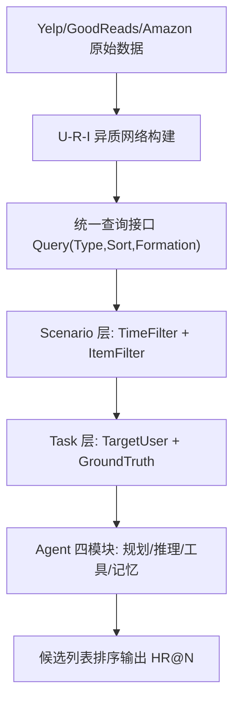
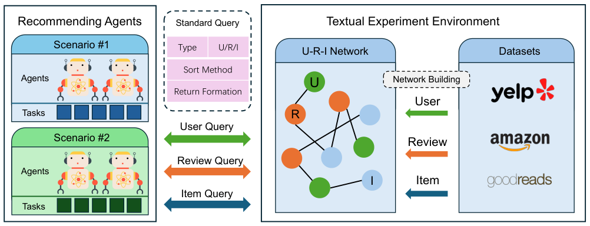

# AgentRecBench: Benchmarking LLM Agent-based Personalized Recommender Systems (LLM 智能体个性化推荐系统基准评测)

- **会议/期刊**: NeurIPS 2025 (Preprint arXiv:2505.19623v2)
- **作者与机构**: Yu Shang, Peijie Liu, Yuwei Yan, Zijing Wu, Leheng Sheng, Yuanqing Yu, Chumeng Jiang, An Zhang, Fengli Xu, Yu Wang, Min Zhang, Yong Li（清华大学、香港科技大学（广州）、中国科学技术大学、新加坡国立大学）
- **推荐链路定位**: 端到端生成式（Agent 直接对候选列表排序）
- **研究方向**: 对话推荐与智能体仿真 / 大语言模型推荐
- **论文原文**: [https://arxiv.org/abs/2505.19623v2](https://arxiv.org/abs/2505.19623v2)
- **开源代码**: 暂未开源（数据集与排行榜公开于 HuggingFace / AgentSociety Challenge 主页）

## TL;DR (1分钟核心速览)

LLM 智能体推荐（Agentic RecSys）被视为推荐范式变革，但**缺乏标准化评测协议**：无统一交互环境、无场景化数据可见性控制、无跨范式可比基线。本文提出 AgentRecBench——将 Yelp/GoodReads/Amazon 聚合为统一 U-R-I 文本网络，设计经典/兴趣演化/冷启动三类场景与双层动态数据可见性控制，并给出四模块（规划/推理/工具/记忆）Agent 开发框架。在 20 候选采样排序协议下评测 10 种方法，结构化工作流 Agent（Baseline666）在 Amazon 经典任务 HR@N 均值达 69.0，远超 MF/LightGCN 的 15.0 与朴素 BaseAgent 的 39.0。

## Background & Motivation (背景与核心矛盾)

- **主流范式**: 推荐系统从规则式、深度学习（MF、LightGCN）演进到 LLM Agent 范式，后者以自然语言为媒介、具备规划/反思/迭代行动能力，可自主采集上下文并显式表达推荐逻辑。
- **前人局限**: 其一，现有 Agent 推荐工作（RecMind、Agent4Rec、RAH）各自定义环境与任务，**评测协议互不兼容**，无法横向比较；其二，传统 ID-based 方法在稀疏数据上无法学习有效模式，且缺乏对富文本元数据与动态兴趣的利用能力。
- **核心洞察 (Key Insight)**: Agent 的优势不在"直接让 LLM 排序"，而在**结构化工作流**——领域自适应特征工程、评论信息挖掘、平台感知特征抽取，才是拉开差距的关键；朴素加 CoT/记忆模块反而可能引入噪声。
- **本文切入点**: 以"统一文本环境 + 场景化数据可见性控制 + 模块化 Agent 框架"三件套，建立首个可复现、可持续维护排行榜的 Agent 推荐基准。

## Method (核心方法设计)

### 1. 整体框架 (Overall Architecture)

AgentRecBench 由三层构成：底层是**文本环境模拟器**，将三平台数据聚合为 User-Review-Item 异质网络，通过统一查询接口 `Query(Type, SortMethod, Formation)` 返回结构化键值或自然语言文本；中层是**双层数据可见性控制**，Scenario 层用 `{TimeFilter, ItemFilter}` 划定数据边界，Task 层用 `{TargetUser, GroundTruth}` 定义具体推荐目标，确保评测时 Agent 无法窥见未来数据；上层是**模块化 Agent 框架**（动态规划、复杂推理、工具调用、记忆管理四模块）与 10 种基线方法。Agent 在每步观测状态 $s_t$后依策略$a_t \sim \pi_\theta(a|s_t)$ 选择推荐物品或信息检索动作，最终输出候选列表排序。

<figure class="paper-figure" markdown="span">
  <figcaption>图1：我们的交互式文本环境模拟器的整体框架。</figcaption>
</figure>

### 2. 关键设计拆解 (Key Designs)

1. **双层动态数据可见性控制（防穿越的核心机制）**：痛点在于 Agent 可主动查询环境，若无约束会"看到"测试期数据造成信息泄漏。本文用 Scenario 级 `TimeFilter` 限制可访问评论的时间窗、`ItemFilter` 设定最小评论数阈值，Task 级再绑定目标用户与真值，形成"先场景过滤、后任务过滤"的两级闸门。直觉上这等价于在传统推荐的全局时间戳切分之上，额外赋予 Agent 一个受控的检索沙盒，使兴趣演化与冷启动场景可被精确构造。

2. **U-R-I 网络与双形态查询接口**：将用户画像（好友关系、平均评分）、物品元数据（价格、标题、描述、位置）、评论（评分、文本、时间戳、有用性投票）统一建模为三类节点。查询接口的 `Formation` 布尔位是关键设计——结构化返回供算法处理，文本返回供 LLM 解读，从而让传统模型与 Agent 在同一数据面上公平竞争。

3. **训练目标、负采样与推理效率**：本文为基准而非新模型，无端到端训练损失；Agent 侧为免训练的零样本推理（Qwen-72B-Instruct / DeepSeek-v3 / GPT-4o-mini 三种骨干）。评测采用 **1 正 19 负的采样排序协议**，指标为 $\mathrm{HR@}N = \frac{1}{|\mathcal{T}|}\sum_{t\in\mathcal{T}}\mathbb{I}(p_t \in R_t^N)$，$N\in\{1,3,5\}$。推理开销集中在多轮工具调用与长上下文拼接，Baseline666 类工作流需对 20 个候选逐一做特征工程，延迟显著高于单次 LLM 排序。

## Experimental Setup & Evaluation Protocol (实验设置与评估协议)

- **数据集与预处理**: 三平台聚合为 items/users/reviews 三张结构化子表，交互呈幂律分布（图 3），Yelp 贡献最多用户、GoodReads 贡献最多物品。

| 数据集 | 领域 | 用户侧特征 | 物品侧特征 | 场景说明 |
| :--- | :---: | :---: | :---: | :--- |
| Amazon | 电商 | 评论数、评分均值 | 价格、标题、描述 | 多品类商品评论 |
| GoodReads | 图书 | 好友关系、评分均值 | 书名、类型、简介 | 文学兴趣建模 |
| Yelp | 本地生活 | 社交连接、评分均值 | 位置、属性、均价 | 餐饮零售评论 |

- **数据划分与防穿越 (Splitting Strategy)**: 采用**场景化时间窗切分**——兴趣演化场景分长期（3 个月窗口，采样 ≥5 次交互的活跃用户）与短期（1 周压缩窗口）；冷启动场景按交互数阈值 $m$（用户侧）与$n$（物品侧）划分，属**冷启动划分**。
- **排名评测协议 (Ranking Protocol)**: **Sampled Ranking**，每测试实例 1 个真值正样本 + 19 个未观测负样本，共 20 候选，报告 HR@{1,3,5} 均值。
- **对比基线与超参设置**: 三类范式共 10 种方法——传统 MF、图模型 LightGCN、8 种 Agent（BaseAgent / CoTAgent / MemoryAgent / CoTMemAgent / Baseline666 / DummyAgent / RecHackers / Agent4Rec）。传统与深度模型因数据高稀疏无法有效学习，统一报告均值预测 15.0 作为参照。

## Key Experimental Results (实验关键数据)

### 1. 主实验对比 (Main Results)

经典推荐场景，HR@N 均值（N=1,3,5），三种 LLM 骨干并列：

| 方法 | Amazon (Qwen/DS/GPT) | GoodReads (Qwen/DS/GPT) | Yelp (Qwen/DS/GPT) |
| :--- | :---: | :---: | :---: |
| MF | 15.0 / 15.0 / 15.0 | 15.0 / 15.0 / 15.0 | 15.0 / 15.0 / 15.0 |
| LightGCN | 15.0 / 15.0 / 15.0 | 15.0 / 15.0 / 15.0 | 15.0 / 15.0 / 15.0 |
| BaseAgent | 39.0 / 44.0 / 27.0 | 15.7 / 20.3 / 13.7 | 3.7 / 4.0 / 4.7 |
| CoTAgent | 39.0 / 39.7 / 26.7 | 16.0 / 23.0 / 15.0 | 5.0 / 4.3 / 5.0 |
| MemoryAgent | 37.3 / 43.7 / 0.0 | 17.3 / 18.0 / 0.0 | 5.3 / 3.7 / 0.0 |
| CoTMemAgent | 37.0 / 33.3 / 0.0 | 16.7 / 17.3 / 0.0 | 3.7 / 4.3 / 0.0 |
| Agent4Rec | 23.3 / 28.3 / 17.7 | 9.3 / 9.3 / 9.3 | 5.7 / 7.6 / 5.3 |
| DummyAgent | 44.0 / 54.0 / 31.0 | 46.0 / 56.3 / 23.7 | 5.3 / 6.3 / 5.7 |
| RecHackers | 54.0 / 63.0 / 50.7 | 45.3 / 55.0 / 29.3 | 7.7 / 7.0 / 6.7 |
| **Baseline666** | **69.0 / 60.0 / 44.7** | **45.0 / 54.7 / 33.0** | **7.0 / 7.3 / 6.0** |

冷启动场景（Qwen-72B-Instruct，用户/物品两侧）：

| 方法 | Amazon U/I | GoodReads U/I | Yelp U/I |
| :--- | :---: | :---: | :---: |
| MF / LightGCN | 15.0 / 15.0 | 15.0 / 15.0 | 15.0 / 15.0 |
| BaseAgent | 16.6 / 15.0 | 16.0 / 21.2 | 2.0 / 3.3 |
| CoTAgent | 15.7 / 17.3 | 18.0 / 18.5 | 2.3 / 2.3 |
| Agent4Rec | 25.7 / 48.3 | 40.7 / 9.1 | 2.3 / 0.7 |
| DummyAgent | 44.7 / 45.6 | 39.3 / 47.8 | 1.7 / 0.3 |
| RecHackers | 44.7 / 49.3 | 38.3 / 42.1 | 1.0 / 2.3 |
| **Baseline666** | **48.7 / 48.3** | 36.7 / 44.1 | 1.3 / 2.3 |

兴趣演化场景（长/短期）：

| 方法 | Amazon L/S | GoodReads L/S | Yelp L/S |
| :--- | :---: | :---: | :---: |
| MF | 38.4 / 49.5 | 17.7 / 21.3 | 42.0 / 65.9 |
| LightGCN | 32.3 / 59.1 | 18.0 / 22.3 | 31.6 / 68.9 |
| BaseAgent | 16.0 / 13.3 | 21.3 / 25.0 | 5.7 / 6.0 |
| Agent4Rec | 26.3 / 37.7 | 36.7 / 43.9 | 8.6 / 9.0 |
| DummyAgent | 53.0 / 56.7 | 59.7 / 54.0 | 10.6 / 6.3 |
| RecHackers | 52.7 / 57.3 | 62.0 / 54.0 | **11.3 / 5.3** |
| **Baseline666** | 50.6 / 55.3 | **63.0 / 55.7** | 0.0 / 0.0 |

### 2. 消融实验 (Ablation Study)

原文未设严格消融表，但通过 Agent 组件组合形成天然消融（Qwen 骨干，Amazon 经典场景）：

| 配置 | HR@N 均值 | 相对 BaseAgent |
| :--- | :---: | :---: |
| BaseAgent（纯 LLM 排序） | 39.0 | — |
| + CoT 推理 | 39.0 | +0.0 |
| + Memory 记忆 | 37.3 | −1.7 |
| + CoT + Memory | 37.0 | −2.0 |
| + 结构化工作流（Baseline666） | **69.0** | **+30.0** |

### 3. 关键实验发现 (Key Findings)

1. **结构化工作流 >> 认知模块堆叠**：给 BaseAgent 加 CoT 与 Memory 在 Amazon 上不升反降（39.0 → 37.0），而引入领域自适应特征工程的 Baseline666 跃升至 69.0（+76.9% 相对提升），说明 Agent 的收益来自"如何组织信息"而非"是否显式推理"。
2. **传统模型在稀疏富文本场景全面失效**：MF/LightGCN 在三数据集经典任务上恒为 15.0（即 20 候选中随机命中水平），而 Agent 类方法在 Amazon 上普遍达 39–69，验证了 ID-based 范式对稀疏交互 + 富元数据的结构性短板。
3. **场景难度与骨干选择强耦合**：Yelp 上所有方法 HR 均低于 8，且 MemoryAgent/CoTMemAgent 在 GPT-4o-mini 下直接崩为 0.0（记忆检索与上下文冲突）；冷启动相对经典任务普遍掉点，但 Baseline666 在 Amazon 物品冷启动仍保持 48.3，显示特征工程对稀疏物品的鲁棒性。

## Highlights & Limitations (亮点、对比与审稿批判)

- **与代表作对比 (vs. Prior Work)**: 相较 RecMind（单一排序 Agent）与 Agent4Rec（用户行为模拟），本文首次把"环境—场景—框架—基线"四件套标准化；相较传统基准（如 Amazon Reviews 上的 NCF/LightGCN 评测），本文把评测对象从"打分函数"扩展到"决策策略"，并显式引入防穿越的数据可见性控制。
- **可迁移亮点**: 其一，双层 `Scenario/Task` 过滤机制可直接迁移到任何需要"Agent 主动检索 + 严格防泄漏"的评测场景（如搜索 Agent、工具调用 Agent）；其二，`Formation` 双形态查询接口让传统模型与 LLM 共享同一数据面，是跨范式公平对比的实用技巧。
- **审稿级局限批判**: 其一，**1 正 19 负的采样排序协议**显著低估全库排序难度，HR 数值不可与 Full-Ranking 结果直接比较，且负样本采样策略未做敏感性分析；其二，传统基线因稀疏性直接报告均值 15.0 而非调参后的最优结果，存在"基线弱化"嫌疑，削弱了 Agent 优越性的说服力；其三，Agent 推理需多轮工具调用与长上下文，论文未报告延迟/Token 成本，工业落地可行性存疑。

## Rating (四维评分)

- **方法创新性 (Novelty)**: ⭐⭐⭐⭐ （基准类工作，双层数据可见性控制与 U-R-I 双形态查询接口设计新颖，但缺少算法层面的理论突破）
- **评估协议与实验扎实度 (Protocol & Experiments)**: ⭐⭐⭐ （三场景 × 三数据集 × 三骨干覆盖广，但采样排序协议偏弱、传统基线未充分调参、缺严格消融）
- **写作与数学规范度 (Clarity & Rigor)**: ⭐⭐⭐⭐ （形式化定义清晰、场景构造可复现，但 HR 公式与协议细节偏简，缺复杂度与成本分析）
- **工业落地与复现价值 (Industrial & Practical Value)**: ⭐⭐⭐⭐ （数据集与排行榜公开、AgentSociety Challenge 295 队 1400+ 提交验证实用性，但代码未开源、推理成本未量化）

