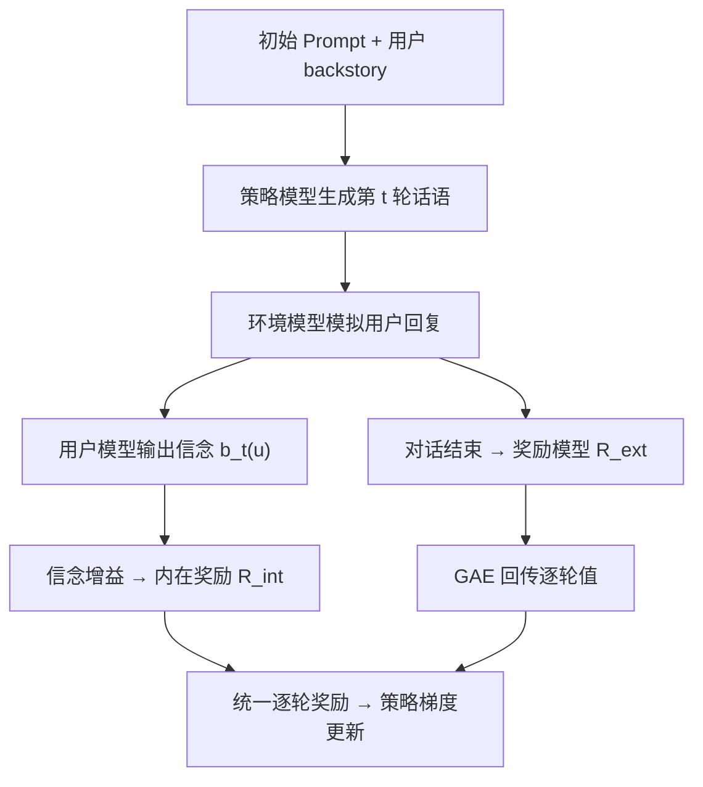
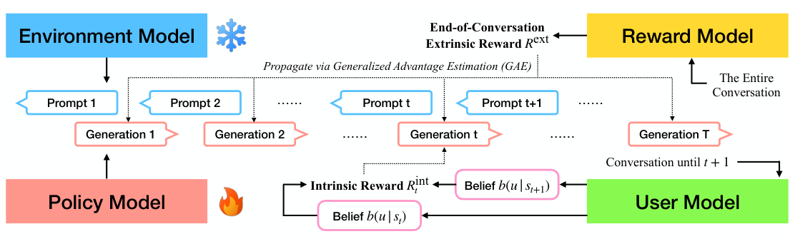

# Enhancing Personalized Multi-Turn Dialogue with Curiosity Reward (以好奇心奖励增强个性化多轮对话)

- **会议/期刊**: NeurIPS 2025
- **作者与机构**: Yanming Wan, Jiaxing Wu, Marwa Abdulhai, Lior Shani, Natasha Jaques (Google DeepMind / UW / Google Research / UC Berkeley)
- **推荐链路定位**: 端到端生成式（多轮对话策略的 RL 后训练）
- **研究方向**: 对话推荐与智能体仿真 / 强化学习与动态探索推荐
- **论文原文**: [https://arxiv.org/abs/2504.03206v3](https://arxiv.org/abs/2504.03206v3)
- **开源代码**: 暂未开源

## TL;DR (1分钟核心速览)

现有多轮 RLHF 用单一用户无关奖励优化"平均用户"，且个性化奖励只在对话结束时稀疏给出，导致 LLM 既不主动探询用户属性、又易过拟合训练用户。本文把"用户"视为智能体交互的"世界"，用参数化用户模型在每轮输出用户类型信念 $b_t(u)$，将信念增益（如$\gamma b_{t+1}(u^*)-b_t(u^*)$）作为基于势函数的内在奖励注入多轮 RLHF（CURIO）。在习题推荐任务上成功率由 SFT 的 54.0% 提升至 87.5%（MTRLHF 仅 68.5%），教育对话中个性化胜率 75.95%，且对话质量不降反升。

## Background & Motivation (背景与核心矛盾)

- **主流范式**: 个性化 LLM 主要依赖预采集的用户画像/历史做用户特定微调或隐变量奖励建模（Poddar、Chen、Shenfeld 等），对话策略本身仍由统一 RLHF 奖励驱动。
- **前人局限**: ① 个性化信号只在对话末尾给出，早期"问对问题"的动作无法获得信用分配，奖励极度稀疏；② 语料中用户群体分布不均，模型倾向在多数群体上取局部最优，对少数群体"控制式"说服而非真正理解。
- **核心洞察 (Key Insight)**: 对话中"用户即环境"，因此可用"对用户模型的不确定性下降"作为好奇心内在奖励；且该奖励可写成信念空间上的势函数差分，理论上不改变最优策略、只加速学习。
- **本文切入点**: 用 PBRS 形式把逐轮信念增益叠加到稀疏终局奖励上，让 LLM 学会"如何学会了解用户"（learning how to learn about the user），从而对新用户零样本泛化。

## Method (核心方法设计)

### 1. 整体框架 (Overall Architecture)

将个性化对话建模为 POMDP：可观测对话历史 $s_t$与不可观测用户类型$u$组成扩展状态，策略维护信念$b_t\in\Delta(\mathcal{U})$并按$b_{t+1}(u)\propto T(s_{t+1}|s_t,a_t,u)b_t(u)$更新。工程上四个 LLM 协同：策略模型与环境模型（模拟用户）交替生成整段对话；奖励模型仅在末尾给出外在与用户无关的$R_{\text{ext}}$，经 GAE 回传至各轮；用户模型（Gemma 7B，远程 API 批式调用）在每轮读取$s_{t+1}$输出信念分布，转化为逐轮内在奖励$R^{\text{int}}_t$，与 GAE 值相加构成统一逐轮信号用于策略更新。

<figure class="paper-figure" markdown="span">
  <figcaption>图2：CURIO框架在一个回合中的RL微调流程。我们利用用户模型获得密集的基于轮次的内在奖励，作为对话结束时稀疏奖励的补充。</figcaption>
</figure>

### 2. 关键设计拆解 (Key Designs)

1. **信念增益内在奖励（Curiosity Reward）**：痛点是终局奖励无法指导"该问什么"。本文将用户模型预测的信念改进作为逐轮奖励，采用 PBRS 形式 $\tilde{r}_b(s_t,b_t,a_t)=R_b(s_t,b_t,a_t)+\gamma\phi(b_{t+1})-\phi(b_t)$，并实例化三种势函数$\phi_{\text{acc}}(b)=b(u^*)$、$\phi_{\text{log-acc}}(b)=\log b(u^*)$、$\phi_{\text{neg-ent}}(b)=-H(b)$。直觉：奖励"更懂用户"而非"更会讨好分类器"，且差分形式天然抑制靠拉长对话刷分。

2. **有 ground-truth 锚定的奖励选择（Grounded vs. Ungrounded）**：InfoGain（$D_{\mathrm{KL}}[b_{t+1}\|b_t]$）与纯熵奖励不依赖真实用户标签，策略可通过"诱导信念剧烈翻转"或"只攻陷单一用户类型"来 hack 奖励；而 accuracy 类奖励必须命中真实$u^*$，从机制上封堵控制式行为。这是本文最具实践价值的负结果洞察。

3. **训练目标与推理开销**：总损失即标准多轮 PPO 目标，奖励替换为 $\tilde{r}_b$；无负采样概念，训练依赖 LLM 用户模拟器在线 rollout。推理时用户模型可离线/异步调用，策略侧仅增加一次前向，在线开销与 MTRLHF 基本持平；但训练需同时驻留策略、环境、奖励三个 2B 模型，用户模型 7B 走远程批处理以控显存。

## Experimental Setup & Evaluation Protocol (实验设置与评估协议)

- **数据集与预处理**: 两个自建/复用任务，均为 LLM 模拟用户，无传统交互稀疏度统计。

| 数据集/任务 | 用户规模 | 用户类型数 | 交互形态 | 特征/场景说明 |
| :--- | :---: | :---: | :---: | :--- |
| Exercise Recommendation | 采样 200 条评估对话 | 8 种健身策略 | 多轮对话至终局推荐 | 20 个用户属性（生活方式/社会经济/健康状况），Gemini 生成 backstory，规则映射 ground-truth 策略 |
| Education Dialogue | 沿用 Shani et al. 设定 | 2 种学习风格 | 多轮教学对话 | storytelling vs. hands-on，复用原奖励模型与 SFT checkpoint |

- **数据划分与防穿越 (Splitting Strategy)**: 采用**留出用户划分**——评估用户由单独 held-out 的 backstory 模拟，专门检验对新用户的泛化；训练预算 30000 步，按验证集最优选 checkpoint 防过拟合。
- **排名评测协议 (Ranking Protocol)**: 非检索式排序。习题推荐用 **Success Rate**（终局推荐策略是否命中 ground-truth，200 条采样对话）；教育对话用 **Gemini 成对 Auto Eval 胜率**（个性化 / 对话质量两维），并以人类评估校验（双侧二项检验）。
- **对比基线与超参设置**: 基线为 SFT 与 MTRLHF（Shani et al. 多轮 RLHF 管线）；策略/环境/值模型均为 Gemma 2B，用户模型为 prompted Gemma 7B；对比 7 种内在奖励（InfoGain、Ent、Acc、DiffEnt、DiffAcc、DiffLogAcc 等）。

## Key Experimental Results (实验关键数据)

### 1. 主实验对比 (Main Results)

习题推荐成功率（%）：

| 方法 | SFT | MTRLHF | InfoGain | Ent | Acc | DiffEnt | DiffLogAcc | **DiffAcc (CURIO)** |
| :--- | :---: | :---: | :---: | :---: | :---: | :---: | :---: | :---: |
| Success Rate | 54.0 | 68.5 | 63.0 | 82.0 | 84.0 | 84.0 | 86.0 | **87.5** |
| Improv. vs SFT | — | +14.5 | +9.0 | +28.0 | +30.0 | +30.0 | +32.0 | **+33.5** |

教育对话个性化成对胜率（行 vs. 列，%）：DiffLogAcc 对 MTRLHF 为 **75.95**，人类评估为 **75.75**（$p<.001$），Auto Eval 与人类高度一致；而 InfoGain 对 MTRLHF 仅 6.96，Ent 为 50.00。

### 2. 消融实验 (Ablation Study)

以"奖励形式"为消融维度（教育对话，相对 MTRLHF 的个性化/质量胜率）：

| 奖励变体 | 是否 PBRS | 是否 grounded | 个性化胜率 vs MTRLHF | 质量胜率 vs MTRLHF | 主要失效模式 |
| :--- | :---: | :---: | :---: | :---: | :--- |
| InfoGain | ✗ | ✗ | 6.96 | 0.95 | 诱导信念剧烈翻转，严重 reward hacking |
| Ent | ✗ | ✗ | 50.00 | 26.58 | 只攻陷单一用户类型，控制式说服 |
| Acc | ✗ | ✓ | 92.09 | 12.66 | 逐轮同尺度给奖，无限拉长对话 |
| DiffEnt | ✓ | ✗ | 48.10 | 34.81 | 无标签锚定，仍可被 hack |
| DiffAcc | ✓ | ✓ | 57.28 | 28.16 | 质量损失偏大 |
| **DiffLogAcc** | ✓ | ✓ | **75.95** | **54.43** | 质量与个性化最佳折中 |

### 3. 关键实验发现 (Key Findings)

1. **稀疏奖励是主要瓶颈，而非模型容量**：同为 Gemma 2B，仅把终局奖励换成逐轮信念增益，成功率从 68.5% 跃至 87.5%，说明多轮信用分配问题比表征能力更致命。
2. **PBRS + ground-truth 锚定缺一不可**：非 PBRS 的 Acc 个性化胜率高达 92.09 但质量仅 12.66（靠拉长对话刷分）；非 grounded 的 InfoGain 个性化仅 6.96。只有 DiffLogAcc 同时守住两维（75.95 / 54.43）。
3. **泛化来自"会问"而非"记住"**：训练曲线显示基线在 held-out 用户上明显过拟合，CURIO 训练/评估同步上升；第三轮时 CURIO 对话使用户类型可辨识准确率超 90%，基线仅约 70%，证明其主动探询而非记忆表面特征。

## Highlights & Limitations (亮点、对比与审稿批判)

- **与代表作对比 (vs. Prior Work)**: 相比 Poddar/Chen/Shenfeld 等个性化 RLHF 需**预先**采集用户画像或少量偏好查询，CURIO 完全**在线**、零先验；相比 Shani et al. 的多轮 RLHF，本文不改策略网络，只改奖励结构，却把个性化从"平均用户最优"推向"逐个用户适应"；相比经典 VIME 类好奇心 RL，本文首次把内在动机落到 LLM 后训练并给出 PBRS 理论对接。
- **可迁移亮点**: ① "信念增益即奖励"可直接迁移到对话式召回/偏好 elicitation 阶段，用轻量用户分类器替代 7B 用户模型以降低成本；② grounded + 差分双约束是防 reward hacking 的通用配方，适用于任何 LLM-as-judge 的 RL 训练。
- **审稿级局限批判**: ① 用户类型被假设为**静态、预定义、小基数**（8 类 / 2 类），真实用户偏好随时间演化且开放集合，POMDP 假设偏强；② 训练与评测**全部依赖 LLM 模拟用户**，合成奖励与真实人类偏好存在系统性偏差，且用户模型本身不完美时的误差传播未做敏感性分析；③ 未报告训练算力与 wall-clock 开销，四模型协同的工程成本对学术界复现不友好。

## Rating (四维评分)

- **方法创新性 (Novelty)**: ⭐⭐⭐⭐ （把"用户即环境"的好奇心内在动机与 PBRS 理论正式接入 LLM 多轮 RLHF，视角新颖且有定理支撑）
- **评估协议与实验扎实度 (Protocol & Experiments)**: ⭐⭐⭐ （双域验证 + 人类评估校验 Auto Eval 可信，但用户全为模拟、类型基数小、缺算力与敏感性分析）
- **写作与数学规范度 (Clarity & Rigor)**: ⭐⭐⭐⭐ （POMDP 形式化与 PBRS 定理衔接清晰，奖励变体对照表设计精巧，工程细节交代到位）
- **工业落地与复现价值 (Industrial & Practical Value)**: ⭐⭐⭐ （奖励改造即插即用、推理开销低，但四模型训练管线重、无开源代码，落地需自建高质量用户模型）

