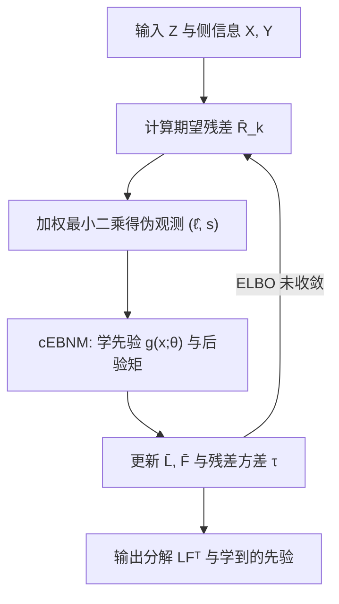

# Covariate-moderated Empirical Bayes Matrix Factorization (协变量调制的经验贝叶斯矩阵分解)

- **会议/期刊**: NeurIPS 2025
- **作者与机构**: William R. P. Denault, Karl Tayeb, Peter Carbonetto, Matthew Stephens (University of Chicago); Jason Willwerscheid (Providence College)
- **推荐链路定位**: 召回（矩阵分解式隐因子召回 / 评分补全）
- **研究方向**: 协同过滤与双塔召回 / 冷启动与长尾推荐
- **论文原文**: [https://arxiv.org/abs/2505.11639v2](https://arxiv.org/abs/2505.11639v2)
- **开源代码**: [https://github.com/william-denault/cebmf_torch](https://github.com/william-denault/cebmf_torch)

## TL;DR (1分钟核心速览)

现有"带侧信息"的矩阵分解要么只接受特定类型侧信息（如空间坐标），要么绑定死板的参数化模型（高斯过程、正态先验均值），在边界突变或侧信息无用时会退化。本文提出 cEBMF：把侧信息 $x_i,y_j$ 塞进**先验分布的参数**而非似然，先验族可任意（spike-and-slab、非负指数混合等），并用经验贝叶斯从数据中自适应学习先验超参。在 MovieLens 100K 随机留出评分补全（RMSE 协议）上，cEBNMF 在 50%/70%/90% 三种训练比例下均取得最低 RMSE，且模拟实验中侧信息越有用增益越大、侧信息无用时不劣于 EBMF。

## Background & Motivation (背景与核心矛盾)

- **主流范式**: 矩阵分解 $Z\approx LF^\top$ 是协同过滤与隐结构分析的基石；带侧信息的变体（CMF、Spatial PCA、MFAI、cVAE/NCF）试图用物品属性、用户画像或空间坐标"引导"分解。
- **前人局限**: 其一，侧信息接入方式高度专用——Spatial PCA 只吃 2D 坐标且假设因子在空间上平滑变化，遇到组织边界这类**锐利跳变**就失效；CMF 要求侧信息矩阵与 $Z$ 同构分解，对"电影类型标签"这类数据根本不成立。其二，MFAI 虽通用些，但只支持正态先验 + 梯度提升树拟合先验均值 + 仅行侧信息，模型柔性不足，假设不匹配时性能剧烈波动。
- **核心洞察 (Key Insight)**: 矩阵分解对 $L,F$的**尺度重标定不变**（$L D\cdot F D^{-1}$不改变$LF^\top$），因此直接让侧信息去预测因子**幅值**是病态的；但预测因子**稀疏位置（哪些元素为零）**是良定义的。同时，经验贝叶斯能"借全局信息"自动定超参，免去交叉验证。
- **本文切入点**: 将侧信息编码为**先验分布的参数化映射** $g_k^{(\ell)}(x_i)$，先验族与映射函数（逻辑回归/MLP/GNN/CNN）均可插拔，再用变分 EM 交替学习因子与先验。

## Method (核心方法设计)

### 1. 整体框架 (Overall Architecture)

cEBMF 在 EBMF 基础上把先验从"全局共享"升级为"逐样本由协变量决定"：对每个因子 $k$，第$i$行的载荷先验为$g_k^{(\ell)}(x_i)\in\mathcal{G}_{\ell,k}$，第$j$列同理为$g_k^{(f)}(y_j)$。拟合采用坐标上升的变分经验贝叶斯：固定其他因子算出第$k$因子的**期望残差**$\bar{R}_k$，对其做加权最小二乘得到带噪声的伪观测$(\hat{\ell}_{ik}, s_{ik}^{\ell})$，再解一个"协变量调制经验贝叶斯正态均值"（cEBNM）子问题同时更新先验参数$\theta$ 与后验矩，循环至 ELBO 收敛。整个框架的模块化体现在：任何能解 cEBNM 的方法都可直接"插"进来。

### 2. 关键设计拆解 (Key Designs)

1. **协变量调制先验（Covariate-Moderated Prior）**：痛点是把侧信息塞进似然会绑定模型形式。本文改为调制先验：$\ell_{ik}\sim g_k^{(\ell)}(x_i;\theta)$，其中$g_k^{(\ell)}$属于预设族$\mathcal{G}_{\ell,k}$。以最常用的稀疏族为例：
$$g(u)=(1-\pi(x,\theta))\,\delta_0(u)+\pi(x,\theta)\,g_1(u;\omega),\quad \pi(x,\theta)=\phi(\theta_0+\textstyle\sum_t x_t\theta_t)$$
即"零质量 + slab"的 spike-and-slab，零概率由逻辑回归从侧信息预测。直觉：侧信息只决定"该不该激活"，不碰幅值，天然规避尺度不变性带来的不可辨识问题；$g_1$ 取正态即稀疏因子分析，取指数分布即稀疏 NMF。

2. **cEBNM 子问题与坐标上升（Modular cEBNM Solver）**：核心是把复杂联合拟合降解为一串一维正态均值问题。给定伪观测 $\hat{\beta}_i\sim N(\beta_i,s_i^2)$、$\beta_i\sim g(d_i,\theta)$，先最大化边际似然
$$\hat{\theta}=\arg\max_\theta \prod_{i=1}^n\int N(\hat{\beta}_i;\beta_i,s_i^2)\,g(\beta_i;d_i,\theta)\,d\beta_i$$
再算后验矩。由于积分是一维的，spike-and-slab 有解析解，其余用 Gauss-Hermite  quadrature 即可，$\hat\theta$ 用现成优化器求解。这使"任意先验族 + 任意侧信息编码器"都能统一进同一算法骨架。

3. **训练目标、负采样与推理效率**：优化目标是均值场变分下的 ELBO
$$\text{ELBO}=\mathbb{E}_q[\log p(Z|L,F,\tau)]+\mathbb{E}_q\Big[\log\frac{p(L,F|X,Y)}{q(L,F)}\Big]$$
缺失值（如 MovieLens 93% 未评分）在似然中直接跳过，等价于**免负采样**的隐式掩码训练。推理即前向计算 $LF^\top$补全缺失项，无 ANN 索引开销；但每轮迭代需对$n\times p$ 残差矩阵做全量扫描，复杂度随规模线性增长（见 Scalability 表）。

## Experimental Setup & Evaluation Protocol (实验设置与评估协议)

- **数据集与预处理**:

| 数据集 | #Users | #Items | #Interactions | 稀疏度/密度 | 特征/场景说明 |
| :--- | :---: | :---: | :---: | :---: | :--- |
| MovieLens 100K | 943 | 1,682 | ~100K 评分 | 93% 缺失 | 侧信息 $X$: 1,682×19 电影类型二值矩阵 |
| DLPFC (12 slices) | ~4,000/片 | ~5,000 基因 | — | — | 侧信息: 像素 2D 坐标 |
| 模拟数据 (4 场景) | 1,000 | 200 | — | — | 稀疏驱动/无信息/tiled-clustering/偏移版 |

- **数据划分与防穿越 (Splitting Strategy)**: MovieLens 采用**随机留出比例划分**（训练比例 50%/70%/90%，其余作测试），每个比例重复 10 次随机划分；模拟数据每场景生成 100 份独立数据集。
- **排名评测协议 (Ranking Protocol)**: 本文是**评分补全（Rating Prediction）**任务，用留出评分的 **RMSE** 衡量，非 Full-Ranking 排序协议；模拟实验用真值分解 $LF^\top$与估计$\hat{L}\hat{F}^\top$ 的 RMSE。
- **对比基线与超参设置**: 无侧信息组 EBMF(flashier)、PMD、VAE；有侧信息组 MFAI、Spatial PCA、cVAE、NCF。因子数 $K$ 自适应选择（EBMF/cEBMF 上限 7，MFAI 上限 12）；MovieLens 上强制非负（混合指数先验），cEBNMF 用 MLP 编码类型侧信息。

## Key Experimental Results (实验关键数据)

### 1. 主实验对比 (Main Results)

MovieLens 100K 评分补全 RMSE（越低越好，数值读自原文图 3，为 10 次划分的典型水平）：

| 方法 | 训练 50% | 训练 70% | 训练 90% | 侧信息 |
| :--- | :---: | :---: | :---: | :---: |
| EBNMF (EBMF 非负版) | ~1.00 | ~0.95 | ~0.90 | ✗ |
| MFAI | ~0.98 | ~0.93 | ~0.89 | ✓ |
| VAE | ~1.02 | ~0.97 | ~0.92 | ✗ |
| cVAE | ~1.01 | ~0.96 | ~0.91 | ✓ |
| NCF | ~1.03 | ~0.98 | ~0.93 | ✓ |
| **cEBNMF (本文)** | **~0.96** | **~0.91** | **~0.87** | ✓ |

模拟实验（图 2，100 次重复的 RMSE 箱线图）显示：tiled-clustering 场景（侧信息最有用）cEBMF 相对 EBMF 增益最大；无信息协变量与偏移 tiled-clustering（先验误设）场景下 cEBMF 与 EBMF 持平，未出现退化；Spatial PCA 即便能用侧信息，在 tiled-clustering 上仍劣于不用侧信息的 EBMF（因其正交因子假设不成立）。

### 2. 消融实验 (Ablation Study)

原文未设标准"逐组件移除"消融，但通过**场景化对照**等价完成归因：

| 对照设置 | 考察点 | 结果 |
| :--- | :--- | :--- |
| 无信息协变量场景 | 侧信息无用时的鲁棒性 | cEBMF ≈ EBMF，无退化 |
| 偏移 tiled-clustering | 先验误设鲁棒性 | cEBMF ≈ EBMF，MFAI 反而占优 |
| 稀疏驱动场景 | 侧信息仅控稀疏位置 | cEBMF 优于 cVAE/VAE |
| 非负约束 (cEBNMF vs cEBMF) | 先验族切换能力 | 混合指数先验下仍最优 |

### 3. 关键实验发现 (Key Findings)

1. **侧信息价值与增益强相关**：tiled-clustering 场景（坐标高度决定因子）cEBMF 相对 EBMF 的 RMSE 降幅最大，而无信息场景增益归零——说明增益来自"先验确实学到了有用结构"，而非模型容量膨胀。
2. **柔性先验胜过专用先验**：Spatial PCA 专为空间数据设计却在 tiled-clustering 上输给不用侧信息的 EBMF，根因是其高斯过程/正交假设与数据生成机制冲突；cEBMF 因先验族可自适应而避免此类误设惩罚。
3. **深度模型在小数据上不占优**：MovieLens 100K 上 VAE/cVAE/NCF 全面落后于矩阵分解系，作者归因于数据量不足；这提示侧信息融合的收益高度依赖"先验结构匹配度"而非非线性容量。

## Highlights & Limitations (亮点、对比与审稿批判)

- **与代表作对比 (vs. Prior Work)**: 相比 MFAI，cEBMF 把"仅正态先验 + 树模型 + 仅行侧信息"扩展为"任意先验族 + 任意神经网络编码器 + 行列双侧信息"，且 MFAI 是 cEBMF 的特例；相比 Spatial PCA，cEBMF 不预设空间平滑，能刻画边界跳变；相比 CMF，cEBMF 不要求侧信息与 $Z$ 同构分解，适用面更广。
- **可迁移亮点**: ①"侧信息只调制稀疏位置、不碰幅值"的思路可直接迁移到双塔召回中的物品 ID 稀疏先验设计；②cEBNM 作为可插拔子问题求解器的模块化范式，便于把新先验族快速接入现有分解框架。
- **审稿级局限批判**: ①MovieLens 100K 规模过小且仅用 RMSE 评分补全协议，缺少 Full-Ranking 召回指标（Recall/NDCG）与更大规模数据验证，对现代推荐系统的说服力有限；②运行时间表显示 cEBMF 在 $n=10^6$ 时需 3,403 秒，比 EBMF 慢约 20 倍，全量残差扫描的复杂度使其难以直接用于工业级千万级用户矩阵。

## Rating (四维评分)

- **方法创新性 (Novelty)**: ⭐⭐⭐⭐ （把侧信息从似然搬到先验、并用经验贝叶斯自适应学习，框架统一性高，但本质是 EBMF 的先验参数化扩展）
- **评估协议与实验扎实度 (Protocol & Experiments)**: ⭐⭐⭐ （模拟实验 100 次重复扎实，但真实数据仅 MovieLens 100K 一个、仅 RMSE 协议，缺排序指标与大样本验证）
- **写作与数学规范度 (Clarity & Rigor)**: ⭐⭐⭐⭐ （cEBNM 子问题与 ELBO 推导完整、Proposition 1 与 Lemma 1 证明清晰，符号略密）
- **工业落地与复现价值 (Industrial & Practical Value)**: ⭐⭐⭐ （PyTorch 开源实现完整，但全量残差扫描导致大规模场景开销偏高，更适合中小规模或离线分析场景）

