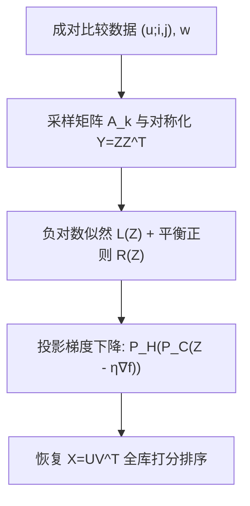

# Recommendations with Sparse Comparison Data: Provably Fast Convergence for Nonconvex Matrix Factorization (稀疏比较数据推荐：非凸矩阵分解的可证快速收敛)

- **会议/期刊**: ICML 2025
- **作者与机构**: Suryanarayana Sankagiri (EPFL), Jalal Etesami (TUM), Matthias Grossglauser (EPFL)
- **推荐链路定位**: 召回（隐式反馈偏好学习 / 双塔内积打分）
- **研究方向**: 协同过滤与双塔召回
- **论文原文**: [https://arxiv.org/abs/2502.20033v2](https://arxiv.org/abs/2502.20033v2)
- **开源代码**: 暂未开源（论文提及仿真代码链接但未提供公开仓库）

## TL;DR (1分钟核心速览)

本文针对"用户以成对比较（pairwise comparison）而非绝对评分反馈"的推荐场景，将经典矩阵分解与 Plackett-Luce 型离散选择模型结合，把偏好学习转化为对低维用户/物品特征的极大似然估计。核心痛点是该负对数似然非凸，此前仅有凸松弛（核范数）版本具备理论保证但不可扩展。作者证明损失在真解邻域内具有（受限）强凸性与光滑性，从而投影梯度下降在**稀疏数据**（每用户仅少量比较）下以 $O((1-\alpha\eta/4)^t)$指数收敛，样本复杂度$O(\mu r\kappa^2 n\log n)$近最优。仿真在$(200,300)$与$(2000,3000)$ 两种规模上验证线性收敛，且实测所需样本量远小于理论常数预测。

## Background & Motivation (背景与核心矛盾)

- **主流范式**: 评分数据用矩阵补全/矩阵分解（$X=UV^\top$，内积为效用），非凸因子分解因可扩展性成为工业主流（BPR、MF）。
- **前人局限**: Park et al. (2015) 与 Negahban et al. (2018) 仅对**凸松弛**（整矩阵 $X$的核范数问题）给出样本复杂度，求解代价$O(n_1 n_2)$ 级不可扩展；而实际可用的非凸因子分解版本缺乏收敛保证，被 Negahban et al. 明确列为开放问题。
- **核心洞察 (Key Insight)**: 比较数据天然消除用户评分偏置、避免离散化、认知负担更低；且比较样本的"用户 + 物品对"结构与矩阵补全的"用户 + 单物品"结构本质不同——采样矩阵不再等价于投影算子或二部图边，经典 Candès-Recht 集中不等式失效。
- **本文切入点**: 用矩阵 Bernstein 不等式重建集中性分析，证明非凸目标在真解邻域内"类强凸"，从而热启动 + 投影梯度下降可证指数收敛。

## Method (核心方法设计)

### 1. 整体框架 (Overall Architecture)

模型将效用矩阵 $X^*=U^*\Sigma^* V^{*\top}$对称化为$Y^*=Z^*Z^{*\top}$，其中$Z^*=\begin{bmatrix}U^*\\V^*\end{bmatrix}\Sigma^{*1/2}\in\mathbb{R}^{n\times r}$（$n=n_1+n_2$），把参数从$n_1n_2$降到$(n_1+n_2)r$。每个数据点$(u;i,j)$对应采样矩阵$A_k$，比较结果服从$P(w=1)=g(\langle\langle A_k,ZZ^\top\rangle\rangle)$，$g$为对称递增链接函数（如 sigmoid）。训练即最小化负对数似然 + 平衡正则项，用带双重投影（非相干集$\mathcal{C}$与去平移子空间$\mathcal{H}$）的梯度下降求解，收敛后由$Z$恢复$X$ 做全库打分排序。

### 2. 关键设计拆解 (Key Designs)

1. **对称化因子分解 + 平衡正则（消除尺度不变性）**: 原始 $X=UV^\top$对任意可逆$P$有$(UP,VP^{-\top})$不可辨识，导致损失在尺度方向无曲率。作者引入$R(Z)=\|Z^\top DZ\|_F^2$（$D=\mathrm{diag}(I_{n_1},-I_{n_2})$），目标$f(Z)=\mathcal{L}(Z)+(\lambda/4)R(Z)$，$\lambda=\xi\gamma/4$。该正则强制$\|U^\top U-V^\top V\|_F^2\to 0$，把尺度自由度"钉死"，是强凸性成立的前提。

2. **双重投影保证非相干与去平移**: 强凸性仅在非相干区域成立，故每步投影到 $\mathcal{C}=\{Z:\|Z\|_{2,\infty}\le \tfrac{4}{3}\sqrt{\mu/n}\|Z_0\|_F\}$（行裁剪）；再投影到$\mathcal{H}=\{Z=(U,V):\mathbf{1}^\top V=0\}$消除"给所有物品特征加同一常向量不改变比较结果"的平移不变性。作者证明第二投影不会把迭代点推出$\mathcal{C}$ 太远（引理 A.3），保证分析闭环。

3. **训练目标、负采样与推理效率**: 总损失即式 (14) 的 $f(Z)$，梯度$\nabla\mathcal{L}(Z)=\frac{1}{m}\sum_k h_k(A_k+A_k^\top)Z$，其中$h_k=\frac{g'(z_k)(g(z_k)-w_k)}{g(z_k)(1-g(z_k))}$。**无需负采样**——比较对本身即构成相对偏好监督。推理时仅需$O((n_1+n_2)r)$ 参数与内积打分，全库排序成本与标准 MF 双塔一致。

## Experimental Setup & Evaluation Protocol (实验设置与评估协议)

- **数据集与预处理**: 本文为纯理论 + 合成仿真工作，**无真实数据集**。仿真生成随机高斯真值矩阵 $X^*$并取其秩$r$ SVD，两种规模：

| 设定 | $n_1$|$n_2$|$r$|$\mu$|$\kappa$ | 说明 |
| :--- | :---: | :---: | :---: | :---: | :---: | :--- |
| 低维 | 200 | 300 | 3 | ≈1.01 | 1.1 | 小规模验证收敛 |
| 高维 | 2000 | 3000 | 3 | ≈1.01 | 1.1 | 大规模验证可扩展性 |

- **数据划分与防穿越 (Splitting Strategy)**: 无训练/验证/测试划分；直接按模型独立采样 $m$个比较三元组$(A_k,w_k)$，$w_k=g(\langle\langle A_k,Z^*Z^{*\top}\rangle\rangle)$（**无噪声期望值设定**）。
- **排名评测协议 (Ranking Protocol)**: 不采用 NDCG/HR 等排名指标，而以归一化重构误差 $\|\Delta(Z_t)\|_F/\sqrt{n_1n_2}$随迭代$t$ 的下降曲线衡量收敛性（对数纵轴）。
- **对比基线与超参设置**: 无外部基线对比，属"理论 vs 仿真自洽性"验证。正则系数 $\lambda=\gamma/40$，步长$\eta$按定理 4.1 推荐值，初始化$Z_0=Z^{*\top}+\vartheta(N_1,N_2J)$，$\vartheta\in\{0.5,1,2\}$。

## Key Experimental Results (实验关键数据)

### 1. 主实验对比 (Main Results)

本文无传统 SOTA 基线表格，核心"结果"是定理 4.1 与仿真收敛曲线。将理论保证与仿真观测对比如下：

| 维度 | 理论预测 (Theorem 4.1) | 仿真观测 (Fig. 1) | 结论 |
| :--- | :---: | :---: | :---: |
| 收敛速率 | $(1-\alpha\eta/4)^t$ 指数 | 对数坐标下近似直线 | 一致 |
| 样本复杂度 | $10^7(\mu r\kappa/\tau)^2 n\log(8n/\delta)$|$c_0(\mu r\kappa)^2 n\log(n/\delta)$，$c_0=1/4$或$1/2$| 理论常数保守约$10^6$ 倍 |
| 热启动需求 | 必须 $Z_0\in B(\tau/50)$|$\vartheta=0.5,1,2$ 均可收敛 | 实践中非必需 |
| 投影步骤 | 理论必需 | 去掉仍收敛 | 实践中非必需 |

### 2. 消融实验 (Ablation Study)

以仿真中的"条件放松"作为消融，考察各理论假设的必要性：

| 配置 | 收敛性 | 说明 |
| :--- | :---: | :--- |
| 完整算法（热启动 + 双投影） | 线性收敛 | 理论保证配置 |
| 去掉投影步骤 | 仍线性收敛 | 投影非实践必需 |
| 不同初始化 $\vartheta\in\{0.5,1,2\}$ | 均收敛 | 热启动非实践必需 |
| 小样本 $m$ 不足 | 误差不趋零 | 样本量是硬门槛 |
| 大样本 $m$ 充足 | 线性收敛 | 与理论一致 |

### 3. 关键实验发现 (Key Findings)

1. **样本量是唯一硬约束**: 当 $m$低于阈值时误差曲线走平不趋零，一旦$m$达到$c_0(\mu r\kappa)^2 n\log(n/\delta)$ 量级即恢复线性收敛，说明"稀疏但足够"的比较数据即可辨识低秩结构，验证了稀疏数据 regime 的核心主张。
2. **理论常数极度保守**: 实测所需 $c_0$仅为$1/4\sim1/2$，而定理中隐含常数达$10^7$ 量级，差距约六个数量级，提示理论界虽正确但远非紧致，实际部署所需数据量远低于理论预测。
3. **热启动与投影在实践中可省**: 三种初始化扰动 $\vartheta$ 下均观测到线性收敛，且去掉投影不破坏收敛，说明理论分析中的技术性假设（为证明服务）并非算法实际生效的必要条件，为后续"随机初始化全局收敛"的开放问题提供了实证支持。

## Highlights & Limitations (亮点、对比与审稿批判)

- **与代表作对比 (vs. Prior Work)**: 相比 Park et al. (2015) 与 Negahban et al. (2018) 的凸松弛分析（有样本复杂度但不可扩展），本文首次给出**非凸因子分解**的收敛保证，填补 Negahban 明确指出的开放问题；相比 Zheng & Lafferty (2016) 的矩阵补全分析，本文的关键差异在于采样结构从"用户-单物品"变为"用户-物品对"，导致经典投影算子/二部图解释失效，须改用矩阵 Bernstein 不等式重建集中性。
- **可迁移亮点**: (1) 对称化 + 平衡正则消除尺度不变性的技巧可直接迁移到任何双线性内积模型的非凸优化分析；(2) 用矩阵 Bernstein 处理"结构化采样矩阵"集中性的框架，适用于其他非标准采样（如列表反馈、slate 比较）的理论分析。
- **审稿级局限批判**: (1) **无噪声假设过强**——观测的是期望选择概率而非二元结果，与真实推荐场景（点击/不点击）存在本质 gap，作者亦承认需后续扩展到噪声情形；(2) **无真实数据实验**——全部结论来自合成仿真，缺乏在真实比较数据集（如从 MovieLens 派生的偏好对）上的验证，工业落地价值存疑；(3) 热启动假设虽实践中可放松，但"随机初始化全局收敛"仍未证明。

## Rating (四维评分)

- **方法创新性 (Novelty)**: ⭐⭐⭐⭐ （首次为非凸比较学习给出收敛保证，采样矩阵集中性分析是实打实的技术增量，但模型本身沿用 Plackett-Luce + MF 组合，建模新颖度中等）
- **评估协议与实验扎实度 (Protocol & Experiments)**: ⭐⭐⭐ （仿真设计清晰、两种规模验证充分，但无真实数据集、无排名指标、无外部基线，实验维度偏窄）
- **写作与数学规范度 (Clarity & Rigor)**: ⭐⭐⭐⭐⭐ （定理-引理-证明链条完整，对称性分析（尺度/旋转/平移）条理清晰，证明 outline 与附录分工明确，数学严谨度高）
- **工业落地与复现价值 (Industrial & Practical Value)**: ⭐⭐⭐ （理论价值高但无开源代码、无真实数据验证，且无噪声假设与工业二元反馈场景有距离，短期落地需补足噪声扩展与实证）

