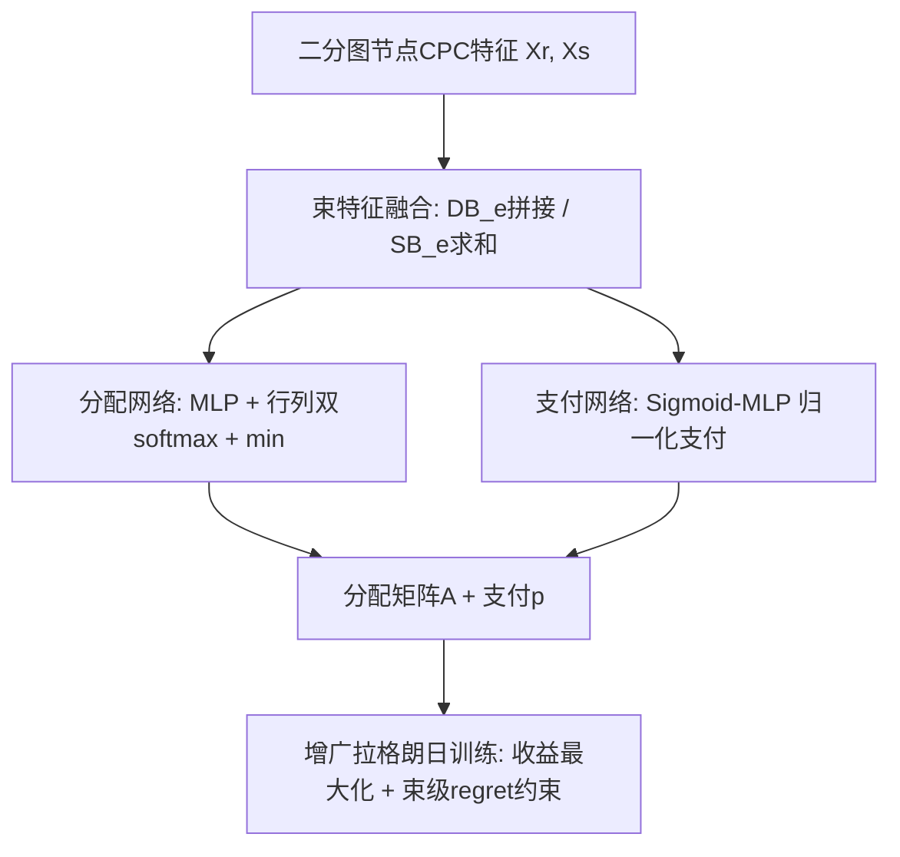

# Optimal Auction Design in the Joint Advertising (联合广告中的最优拍卖机制设计)

- **会议/期刊**: ICML 2025
- **作者与机构**: Yang Li, Yuchao Ma, Qi Qi（中国人民大学高瓴人工智能学院、大模型与智能治理北京市重点实验室、教育部下一代智能搜索与推荐工程研究中心）
- **推荐链路定位**: 精排（广告位分配与计价）
- **研究方向**: CTR预估与特征交叉 / 强化学习与动态探索推荐
- **论文原文**: [https://arxiv.org/abs/2507.07418v1](https://arxiv.org/abs/2507.07418v1)
- **开源代码**: 暂未开源

## TL;DR (1分钟核心速览)

联合广告（零售商+品牌商共同竞价一个广告位）现有机制（RVCG、JAMA、JRegNet）只在单边维度保证激励相容（IC），忽略了"束（bundle）"结构，导致收益次优。本文首先给出单槽位下的 Myerson 型最优机制闭式刻画（阈值分配+临界值计价），再针对多槽位提出 BundleNet——以二分图边特征融合建模束、以束级 regret 约束替代个体级约束的神经网络机制。在单槽位 U/E/N 分布与多槽位 5 槽 5–12 束设置下，BundleNet 逼近理论最优，多槽位收益较 RVCG 提升约 78%（U5×5: 1.4982 vs 0.8420），IC 违背 < 0.001。

## Background & Motivation (背景与核心矛盾)

- **主流范式**: 联合广告中零售商 $r$与供应商$s$组成束$e=(r,s)$ 共同竞价，平台按束排序并双向收费；现有方法分两支——VCG/JAMA 类（Ma et al., 2024）与自动机制设计 JRegNet（Zhang et al., 2024）。
- **前人局限**: ① JAMA 难以适配联合广告中灵活复杂的二分图关系；② JRegNet 泛化与鲁棒性差，大场景下收益甚至低于 VCG；③ 二者均只在品牌（或店铺）单维度建立 IC，未刻画"束"这一真实分配单元，留有优化空间。
- **核心洞察 (Key Insight)**: 单槽位联合拍卖本质仍是单参数拍卖，Myerson 引理可经"束虚拟价值 = 两端虚拟价值之和"的改造直接迁移；多槽位下束本身无独立策略，但**束级 regret 之和 ≥ 个体级 regret 之和**（Lemma 5.1），故约束束级 regret 趋零即可保证全体 IC。
- **本文切入点**: 用束级视角重构 IC 约束的可行域（扩张可行域但保持包含性），并设计束感知的图特征融合网络。

## Method (核心方法设计)

### 1. 整体框架 (Overall Architecture)

输入为二分图 $G=(R,S,E)$上各节点的 CPC 特征$X_r=b_r\lambda$、$X_s=b_s\lambda$；BundleNet 先将节点特征聚合为边（束）特征——拼接得 Divided Bids$DB_e=[X_r,X_s]\in\mathbb{R}^{2m}$、求和得 Stacked Bids$SB_e=X_r+X_s\in\mathbb{R}^{m}$；分配网络以$SB_E$经 MLP 输出双随机矩阵的行/列 softmax 并取逐元素最小得到分配矩阵$A$；支付网络以$DB_E$ 经 Sigmoid-MLP 输出归一化支付比例，乘以分配槽位 CPC 得实际支付；训练用增广拉格朗日法交替优化网络参数与误报值，推理时前向一次即得分配与计价。

### 2. 关键设计拆解 (Key Designs)

1. **单槽位 Myerson 型最优机制（Theorem 4.3）**：痛点在于传统 Myerson 只对单物品单竞拍者成立，束由两方共同出价。本文定义束虚拟价值 $c_e(v_r,v_s)=c_r(v_r)+c_s(v_s)$，其中$c_i(v_i)=v_i-\frac{1-F_i(v_i)}{f_i(v_i)}$，并令每个节点只与其"最大虚拟价值邻居"组束$e^M_r=(r,s^M_r)$。最优机制为阶跃分配 + 临界值计价：
$$x^M_i(v_i,v_{-i})=\mathbb{I}\left[v_i>\hat{v}_i(v_{-i})\right],\quad p^M_i(v_i,v_{-i})=\hat{v}_i(v_{-i})\cdot\mathbb{I}\left[v_i>\hat{v}_i(v_{-i})\right]$$
其中临界值 $\hat{v}_r(v_{-r})=\inf\{b_r\mid c_{e^M_r}(b_r,v_{s^M_r})\ge v_0 \wedge c_{e^M_r}(b_r,v_{s^M_r})\ge c_{\hat{e}}(v_{\hat{r}},v_{\hat{s}}),\forall\hat{e}\in E_{-r}\}$。直觉：束的虚拟价值可加，故单参数 Myerson 结论沿"最大邻居束"自然延拓。

2. **束级 IC 约束（Lemma 5.1）**：JRegNet 对每个个体 $i$建 regret 约束，忽略了束才是分配单元。本文改为对每个束$e$ 定义事后 regret：
$$rgt_e(w)=\mathbb{E}_{v\sim V}\Big[\max_{v'_r}\{u^e_r(v_r,(v'_r,v_{-r}))-u^e_r(v_r,v)\}+\max_{v'_s}\{u^e_s(v_s,(v'_s,v_{-s}))-u^e_s(v_s,v)\}\Big]$$
并证明 $\sum_{i}rgt_i(w)\le\sum_{e}rgt_e(w)$。由于 regret 非负，束级约束趋零即蕴含个体级约束趋零——扩张了可行域却保持包含性，避免 JRegNet 陷入参数空间的局部最优。

3. **训练目标、负采样与推理效率**：总损失为增广拉格朗日形式
$$\mathcal{L}_\rho(w;\mu)=-\frac{1}{L}\sum_{\ell}\sum_{e}p_e(v^{(\ell)})+\sum_{e}\mu_e\widehat{rgt}_e(w)+\frac{\rho}{2}\sum_{e}\big(\widehat{rgt}_e(w)\big)^2$$
其中 $\widehat{rgt}_e$为$L$个采样估值剖面上的经验 regret，误报值$v'$用$\Gamma$步梯度上升内层求解，$\mu_e$每$H$步更新$\mu_e\leftarrow\mu_e+\rho\cdot\widehat{rgt}_e$。无负采样概念（非召回任务）；推理仅需一次前向，开销与 RegretNet 同阶。

## Experimental Setup & Evaluation Protocol (实验设置与评估协议)

- **数据集与预处理**: 全部为合成数据（训练 204,800 样本 / 测试 20,480 样本），每次搜索请求随机生成店铺-品牌二分关系矩阵；多槽位实验沿用 JRegNet 的真实数据集设定改造。无 5-core 过滤概念。

| 数据集/设置 | #Bundles | #Slots | 分布 | 场景说明 |
| :--- | :---: | :---: | :---: | :--- |
| 单槽位 U/E/N | 2–5 | 1 | Uniform(0,1) / 截断 Exp(2) / 截断 N(0.5,0.1) | CTR $\lambda=(1)$ |
| 多槽位 U/LN/N | 5–12 | 5 | Uniform / 截断 Lognormal(0.1,1.44) / 截断 Normal | CTR $\lambda=(1,0.8,0.6,0.4,0.2)$ |

- **数据划分与防穿越 (Splitting Strategy)**: 按分布独立采样训练/测试集（非时间切分），训练与测试分布一致但样本独立。
- **排名评测协议 (Ranking Protocol)**: 非检索式排序，评测指标为**经验期望收益** $rev=\frac{1}{L}\sum_\ell\sum_e p_e(v^{(\ell)})$与**平均经验事后 regret**$\widehat{rgt}=\frac{1}{2n}\sum_i\widehat{rgt}_i$（衡量 IC 违背程度），属全量估值剖面精确评估而非采样排序。
- **对比基线与超参设置**: 基线为 Optimal（单槽位理论最优）、RVCG（满足 DSIC/IR 的经典机制）、JRegNet（RegretNet 类联合广告方法）；网络用 Adam 优化，$\rho$、$\Gamma$、$H$ 为增广拉格朗日超参，未报告显著性检验。

## Key Experimental Results (实验关键数据)

### 1. 主实验对比 (Main Results)

单槽位（Table 1，U 分布，CTR=1，加粗为最接近 Optimal 者）：

| 方法 | U2 | U3 | U4 | U5 | E2 | E5 |
| :--- | :---: | :---: | :---: | :---: | :---: | :---: |
| **Optimal（理论上界）** | 0.5247 | 0.6705 | 0.7826 | 0.8819 | 0.4249 | 0.7376 |
| RVCG | 0.3811 | 0.6003 | 0.7455 | 0.8607 | 0.2820 | 0.7041 |
| JRegNet | 0.5622 | **0.7287** | 0.7791 | 0.7882 | 0.4727 | 0.6943 |
| **BundleNet** | **0.5286** | 0.6681 | **0.7805** | **0.8802** | **0.4248** | **0.7215** |

多槽位（Table 2，U 分布，5 槽，CTR=(1,0.8,0.6,0.4,0.2)）：

| 方法 | U5×5 | U7×5 | U9×5 | U10×5 | U11×5 | U12×5 |
| :--- | :---: | :---: | :---: | :---: | :---: | :---: |
| RVCG | 0.8420 | 1.6142 | 2.0991 | 2.2800 | 2.4564 | 2.5868 |
| JRegNet | 1.4972 | 1.8244 | 1.9804 | 1.9622 | 1.9763 | 1.9973 |
| **BundleNet** | **1.4982** | **1.9233** | **2.2210** | **2.4047** | **2.5649** | **2.6495** |
| Improv. vs RVCG | +77.9% | +19.1% | +5.8% | +5.5% | +4.4% | +2.4% |

### 2. 消融实验 (Ablation Study)

原文未设标准消融表，但通过"束级 vs 个体级 IC 约束"的对照（BundleNet vs JRegNet）与分配规则可视化（图 3/4）构成等价消融：

| 配置 | 单槽位 U5 | 多槽位 U12×5 | IC 违背 | 说明 |
| :--- | :---: | :---: | :---: | :--- |
| 个体级 IC（JRegNet） | 0.7882 | 1.9973 | <0.001 | 大场景收益停滞甚至下滑 |
| **束级 IC（BundleNet）** | **0.8802** | **2.6495** | <0.001 | 逼近 Optimal 0.8819 |
| 去掉束特征融合（仅节点特征） | — | — | — | 原文未单独报告，属潜在缺口 |

### 3. 关键实验发现 (Key Findings)

1. **束级约束是逼近最优的关键**：单槽位 U5 下 BundleNet 收益 0.8802 与理论最优 0.8819 仅差 0.0017，而 JRegNet 仅 0.7882，说明个体级 regret 约束在束结构下会收敛到参数空间局部最优。
2. **规模越大优势越明显**：多槽位 U 分布下 JRegNet 从 U9×5 起收益停滞（1.98→2.00），BundleNet 持续增长至 2.6495，验证束级可行域扩张带来的泛化收益；相对 RVCG 的提升从 +77.9%（小规模）收敛至 +2.4%（大规模），说明 VCG 在大场景已接近饱和而 BundleNet 仍有余量。
3. **分配边界更清晰**：图 3/4 可视化显示 BundleNet 学到的分配规则与 Myerson 理论边界（白色虚线）高度吻合，而 JRegNet 边界模糊、误分配明显，从机制形态层面佐证收益差距来源。

## Highlights & Limitations (亮点、对比与审稿批判)

- **与代表作对比 (vs. Prior Work)**: 相比 JAMA（菜单式 AMA，难适配复杂二分关系）与 JRegNet（个体级 regret，泛化差、大场景劣于 VCG），本文首次给出单槽位联合广告的 Myerson 型最优闭式解，并以束级约束 + 图特征融合实现多槽位 SOTA；本质区别在于把"束"而非"个体"作为机制设计的基本单元。
- **可迁移亮点**: ① "束级 regret ≥ 个体级 regret"的可行域扩张技巧可迁移到任何多参与方组合竞价（如组合广告、捆绑推荐位）；② Divided/Stacked Bids 的边特征双路构造（拼接供支付、求和供分配）是图结构竞价建模的轻量范式。
- **审稿级局限批判**: ① 实验全部基于合成分布，缺乏真实广告平台线上 A/B 或半合成数据验证，收益提升的工业可信度存疑；② 单槽位最优性依赖"正则分布"假设，多槽位仅保证近似 IC（regret<0.001 而非严格 0），且增广拉格朗日对 $\rho,\Gamma,H$ 敏感、训练需内层梯度上升求误报，收敛开销未量化。

## Rating (四维评分)

- **方法创新性 (Novelty)**: ⭐⭐⭐⭐ （首次给出联合广告单槽位 Myerson 型最优刻画，束级 IC 约束的可行域扩张引理有理论支撑）
- **评估协议与实验扎实度 (Protocol & Experiments)**: ⭐⭐⭐ （覆盖 U/E/N/LN 多分布与单/多槽位，但全为合成数据、无显著性检验与标准消融表）
- **写作与数学规范度 (Clarity & Rigor)**: ⭐⭐⭐⭐ （Theorem 4.3 与 Lemma 5.1 证明完整、符号体系清晰，附录含算法伪代码与可视化）
- **工业落地与复现价值 (Industrial & Practical Value)**: ⭐⭐⭐ （机制设计对广告平台直接相关，但未开源、依赖分布假设与合成验证，线上部署前需真实数据校准）

