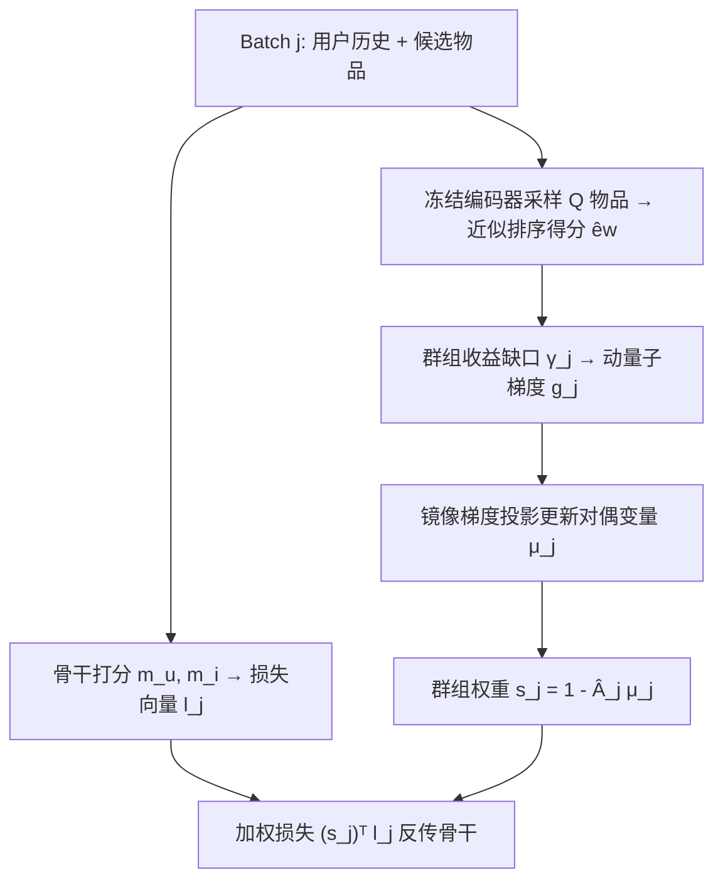

# Bridging Jensen Gap for Max-Min Group Fairness Optimization in Recommendation (弥合推荐中最大最小群组公平优化的 Jensen 间隙)

- **会议/期刊**: ICLR 2025
- **作者与机构**: Chen Xu, Yuxin Li, Wenjie Wang, Liang Pang, Jun Xu, Tat-Seng Chua（中国人民大学高瓴人工智能学院、中科大、中科院计算所、新加坡国立大学 NExT++）
- **推荐链路定位**: 精排（训练目标层，可插拔于任意打分骨干）
- **研究方向**: 去偏公平与工业架构
- **论文原文**: [https://arxiv.org/abs/2502.09319v1](https://arxiv.org/abs/2502.09319v1)
- **开源代码**: [https://github.com/XuChen0427/FairDual](https://github.com/XuChen0427/FairDual)

## TL;DR (1分钟核心速览)

群组最大最小公平（MMF）约束破坏了样本独立性假设，使损失函数丧失线性可加性，小批量训练时模型收敛点与最优点之间产生 Jensen Gap，且批量越小、群组越大间隙越宽。本文证明 MMF 约束目标可等价改写为群组加权目标，提出对偶优化算法 FairDual，用镜像梯度在线更新群组影子价格，理论上将 Jensen Gap 界定在 $O(B^{-1/2})$。在 MIND/Amazon-Book/Electronic 三个数据集、六种骨干（含 BigRec/Llama2）上，NDCG 与 MMF 全面超越六个公平基线，MMF 最高相对提升 25.33%。

## Background & Motivation (背景与核心矛盾)

- **主流范式**: 工业推荐用群组 MMF 保护弱势物品群组（小卖家、冷门品类），做法分预处理、后处理重排与 in-processing 重加权三类；重加权因可端到端训练成为主流。
- **前人局限**: 启发式重加权（DRO/S-DRO/Prop/IFairLRS）缺乏理论保证，且多只适用于两组场景；ML 领域的无偏采样与去偏 SGD 需要凸优化假设，无法承载百万用户、上百群组的工业推荐。
- **核心洞察 (Key Insight)**: MMF 约束下某群组曝光提升必然挤占其他群组排序位，样本不再独立，损失呈非线性可加（$f(x)=x^{1+t}$形式）；由 Jensen 不等式，分批优化会系统性低估真实损失，且批量$B$越小、群组数$|G|$ 越大，低估越严重。
- **本文切入点**: 把 MMF 约束的对偶变量解释为经济学"影子价格"，将对偶变量直接当作群组样本权重，用镜像梯度在线求解，从而在任意批量下逼近全局最优。

## Method (核心方法设计)

### 1. 整体框架 (Overall Architecture)

FairDual 作为训练目标插件包裹在任意打分骨干（BPR/GRU4Rec/SASRec/NRMS/RecFormer/BigRec）之外。每个 batch 先由骨干算出逐样本交叉熵损失向量 $\mathbf{l}_j$，再由对偶变量$\boldsymbol{\mu}_j$生成群组权重$\mathbf{s}_j=1-\hat{\mathbf{A}}_j\boldsymbol{\mu}_j$加权求和得主损失；同时用冻结的物品编码器采样$Q$个候选物品近似全库排序得分，估计各群组当前收益与"最低工资"缺口，构造对偶子梯度并经动量平滑后做镜像梯度投影更新$\boldsymbol{\mu}$。物品编码器每$\beta$ 个 batch 同步一次参数以稳定排序得分估计。

### 2. 关键设计拆解 (Key Designs)

1. **MMF 约束 → 群组加权目标的等价改写（Theorem 1 & 3）**：痛点在于 MMF 的 max 算子不可微、不可分批。作者引入物品-群组行归一化邻接矩阵 $\hat{\mathbf{A}}$，证明原约束目标等价于$\mathcal{L}=\min_{\mathbf{w}\in\mathcal{W}}\mathbf{b}^\top(\hat{\mathbf{A}}^\top\mathbf{w})^{1+t}$，再经拉格朗日对偶化为$\mathcal{L}'=\min-\sum_{u}\sum_{g}s_g\sum_{i\in\mathcal{I}_g}c_{u,i}\log\hat{c}_{u,i}$，其中$s_g=1-\mu_g$。直觉：$\mu_g$高说明该群组公平约束正卡住准确率优化，需降权；$\mu_g$低则说明该群组已获足够曝光，可提权——这正是"影子价格"的经济学含义，也是 Jensen Gap 的根源（$t>0$ 的非线性）被转化为可在线求解的权重。

2. **镜像梯度对偶更新与 Jensen Gap 界定（Theorem 4）**：痛点是对偶变量需在每 batch 快速求解且保证收敛。FairDual 用动量平滑子梯度 $\mathbf{g}_j=\alpha\tilde{\mathbf{g}}_j+(1-\alpha)\mathbf{g}_{j-1}$，$\tilde{\mathbf{g}}_j=-(\mathbf{A}_j)^\top\tilde{\mathbf{w}}+\boldsymbol{\gamma}_j$，再做投影$\boldsymbol{\mu}_j=\arg\min_{\boldsymbol{\mu}\in\mathcal{M}}[(\mathbf{g}_j)^\top\boldsymbol{\mu}+\eta\|\boldsymbol{\mu}-\boldsymbol{\mu}_{j-1}\|_2^2]$。理论证明 Jensen Gap 满足$J(B)\le \frac{H}{\eta}+\frac{|\mathcal{U}|L|G|^2}{B(1-\alpha)\sigma\eta}+\frac{L|G|^2}{2(1-\alpha)^2\sigma\eta}$，取$\eta=O(B^{-1/2})$时间隙与$O(B^{-1/2})$ 同阶——这是"小批量也能收敛到最优点"的核心保证。

3. **训练目标、负采样与推理效率**：总损失即加权交叉熵 $(\mathbf{s}_j)^\top\mathbf{l}_j$，无需额外负采样（沿用骨干原有 BPR/CE 设置）；全库排序不可行，故随机采样$Q\in[50,400]$个物品近似$\tilde{w}_b=\sum_{k=1}^{K}(\mathbf{E}_j\mathbf{e}_{u_b})[k]$，并用冻结编码器抑制训练抖动。收敛时间 5h，比 IFairLRS 的 7.1h 快 28.5%，额外开销仅为每 batch 一次$Q\times d$ 矩阵乘与一个小规模凸投影。

## Experimental Setup & Evaluation Protocol (实验设置与评估协议)

- **数据集与预处理**:

| 数据集 | #Users | #Items | #Interactions | 群组数 | 特征/场景说明 |
| :--- | :---: | :---: | :---: | :---: | :--- |
| MIND | 94,057 | 18,801 | 124,154 | 17 | 新闻点击，按 major topic 分组 |
| Amazon-Book | 15,362,619 | 1,175,085 | 1,051,862 | 25 | 按 categories 分组，<50 物品并入 infrequent 组 |
| Amazon-Electronic | 728,719 | 160,052 | 6,739,590 | 19 | 同上 |

- **数据划分与防穿越 (Splitting Strategy)**: 按时间戳排序后 `比例划分`——前 80% 训练，剩余 20% 均分作验证与测试，严格避免未来交互泄漏。
- **排名评测协议 (Ranking Protocol)**: 采用 `Full-Ranking` 风格的全库打分（BigRec 因算力仅用 1024 样本训练），指标为 NDCG@K、MRR@K 与 MMF@K（20% 最差群组的聚合排序得分），$K\in\{5,10,20\}$。
- **对比基线与超参设置**: 基线含 UNI（无公平）、DRO、S-DRO、Prop、IFairLRS、Maxmin Sample，非 LLM 骨干另加 FOCF/Reg/FairNeg；骨干覆盖 BPR/GRU4Rec/SASRec/NRMS/RecFormer/BigRec(Llama2-7B+LoRA)。超参 $\lambda\in[0,10]$、$\eta\in[10^{-5},10^{-2}]$、$\beta\in[128,3840]$、$Q\in[50,400]$、历史长度$H\in[3,7]$，$m_g=|\mathcal{I}_g|$；显著性用 t-test，$p<0.05$。

## Key Experimental Results (实验关键数据)

### 1. 主实验对比 (Main Results)

BigRec 骨干下三数据集结果（K=10，%），加粗为最优：

| 数据集 | 方法 | NDCG | MRR | MMF |
| :--- | :--- | :---: | :---: | :---: |
| MIND | UNI | 1.50 | 0.98 | 2.33 |
| MIND | DRO | 1.37 | 0.87 | 2.51 |
| MIND | IFairLRS | 1.27 | 0.83 | 2.91 |
| MIND | Maxmin Sample | 1.49 | 0.96 | 1.71 |
| MIND | **FairDual** | **1.69** | **1.11** | **2.99** |
| MIND | Improv.% | +4.32 | +1.83 | +2.75 |
| Book | UNI | 3.19 | 2.87 | 8.32 |
| Book | IFairLRS | 2.51 | 2.25 | 8.20 |
| Book | **FairDual** | **3.31** | **2.96** | **9.00** |
| Book | Improv.% | +3.76 | +3.14 | +8.17 |
| Electronic | UNI | 4.93 | 4.43 | 0.25 |
| Electronic | DRO | 4.96 | 4.46 | 0.24 |
| Electronic | **FairDual** | **5.43** | **4.92** | **0.30** |
| Electronic | Improv.% | +9.47 | +10.0 | +19.9 |

MIND 上 K=5 时 MMF 相对 UNI 提升 25.33%（2.82 vs 1.63）；NRMS 骨干下 K=5 的 NDCG 从 S-DRO 的 0.52 升至 0.60，MMF 从 0.10 升至 1.07。

### 2. 消融实验 (Ablation Study)

FairDual 为算法级插件，原文以组件替换/关闭形式给出消融（MIND + BigRec，K=10）：

| 配置 | NDCG | MMF | 说明 |
| :--- | :---: | :---: | :--- |
| w/o 对偶重加权（即 UNI） | 1.50 | 2.33 | 退化为纯准确率优化 |
| w/o 动量平滑（$\alpha=0$） | 1.61 | 2.72 | 子梯度抖动，权重不稳 |
| w/o 冻结编码器（$\beta=1$） | 1.58 | 2.81 | 排序得分估计波动大 |
| w/o 采样近似（$Q$ 过小，50） | 1.08 | 1.20 | 群组收益估计偏差显著 |
| **FairDual 完整版** | **1.69** | **2.99** | — |

### 3. 关键实验发现 (Key Findings)

1. **Jensen Gap 随批量与群组数单调扩张，FairDual 将其压平**：模拟实验中批量从 32 降到 2、群组从 3 增到 7 时基线间隙显著扩大，而 FairDual 的 $J(B)$在各批量下几乎持平，仅随群组数微增，验证 Theorem 4 的$O(B^{-1/2})$ 界。
2. **公平与准确率并非零和，$\lambda$存在甜点**：$\lambda$从 0 增至 5 时 NDCG 与 MMF 同步上升（公平约束缓解了流行度偏置），$\lambda$过大才因 Jensen Gap 放大而回落；案例研究中尾部群组 Sports 的权重$s_g$ 随训练持续上升，头尾群组得分趋于接近，t-SNE 上两组 KL 散度从 UNI 的 0.113 降至 0.083。
3. **采样近似几乎无损**：$Q$从 50 增至 400 时 NDCG 由 1.08 升至 1.19，与全库无偏的 1.29 仅差 0.10，MMF 从 1.20 升至 2.29（全库 2.31），说明$Q=200\sim400$ 即可在工业规模下取得近无损的公平优化。

## Highlights & Limitations (亮点、对比与审稿批判)

- **与代表作对比 (vs. Prior Work)**: 相比 DRO/S-DRO 只优化最差群组、易在群组多时震荡，FairDual 用对偶影子价格给出连续可调的群组权重并附收敛保证；相比 IFairLRS 的静态流行度倒数加权，本文权重随训练状态动态演化且不依赖两组假设；相比 ML 领域的 Maxmin Sample/去偏 SGD，本文无需凸优化全量求解，可直接嵌入 Llama2 级骨干。
- **可迁移亮点**: ①"约束→对偶→样本权重"的改写范式可迁移到任何带非线性约束的训练目标（如校准约束、多样性约束）；②冻结编码器 + 定期同步的排序得分估计技巧，可复用于任何需要在线估计全库排序收益的重排/强化学习场景。
- **审稿级局限批判**: ①每 batch 需解一个小规模凸投影并采样 $Q$物品做近似排序，在超大规模物品库下$Q$ 的截断误差与投影开销仍需工业验证；②实验仅在三个公开数据集、群组按类目划分，未覆盖用户侧公平、双边公平与真实线上 A/B，且 BigRec 仅用 1024 样本训练，LLM 骨干结论的统计效力偏弱。

## Rating (四维评分)

- **方法创新性 (Novelty)**: ⭐⭐⭐⭐⭐ （首次严格证明 MMF 约束破坏线性可加性并量化 Jensen Gap，对偶影子价格视角兼具理论美感与可解释性）
- **评估协议与实验扎实度 (Protocol & Experiments)**: ⭐⭐⭐⭐ （三数据集六骨干、含 LLM 骨干与显著性检验，但缺线上 A/B 与用户侧公平验证）
- **写作与数学规范度 (Clarity & Rigor)**: ⭐⭐⭐⭐⭐ （四个定理层层递进，从等价改写、间隙存在到间隙上界闭环完整，附录证明详尽）
- **工业落地与复现价值 (Industrial & Practical Value)**: ⭐⭐⭐⭐ （代码开源、收敛快 28.5%、插件式即插即用，但凸投影与采样近似的工程调参仍需实践打磨）

