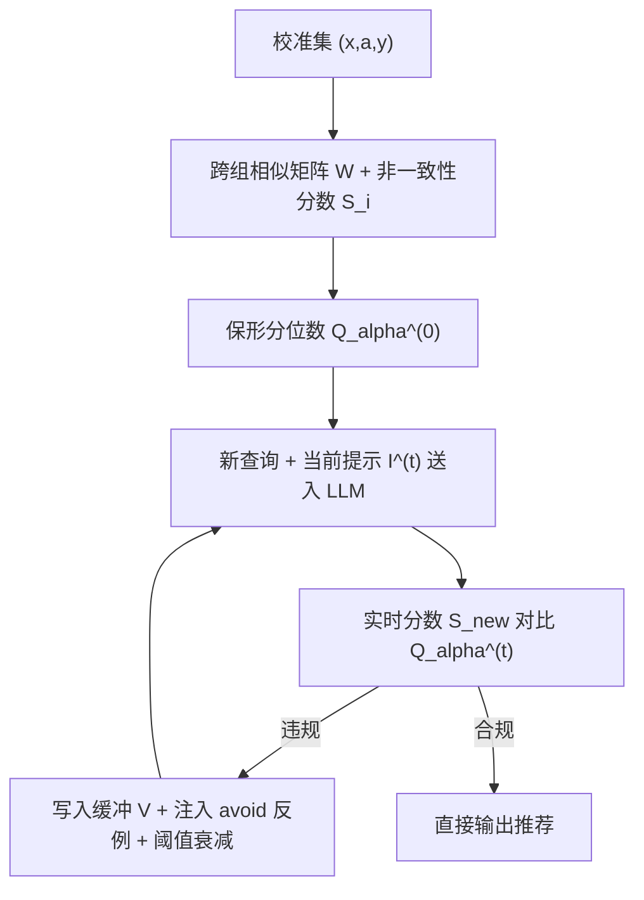
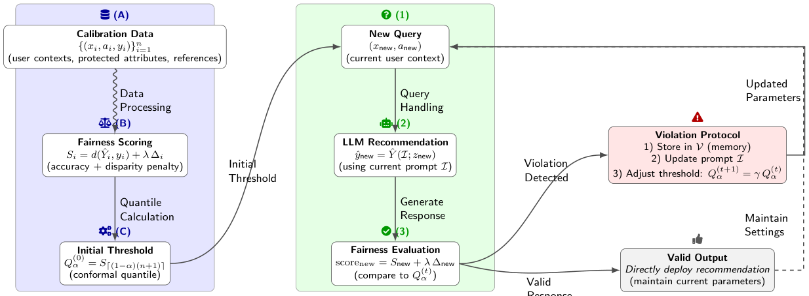

# FACTER: Fairness-Aware Conformal Thresholding and Prompt Engineering for Enabling Fair LLM-Based Recommender Systems (面向公平 LLM 推荐的保形阈值与提示工程框架)

- **会议/期刊**: arXiv preprint (2025-02)
- **作者与机构**: Arya Fayyazi, Mehdi Kamal, Massoud Pedram（University of Southern California）
- **推荐链路定位**: 重排 / 生成式端到端（黑盒 LLM 零样本推荐的后处理包装层）
- **研究方向**: 去偏公平、可信隐私与工业架构 / 大语言模型推荐
- **论文原文**: [https://arxiv.org/abs/2502.02966v1](https://arxiv.org/abs/2502.02966v1)
- **开源代码**: 暂未开源

## TL;DR (1分钟核心速览)

LLM 零样本推荐器在仅改动性别/年龄等敏感属性时会输出语义迥异的推荐（如男性得犯罪片、女性得爱情片），而现有方法要么需重训参数（黑盒 API 不可行），要么缺乏"多大差异才算违规"的原则性判据。FACTER 把**保形预测**引入公平性校准：用校准集估计语义距离的非一致性分数分位数作为初始阈值，在线阶段一旦违规即注入"avoid"反例提示并以指数衰减收紧阈值，形成免重训闭环。在 MovieLens-1M 与 Amazon 上，违规数分别从 112 降至 5（-95.5%）、198 降至 18（-90.9%），NDCG@10 仅从 0.458 微降至 0.445。

## Background & Motivation (背景与核心矛盾)

- **主流范式**: LLM 作为零样本推荐器（Zero-Shot Ranker）直接生成物品建议；公平性缓解主流走两条路——参数级干预（对抗训练、重参数化、指令微调/RLHF）与事后嵌入空间语义检查。
- **前人局限**: ① 工业部署多为黑盒 API（OpenAI/HuggingFace），无法访问权重与训练数据，参数级方法直接失效；② 嵌入距离类事后检测能发现"差异大"，却**无法原则性地回答"距离多大才算不可接受"**，阈值全靠主观拍定，且静态阈值（如 UP5）无法随新出现的偏见模式自适应。
- **核心洞察 (Key Insight)**: 作者观察到**语义方差（semantic variance）是偏见的强代理信号**——固定非敏感上下文、仅翻转敏感属性 $a\to a'$，若输出嵌入距离超常，即对应个体公平（相似输入应得相似输出）的违背。而保形预测恰好提供有限样本覆盖保证，可把"阈值该定多少"转化为可校准的分位数估计问题。
- **本文切入点**: 用保形分位数给出有统计保证的初始公平阈值，再用"违规触发"的提示注入 + 阈值指数衰减构成闭环，在**完全不改模型参数**的前提下迭代压降违规率。

## Method (核心方法设计)

### 1. 整体框架 (Overall Architecture)

FACTER 将黑盒推荐器 $\hat{Y}$包裹为公平算子$\Gamma_{\text{fair}}$，分离线与在线两阶段。离线阶段：对校准集$\{(x_i,a_i,y_i)\}_{i=1}^n$编码用户上下文与参考物品，构造仅保留"上下文相近但敏感属性不同"的跨组相似矩阵$W$，计算融合预测误差与跨组差异惩罚的非一致性分数$S_i$，取保形分位数得初始阈值$Q_\alpha^{(0)}$。在线阶段：新查询拼接当前公平提示$I^{(t)}$送入 LLM，实时计算$S_{\text{new}}$与$Q_\alpha^{(t)}$ 比较；若超阈值则写入 FIFO 违规缓冲、向提示注入"avoid"反例、并按指数衰减收紧阈值，否则原样输出、参数不变。

<figure class="paper-figure" markdown="span">
  <figcaption>图 2：FACTER 框架工作流程。系统在两个协同阶段运行：（左）离线校准使用历史数据计算公平性感知阈值（阶段 A–C）：(A) 数据预处理与校准，(B) 公平性评分，(C) 初始分位数阈值计算。（右）在线部署与持续监控（阶段 1–3）：(1) 新查询生成 (2) LLM 推荐，其经过 (3) 公平性评估。违规触发提示更新和阈值调整，通过闭环反馈进行，而有效响应保持当前参数。</figcaption>
</figure>

### 2. 关键设计拆解 (Key Designs)

1. **公平感知非一致性分数（Fairness-Aware Non-conformity Score）**：痛点是把"精度误差"与"跨组偏见"塞进同一可校准标量。作者定义 $S_i = \underbrace{1-\cos(\text{Emb}(\hat{y}_i),\mathbf{e}_{y_i})}_{d_i} + \lambda \underbrace{\max_{j:\,W_{ij}>\tau_\rho}\|\text{Emb}(\hat{y}_i)-\text{Emb}(\hat{y}_j)\|_2}_{\Delta_i}$，其中$W_{ij}$仅在$a_i\neq a_j$且上下文距离$\le\tau_x$时非零。$d_i$保精度、$\Delta_i$罚"同上下文异组输出发散"，$\lambda$ 调节二者权衡。直觉：把个体公平的"最小属性改动不应引起大输出偏移"直接编码为可排序的标量，从而能被保形分位数统一处理。

2. **保形分位数阈值 + 违规触发指数衰减**：痛点是无从判定阈值。离线取 $Q_\alpha^{(0)}=\inf\{q:\frac{1}{n+1}\sum_i\mathbb{I}\{S_i\le q\}\ge 1-\alpha\}$，在可交换性假设下给出$P(S_{\text{new}}\le Q_\alpha^{(0)})\ge 1-\alpha$的有限样本覆盖保证（Lemma 3.1）。在线若$S_{\text{new}}>Q_\alpha^{(t)}$，则更新$Q_\alpha^{(t+1)}=\gamma Q_\alpha^{(t)}+(1-\gamma)\min(Q_\alpha^{(t)},S_{\text{new}})$，$\gamma\in(0,1)$越小收紧越激进。直觉：持续违规说明当前阈值对真实偏见分布过于宽松，衰减机制把阈值逐步压向真实$\alpha$-分位点，附录定理证明以$O((1-\gamma)^t)$ 几何收敛。

3. **对抗式提示修复（Adversarial Prompt Repair）与训练/推理开销**：痛点是不重训如何让模型"记住"偏见。违规样本 $(z_{\text{new}},\hat{y}_{\text{new}})$入 FIFO 缓冲$V$（容量$M=50$防爆 token），提示更新为$I^{(t+1)}=I^{(t)}\oplus[\text{"Avoid: }(x,a)\to\hat{y}\text{"}]$。消融显示**枚举显式模式**（多条 avoid 对）优于泛化警告与单条反例（Amazon 上违规 15 vs 24 vs 38）。全流程无梯度、无负采样；离线$O(n^2)$相似度计算，在线单查询近似常数开销（LLaMA3-8B 推理延迟$155\pm18$ ms）。

## Experimental Setup & Evaluation Protocol (实验设置与评估协议)

- **数据集与预处理**: 两数据集均**采样子集**（非全量），70% 校准 / 30% 测试：

| 数据集 | #校准样本 | #测试样本 | 稀疏度/场景说明 |
| :--- | :---: | :---: | :--- |
| MovieLens-1M | 1,750 | 750 | 采样 2,500 条交互，含性别/年龄/职业敏感属性 |
| Amazon Movies & TV | 2,625 | 1,125 | 采样 3,750 条，更稀疏，鲁棒性压力测试 |

- **数据划分与防穿越 (Splitting Strategy)**: 比例划分（70:30），校准集与测试集按可交换性假设独立采样；未采用时间戳切分，存在分布漂移风险。
- **排名评测协议 (Ranking Protocol)**: 生成式推荐场景，以 Recall@10 与 NDCG@10 衡量精度；公平性用违规数（超保形阈值计数）、SNSR、SNSV、CFR 四指标。**未采用 Full-Ranking 全库排序**，属 LLM 直接生成 top-10 的评测范式。
- **对比基线与超参设置**: 基线为 Zero-Shot Ranker（无公平调整）与 UP5（SOTA 公平感知基础模型推荐器）；LLM 主干 LLaMA3-8B / LLaMA2-7B / Mistral-7B，嵌入用 SentenceTransformer `paraphrase-mpnet-base-v2`；超参 $\tau_\rho=0.9$、$\lambda=0.7$、$\gamma=0.95$、$M=50$，经网格搜索与交叉验证确定。

## Key Experimental Results (实验关键数据)

### 1. 主实验对比 (Main Results)

MovieLens-1M（Iteration 3）：

| Method | #Violations ↓ | SNSR ↓ | CFR ↓ | NDCG@10 ↑ | Recall@10 ↑ |
| :--- | :---: | :---: | :---: | :---: | :---: |
| Zero-Shot | 112 | 0.083 | 0.742 | **0.458** | **0.402** |
| UP5 | 28 | 0.049 | 0.613 | 0.427 | 0.381 |
| **FACTER (Iter3)** | **5** | **0.041** | **0.591** | 0.445 | 0.389 |
| Improv. (vs Zero-Shot) | **-95.5%** | -50.6% | -20.3% | -2.8% | -3.2% |

Amazon Movies & TV（Iteration 3）：

| Method | #Violations ↓ | SNSR ↓ | CFR ↓ | NDCG@10 ↑ | Recall@10 ↑ |
| :--- | :---: | :---: | :---: | :---: | :---: |
| Zero-Shot | 198 | 0.121 | 0.814 | **0.351** | **0.317** |
| UP5 | 63 | 0.067 | 0.721 | 0.328 | 0.294 |
| **FACTER (Iter3)** | **18** | **0.053** | **0.634** | 0.339 | 0.301 |
| Improv. (vs Zero-Shot) | **-90.9%** | -56.2% | -22.1% | -3.4% | -5.0% |

跨 LLM 泛化（MovieLens-1M, Iter3）：LLaMA3-8B 违规 3 / NDCG 0.440；LLaMA2-7B 违规 5 / NDCG 0.444；Mistral-7B 违规 7 / NDCG 0.451，均 $\ge 90\%$ 违规下降。

### 2. 消融实验 (Ablation Study)

| 消融维度 | 设置 | #Viol. ↓ | CFR ↓ | NDCG@10 ↑ |
| :--- | :--- | :---: | :---: | :---: |
| 保形校准 | No Calib | 42 | 0.716 | 0.336 |
| 保形校准 | **Calib (FACTER)** | **15** | **0.649** | **0.339** |
| 提示策略 | Generic Warnings | 38 | 0.721 | 0.336 |
| 提示策略 | Negative Examples | 24 | 0.661 | 0.334 |
| 提示策略 | **Explicit Patterns** | **15** | **0.649** | **0.339** |
| 公平惩罚 $\lambda$ | 0.1 → 0.9 | 18 → 2 | — | 0.446 → 0.395 |
| 邻域阈值 $\tau_\rho$ | 0.80 → 0.95 | 16 → 4 | 0.721 → 0.630 | 0.442 → 0.435 |

（消融均在 Amazon 或 MovieLens-1M 的 Iteration 3、$\lambda=0.7$、$\gamma=0.95$、$\tau_\rho=0.90$ 下进行。）

### 3. 关键实验发现 (Key Findings)

1. **保形校准是主要增益来源**：去掉校准后 Amazon 违规从 15 反弹至 42（+180%），CFR 从 0.649 恶化至 0.716，而 NDCG 几乎不变（0.339 vs 0.336），说明阈值的原则性设定而非提示本身承担了大部分去偏收益。
2. **公平-精度权衡高度可控且代价极小**：$\lambda$ 从 0.1 增至 0.9，MovieLens 违规 18→2、Amazon 41→12，NDCG 仅从 0.446 降至 0.395；主实验中 FACTER 相对 Zero-Shot 精度损失仅 2.8%–3.4%，却换来 90%+ 违规削减，验证"语义方差是偏见强代理"的假设成立。
3. **显式模式提示显著优于泛化警告**：Explicit Patterns 相比 Generic Warnings 违规减少 60.5%（15 vs 38），且 CFR 更低（0.649 vs 0.721），说明 LLM 需要具体"avoid 对"才能泛化到新查询；同时 LLaMA3-8B 在第 3 轮即收敛至近零违规，迭代轮数少、在线成本可控。

## Highlights & Limitations (亮点、对比与审稿批判)

- **与代表作对比 (vs. Prior Work)**: 相比 UP5 等参数级公平校准方法，FACTER 完全黑盒、免重训，且阈值随违规自适应而非静态固定（UP5 违规数在迭代中保持 28 不变，FACTER 逐轮降至 5）；相比 Zero-Shot Ranker 的嵌入事后检查，本文补上了"阈值如何定"这一缺失环节，并给出有限样本覆盖保证（Type I 误差理论上界 0.201，实测仅 0.018）。
- **可迁移亮点**: ① "保形分位数 + 违规触发衰减"的闭环阈值机制可迁移到任何需要动态设定判据的黑盒生成系统（如毒性检测、幻觉监控）；② 用 FIFO 缓冲 + 显式 avoid 模式注入提示，是一种零训练、低 token 开销的在线行为纠偏范式。
- **审稿级局限批判**: ① 实验规模偏小（MovieLens 仅 2,500 条、Amazon 3,750 条采样），且为 70:30 随机划分而非时间切分，未验证真实分布漂移下的可交换性假设是否成立；② 离线 $O(n^2)$ 相似度计算与对嵌入器无偏性的强假设（若 SentenceTransformer 本身带偏见则校准失效），加上提示 token 预算限制 avoid 示例数量，规模化部署的延迟与鲁棒性仍待验证。

## Rating (四维评分)

- **方法创新性 (Novelty)**: ⭐⭐⭐⭐ （首次将保形预测的分位数校准与提示工程闭环结合用于 LLM 推荐公平性，语义方差作偏见代理的洞察有理论支撑，但各组件本身均为已有技术的组合）
- **评估协议与实验扎实度 (Protocol & Experiments)**: ⭐⭐⭐ （含跨 3 个 LLM、2 数据集、4 类公平指标与理论-实证对照，但数据规模小、随机划分、缺时间切分与显著性检验）
- **写作与数学规范度 (Clarity & Rigor)**: ⭐⭐⭐⭐ （公平定义、非一致性分数、保形覆盖引理与收敛定理链条完整，附录给出嵌入扰动鲁棒性与 Type II 误差界，符号清晰）
- **工业落地与复现价值 (Industrial & Practical Value)**: ⭐⭐⭐⭐ （完全黑盒、免重训、在线单查询常数开销，对 API 化 LLM 推荐部署友好；但未开源、离线 $O(n^2)$ 与嵌入器偏见依赖是落地障碍）

