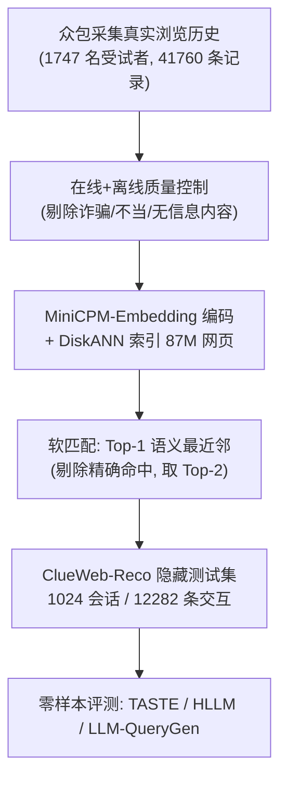

# ORBIT: Open Recommendation Benchmark for Reproducible Research with Hidden Tests (面向可复现研究与隐藏测试的开放推荐基准)

- **会议/期刊**: NeurIPS 2025 (Datasets & Benchmarks Track)
- **作者与机构**: Jingyuan He, Jiongnan Liu, Vishan Vishesh Oberoi 等；卡内基梅隆大学 LTI 与 Meta
- **推荐链路定位**: 端到端评测（召回/排序统一协议）+ 隐藏测试泛化评估
- **研究方向**: 去偏公平、可信隐私与工业架构 / 大语言模型推荐
- **论文原文**: [论文原文链接](https://arxiv.org/abs/2510.26095v1)
- **开源代码**: [开源代码仓库链接](https://github.com/cxcscmu/RecSys-Benchmark)

## TL;DR (1分钟核心速览)

现有推荐研究受困于两类顽疾：公开数据集多为评论/购买等稀疏行为（仅占交互 1–2%），且划分方式、候选池与指标各行其是，导致结论不可复现。ORBIT 提出统一基准：5 个公开数据集采用一致的 Leave-One-Out 划分与 Full-Ranking 全库排序，并构建隐私安全的 ClueWeb-Reco 隐藏测试集（1024 会话、8720 万候选网页）。在公开榜上 HLLM 平均 NDCG@10 达 0.0641 最优；隐藏测试中零样本 LLM-QueryGen（DeepSeek-V3）Recall@10 达 0.0127，显著超越 TASTE（0.0020）与 HLLM（0.0088）。

## Background & Motivation (背景与核心矛盾)

- **主流范式**: 推荐研究长期依赖 Amazon Review、Yelp、MovieLens 等评论/评分数据集，并以各自设定的划分与采样候选池报告指标。
- **前人局限**: 其一，评论类行为仅覆盖 1–2% 交互，存在严重流行度偏置，无法反映真实浏览行为；其二，PixelRec/Tenrec/MicroLens 等新数据集采集未获用户明示同意，存在隐私伦理风险。
- **核心矛盾**: 真实行为序列几乎不在用户间重复，MSMARCO 式"≥50 用户共享查询"的脱敏门槛对序列推荐完全失效；而纯 LLM 合成序列又丢失真实行为分布。
- **核心洞察 (Key Insight)**: 可将"真实但私密"的浏览序列，通过语义软匹配映射到公开网页语料（ClueWeb22-B EN），在保留行为语义的同时彻底去除 PII。
- **本文切入点**: 以"标准化公开榜 + 隐私安全隐藏测试榜"双轨制，同时解决可复现性与真实性问题。

## Method (核心方法设计)

### 1. 整体框架 (Overall Architecture)

ORBIT 由两条支柱构成。**公开基准**：统一 5 个数据集（ML-1M 与 Amazon Beauty/Toys/Sports/Books）的预处理、Leave-One-Out 划分、全库排序协议与 Recall/NDCG 指标，复现 12 个代表性模型并公开排行榜。**隐藏测试**：ClueWeb-Reco 通过"众包采集真实浏览历史 → 在线/离线双重质量控制 → 稠密检索软匹配到 ClueWeb22-B EN"三阶段流水线构建，仅发布网页 ID 序列，原始 URL 与内容需签署 ClueWeb22 许可方可访问，从而在物理上杜绝测试集泄漏。

### 2. 关键设计拆解 (Key Designs)

1. **隐私保护的语义软匹配 (Soft Matching)**：直接发布真实 URL 会因聚合效应泄露 PII（如本地商户、课程资源）。本文对每条采集 URL 用 MiniCPM-Embedding-Light 编码，在 87M 篇 ClueWeb22-B EN 文档的 DiskANN 索引中检索语义最近邻，并以一对一映射替换原页面。关键细节是：11.07% 的 URL 在语料中有精确命中，此时强制取 Top-2 以保证输出序列完全合成。人工标注验证了检索分数与相关性正相关（图 2b），Top-1 候选的相关性显著优于 Top-10 其他候选（图 2c），说明软匹配在隐私与真实性间取得可量化折中。

2. **LLM-QueryGen 检索式推荐基线**：传统 ID 模型无法泛化到 8720 万未见网页，内容模型受限于跨域分布偏移。本文将推荐重构为检索：把交互历史中的网页标题序列化后提示 LLM 生成一条意图查询 $q = \mathrm{LLM}(\text{verbalize}(h_{1:t}))$，再以$q$的稠密向量在 ClueWeb22 索引中做 ANN 检索取最近邻作为预测$\hat{i}_{t+1} = \arg\max_{i \in \mathcal{I}} \cos(\mathbf{e}_q, \mathbf{e}_i)$。其直觉是：LLM 的语义抽象能力可跨越 ID 空间，将"短期兴趣漂移"压缩为一句可检索的自然语言意图。

3. **训练目标、负采样与推理效率**：公开榜沿用各模型原生训练目标（如 SASRec 的 BPR、BERT4Rec 的掩码交叉熵），统一采用**免负采样的全库排序**评估，避免采样偏差；历史长度统一截断为 50（HLLM 因算力限制为 10）。LLM-QueryGen 为纯零样本推理，无需训练，单次预测开销为一次 LLM 调用加一次 ANN 检索，延迟主要由 LLM 生成主导。

## Experimental Setup & Evaluation Protocol (实验设置与评估协议)

- **数据集与预处理**: 公开数据集沿用 5-core 过滤；ClueWeb-Reco 经离线质控剔除约 70% 原始记录。

| 数据集 | #Users/Sessions | #Items | #Interactions | 稀疏度 | 特征/场景说明 |
| :--- | :---: | :---: | :---: | :---: | :--- |
| ML-1M | 6,023 | 3,044 | 995,154 | 94.57% | 电影，含显式评分 |
| Amzn-Beauty | 254 | 357 | 2,523 | 97.20% | 电商，极小样本 |
| Amzn-Sports | 409,773 | 156,236 | 3,472,020 | 99.995% | 电商，高稀疏长尾 |
| Amzn-Toys | 432,265 | 162,036 | 3,861,886 | 99.994% | 电商，高稀疏长尾 |
| Amzn-Books | 776,371 | 495,064 | 9,488,297 | 99.998% | 电商，最大规模 |
| ClueWeb-Reco | 1,024 | 87,208,655 | 12,282 | 99.99999% | 网页浏览，隐藏测试 |

- **数据划分与防穿越 (Splitting Strategy)**: 全部采用 `Leave-One-Out`：长度 $n$的序列前$n-2$项训练、第$n-1$项验证、第$n$ 项测试；ClueWeb-Reco 仅提供验证/测试划分，训练数据不公开。
- **排名评测协议 (Ranking Protocol)**: 无偏 `Full-Ranking`，模型须从**全库物品池**中排序，$K \in \{1,10,50,100\}$，报告 Recall@K 与 NDCG@K（单相关物品设定下 Recall 等价于 HitRate）。
- **对比基线与超参设置**: ID 类 9 个（GRU4Rec、SASRec、Caser、HGN、STAMP、FDSA、BERT4Rec、S3-Rec、HSTU），内容类 3 个（SASRecF、TASTE、HLLM）；隐藏测试另加 10 种 LLM 的 QueryGen 基线。历史长度 50（HLLM 为 10）。

## Key Experimental Results (实验关键数据)

### 1. 主实验对比 (Main Results)

公开榜（Recall@10 / NDCG@10，节选）：

| 模型 | ML-1M R@10 | ML-1M N@10 | Beauty N@10 | Toys N@10 | Sports N@10 | Books N@10 | 平均 N@10 |
| :--- | :---: | :---: | :---: | :---: | :---: | :---: | :---: |
| GRU4Rec | 0.2590 | 0.1438 | 0.0065 | 0.0139 | 0.0120 | 0.0473 | 0.0447 |
| Caser | 0.2335 | 0.1252 | 0.0082 | 0.0109 | 0.0061 | 0.0226 | 0.0346 |
| BERT4Rec | 0.3072 | 0.1820 | 0.0254 | 0.0165 | 0.0096 | 0.0325 | 0.0532 |
| S3-Rec | 0.3068 | 0.1899 | 0.0297 | 0.0214 | 0.0144 | 0.0398 | 0.0590 |
| HSTU | **0.3236** | 0.1838 | 0.0343 | 0.0221 | 0.0170 | 0.0375 | 0.0589 |
| SASRecF | 0.3045 | 0.1705 | 0.0440 | 0.0208 | 0.0149 | 0.0441 | 0.0589 |
| TASTE | 0.2625 | 0.1505 | 0.0122 | 0.0254 | 0.0183 | 0.0386 | 0.0490 |
| HLLM | 0.3205 | **0.1880** | 0.0027 | **0.0388** | **0.0245** | **0.0663** | **0.0641** |

隐藏测试 ClueWeb-Reco（零样本，Recall@10 / NDCG@10 / Recall@100）：

| 模型 | R@10 | N@10 | R@100 |
| :--- | :---: | :---: | :---: |
| TASTE | 0.0020 | 0.0015 | 0.0039 |
| HLLM | 0.0088 | 0.0041 | 0.0176 |
| GPT-4.1-QueryGen | 0.0107 | 0.0050 | 0.0254 |
| Claude-Sonnet-4-QueryGen | 0.0068 | 0.0032 | 0.0215 |
| **DeepSeek-V3-QueryGen** | **0.0127** | **0.0082** | **0.0371** |
| Qwen3-235B-QueryGen | 0.0088 | 0.0046 | 0.0303 |

### 2. 消融实验 (Ablation Study)

本文为基准论文，未设传统消融，但软匹配质量分析构成事实上的组件验证：

| 配置 | 关键观测 | 结论 |
| :--- | :--- | :--- |
| Top-1 映射 vs. Top-10 候选 | Top-1 人工相关性标签系统性更高（图 2c） | 取 Top-1 最优 |
| 检索分数分位数 vs. 相关性 | 分数越高相关性越高（图 2b） | 软匹配保真有效 |
| 精确命中剔除（取 Top-2） | 11.07% URL 被替换 | 保证全合成序列 |
| 域分布前后对比 | Top 域名及排序高度一致（图 3a/3c） | 域级行为特征保留 |

### 3. 关键实验发现 (Key Findings)

1. **内容类模型在高稀疏场景系统性胜出**：Amazon Books 上 HLLM NDCG@10 为 0.0663，是 GRU4Rec（0.0473）的 1.40 倍、Caser（0.0226）的 2.93 倍，说明元信息在 ID 共现稀缺时提供了不可替代的信号。
2. **大模型并非处处占优，训练量是硬约束**：HLLM 在 Beauty（仅 2,523 条交互）上 NDCG@10 暴跌至 0.0027，低于 SASRecF 的 0.0440，暴露十亿级骨干在小样本上的过拟合/欠调问题。
3. **零样本 LLM 检索在超大候选池上反超专用模型**：DeepSeek-V3-QueryGen 的 Recall@100（0.0371）是 HLLM（0.0176）的 2.1 倍、TASTE（0.0039）的 9.5 倍；但案例研究（表 6）显示 LLM 易被序列早期主题干扰（如误判为 Predator 系列而非 The Last of Us），说明长程兴趣聚焦仍是瓶颈。

## Highlights & Limitations (亮点、对比与审稿批判)

- **与代表作对比 (vs. Prior Work)**: 相较 RecBole/BARS 仅统一训练管线，ORBIT 额外锁定划分、候选池与指标三要素并引入隐藏测试；相较 PixelRec/Tenrec 的无同意采集，ClueWeb-Reco 以 IRB 豁免协议 + 软匹配实现合规发布；相较 MSMARCO 的"多用户重复"脱敏，软匹配是首个适配序列推荐的隐私方案。
- **可迁移亮点**: ①"真实行为 → 公开语料语义映射"的脱敏范式可迁移至搜索日志、对话日志等敏感序列数据发布；②LLM-QueryGen 的"历史序列化 → 意图查询 → ANN 检索"三段式，可作为冷启动/开放词表推荐的零训练基线。
- **审稿级局限批判**: ①ClueWeb-Reco 仅 1024 会话且限于美国用户，统计功效有限，隐藏测试无法做细粒度分桶分析；②软匹配引入语义漂移（约 20% 映射相关性低于 3 分），且 LLM-QueryGen 依赖外部商用 API，成本与可复现性受模型版本漂移影响；③公开榜未纳入 TASTE/HLLM 之外的多数 LLM4Rec 新作（如 LLM2Rec、Molar），覆盖度仍待社区补充。

## Rating (四维评分)

- **方法创新性 (Novelty)**: ⭐⭐⭐⭐ （软匹配脱敏范式与隐藏测试双轨设计在基准类工作中属首创，但单模型层面无算法创新）
- **评估协议与实验扎实度 (Protocol & Experiments)**: ⭐⭐⭐⭐ （Full-Ranking + 统一 LOO 划分严谨，12 模型 × 5 数据集覆盖充分；隐藏测试规模偏小扣分）
- **写作与数学规范度 (Clarity & Rigor)**: ⭐⭐⭐⭐ （流水线与质控描述详尽、隐私合规文档完备；核心公式较少，偏工程叙述）
- **工业落地与复现价值 (Industrial & Practical Value)**: ⭐⭐⭐⭐⭐ （代码与排行榜全开源，ClueWeb-Reco 可直接作为浏览器推荐线上前哨评测，隐私方案具直接合规价值）

