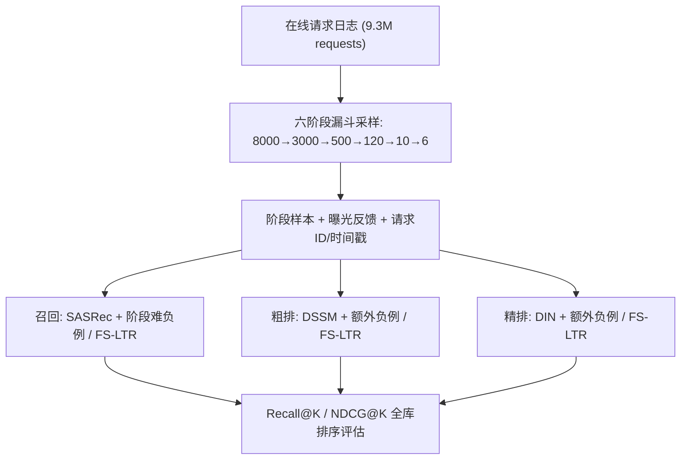

# RecFlow: An Industrial Full Flow Recommendation Dataset (工业全流程推荐数据集)

- **会议/期刊**: ICLR 2025 (Under Review)
- **作者与机构**: Qi Liu, Kai Zheng, Rui Huang, Wuchao Li, Kuo Cai, Yuan Chai, Yanan Niu, Yiqun Hui, Bing Han, Na Mou, Hongning Wang, Wentian Bao, Yunen Yu, Guorui Zhou, Han Li, Yang Song, Defu Lian, Kun Gai (USTC / Kuaishou / Tsinghua / Independent)
- **推荐链路定位**: 召回 / 粗排 / 精排（全链路六阶段：retrieval → pre-ranking → coarse ranking → ranking → re-ranking → edge ranking）
- **研究方向**: 去偏公平与工业架构 / 协同过滤与双塔召回
- **论文原文**: [https://arxiv.org/abs/2410.20868v1](https://arxiv.org/abs/2410.20868v1)
- **开源代码**: [https://github.com/RecFlow-ICLR/RecFlow](https://github.com/RecFlow-ICLR/RecFlow)

## TL;DR (1分钟核心速览)

现有推荐基准数据集只覆盖**曝光空间**，而工业系统实际打分的是**未曝光空间**（占候选池 89% 以上），导致离线训练与在线服务存在严重分布偏移；同时各阶段模型独立训练、忽视阶段间级联影响。本文发布 RecFlow——首个包含工业六阶段漏斗**逐阶段过滤样本**的全流程数据集（38M 曝光交互 + 1.9B 阶段样本，42K 用户、9M 物品、37 天、9.3M 请求）。在 SASRec/DSSM/DIN 上验证：阶段样本作难负例使召回 Recall@100 相对提升 24.7%–49.1%，FS-LTR 级联蒸馏进一步将 Recall@100 提升至 74.2%，且部分算法已上线取得稳定收益。

## Background & Motivation (背景与核心矛盾)

- **主流范式**: 工业推荐采用"召回→粗排→精排→重排"漏斗式多阶段流水线，各阶段模型独立训练、独立评估，训练数据几乎全部来自曝光空间（用户对已展示物品的正负反馈）。
- **前人局限**: ① **分布偏移**——粗排需对 3000 个候选打分，但每请求仅 6 个曝光样本可训练，训练空间（曝光）与服务空间（未曝光）严重错配；② **阶段割裂**——各阶段模型只优化自身目标，缺乏对后续阶段偏好的感知，导致"用户喜欢但被下游过滤"的低效召回。
- **核心洞察 (Key Insight)**: 漏斗中被各阶段过滤掉的视频，恰恰是"与正例相似但用户不感兴趣"的天然**难负例**；同时，阶段优先级（positive > exposure neg > rerank pos > rank pos > ... > random neg）隐含了后续阶段的偏好信号，可作为级联监督。
- **本文切入点**: 构建首个记录**每阶段过滤样本 + 阶段标签 + 多类反馈 + 请求 ID + 时间戳**的全流程数据集，使分布偏移建模与多阶段联合优化首次可在离线基准上系统研究。

## Method (核心方法设计)

### 1. 整体框架 (Overall Architecture)

RecFlow 并非提出新模型，而是提供**数据基础设施 + 三类探索性实验范式**。数据采集上，随机采样 42K 种子用户，记录 2024-01-13 至 02-18 共 37 天的全部推荐请求；对每个请求，除全部曝光样本外，按阶段分层采样过滤视频（pre-rank neg、coarse neg、rank pos/neg、rerank pos/neg），并保留 `realshow`、`rank index`、`rerank index`、播放时长及 7 类正反馈。实验层面，在召回（SASRec）、粗排（DSSM）、精排（DIN）三阶段分别验证两条主线：**(a) 阶段样本作难负例缓解分布偏移**；**(b) FS-LTR 级联损失蒸馏后续阶段偏好**。

### 2. 关键设计拆解 (Key Designs)

1. **阶段样本作难负例 (Stage Samples as Hard Negatives)**：痛点在于随机负例过易、无法刻画服务空间分布。做法是将每个正例配 200 个负例，用同数量的阶段过滤样本替换随机负例，BPR 损失不变：$\mathcal{L}_{\text{BPR}} = -\sum_{(u,i^+)\in\mathcal{D}}\sum_{j\in\mathcal{N}(u)}\log\sigma(\hat{s}_{ui^+}-\hat{s}_{uj})$，其中$\mathcal{N}(u)$ 混入阶段样本。直觉：被漏斗过滤的视频与正例共享高相似度但被判定为不感兴趣，梯度信号更聚焦决策边界。

2. **FS-LTR 级联偏好蒸馏 (Generalized Probability Ranking Principle)**：痛点在于各阶段只学用户偏好、不学下游偏好。做法是定义阶段优先级 $p_i$（positive:6, exposure neg:5, rerank pos:4, rank pos:4, rerank neg:3, rank neg:3, coarse neg:2, pre-rank neg:1, random neg:0），对同请求内所有"高优先级 vs 低优先级"样本对施加成对排序损失：
$$\mathcal{L}_{\text{FS-LTR}} = \sum_{i=1}^{N}\sum_{j\in\{k:\,p_k<p_i\}}\text{BPR}(o_i,o_j)$$
直觉：强制模型把"能通过下游筛选"的视频打分高于"被下游淘汰"的视频，从而在召回端就内化后续阶段的偏好，逼近 GPRP 理论最优。

3. **训练目标、负采样与推理效率**：召回用 BPR + 200 负例（含阶段难负例），粗排/精排用 BCE + 额外阶段负例（1 或 10 个/正例）；所有模型仅训练 **1 个 epoch**（与线上配置一致，且存在 one-epoch phenomenon），Adam 优化，embedding 维度 8，batch size 4096/1024。推理沿用双塔 + ANN，无额外在线开销；FS-LTR 仅在训练期引入成对损失，服务时零成本。

## Experimental Setup & Evaluation Protocol (实验设置与评估协议)

- **数据集与预处理**: 数据来自快手 feeds 场景，两阶段采集（1st period 采样 10 个/阶段，2nd period 扩至 40 个并保留后三阶段全量）：

| 数据集 | #Users | #Items | #Interactions | 稀疏度/密度 | 特征/场景说明 |
| :--- | :---: | :---: | :---: | :---: | :--- |
| RecFlow (1st) | 38,193 | 30.3M | 352M 阶段样本 / 24.5M 曝光 | 极稀疏 | 6 阶段采样，10/阶段 |
| RecFlow (2nd) | 35,073 | 55.7M | 1.57B 阶段样本 / 13.7M 曝光 | 极稀疏 | 后三阶段全量保留 |
| **合计** | **42,472** | **82.2M** | **1.92B 阶段 / 38.2M 曝光** | — | 89% 视频从未曝光 |

- **数据划分与防穿越 (Splitting Strategy)**: **全局时间戳切分**——前 36 天逐日训练（模拟线上 day-by-day 学习），最后 1 天评估，严格防穿越。
- **排名评测协议 (Ranking Protocol)**: 召回采用 **Full-Ranking 全库排序**（Recall@K / NDCG@K，K=100/500/1000）；粗排/精排除经典 AUC 外，新增基于阶段样本的 **Recall@K / NDCG@K**（候选集 = 下游阶段视频 + 本阶段过滤样本），更贴近在线服务空间。
- **对比基线与超参设置**: 召回 SASRec（1 头 1 层，50 历史，d=8）；粗排 DSSM（MLP [128,64,32]）；精排 DIN（MLP [128,128,32,1]）。所有结果 5 次运行取均值 ± 标准差，采用 **paired t-test @ 5% 显著性**。

## Key Experimental Results (实验关键数据)

### 1. 主实验对比 (Main Results)

**召回阶段（SASRec，Full-Ranking，%）**：

| 方法 | R@100 | N@100 | R@500 | N@500 | R@1000 | N@1000 |
| :--- | :---: | :---: | :---: | :---: | :---: | :---: |
| Baseline (随机负例) | 0.461 | 0.099 | 1.593 | 0.241 | 2.685 | 0.356 |
| + Prerank neg (难负例) | 0.575 | 0.127 | 1.883 | 0.291 | 2.931 | 0.401 |
| + Rerank pos (难负例) | **0.687** | **0.144** | 1.889 | **0.295** | 2.892 | 0.401 |
| + Exposure neg (难负例) | 0.603 | 0.137 | 1.860 | **0.295** | **2.902** | **0.405** |
| + Prerank neg (FS-LTR) | 0.677 | 0.167 | 2.268 | 0.367 | 3.446 | 0.492 |
| + Rerank pos (FS-LTR) | **0.795** | 0.176 | 2.263 | 0.361 | 3.394 | 0.480 |
| **FS-LTR (全阶段)** | **0.803** | **0.215** | **2.466** | **0.425** | **3.606** | **0.545** |
| **Improv.% (vs Baseline)** | **+74.2%** | **+117.2%** | **+54.8%** | **+76.3%** | **+34.3%** | **+53.1%** |

**粗排阶段（DSSM，%）**：

| 方法 | AUC | LogLoss | R@100 | N@100 | R@200 | N@200 |
| :--- | :---: | :---: | :---: | :---: | :---: | :---: |
| Baseline | **0.718** | **0.592** | 0.271 | 0.059 | 0.535 | 0.096 |
| + Rank neg ×10 | 0.618 | 0.825 | 0.454 | 0.102 | 0.726 | 0.140 |
| + All 阶段 neg ×10 | 0.563 | 1.243 | 0.455 | 0.105 | 0.728 | 0.144 |
| PositiveRank | 0.554 | 1.040 | 0.457 | 0.112 | 0.723 | 0.149 |
| **FS-LTR** | 0.473 | 1.253 | **0.475** | **0.119** | **0.734** | **0.155** |
| **Improv.% (FS-LTR)** | -34.1% | — | **+75.3%** | **+101.7%** | **+37.2%** | **+61.5%** |

**精排阶段（DIN，%）**：

| 方法 | AUC | R@50 | N@50 | R@100 | N@100 |
| :--- | :---: | :---: | :---: | :---: | :---: |
| Baseline | **0.727** | 0.169 | 0.045 | 0.319 | 0.069 |
| + Rank neg ×10 | 0.645 | 0.264 | 0.074 | 0.454 | 0.105 |
| + All 阶段 neg ×10 | 0.602 | 0.278 | 0.078 | 0.467 | 0.108 |
| PositiveRank | 0.564 | 0.309 | 0.093 | 0.506 | 0.125 |
| **FS-LTR** | 0.461 | **0.323** | **0.098** | **0.525** | **0.131** |
| **Improv.% (FS-LTR)** | -36.6% | **+91.1%** | **+117.8%** | **+64.6%** | **+89.9%** |

### 2. 消融实验 (Ablation Study)

以召回阶段 FS-LTR 为例（逐步引入阶段样本，%）：

| 配置 | R@100 | N@100 | R@1000 | N@1000 |
| :--- | :---: | :---: | :---: | :---: |
| Baseline（纯随机负例） | 0.461 | 0.099 | 2.685 | 0.356 |
| w/o 阶段样本（仅 BPR） | 0.461 | 0.099 | 2.685 | 0.356 |
| w/ 单阶段难负例（Prerank neg） | 0.575 | 0.127 | 2.931 | 0.401 |
| w/ 单阶段 FS-LTR（Prerank neg） | 0.677 | 0.167 | 3.446 | 0.492 |
| w/ 全阶段 FS-LTR | **0.803** | **0.215** | **3.606** | **0.545** |

粗排/精排消融（额外负例数量与类型）：

| 配置 | 粗排 R@100 | 精排 R@100 |
| :--- | :---: | :---: |
| Baseline | 0.271 | 0.319 |
| + Rank neg ×1 | 0.353 | 0.223 |
| + Rank neg ×10 | 0.454 | 0.264 |
| + All 阶段 ×10 | 0.455 | 0.278 |
| + FS-LTR | **0.475** | **0.323** |

### 3. 关键实验发现 (Key Findings)

1. **阶段样本是高质量难负例，且 K 越小收益越大**：召回中加 1 个 prerank neg，Recall@100/500/1000 相对提升 24.7%/18.2%/9.2%，NDCG@100 提升 28.3%——说明阶段样本精准压缩了 top 排序的决策边界，而非泛化性提升。
2. **FS-LTR 显著优于纯难负例挖掘**：相同负例设置下，FS-LTR 将 Recall@100 从 0.575 推至 0.677（prerank neg），全阶段版达 0.803（+74.2%），证明"学习下游偏好"比"仅把下游样本当负例"信息利用更充分。
3. **AUC 与 Recall@K 出现方向性背离**：粗排/精排加入阶段负例后 AUC 从 0.718 降至 0.473，但 Recall@K 大幅上升——经典 AUC 在曝光空间评估，与在线服务空间不一致，**阶段样本支撑的 Recall@K 才是更可信的离线指标**，这本身即是对现有评测协议的重要修正。

## Highlights & Limitations (亮点、对比与审稿批判)

- **与代表作对比 (vs. Prior Work)**: 相比 MovieLens/Amazon/Taobao/Tenrec 等仅含曝光反馈的数据集，RecFlow 首次记录**逐阶段过滤样本与阶段标签**；相比 KuaiRec（全观测曝光）、KuaiRand（随机曝光去偏），RecFlow 的独特性在于**服务空间覆盖**与**多阶段级联结构**，使分布偏移与多阶段一致性首次可离线量化。
- **可迁移亮点**: ① "阶段过滤样本 = 天然难负例"可直接迁移至任何有漏斗结构的工业召回/粗排系统，无需额外标注；② 阶段优先级构造的成对损失是一种**零推理开销的级联蒸馏**，可推广至多任务/多场景联合建模。
- **审稿级局限批判**: ① 仅单一短视频场景、缺乏多模态特征，无法支撑跨域/多模态推荐研究；② 1.9B 样本带来极高存储与算力门槛，且阶段样本为分层采样（非全量），可能引入采样偏差；③ 实验仅用 SASRec/DSSM/DIN 三类基础模型、单 epoch 训练，未与更先进的多阶段联合优化方法（如全链路端到端）对比，结论泛化性待验证。

## Rating (四维评分)

- **方法创新性 (Novelty)**: ⭐⭐⭐⭐ （数据集本身为首创，FS-LTR 级联蒸馏有 GPRP 理论支撑，但方法层面多为已有技术的系统性验证）
- **评估协议与实验扎实度 (Protocol & Experiments)**: ⭐⭐⭐⭐ （Full-Ranking + 阶段 Recall@K 双协议、5 次运行 + paired t-test、三阶段全覆盖，但基线模型偏基础）
- **写作与数学规范度 (Clarity & Rigor)**: ⭐⭐⭐⭐ （数据采集流程、特征字段、优先级定义清晰，公式简洁；部分实验细节置于附录，正文略简）
- **工业落地与复现价值 (Industrial & Practical Value)**: ⭐⭐⭐⭐⭐ （真实工业日志、代码开源、部分算法已上线并稳定收益，对工业界直接可用性极高）

