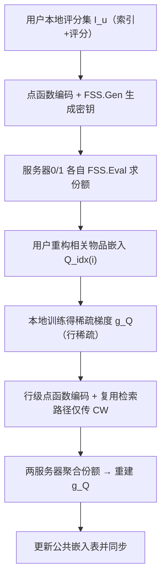

# SecEmb: Sparsity-Aware Secure Federated Learning of On-Device Recommender System with Large Embedding (面向大嵌入表端侧推荐系统的稀疏感知安全联邦学习)

- **会议/期刊**: ICML 2025
- **作者与机构**: Peihua Mai, Youlong Ding, Ziyan Lyu, Minxin Du, Yan Pang（NUS / 希伯来大学 / NUS 重庆研究院 / 香港理工大学）
- **推荐链路定位**: 端侧训练（联邦召回/嵌入层训练）
- **研究方向**: 去偏公平、可信隐私与工业架构 / 协同过滤
- **论文原文**: [https://arxiv.org/abs/2505.12453v2](https://arxiv.org/abs/2505.12453v2)
- **开源代码**: [https://github.com/NusIoraPrivacy/SecEmb](https://github.com/NusIoraPrivacy/SecEmb)

## TL;DR (1分钟核心速览)

联邦推荐（FedRec）中，物品嵌入表随物品数 $m$线性膨胀，而用户实际只评分极少数物品，更新矩阵$g_Q$ 高度行稀疏。现有稀疏聚合协议（SecAggMask、TopkSecAgg）为省通信必然泄露非零坐标——在推荐场景中即"用户评过哪些物品"，属直接隐私泄露。SecEmb 用 FSS 点函数把"评分物品索引 + 梯度值"整体编码为两服务器秘密份额，实现**无损**的稀疏安全聚合：上传/下载通信较最省通信的 SecAgg 降 4–90x，端侧密钥生成时间降最多 70x，且 RMSE 优于 Bit8Quant/SVD/CoLR 等有损压缩 1.3%–2.0%。

## Background & Motivation (背景与核心矛盾)

- **主流范式**: FedRec 让用户在本地训练、上传梯度，配合 SecAgg（两服务器加法秘密共享 ASS 为最省通信方案）隐藏个体更新；但协议要求传输**完整模型与完整更新**，复杂度 $O(md)$。
- **前人局限**: (1) 通用 SecAgg 的通信/计算随物品数线性增长，端侧带宽与算力无法承受；(2) 稀疏聚合方案（SecAggMask 传非零并集+掩码、TopkSecAgg 传非零坐标集）虽省通信，却把非零坐标暴露给服务器，服务器可将候选评分物品缩至极小集合，SecAggMask 甚至泄露明文梯度值。
- **核心洞察 (Key Insight)**: 推荐系统的信息过载本质决定了 $m'_u \ll m$（ML10M 上近 90% 用户仅评过 ≤300 个物品，物品数 27,278），且物品嵌入占 DeepFM 总参数绝大部分——因此只需优化嵌入层载荷，且"索引保密"与"稀疏高效"并非不可兼得。
- **本文切入点**: 用 FSS 点函数 $f_{\alpha,\beta}(x)=\beta\cdot\mathbb{I}[x=\alpha]$把"某用户对某物品的更新"编码成函数，两非合谋服务器各持一把密钥、各自求值得到加法份额，从而在不暴露$\alpha$（物品索引）与$\beta$（梯度值）的前提下完成检索与聚合。

## Method (核心方法设计)

### 1. 整体框架 (Overall Architecture)

SecEmb 由两个共享同一索引路径的模块构成。**隐私保护嵌入检索**：用户对每个评分物品 $i$构造点函数并 FSS 生成密钥$(\text{reK}^0_{u,i},\text{reK}^1_{u,i})$分发给服务器 0/1；服务器$s$计算$v^s_{u,i}=\sum_j \text{FSS.Eval}(\text{reK}^s_{u,i},j)\cdot Q_j$，用户求和$Q_{\text{idx}(i)}=v^0_{u,i}+v^1_{u,i}$只取回相关嵌入。**安全更新聚合**：用户本地算梯度后，把稀疏行编码为点函数、仅上传"转换修正字"$CW$，服务器复用检索阶段的二叉树路径求值并聚合份额，服务器 0 收齐后重建$g_Q$ 更新公共模型。全流程服务器仅见聚合结果。

### 2. 关键设计拆解 (Key Designs)

1. **基于 FSS 点函数的隐私检索与聚合（索引即秘密）**：痛点是任何"传坐标"的方案都泄露评分物品。本文将每个非零行编码为向量值点函数 $f_{u,i}(x)=g^u_{Q_i}\in\mathbb{R}^d$（当$x=\text{idx}(i)$，否则$\mathbf{0}$），服务器只能对全域$j\in\mathcal{I}$盲求值：$v^s_{Q_j}=\sum_u\sum_{i\in[m']}\text{FSS.Eval}(\text{agK}^s_{u,i},j)$。由于 FSS 安全性保证单把密钥不泄露函数描述，服务器既不知$\text{idx}(i)$也不知$g^u_{Q_i}$，却仍能精确重建$\sum_u g^u_Q$——这是"无损 + 安全 + 稀疏"三者兼容的关键。

2. **行级编码与跨阶段路径复用（两级载荷压缩）**：初始构造对每个元素生成密钥，需 $m'd$把密钥；行级编码把整行$d$维打包进一个点函数，密钥数降为$m'$。进一步观察到 FSS 密钥结构为$s^0_b\|t^0_b\|CW_1\|\cdots\|CW_{n+1}$，前$n$个修正字仅由索引决定，而检索与聚合阶段索引完全相同——故聚合阶段只需上传末位$CW_{n+1}$，服务器复用检索阶段已算出的$(t^{(n)},s^{(n)})$做$\text{FSS.ConvertEval}$。单用户上传从$m'(bd+\lambda\log m)$降至$m'(\lambda\log m+bd)$量级中"每行仅一个群元素"，且省去$n$ 次 AES 伪随机展开。

3. **训练目标、隐私增强与推理开销**：损失仍为常规 MSE + 正则，创新在协议层。为隐藏评分数量 $m'_u$，服务器先用廉价 SecAgg 统计均值并取统一$m'=\alpha\cdot\frac{1}{n}\sum_u m'_u$，用户对索引集与梯度矩阵做填充/截断（填充项为零梯度，不改变聚合正确性）。协议可与 DP 叠加：用户逐样本裁剪后秘密共享，各服务器独立加高斯噪声$\sigma=\sqrt{\ln(1.25/\delta)}\cdot\Delta_2/\epsilon$，得到 record-level$(\epsilon,\delta)$-DP。安全性归约为 Theorem 4.1：存在 PPT 模拟器使$\text{Real}^{\mathcal{C}}_{\lambda,\text{agg}}\equiv\text{Sim}^{\mathcal{C}}_{\lambda,\text{agg}}(1^\lambda,(m',G_1,\dots,G_{m'},g_\theta,g_Q))$，即合谋方（一服务器 + 任意用户子集）除聚合结果外一无所获。

## Experimental Setup & Evaluation Protocol (实验设置与评估协议)

- **数据集与预处理**: 五个公开数据集，用户/物品特征二值编码（ML100K/1M 用 genre+gender+age+occupation，ML10M/25M 用 genre，Yelp 用 restaurant state）：

| 数据集 | #Users | #Items | #Interactions | 密度 | 特征/场景说明 |
| :--- | :---: | :---: | :---: | :---: | :--- |
| ML100K | 943 | 1,682 | 100,000 | 6.30% | 用户 84 维 / 物品 19 维 |
| ML1M | 6,040 | 3,883 | 1,000,209 | 4.26% | 用户 30 维 / 物品 18 维 |
| ML10M | 69,878 | 10,681 | 10,000,054 | 1.34% | 物品 20 维 |
| ML25M | 162,541 | 62,423 | 25,000,095 | 0.25% | 物品 20 维 |
| Yelp | 10,000 | 93,386 | 1,007,956 | 0.11% | 按评分数降序采样的 top 用户子集 |

- **数据划分与防穿越**: 每数据集按 **80% 训练 / 20% 测试** 比例划分；每用户为一个 client，每轮随机选 100 个 client，训练 200 epoch，Adam 优化，损失为 MSE + 正则。
- **排名评测协议**: 本文为评分预测任务，主指标为 **RMSE**（四次实验均值 ± 标准差）；序列推荐扩展实验用 **HR@10 / NDCG@10**。效率指标为单轮每用户上传/下载通信量（MB）与密钥生成时间（ms），安全参数 $\lambda=128$。
- **对比基线与超参设置**: 模型侧 MF / NCF / FM / DeepFM（嵌入维度 $d\in\{16,20,24,64\}$）；协议侧对比 Secure FedRec（全模型下载 + 两服务器 ASS）、SecAggMask、TopkSecAgg，以及有损压缩 Bit8Quant、TernQuant、SVD、CoLR（仅作用于物品嵌入，rank 见表 10）。统一$m'$ 在五个数据集上分别取 200/300/300/500/500。

## Key Experimental Results (实验关键数据)

### 1. 主实验对比 (Main Results)

上传通信（MB/用户/轮，Red. Ratio = SecFedRec / SecEmb）：

| 模型 | 方案 | ML100K | ML1M | ML10M | ML25M | Yelp |
| :--- | :--- | :---: | :---: | :---: | :---: | :---: |
| MF | SecFedRec | 0.86 | 1.99 | 5.47 | 31.96 | 47.81 |
| MF | **SecEmb** | **0.17** | **0.27** | **0.28** | **0.51** | **0.52** |
| MF | Red. Ratio | 4.99 | 7.35 | 19.22 | 62.07 | **91.22** |
| NCF | SecFedRec | 0.44 | 1.00 | 4.11 | 23.98 | 29.89 |
| NCF | **SecEmb** | **0.13** | **0.20** | **0.26** | **0.46** | **0.44** |
| NCF | Red. Ratio | 3.44 | 5.02 | 15.93 | 51.80 | 68.46 |
| DeepFM | SecFedRec | 14.95 | 8.84 | 8.63 | 35.13 | 50.45 |
| DeepFM | **SecEmb** | **14.22** | **7.10** | **3.45** | **3.68** | **3.16** |
| DeepFM | Red. Ratio | 1.05 | 1.24 | 2.50 | 9.54 | 15.98 |

效用对比（RMSE 越低越好，R.R. 为上传压缩比）：

| 模型/数据集 | Bit8Quant | TernQuant | SVD | CoLR | **SecEmb** |
| :--- | :---: | :---: | :---: | :---: | :---: |
| MF / ML1M | 0.914 (4.00) | 0.916 (8.00) | 0.917 (6.39) | 0.916 (6.50) | **0.903 (7.35)** |
| MF / ML25M | 0.870 (4.00) | 0.874 (8.00) | 0.873 (16.23) | 0.873 (16.25) | **0.864 (62.07)** |
| NCF / ML25M | 0.820 (3.99) | 0.825 (7.97) | 0.824 (12.17) | 0.839 (12.18) | **0.786 (51.80)** |
| FM / ML25M | 0.836 (4.00) | 0.850 (7.98) | 0.856 (16.16) | 0.851 (16.17) | **0.789 (60.87)** |
| DeepFM / Yelp | 1.012 (3.47) | 1.018 (5.88) | 1.014 (9.09) | 1.017 (9.10) | **1.011 (15.98)** |

序列推荐扩展（Amazon，9.27M 物品，密度 <0.002‰）：Caser 上 SecEmb 达 HR@10 = 0.629、NDCG@10 = 0.483，上传压缩比 **2549×**；SASRec 上 HR@10 = 0.639、压缩比 2342×，均优于全部有损压缩基线。

### 2. 消融实验 (Ablation Study)

MF 模型下逐级移除优化（上传通信 MB / 计算 ms）：

| 变体 | ML100K | ML1M | ML10M | ML25M | Yelp |
| :--- | :---: | :---: | :---: | :---: | :---: |
| SecEmb-Init（逐元素编码） | 4.56 / 5.34 | 7.60 / 15.35 | 8.51 / 22.56 | 16.83 / 28.53 | 17.43 / 26.43 |
| SecEmb-RowEnc（+行级编码） | 0.28 / 0.37 | 0.43 / 0.90 | 0.45 / 0.91 | 0.78 / 1.34 | 0.79 / 1.47 |
| **SecEmb（+路径复用）** | **0.17 / 0.31** | **0.27 / 0.47** | **0.28 / 0.47** | **0.51 / 0.72** | **0.52 / 0.74** |

### 3. 关键实验发现 (Key Findings)

1. **收益随物品规模单调放大，正是大嵌入表的对症解**：MF 上压缩比从 ML100K 的 4.99× 升至 Yelp 的 91.22×，计算时间降幅在 Yelp 上近 70×；而 DeepFM 在物品数 <4k 时仅 1.05×，说明收益完全由"稀疏更新占比"驱动，稠密参数（DeepFM 的 176 万维稠密更新）会稀释协议优势。
2. **无损性带来实打实的效用优势**：SecEmb 在 5 个数据集 × 4 个模型上 RMSE 全部不劣于有损压缩，平均领先 Bit8Quant 1.29%、TernQuant 1.74%、SVD 1.95%、CoLR 2.04%；在 NCF/ML25M 上 SecEmb 的 0.786 比 CoLR 的 0.839 低 6.3%，同时压缩比还高 4.3 倍——"压缩率换精度"的权衡被打破。
3. **两项优化各自贡献明确且互补**：行级编码把上传从 4.56MB 砍到 0.28MB（ML100K，约 16×），路径复用再降约 36%（0.28→0.17MB）并把计算从 0.37ms 压到 0.31ms；初始构造在物品数 <11k 的数据集上甚至比 Secure FedRec 更贵，说明"仅靠 FSS 不够，必须叠加结构冗余消除"。

## Highlights & Limitations (亮点、对比与审稿批判)

- **与代表作对比 (vs. Prior Work)**: 与 SecAggMask / TopkSecAgg 的本质区别是**索引保密**——后两者传非零并集或坐标集，服务器可把候选评分物品缩至极小集合，SecAggMask 还泄露明文梯度；与 Bit8Quant / SVD / CoLR 的区别是**无损**，后者以 1.3%–2.0% 的 RMSE 代价换取 4–16× 压缩，而 SecEmb 在 60–90× 压缩下精度反升；与 FedMF（同态加密）相比，避免了每轮重加密的巨额算力。
- **可迁移亮点**: (1) "检索阶段与聚合阶段共享同一索引路径"的密钥复用思路，可迁移到任何需要两阶段访问同一稀疏坐标的安全计算协议；(2) 用统一 $m'$ 填充/截断来隐藏集合基数，是低成本抗流量分析的通用技巧。
- **审稿级局限批判**: (1) 依赖**两服务器非合谋**这一强假设，单服务器部署场景失效，且未给出合谋概率下的泄露量化；(2) 收益强依赖稀疏度，DeepFM 类稠密参数主导的模型仅 1.05–2.5× 提升，且 $m'$ 需服务器预先统计、对长尾极端用户（评分数远超均值）会截断真实梯度，论文未量化该截断的效用损失。

## Rating (四维评分)

- **方法创新性 (Novelty)**: ⭐⭐⭐⭐ （首次把 FSS 点函数用于 FedRec 的"索引+值"双重保密稀疏聚合，行级编码与跨阶段路径复用是有洞察的工程-密码学协同设计）
- **评估协议与实验扎实度 (Protocol & Experiments)**: ⭐⭐⭐⭐ （5 数据集 × 4 模型 × 4 轮标准差，效率/效用/消融/序列扩展/DP 全覆盖，但缺少真实网络环境与端到端 wall-clock 时延）
- **写作与数学规范度 (Clarity & Rigor)**: ⭐⭐⭐⭐ （复杂度表与 Theorem 4.1 的模拟器归约严谨，FSS 算法伪代码完整；正文与附录符号略有重复，$m'$ 截断的效用分析偏薄）
- **工业落地与复现价值 (Industrial & Practical Value)**: ⭐⭐⭐⭐ （代码已开源，通信降 90×、内存降最多 214× 对端侧极友好；但需部署双服务器基础设施，且与现有单服务器 FedRec 架构不兼容）

