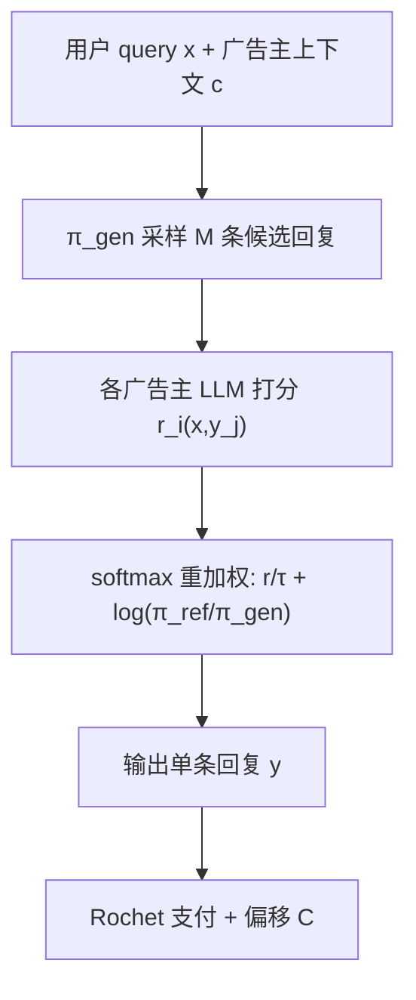

# Truthful Aggregation of LLMs with an Application to Online Advertising (LLM 真实偏好聚合及其在线广告应用)

- **会议/期刊**: arXiv (cs.GT)，2025 年 v5
- **作者与机构**: Ermis Soumalias, Michael J. Curry, Sven Seuken（University of Zurich / ETH AI Center / Harvard）
- **推荐链路定位**: 端到端生成式（LLM 输出后处理 + 拍卖计费）
- **研究方向**: 去偏公平与工业架构 / 生成式推荐
- **论文原文**: [https://arxiv.org/abs/2405.05905v5](https://arxiv.org/abs/2405.05905v5)
- **开源代码**: 暂未开源

## TL;DR (1分钟核心速览)

LLM 生成内容中的广告位需要同时满足用户有用性与广告主价值，但广告主有谎报偏好（虚报自家 LLM 奖励）的动机，且逐 token 拍卖存在曝光问题与不可微性。MOSAIC 把"从参考 LLM 分布向广告主奖励偏移"建模为 RLHF 式 KL 正则目标，用 M 条候选回复的重要性采样重加权逼近最优分布，再配以 Rochet 循环单调性支付保证真实报价是占优策略。在 Llama-2-7b 上，仅 20 条候选回复即逼近最优分布，上下文感知版本 4 条候选即超过基线 20 条的效果，且计算开销仅相当于 5 次 LLM 查询。

## Background & Motivation (背景与核心矛盾)

- **主流范式**: 广告拍卖（VCG、位置拍卖）假设物品/广告位可枚举、估值非负且可自由处置；LLM 广告则要求对"一段生成文本"定价。
- **前人局限**: Dütting et al. (2024) 的逐 token 序列拍卖存在三大硬伤——(i) 曝光问题：广告主为前若干 token 付费，却可能因后续一个 "not" 而语义反转；(ii) 若放开"不可谎报 LLM"假设则机制可被操纵；(iii) 花费随序列长度线性增长。而 VCG 要求精确求解最优分配，在 LLM 输出空间上不可解，次优解下真实性保证失效。
- **核心洞察 (Key Insight)**: 平台目标（式 1）与 RLHF 目标同构，其闭式最优解 $\pi^*_r(y|x)\propto\pi_{\text{ref}}(y|x)\exp\!\big(\tfrac{1}{\tau}\sum_i r_i(x,y)\big)$已知；因此无需微调权重，只需对候选回复做**重要性采样重加权**即可在$M\to\infty$ 时收敛到该最优分布。
- **本文切入点**: 把"分配规则 = 对候选集做 softmax 重加权"这一算子与 Rochet 支付配对，使机制在**未收敛时也保持策略防伪**。

## Method (核心方法设计)

### 1. 整体框架 (Overall Architecture)

给定用户 query $x$，平台先用一个可控的生成器$\pi_{\text{gen}}$（基线版取$\pi_{\text{ref}}$，上下文感知版取注入广告主描述的$\pi_{\text{con}}$）采样$M$条候选回复；再向各广告主 LLM 以 API 方式查询其对每条候选的奖励$r_i(x,y_j)$（由 DPO 映射$r_i=\tau_i\log\frac{\pi_i}{\pi_{\text{ref}}}$ 得到，无需权重）；随后按"奖励/温度 + 参考-生成似然比"做 softmax 重采样输出一条回复；最后按 Rochet 支付（含偏移项）计费。全流程仅需前向推理，可完全并行。

### 2. 关键设计拆解 (Key Designs)

1. **重要性采样分配规则（收敛性保证）**：若直接从 $\pi_{\text{ref}}$ 采样，含品牌名的回复概率极低，候选集几乎全是低奖励样本。MOSAIC 改为对候选集做
$$\pi_{r,M}(y_j|x)=\mathrm{softmax}_j\!\Big(\tfrac{r(x,y_j)}{\tau}+\log\tfrac{\pi_{\text{ref}}(y_j|x)}{\pi_{\text{gen}}(y_j|x)}\Big)$$
其中似然比项正是重要性权重，抵消了提议分布 $\pi_{\text{gen}}$的偏置。由大数定律可得$\lim_{M\to\infty}\pi_{r,M}=\pi^*_r$，且估计方差$\mathrm{Var}\propto\frac{1}{M}\sum_y \pi^{*4}_r/\pi_{\text{gen}}$——**提议分布越接近目标，方差越小、收敛越快**，这正是引入上下文感知生成器的理论依据。

2. **循环单调性支付与效用偏移（策略防伪 + 社会福利对齐）**：分配规则是凸函数 $U_i=\tau\log\sum_j\exp\big(\tfrac{r_i+\sum_{k\ne i}\hat r_k}{\tau}+\log\tfrac{\pi_{\text{ref}}}{\pi_{\text{gen}}}\big)+C$的梯度（LogSumExp 凸性），满足循环单调性，故 Rochet 支付使真实报价成为占优策略——**关键优势在于即使$M$有限、分配未收敛，防伪性依然成立**（VCG 不具备）。再取偏移$C=-\tilde U_i(0,\hat r_{-i})$，得到
$$U_i=\tau\log\Big(\sum_{j}\exp\big(\tfrac{r_i(x,y_j)}{\tau}\big)\pi_{\hat r_{-i}}(y_j|x)\Big)$$
即"给多少得多少"：效用与自身对福利的贡献单调对齐，抑制不相关广告主搭便车；同时保证零贡献者零效用、全正奖励者正效用（"almost IR"）。

3. **训练目标、负采样与推理效率**：无训练、无负采样。总前向次数为 $M\cdot(L+n+1)$（$L$为序列长度），对比 Dütting 逐 token 机制的$L\cdot n$；实测$M=20$ 即收敛，总算力约等于 5 次 LLM 查询，且候选生成与评估可并行，用户感知延迟等同单次查询。

## Experimental Setup & Evaluation Protocol (实验设置与评估协议)

- **数据集与预处理**: 合成实例，50 条用户 query × 25 个随机种子 = 1,250 次运行；每条 query 配 2 个广告主（另在附录扩展到 5/10 个广告主）。参考模型 Llama-2-7b-chat-hf，附录用 flan-t5-large 复现。

| 数据集 | #Queries | #Advertisers | #Runs | 采样设置 | 说明 |
| :--- | :---: | :---: | :---: | :---: | :--- |
| 合成广告实例 | 50 | 2（扩展 5/10） | 1,250 | temp=0.8, top-p=0.95 | 广告主 LLM = 参考 LLM + 广告指令 |

- **数据划分与防穿越 (Splitting Strategy)**: 无训练过程，不涉及划分；所有评估均为对同一 query 的多次随机采样平均（含 95% 置信区间）。
- **排名评测协议 (Ranking Protocol)**: 非检索式排序。核心指标为**返回回复相对最优分布 $\pi^*_r$的对数概率**（闭式可算但不可采样，故以"从$\pi_{\text{ref}}$ 单次采样"作为代理上界）、广告主归一化奖励增益、平台收入、广告主效用-奖励皮尔逊相关。
- **对比基线与超参设置**: 由于文献中无第二个可聚合多广告主 LLM 的机制（Dütting 机制不防伪且不收敛，VCG 不适用），基线为 **naive MOSAIC（$\pi_{\text{gen}}=\pi_{\text{ref}}$）**；$\tau=1$。

## Key Experimental Results (实验关键数据)

### 1. 主实验对比 (Main Results)

| 方法 | 候选数 $M$ | 回复对数概率（越高越好） | 广告主归一化奖励增益 | 平台收入 | 备注 |
| :--- | :---: | :---: | :---: | :---: | :--- |
| 单次采样 $\pi^*$ 代理上界 | 1 | ≈ -100 | — | — | 理论上界参考 |
| MOSAIC 基线 ($\pi_{\text{ref}}$) | 20 | ≈ -140 | ≈ 0 或略降 | 低 | 收敛慢 |
| **MOSAIC 上下文感知 ($\pi_{\text{con}}$)** | **4** | **优于基线 20 条** | 显著正增益 | 中 | 4 条即超基线 20 条 |
| **MOSAIC 上下文感知 ($\pi_{\text{con}}$)** | **20** | **≈ -100（逼近上界）** | **最高（Improv. 显著）** | **最高** | 近乎匹配最优分布 |

### 2. 消融实验 (Ablation Study)

| 配置 | 对数概率收敛 | 广告主效用 | 效用-奖励相关性 (Pearson) |
| :--- | :---: | :---: | :---: |
| w/o 上下文（$\pi_{\text{ref}}$ 生成） | 慢 | 近零/负 | — |
| w/ 上下文（$\pi_{\text{con}}$ 生成） | 快（4 条≈基线 20 条） | 显著正 | — |
| w/o 支付偏移（标准 Rochet） | 同 | 较低 | 0.4 |
| **w/ 支付偏移** | 同 | **更高** | **0.8** |

### 3. 关键实验发现 (Key Findings)

1. **上下文是收敛加速器而非锦上添花**：上下文感知版用 4 条候选达到的对数概率即超过基线 20 条，20 条时几乎匹配"从最优分布单次采样"的代理上界；而基线在可行算力内广告主奖励甚至略有下降——因为更多候选只提升了参考 LLM 的边际奖励，反而稀释了广告主收益。
2. **支付偏移把"防伪"升级为"激励相容 + 公平"**：加入偏移后广告主效用与福利贡献的皮尔逊相关从 0.4 升至 0.8，且上下文版下广告主期望效用为正（ex-ante IR 成立），平台同时把广告主剩余的大部分转化为收入。
3. **算力可控**：$M=20$ 时总开销约等于 5 次 LLM 查询，且完全可并行；扩展到 5/10 个广告主时所需候选数不变，说明机制对广告主数量不敏感。

## Highlights & Limitations (亮点、对比与审稿批判)

- **与代表作对比 (vs. Prior Work)**: 相比 Dütting et al. 的逐 token 拍卖，MOSAIC 以"整段回复"为分配单元，彻底规避曝光问题与长度线性计费，且在允许谎报 LLM 的前提下仍防伪；相比 VCG，它不要求分配规则精确最优，因而在有限 $M$ 下仍保持策略防伪；相比 Dubey/Hajiaghayi 的标量报价或 RAG 插槽拍卖，MOSAIC 允许聚合**完整可谎报的 LLM**。
- **可迁移亮点**: (i) "闭式最优分布 + 重要性采样重加权"这一免微调对齐范式，可直接迁移到多利益方（如多商家、多内容方）的生成式推荐输出融合；(ii) 用凸性/循环单调性为不可微的采样型分配规则配支付，是生成式推荐商业化计费的通用模板。
- **审稿级局限批判**: (i) 实验完全基于合成 query 与"参考 LLM + 指令"构造的广告主 LLM，缺乏真实广告主数据与线上 A/B，奖励函数与真实商业价值的映射未验证；(ii) 每 query 需 $M$次生成 +$n$次打分，虽可并行但总算力随广告主数线性增长，且$M$的自适应估计（按 query 决定候选数）被作者列为未来工作，$\tau$ 的标定也缺少系统性敏感性分析。

## Rating (四维评分)

- **方法创新性 (Novelty)**: ⭐⭐⭐⭐⭐ （把 RLHF 闭式解与 Rochet 循环单调性支付嫁接，首次给出"未收敛仍防伪 + 可证明收敛"的 LLM 拍卖机制）
- **评估协议与实验扎实度 (Protocol & Experiments)**: ⭐⭐⭐ （1,250 次运行含置信区间、双模型复现较严谨，但全为合成实例、无真实数据与线上验证）
- **写作与数学规范度 (Clarity & Rigor)**: ⭐⭐⭐⭐⭐ （收敛性、方差、TV 距离、IR 不可能性与 almost-IR 均有完整证明，符号体系清晰）
- **工业落地与复现价值 (Industrial & Practical Value)**: ⭐⭐⭐⭐ （仅需 API 前向、可并行、5 倍查询开销，工程友好；但无开源代码，且依赖广告主诚实提供 LLM 接口）

