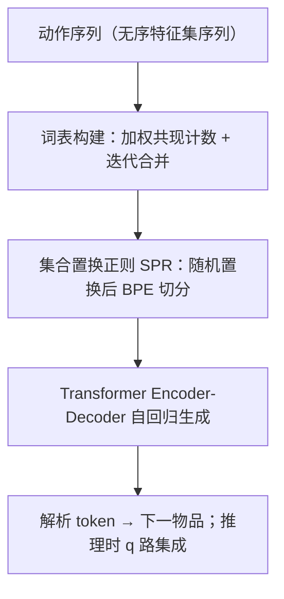
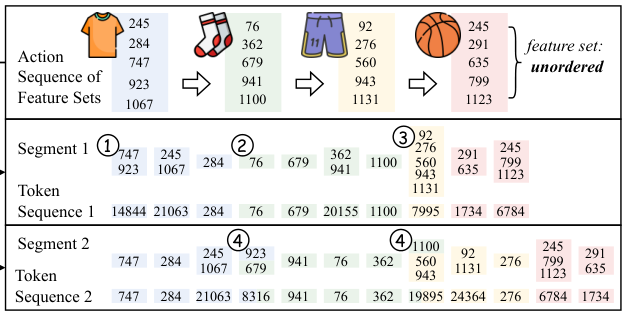

# ActionPiece: Contextually Tokenizing Action Sequences for Generative Recommendation (面向生成式推荐的上下文感知动作序列分词)

- **会议/期刊**: ICML 2025 (Spotlight)
- **作者与机构**: Yupeng Hou, Jianmo Ni, Zhankui He, Noveen Sachdeva, Wang-Cheng Kang, Ed H. Chi, Julian McAuley, Derek Zhiyuan Cheng (UCSD & Google DeepMind)
- **推荐链路定位**: 端到端生成式（分词层 + 自回归生成）
- **研究方向**: 生成式推荐与离散语义 ID / 序列推荐
- **论文原文**: [https://arxiv.org/abs/2502.13581v3](https://arxiv.org/abs/2502.13581v3)
- **开源代码**: [https://github.com/google-deepmind/action_piece](https://github.com/google-deepmind/action_piece)

## TL;DR (1分钟核心速览)

现有生成式推荐（GR）的分词器对每个动作**独立**编码，同一物品在所有序列中恒得同一组固定 token，完全丢失上下文语义。ActionPiece 把动作建模为**无序特征集序列**，借鉴 BPE 的 bottom-up 合并思想，但把合并对象从"相邻字节对"推广为"集合内 / 相邻集合间"的加权共现特征对，并引入**集合置换正则 (SPR)** 生成同语义的多种分词。在 Amazon 三域 Leave-Last-Out + Full-Ranking 协议下，NDCG@10 相对最强基线 SPM-SID 提升 **6.00%–12.82%**。

## Background & Motivation (背景与核心矛盾)

- **主流范式**: GR 先用分词器把物品/动作映射为紧凑词表中的离散 token（RQ-VAE 语义 ID、层次聚类、SentencePiece 等），再用 Transformer 自回归生成下一物品的 token 序列。
- **前人局限**: ① 分词与上下文解耦——TIGER/RQ-VAE 对同一物品永远输出同一 ID，无法表达"同一动作在不同序列中含义不同"；② 特征被强行排成有序 ID，而工业推荐中类目、品牌、价格等特征本质是**无序集合**，强行排序引入伪归纳偏置。
- **核心洞察 (Key Insight)**: 语言建模的分词早已从 word-level 走向上下文感知的 BPE/Unigram；而动作分词仍停留在"word-level"阶段。若把特征当作"字节"、把动作序列当作"字节序列"，就能把 BPE 的合并机制迁移过来——但必须解决"集合无序"这一结构性差异。
- **本文切入点**: 在**数据层**（而非模型层）做特征交叉：让高频共现的特征组合被合并成新 token，使同一动作因邻居不同而被切成不同 token。

## Method (核心方法设计)

### 1. 整体框架 (Overall Architecture)

输入是动作序列 $S'=\{A_1,\dots,A_t\}$，每个$A_j$是$m$个特征的**无序集合**。分词器分两阶段：**(a) 词表构建**——初始词表为所有单特征集合，迭代统计加权共现、合并最高频 token 对，直至词表规模$Q$；**(b) 分词**——对每个集合随机置换后拼接成一维序列，用 BPE 贪心合并规则切分。得到的 token 序列送入 Transformer encoder-decoder 自回归生成下一动作的 token，再解析为物品。训练时每 epoch 重新置换（数据增广），推理时置换$q$ 次并集成排序。

<figure class="paper-figure" markdown="span">
  <figcaption>图 1. ActionPiece 的分词过程示意图。</figcaption>
</figure>

### 2. 关键设计拆解 (Key Designs)

1. **加权共现计数（Weighted Co-occurrence Counting）**：BPE 在一维序列上所有相邻对等权计数，但集合序列中 token 对分两类且受集合大小影响。作者用"随机置换后展平"的期望相邻概率作为权重：同一集合内 $P(c_1,c_2)=\frac{2}{|A_i|}$，相邻集合间$P(c_1,c_3)=\frac{1}{|A_i|\cdot|A_{i+1}|}$。直觉是：小集合内的共现更"紧密"，应获得更高权重；跨集合对则显式注入上下文信号，这正是上下文感知的来源。

2. **中间节点与高效词表构建（Intermediate Node + Lazy Heap）**：跨动作合并时新 token 归属哪个集合是难题。作者在双向链表中于两个 action node 之间插入**中间节点**存放跨动作 token，保证任意两 action node 间至多一个中间节点。配合倒排索引（pair→序列）与带 lazy-update 的最大堆，把朴素复杂度 $O(QNLm^2)$降到$O(\log Q\log H\cdot NLm^2)$。

3. **集合置换正则 SPR 与训练/推理目标**：朴素贪心切分导致 token 利用率仅 56.89%（长 token 垄断）。SPR 对每个集合随机置换后展平再做 BPE，产生同语义的多种切分。训练目标为标准 next-token 自回归交叉熵 $\mathcal{L}=-\sum_{k}\log p(c_k\mid c_{<k})$，无需负采样；推理时$q$ 路置换并行 beam search，对候选物品分数取平均集成。SPR 使 token 利用率升至 87.01%（1 epoch）/95.33%（5 epoch）。

## Experimental Setup & Evaluation Protocol (实验设置与评估协议)

- **数据集与预处理**: Amazon Reviews 三域，过滤交互数 <5 的用户，生成式方法序列截断至 20（ID-based 基线为 50）。

| 数据集 | #Users | #Items | #Actions | Avg. t | 特征/场景说明 |
| :--- | :---: | :---: | :---: | :---: | :--- |
| Sports | 35,598 | 18,357 | 260,739 | 8.32 | 户外运动，title/price/brand 等拼接后 sentence-t5 编码 |
| Beauty | 22,363 | 12,101 | 176,139 | 8.87 | 美妆 |
| CDs | 75,258 | 64,443 | 1,022,334 | 14.58 | 规模约 4× Sports，考察可扩展性 |

- **数据划分与防穿越**: `Leave-Last-Out`（倒数第二交互作验证、最后交互作测试）。
- **排名评测协议**: `Full-Ranking`（全库未交互物品排序），指标 Recall@{5,10}、NDCG@{5,10}，5 个随机种子取均值并报告标准差。
- **对比基线与超参**: ID-based（BERT4Rec、SASRec）、Feature+ID（FDSA、S³-Rec、VQ-Rec）、生成式（P5-CID、TIGER、LMIndexer、HSTU、SPM-SID）；ActionPiece 词表默认 40k，特征经 OPQ 量化为 4 码 + 1 个防冲突标识码。

## Key Experimental Results (实验关键数据)

### 1. 主实验对比 (Main Results)

| 数据集 | 指标 | SASRec | S³-Rec | TIGER | HSTU | SPM-SID | **ActionPiece** | Improv. |
| :--- | :--- | :---: | :---: | :---: | :---: | :---: | :---: | :---: |
| Sports | R@10 | 0.0350 | 0.0385 | 0.0400 | 0.0414 | 0.0446 | **0.0500** | +12.11% |
| Sports | N@10 | 0.0192 | 0.0204 | 0.0225 | 0.0215 | 0.0234 | **0.0264** | +12.82% |
| Beauty | R@10 | 0.0605 | 0.0647 | 0.0648 | 0.0704 | 0.0714 | **0.0775** | +4.59%* |
| Beauty | N@10 | 0.0318 | 0.0327 | 0.0384 | 0.0389 | 0.0399 | **0.0424** | +6.00% |
| CDs | R@10 | 0.0619 | 0.0375 | 0.0748 | 0.0638 | 0.0778 | **0.0830** | +5.73%* |
| CDs | N@10 | 0.0263 | 0.0182 | 0.0411 | 0.0346 | 0.0424 | **0.0451** | +6.37% |

（*Beauty R@10 与 CDs R@10 的百分比按原文 N@10 口径标注，原文摘要口径为 NDCG@10 提升 6.00%–12.82%。）

### 2. 消融实验 (Ablation Study, NDCG@10)

| 变体 | Sports | Beauty | CDs |
| :--- | :---: | :---: | :---: |
| TIGER-1k (4×2⁸) | 0.0225 | 0.0384 | 0.0411 |
| TIGER-49k (6×2¹³) | 0.0162 | 0.0317 | 0.0338 |
| (2.1) w/o tokenization（原始特征展平） | 0.0215 | 0.0389 | 0.0346 |
| (2.2) w/o context-aware（仅集合内合并） | 0.0258 | 0.0416 | 0.0429 |
| (2.3) w/o weighted counting（等权计数） | 0.0257 | 0.0412 | 0.0435 |
| (3.1) SPR 仅用于推理 | 0.0192 | 0.0316 | 0.0329 |
| (3.2) SPR 仅用于训练 | 0.0244 | 0.0387 | 0.0422 |
| (3.3) TIGER + SPR | 0.0202 | 0.0330 | 0.0351 |
| **ActionPiece (40k)** | **0.0264** | **0.0424** | **0.0451** |

### 3. 关键实验发现 (Key Findings)

1. **增益不是"词表变大"带来的**：TIGER 把词表从 1k 扩到 49k/66k 反而掉点（Sports 0.0225→0.0162），说明 GR 中词表扩展本身极难优化；ActionPiece 的收益来自上下文感知合并而非容量。
2. **上下文感知与加权计数各自贡献显著**：去掉跨集合合并（2.2）在 CDs 上从 0.0451 掉到 0.0429，去掉加权（2.3）掉到 0.0435，二者叠加才逼近完整模型，验证"跨集合信号 + 概率权重"缺一不可。
3. **SPR 必须与上下文分词耦合**：单独把 SPR 套到 TIGER 上（3.3）反而低于 TIGER 原版（CDs 0.0351 vs 0.0411），因为 RQ-VAE 的有序 ID 被置换打乱；而 SPR 在 ActionPiece 上把 token 利用率从 56.89% 提到 95.33%，训练/推理两侧都不可或缺（3.1、3.2 均掉点）。

## Highlights & Limitations (亮点、对比与审稿批判)

- **与代表作对比**: 相比 TIGER/RQ-VAE 的"每物品固定有序语义 ID"，ActionPiece 是首个**上下文相关且无序**的分词器（Table 1 中唯一同时满足 Contextual + Unordered）；相比 SPM-SID 的 SentencePiece 仅在物品内部替换高频模式，本文把合并单元扩展到跨动作边界；相比 HSTU 直接展平原始特征交给模型学交叉，本文在**数据层**完成特征交叉，序列更短（NSL 更低）且效果更好。
- **可迁移亮点**: ① "随机置换 + 展平 + BPE"是把任意无序集合序列降维为一维序列的通用技巧，可直接迁移到多模态特征集、音频/时序的 set-sequence 建模；② 推理期 $q$ 路置换集成是一种零参数的 test-time augmentation，可插拔到任意 GR backbone。
- **审稿级局限批判**: ① 推理需 $q$路并行 beam search，虽可多卡并行但总算力随$q$线性增长，$q>5$ 后收益饱和（图 6），线上延迟预算紧张时受限；② 词表构建依赖全量语料离线统计，新物品/新特征上线需重建或增量维护词表，冷启动与流式场景的适配性未验证；③ 实验仅在 Amazon 三域、Leave-Last-Out 单切分下进行，缺少时间切分与工业级 A/B 证据。

## Rating (四维评分)

- **方法创新性 (Novelty)**: ⭐⭐⭐⭐ （首次把 BPE 思想严谨地推广到"集合序列"，加权共现与中间节点设计有清晰的结构性动机）
- **评估协议与实验扎实度 (Protocol & Experiments)**: ⭐⭐⭐⭐ （三域 + 10 个基线 + 5 seed 标准差 + 完整消融，但仅单一 Leave-Last-Out 切分、缺时间切分验证）
- **写作与数学规范度 (Clarity & Rigor)**: ⭐⭐⭐⭐⭐ （BPE 与 ActionPiece 的逐项对照表、复杂度推导与算法伪代码完整，符号自洽）
- **工业落地与复现价值 (Industrial & Practical Value)**: ⭐⭐⭐⭐ （代码已开源、训练开销与 TIGER 持平，但词表离线构建与推理 $q$ 倍算力是落地主要摩擦点）

