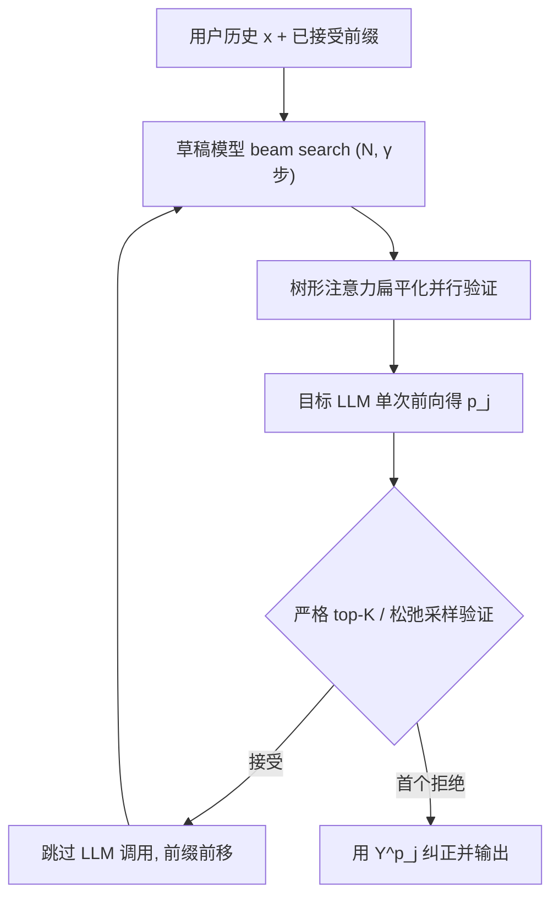
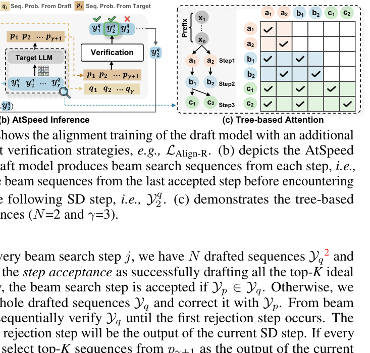

# Efficient Inference for Large Language Model-based Generative Recommendation (面向大语言模型生成式推荐的高效推理)

- **会议/期刊**: ICLR 2025
- **作者与机构**: Xinyu Lin, Chaoqun Yang, Wenjie Wang, Yongqi Li, Cunxiao Du, Fuli Feng, See-Kiong Ng, Tat-Seng Chua（NUS / 清华 / USTC / PolyU）
- **推荐链路定位**: 端到端生成式（推理加速层）
- **研究方向**: 生成式推荐与离散语义 ID / 大语言模型推荐
- **论文原文**: [https://arxiv.org/abs/2410.05165v3](https://arxiv.org/abs/2410.05165v3)
- **开源代码**: [https://github.com/Linxyhaha/AtSpeed](https://github.com/Linxyhaha/AtSpeed)

## TL;DR (1分钟核心速览)

LLM 生成式推荐（如 LC-Rec）用 beam search 自回归解码 top-K 物品，解码占推理耗时 91%，但 NLP 的投机解码（SD）只做 N-to-1 验证，直接迁移到推荐会因"必须一次性草拟出全部 top-K 序列"而几乎无法跳过任何 LLM 调用。本文把该问题形式化为更严苛的 **N-to-K 验证**，提出 AtSpeed：严格验证下用 AtSpeed-S（RKLD + 密度正则）对齐草稿模型，松弛验证下用 AtSpeed-R（TVD 对齐）+ 松弛采样验证。在 Beauty/Games 上基于 LC-Rec(LLaMA-7B) 实现严格验证平均 1.97×/1.83× 无损加速，松弛验证平均 2.11×/2.05× 加速且排序指标几乎不降。

## Background & Motivation (背景与核心矛盾)

- **主流范式**: 基于 LLM 的生成式推荐将物品编码为 RQ-VAE 语义 ID 序列，用 beam search 自回归解码 top-K 物品作为推荐列表；效果强但推理极慢。
- **前人局限**: ① 解码阶段占端到端耗时约 91%（图 1a），串行 LLM 调用是瓶颈；② NLP 的 SD 面向 N-to-1（每步只需接受 1 个 token），而推荐需每步同时命中 K 条不同序列，任一 top-K 序列未被草拟出即整步拒绝，导致加速比趋近 1。
- **核心洞察 (Key Insight)**: N-to-K 验证的接受率由"草稿模型对目标 LLM top-K 序列的召回"决定，因此关键在于**序列级 top-K 对齐**而非词表级 logit 对齐；同时可**松弛验证**，允许高概率非 top-K 序列以一定概率被接受，只要输出分布近似等价。
- **本文切入点**: 分别针对严格与松弛两种验证策略设计对齐损失，并配套树形注意力消除 beam 前缀重复计算。

## Method (核心方法设计)

### 1. 整体框架 (Overall Architecture)

AtSpeed 沿用 draft-then-verify 范式：小模型（LLaMA-68M）作为草稿模型，在每步以 beam size $N$草拟$\gamma$步候选序列$\{Y^q_j\}$，目标 LLM（LLaMA-7B）单次前向并行验证并给出 top-K 理想序列$Y^p_j$；从第 1 步起顺序比对，遇到首个拒绝步即用$Y^p_j$纠正并结束本 SD 步，被接受步的 LLM 调用全部省去。训练阶段在推荐损失$\mathcal{L}_{Rec}$上叠加对齐损失（S 版或 R 版），推理阶段按需选择严格或松弛验证。验证时把各步 beam 序列拼成扁平序列，用树形注意力共享前缀 KV，避免$\gamma N$ 条序列的重复自注意力计算。

<figure class="paper-figure" markdown="span">
  <figcaption>图 2：AtSpeed 概览。(a) 展示草稿模型的对齐训练，并针对不同验证策略（如 LAlign-R）加入额外的对齐损失。(b) 展示 AtSpeed 推理过程，其中训练良好的草稿模型从每一步生成 beam search 序列，即 Yq</figcaption>
</figure>

### 2. 关键设计拆解 (Key Designs)

1. **AtSpeed-S：严格 top-K 验证下的对齐目标**：痛点在于词表级 KD 会被"高概率但非法 token"污染，且小模型表达力有限难以全词表对齐。作者将接受率最大化转化为最小化 top-K 序列上的反向 KL 与密度正则，并把对齐限制在约束合法 token 集 $V_c$ 上：
$$\mathcal{L}_{Align\text{-}S}=\mathbb{E}_{(x,Y)\sim\mathcal{D}'}\sum_{y\in Y}\frac{1}{|y|}\sum_{t=1}^{|y|}\Big[\sum_{y_t\in V_c}q_\theta\log\frac{q_\theta}{p}-\sum_{y_t\in V_c}q_\theta\log\frac{q_\theta}{p(y_K)}\Big]$$
RKLD 让草稿在自身能力范围内贴合目标的 top-K 分布，密度项则迫使 top-K 概率主导整体分布，从而提升"整步全命中"概率。

2. **AtSpeed-R + 松弛采样验证**：严格验证下 K 增大时接受步骤降。作者引入松弛验证：对草稿序列 $y$，若$p(y)\ge q(y)$直接接受，否则以$1-p(y)/q(y)$拒绝并从$\mathrm{norm}(\max(0,p-q))$重采样。单序列接受率$b=\mathbb{E}_{y\sim q}\min(1,p/q)=1-\mathrm{TVD}(p,q)$，步接受率$\beta=b^K$（有放回近似），故最大化$\log\beta$ 等价于最小化 TVD：
$$\mathcal{L}_{Align\text{-}R}=\mathbb{E}_{(x,y)\sim\mathcal{D}'}\Big[\frac{1}{|y|}\sum_{t=1}^{|y|}\mathrm{TVD}\big(p'(\cdot|x,y_{<t}),\,q'(\cdot|x,y_{<t})\big)\Big]$$
有放回近似保证 SD 输出分布与目标 LLM 采样 beam search 近似等价，因此精度损失可控。

3. **训练目标、负采样与推理效率**：总损失 $\mathcal{L}=\alpha\mathcal{L}_{Align}+(1-\alpha)\mathcal{L}_{Rec}$，$\alpha=0.5$为经验最优；对齐数据$\mathcal{D}'$由目标模型混合采样构造（$Y=\mathrm{TopK}((1-\lambda)M_q+\lambda M_p)$），无需负采样。推理开销主要来自草稿模型 beam search 与一次目标 LLM 前向；树形注意力使$N$增大时验证开销近似线性而非$N$ 倍重复。

## Experimental Setup & Evaluation Protocol (实验设置与评估协议)

- **数据集与预处理**: Amazon Review 两个子集，物品用 RQ-VAE 生成等长语义 ID：

| 数据集 | #Users | #Items | #Interactions | 稀疏度/密度 | 特征/场景说明 |
| :--- | :---: | :---: | :---: | :---: | :--- |
| Beauty | 22.4k | 12.1k | 198.5k | 99.93% 稀疏 | 美妆，含标题/描述文本 |
| Games | 24.8k | 10.7k | 231.8k | 99.91% 稀疏 | 电子游戏，含文本 |

- **数据划分与防穿越 (Splitting Strategy)**: 沿用 LC-Rec 的 `Leave-One-Out` 式序列划分（最后交互为测试、倒数第二为验证），历史序列作为 prompt 输入。
- **排名评测协议 (Ranking Protocol)**: 生成式 top-K 输出，报告 Recall@K / NDCG@K（K=1,3,5,10,20）；效率侧报告 walltime speedup WS@K 与接受步数 AS@K。严格验证下输出与目标 LLM 完全一致，属无损对比。
- **对比基线与超参设置**: 基线含 SFT、WordKD、SeqKD、TVDKD、DARE；目标模型 LLaMA-7B + LoRA，草稿模型 LLaMA-68M 全参微调；$\gamma=4$，$N=40$，$\alpha=0.5$。

## Key Experimental Results (实验关键数据)

### 1. 主实验对比 (Main Results)

Beauty 数据集（Avg 为 K=1..20 平均；严格验证下 Recall/NDCG 与目标 LLM 完全一致）：

| 验证策略 | 方法 | WS@5 | WS@10 | WS@20 | Avg WS | Avg AS |
| :--- | :--- | :---: | :---: | :---: | :---: | :---: |
| 严格 top-K | SFT | 1.43 | 1.37 | 1.55 | 1.56 | 1.18 |
| 严格 top-K | SeqKD | 1.75 | 1.67 | 1.68 | 1.83 | 1.60 |
| 严格 top-K | **AtSpeed-S** | **1.84** | **1.87** | **1.84** | **1.97** | **1.80** |
| 松弛采样 | SeqKD | 1.90 | 2.11 | 2.31 | 2.01 | 1.97 |
| 松弛采样 | AtSpeed-S | 1.89 | 2.12 | **2.51** | 2.07 | 2.05 |
| 松弛采样 | **AtSpeed-R** | **1.94** | **2.16** | 2.47 | **2.11** | **2.10** |

Games 数据集：严格验证 AtSpeed-S 平均 **1.83×**（SFT 1.53×、SeqKD 1.71×）；松弛验证 AtSpeed-R 平均 **2.05×**（SeqKD 1.95×），Recall@5 由 0.0074 升至 0.0080（+8.1%）。

### 2. 消融实验 (Ablation Study)

Beauty 上 AtSpeed-S / AtSpeed-R 组件移除（图 3）：

| 变体 | 影响维度 | 结论 |
| :--- | :--- | :--- |
| w/o DR（去密度正则） | AS/WS | 接受率下降，top-K 概率未主导分布 |
| w/o CA（去约束对齐） | AS/WS | 非法高概率 token 引入噪声，接受率降 |
| w/o TA（去树形注意力） | WS | 接受率不变但验证变慢，加速比降 |
| w/o top-K（R 版仅用 top-1） | AS | 序列多样性缺失，接受率明显下降 |

### 3. 关键实验发现 (Key Findings)

1. **词表级 KD 反而拖后腿**：WordKD/TVDKD 在严格验证下 Avg WS 仅 1.68/1.55，低于 SFT 的 1.56 附近水平甚至不如 SeqKD 的 1.83，说明全词表对齐被非法 token 噪声稀释，序列级对齐才是 N-to-K 的正解。
2. **松弛验证是效率主增益来源**：同一 AtSpeed-S 从严格切到松弛，Avg WS 由 1.97 升至 2.07；AtSpeed-R 进一步到 2.11，且 Recall@5 仅从 0.0056 微降至 0.0058（Beauty 上甚至略升），验证了分布等价近似的有效性。
3. **K 增大不必然掉速**：AS@K 随 K 增大而下降（N-to-K 更难），但 WS@20 仍与 WS@5 相当甚至超过 WS@10，归因于树形注意力把 $N$ 条 beam 的验证压成单次扁平前向，抵消了候选膨胀的开销。

## Highlights & Limitations (亮点、对比与审稿批判)

- **与代表作对比 (vs. Prior Work)**: 相比 DistillSpec（仅研究 N-to-1 下的 KD 对齐）与 DARE（把 SD 用于用户特征生成的 N-to-1 场景），本文首次定义并解决推荐特有的 N-to-K 验证；相比 LC-Rec 原始解码，AtSpeed 是外挂式加速层，不改动推荐模型本身。
- **可迁移亮点**: ① "约束合法 token 集 + 密度正则"的对齐技巧可迁移到任何受限解码的蒸馏场景；② 树形注意力扁平化验证可直接复用于任意 beam search 的并行校验。
- **审稿级局限批判**: ① 仅在 LC-Rec + LLaMA 系模型上验证，草稿模型仍需 beam search，$N=40$ 时草稿开销不可忽略，缺少与量化/剪枝等正交加速的联合评测；② 松弛验证的分布等价依赖"有放回采样近似"，K 较大时近似误差与精度损失的上界未给出理论刻画，且仅在两个 Amazon 子集上评估，跨域泛化性存疑。

## Rating (四维评分)

- **方法创新性 (Novelty)**: ⭐⭐⭐⭐ （首次形式化 N-to-K 验证，RKLD/TVD 两套对齐目标与松弛采样验证均有推导支撑）
- **评估协议与实验扎实度 (Protocol & Experiments)**: ⭐⭐⭐⭐ （双数据集 + 双验证策略 + 完整消融与超参分析，但数据集仅两个 Amazon 子集）
- **写作与数学规范度 (Clarity & Rigor)**: ⭐⭐⭐⭐ （接受率与 TVD 的推导链条清晰，附录给出分布等价证明）
- **工业落地与复现价值 (Industrial & Practical Value)**: ⭐⭐⭐⭐ （代码开源、外挂式无损加速近 2×，对 LLM 推荐线上部署直接可用）

