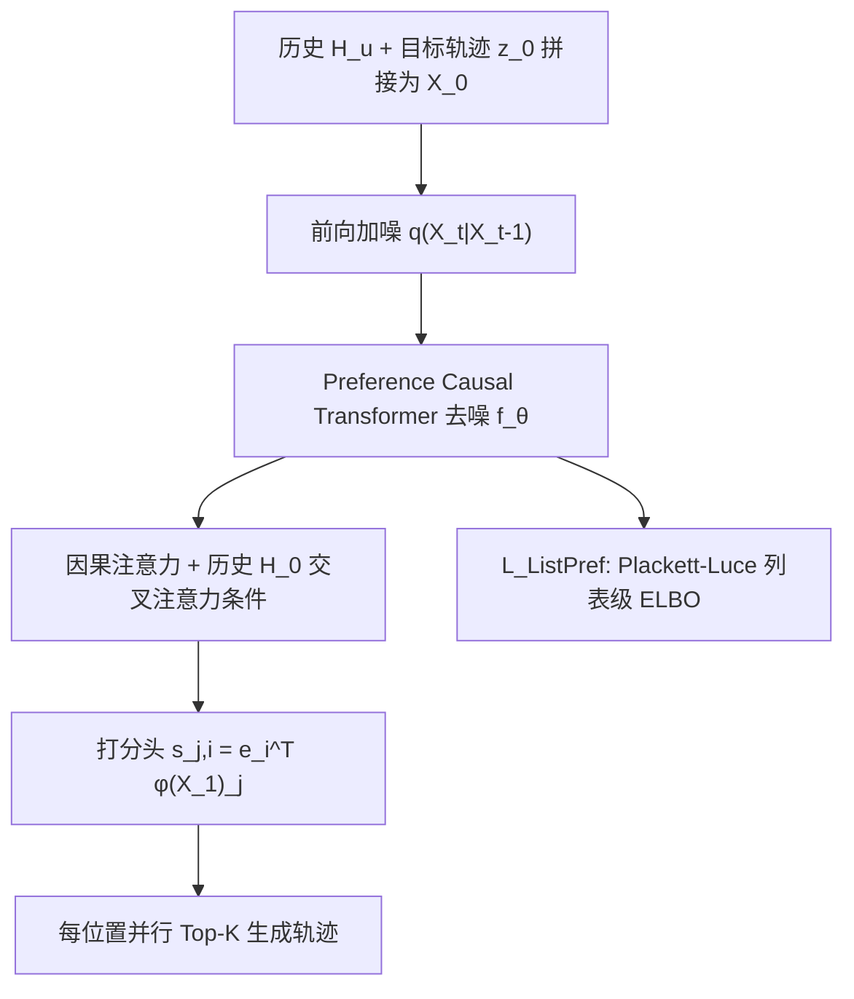

# Listwise Preference Diffusion Optimization for User Behavior Trajectories Prediction (列表级偏好扩散优化用于用户行为轨迹预测)

- **会议/期刊**: NeurIPS 2025
- **作者与机构**: Hongtao Huang, Chengkai Huang (UNSW/Macquarie), Junda Wu, Julian McAuley (UCSD), Tong Yu (Adobe Research), Lina Yao (CSIRO's Data61/UNSW)
- **推荐链路定位**: 端到端生成式（多步轨迹生成）
- **研究方向**: 生成式推荐与离散语义ID / 序列与会话推荐
- **论文原文**: [https://arxiv.org/abs/2511.00530v1](https://arxiv.org/abs/2511.00530v1)
- **开源代码**: 暂未开源

## TL;DR (1分钟核心速览)

传统序列推荐只做单步 next-item 预测，扩散式推荐器虽能建模不确定性，却以 **point-wise** 方式独立优化每个位置，忽略整条未来轨迹的联合依赖与相对次序，导致概率质量散落到无关物品上。本文提出 **LPDO**，把 Plackett-Luce 列表级排序信号注入扩散模型的变分下界，推导出与列表级似然对齐的紧致 ELBO，使去噪每一步都朝"整条有序列表"的联合似然优化。同时提出轨迹级指标 **SeqMatch@K**。在 Beauty/ML-1M/LastFM 三个数据集、Full-Ranking 协议下，SeqMatch@50 相对最强基线最高提升 **36.81%**，PPL 全面最低。

## Background & Motivation (背景与核心矛盾)

- **主流范式**: 序列推荐以 SASRec 类自回归模型做单步预测；扩散推荐（DiffuRec、DreamRec、DCRec）用去噪生成目标物品嵌入，建模用户兴趣不确定性。
- **前人局限**: 其一，单步模型是"短视"的，只优化即时点击，无法刻画多步轨迹中偏好的漂移与因果演化；其二，现有扩散推荐器全部采用 **point-wise** 监督——对每个位置独立调整物品似然，完全丢弃列表内物品间的联合依赖与相对排序，生成的多步轨迹概率质量会溢出到无关目标（图 1(b)）。
- **核心洞察 (Key Insight)**: 轨迹预测的本质是"生成一条有序列表"，其评价天然是列表级的；而扩散 ELBO 中的 ranking 项恰好可以替换为列表级似然，从而在去噪的每一步都施加全局排序约束（图 1(d)）。
- **本文切入点**: 将 Plackett-Luce 列表级排序似然嵌入扩散 ELBO，用一条紧致变分下界把"去噪保真"与"列表排序效用"联合优化。

## Method (核心方法设计)

### 1. 整体框架 (Overall Architecture)

输入用户历史 $H_u$与未来$k$步目标轨迹嵌入$z_0\in\mathbb{R}^{k\times d}$，拼接为$X_0=\text{concat}(H,z_0)$。前向过程对$X_0$逐步加噪；反向过程用 **Preference Causal Transformer** 去噪：拼接嵌入$X_t$与时间嵌入$t$先过因果注意力（建模轨迹内位置间因果依赖），再以干净历史嵌入$H_0$通过 cross-attention 作为条件信号注入。去噪得到$X_1$后，用可微打分头$s_{j,i}=e_i^\top\phi_\theta(X_1)_j$ 对每个未来位置并行做全库 Top-K 检索。训练目标为重建损失、列表级偏好损失与正则项的加权和。

### 2. 关键设计拆解 (Key Designs)

1. **列表级偏好扩散损失 (ListPref Loss)**：痛点在于 BPR 的成对短视与 point-wise 扩散的独立同分布假设都无法刻画整条轨迹。作者从联合似然 $\sum_j\ln p_\theta(i_{u,n+j}\mid H;\gamma)$ 出发，引入前向噪声链作变分后验，推出紧致 ELBO：
$$\mathcal{L}_{\text{ELBO}}=\sum_{t=1}^{T}\text{KL}\big(q(X_{t-1}|X_t,X_0)\,\|\,p_\theta(X_{t-1}|X_t,H;\gamma)\big)-\sum_{j=1}^{k}\mathbb{E}_{q}\big[\ln p_\theta(i_{u,n+j}|X_0,H;\gamma)\big]$$
第一项保去噪保真、第二项保列表排序效用，二者在同一目标内耦合，使每个去噪步都朝"整条有序列表"的联合似然前进。

2. **软化 ListMLE (Soft-ListMLE)**：标准 ListMLE 严格剔除已排位物品，分布过尖、梯度稀疏。作者引入惩罚因子 $\gamma$把分母在"剩余候选集$C_r$"与"全候选集$C$"间插值：
$$\mathcal{L}_{\text{Soft-ListMLE}}=-\sum_{r=1}^{K}\log\frac{\exp(s_{\pi_r})}{(1-\gamma)\sum_{i\in C_r}\exp(s_i)+\gamma\sum_{i\in C}\exp(s_i)}$$
$\gamma=0$退化为标准 Plackett-Luce，$\gamma>0$ 平滑梯度、缓解早期位置对后续位置的过度压制，从而更好捕捉偏好演化。

3. **训练目标、负采样与推理效率**：总损失 $\mathcal{L}_{\text{LPDO}}=\lambda\mathcal{L}_{\text{Simple}}+(1-\lambda)\mathcal{L}_{\text{ListPref}}+\mathcal{L}_{\text{Reg}}$，训练时候选集取全库$K=M$（**免负采样**，列表级 softmax 天然含全库归一化）。推理从纯高斯噪声迭代去噪，实测 **1 步去噪**即可达到与 50 步几乎相同的精度（SeqMatch@50 0.1559 vs. 0.1575），推理耗时 3.40s，与 SASRec 的 3.34s 基本持平，远低于 DiffuRec 的 24.68s。

## Experimental Setup & Evaluation Protocol (实验设置与评估协议)

- **数据集与预处理**: 三个公开序列推荐数据集，采用标准过滤：

| 数据集 | 轨迹长度 $k$ | 说明 |
| :--- | :---: | :--- |
| Amazon Beauty | 3 | 稀疏、短序列 |
| MovieLens-1M | 5 / 10 | 电影，主题系列性强 |
| LastFM | 5 / 10 | 音乐，长尾显著 |

- **数据划分与防穿越 (Splitting Strategy)**: 采用 **Leave-One-Out** 变体，其中"One"指一条预设长度的用户轨迹（而非单个物品），即留出最后 $k$ 个交互作为多步预测目标。
- **排名评测协议 (Ranking Protocol)**: **Full-Ranking（全库未交互排序）**，对轨迹每个位置在全部 $M$个候选上排序；指标为 SeqHR@K、SeqNDCG@K（位置级指标的几何平均）、新提出的 **SeqMatch@K**（要求轨迹每个位置的真值都命中 Top-K，即$\mathbb{I}(\bigwedge_{j=1}^{k}(i_{u,n+j}\in A_{u,j}))$）以及 PPL（对数缩放）。
- **对比基线与超参设置**: 8 个基线——传统序列 FPMC/SASRec/SASRec-AR/STOSA，扩散式 DiffuRec/DreamRec/PreferDiff/DCRec，全部改造为支持 UBTP 的多位置损失。LPDO 设 $\lambda=0.1$，$\gamma=0.0/0.3/0.8$（Beauty/ML-1M/LastFM），扩散步数训练 50、推理 1，$\beta$线性$[10^{-4},0.02]$，显著性$p<0.05$。

## Key Experimental Results (实验关键数据)

### 1. 主实验对比 (Main Results)

选取最具代表性的指标（SeqMatch@50 与 PPL，ML-1M len=5 与 LastFM len=5）：

| 数据集/指标 | SASRec | DiffuRec | DreamRec | PreferDiff | DCRec | **LPDO** | Improv. |
| :--- | :---: | :---: | :---: | :---: | :---: | :---: | :---: |
| ML-1M SM@50 | 0.1045 | 0.1168 | 0.0000 | 0.0000 | 0.1458 | **0.1559** | +6.92% |
| ML-1M SeqHR@5 | 0.0895 | 0.0894 | 0.0028 | 0.0004 | 0.1107 | **0.1218** | +10.03% |
| ML-1M PPL↓ | 33.62 | 32.47 | 165.59 | >500.0 | 31.42 | **30.36** | -3.37% |
| LastFM SM@50 | 0.1578 | 0.1638 | 0.0189 | 0.0000 | 0.1723 | **0.2357** | +36.81% |
| LastFM SeqHR@5 | 0.1816 | 0.1793 | 0.0433 | 0.0035 | 0.1931 | **0.2507** | +29.83% |
| Beauty SM@50 | 0.0257 | 0.0363 | 0.0000 | 0.0000 | 0.0432 | **0.0521** | +20.60% |

LPDO 在全部 3 数据集 × 5 指标组合上均取得最优，SeqMatch@50 提升幅度 6.87%–36.81%，PPL 全面最低。

### 2. 消融实验 (Ablation Study)

| 模型变体 | ML-1M SeqHR@5 | ML-1M SM@50 | ML-1M PPL↓ | LastFM SeqHR@5 | LastFM SM@50 |
| :--- | :---: | :---: | :---: | :---: | :---: |
| w/o $\mathcal{L}_{\text{ListPref}}$ | 0.0000 | 0.0000 | 76.54 | 0.0000 | 0.0000 |
| w/o $\mathcal{L}_{\text{Simple}}$ | 0.0563 | 0.0370 | 34.11 | 0.1452 | 0.1345 |
| w/o $\mathcal{L}_{\text{Reg}}$ | 0.0646 | 0.0634 | 32.99 | 0.2284 | 0.2123 |
| **LPDO (完整)** | **0.1218** | **0.1567** | **30.35** | **0.2507** | **0.2357** |

### 3. 关键实验发现 (Key Findings)

1. **列表级损失是"生死线"而非"锦上添花"**：移除 $\mathcal{L}_{\text{ListPref}}$ 后所有排序指标直接归零、PPL 飙至 76.54，说明在 UBTP 设定下 point-wise 扩散目标根本无法维持基本预测功能，列表级监督是模型可用的必要条件。
2. **重建损失是稳定器**：去掉 $\mathcal{L}_{\text{Simple}}$ 使 ML-1M SeqHR@5 从 0.1218 暴跌 53.8% 至 0.0563，表明扩散重建项对训练稳定性不可或缺，列表排序项无法单独支撑优化。
3. **收敛更快且各位置全面领先**：LPDO 约 25 epoch 收敛，而采用交叉熵排序损失的 DCRec 需约 33 epoch；位置级 HR@5 对比显示 LPDO 在轨迹每个位置均优于 SASRec 与 DiffuRec，且**越靠前的位置优势越明显**，印证因果 Transformer 对偏好演化的建模有效。

## Highlights & Limitations (亮点、对比与审稿批判)

- **与代表作对比 (vs. Prior Work)**: 与 DiffuRec/DCRec 的本质区别在于监督粒度——前者在去噪中对每个位置独立施加 point-wise 或交叉熵排序损失，LPDO 则把 Plackett-Luce 列表似然直接写进 ELBO，使去噪轨迹与整条有序列表的联合似然对齐；与 PreferDiff（BPR 改造）相比，LPDO 摆脱了成对短视与潜在变量不匹配两个缺陷。
- **可迁移亮点**: (1) "把列表级排序似然嵌入生成模型 ELBO"的推导范式可迁移到 VAE/流匹配等其它生成式推荐骨干；(2) SeqMatch@K 这一"全位置严格命中"指标可直接用于任何多步/会话级推荐的评测，弥补 HR@K 无法衡量轨迹一致性的空白。
- **审稿级局限批判**: (1) 轨迹长度仅 3/5/10，更长轨迹（数十步）下的误差累积与去噪步数需求未验证，且推理虽可 1 步近似，但训练仍需 50 步扩散，训练成本偏高；(2) 实验仅在三个中等规模公开数据集上做离线 Full-Ranking，缺少工业级线上 A/B 与冷启动/长尾分桶分析，SeqMatch@K 在稀疏数据下方差可能较大。

## Rating (四维评分)

- **方法创新性 (Novelty)**: ⭐⭐⭐⭐ （首次将 Plackett-Luce 列表级似然严格嵌入扩散 ELBO 并给出紧致下界推导，理论衔接扎实，但扩散+排序的组合范式本身并非全新）
- **评估协议与实验扎实度 (Protocol & Experiments)**: ⭐⭐⭐⭐ （三数据集五轨迹长度、8 基线、Full-Ranking 与显著性检验齐全，消融完整；缺线上验证与长尾分桶）
- **写作与数学规范度 (Clarity & Rigor)**: ⭐⭐⭐⭐ （ELBO 推导链条清晰、Soft-ListMLE 动机明确，符号略密但可读）
- **工业落地与复现价值 (Industrial & Practical Value)**: ⭐⭐⭐⭐ （1 步去噪推理与 SASRec 同量级、免负采样全库打分，工程友好；但代码未开源、训练扩散步数成本需评估）

