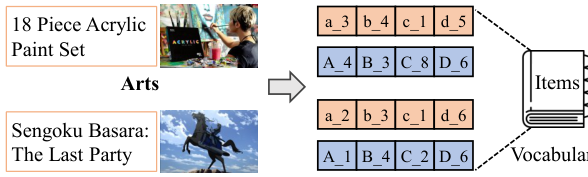
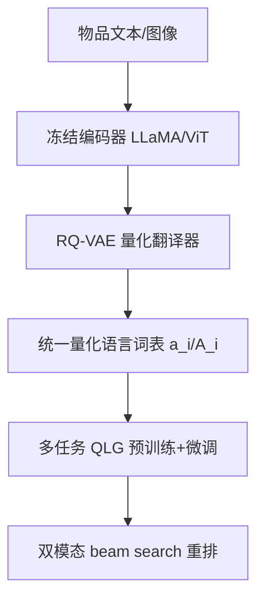

# Multimodal Quantitative Language for Generative Recommendation (面向生成式推荐的多模态量化语言)

- **会议/期刊**: ICLR 2025
- **作者与机构**: Jianyang Zhai, Zi-Feng Mai, Chang-Dong Wang 等（中山大学、鹏城实验室、厦门大学、北京大学）
- **推荐链路定位**: 端到端生成式（语义 ID 生成式召回）
- **研究方向**: 生成式推荐与离散语义 ID / 多模态推荐
- **论文原文**: [https://arxiv.org/abs/2504.05314v1](https://arxiv.org/abs/2504.05314v1)
- **开源代码**: [https://github.com/zhaijianyang/MQL4GRec](https://github.com/zhaijianyang/MQL4GRec)

## TL;DR (1分钟核心速览)

现有 PLM 生成式推荐直接把自然语言词表套在物品 ID 上，既受"通用语言知识与推荐需求错位"之困，又浪费了图文互补信息。本文提出 MQL4GRec：为文本与图像各训练一个 RQ-VAE 量化翻译器，把不同域、不同模态的物品统一翻译成共享词表的"量化语言"，再设计下一物品生成、非对称跨模态生成、量化语言对齐三类任务做预训练+微调，并用双模态重排融合。在 Amazon 三域上采用 Leave-One-Out + Full-Ranking 协议，NDCG@10 相对最强基线分别提升 11.58%、12.56%、7.66%。

## Background & Motivation (背景与核心矛盾)

- **主流范式**: 生成式推荐（TIGER、P5、LC-Rec 等）用 RQ-VAE 或语义树把物品编码为离散 token，再让 Transformer/PLM 以 seq2seq 方式自回归生成目标物品 ID。
- **前人局限**: 其一，PLM 的通用语言知识与推荐任务存在显著任务鸿沟，直接复用自然语言词表导致语义错位；其二，多数方法只用单一模态（多为文本）构 ID，忽略了图文互补所刻画的用户多面偏好。
- **核心洞察 (Key Insight)**: NLG 之所以能迁移，关键在于"共享词表 + 预训练-微调"范式——若能让所有域、所有模态的物品共享同一套离散词表，词表本身就成为知识迁移的桥梁。
- **本文切入点**: 把量化器当作"翻译器"，将物品内容翻译为比原文/原图更简洁的统一量化语言，再以多任务预训练把源域与跨模态推荐知识注入该语言。

<figure class="paper-figure" markdown="span">
  <figcaption>图 1：我们的 MQL4GRec 示意图。我们将来自不同领域和模态的项目转换为一种新的统一语言，该语言随后可作为迁移推荐知识的桥梁。</figcaption>
</figure>

## Method (核心方法设计)

### 1. 整体框架 (Overall Architecture)

模型分两段：左段是"翻译"，用冻结的模态编码器（文本用 LLaMA、图像用 ViT）提取物品表征，各自经一个 RQ-VAE 量化为 4 级码字元组，文本码字加小写前缀、图像码字加大写前缀，两套码本合并构成共享词表 $\mathcal{V}=\{\mathcal{V}_t,\mathcal{V}_v\}$；右段是"生成"，把用户历史物品的量化语言序列连同任务提示 token 送入 Transformer 编解码器，通过预训练（源域下一物品生成）与微调（目标域全部量化语言生成任务）完成知识迁移，最终用文本/图像两条子任务的 beam search 列表做重排输出。

### 2. 关键设计拆解 (Key Designs)

1. **量化翻译器与统一词表（Quantitative Translator）**：痛点是用自然语言原名或随机整数作 ID 迁移性弱。做法是对表征 $z$逐级残差量化：$c_i=\arg\min_k\|r_i-v^i_k\|_2^2,\ r_{i+1}=r_i-v^i_{c_i}$，重构损失$\mathcal{L}_{recon}=\|h-\hat{h}\|_2^2$与码本损失$\mathcal{L}_{rqvae}=\sum_i(\|\mathrm{sg}[r_i]-v^i_{c_i}\|_2^2+\beta\|r_i-\mathrm{sg}[v^i_{c_i}]\|_2^2)$联合优化。直觉是：码本即词表，$2LK$个码字可表达$K^L$ 个物品，跨域跨模态天然共享同一"语言"。

2. **碰撞重分配（Collision Reallocation）**：TIGER 追加额外索引层会引入语义无关分布，LC-Rec 的均匀约束也无法彻底消解碰撞。本文按残差到码字的距离 $d^i_k=\|r_i-v^i_k\|_2^2$ 排序，从最后一级开始为碰撞物品分配最近码字，冲突则退而取次近，末级不足时回溯上一级再重排，直至全部消解——保证 token 分配始终贴合语义几何。

3. **三类量化语言生成任务与训练目标**：NIG（同模态下一物品生成，分文本/图像两子任务）、AIG（非对称生成，如图像历史 $\to$文本目标，实现隐式跨模态对齐）、QLA（显式图文量化语言互译）。总损失为条件生成负对数似然$\mathcal{L}_\theta=-\sum_{j=1}^{|Y|}\log P_\theta(Y_j\mid Y_{<j},X)$，无负采样，纯自回归 teacher forcing；推理用 beam size=20，重排打分$s(x)=(s_t(x)+s_v(x))/2+1$（双列表均命中时），否则取单侧分数。

## Experimental Setup & Evaluation Protocol (实验设置与评估协议)

- **数据集与预处理**: Amazon Reviews，6 个源域类目预训练（Pet、Cell Phones、Automotive、Tools、Toys&Games、Sports），3 个目标域评测：

| 数据集 | 域角色 | 模态 | 说明 |
| :--- | :---: | :---: | :--- |
| Instruments | 目标域 | 文本+图像 | 乐器，稀疏 |
| Arts | 目标域 | 文本+图像 | 手工艺，稀疏 |
| Games | 目标域 | 文本+图像 | 视频游戏，稠密 |

- **数据划分与防穿越**: `Leave-One-Out` 策略，最后一条交互作测试、倒数第二条作验证。
- **排名评测协议**: 无偏 `Full-Ranking`（全物品库排序），非采样排序；生成式基线统一 beam size=20。
- **对比基线与超参设置**: 非生成式 GRU4Rec/BERT4Rec/SASRec/FDSA/S3-Rec/MISSRec，生成式 VQ-Rec/P5-CID/VIP5/TIGER；指标 HR@{1,5,10}、NDCG@{5,10}。

## Key Experimental Results (实验关键数据)

### 1. 主实验对比 (Main Results)

| 数据集 | 指标 | TIGER | MISSRec | VIP5 | VQ-Rec | **MQL4GRec** | Improv. |
| :--- | :--- | :---: | :---: | :---: | :---: | :---: | :---: |
| Instruments | HR@10 | 0.1221 | 0.1361 | 0.1071 | 0.1357 | **0.1375** | +1.03% |
| Instruments | NDCG@10 | 0.0950 | 0.0880 | 0.0872 | 0.0891 | **0.1060** | +11.58% |
| Arts | HR@1 | 0.0532 | 0.0479 | 0.0474 | 0.0408 | **0.0672** | +26.32% |
| Arts | NDCG@10 | 0.0806 | 0.0815 | 0.0635 | 0.0844 | **0.0950** | +12.56% |
| Games | HR@1 | 0.0166 | 0.0201 | 0.0173 | 0.0075 | **0.0203** | +1.00% |
| Games | NDCG@10 | 0.0453 | 0.0499 | 0.0418 | 0.0329 | **0.0548** | +7.66% |

### 2. 消融实验 (Ablation Study)

| 配置 | Instruments NDCG@10 | Arts NDCG@10 | Games NDCG@10 |
| :--- | :---: | :---: | :---: |
| (0) 仅 NIG1（文本） | 0.0987 | 0.0844 | 0.0473 |
| (1) QLG 全任务，无预训练 | 0.0993 | 0.0913 | 0.0531 |
| (2) NIG1 + 预训练 | 0.1043 | 0.0959 | 0.0508 |
| (3) QLG + 预训练 | 0.1051 | 0.0944 | 0.0521 |
| (4) MQL4GRec（(3)+重排） | **0.1060** | **0.0950** | **0.0548** |
| TIGER 碰撞处理 vs 本文 | 0.0950 vs 0.0987 | 0.0806 vs 0.0844 | 0.0453 vs 0.0473 |

### 3. 关键实验发现 (Key Findings)

1. **多任务叠加单调增益**：无预训练时，从 NIG 到 +AIG 再到 +QLA，Games 的 NDCG@10 由 0.0493 升至 0.0529 再至 0.0531，说明跨模态非对称生成与显式对齐确实为量化语言注入了互补语义。
2. **预训练收益依赖域相似度**：文本单模态预训练在三域均稳定提升（Instruments 0.0987→0.1043）；但双模态预训练在 Games 上反而从 0.0531 降至 0.0521，作者归因于源域与 Games 域差异大导致过拟合，且跨模态知识与源域知识存在冲突。
3. **碰撞处理与用户 ID 均不可忽视**：本文碰撞重分配在 Arts 上把 NDCG@10 从 TIGER 的 0.0806 提到 0.0844；而 TIGER 去掉 user ID token 后 Games 反而从 0.0453 升至 0.0464，暴露其 2000 个 token 表示数万用户造成的严重 ID 碰撞。

## Highlights & Limitations (亮点、对比与审稿批判)

- **与代表作对比 (vs. Prior Work)**: TIGER 仅用文本 RQ-VAE 构 ID 且靠追加索引解碰撞；LC-Rec 用均匀分布约束缓解碰撞但不彻底；VIP5 直接拼接 CLIP 图像特征，受模态鸿沟拖累（Games NDCG@10 仅 0.0418）。本文的本质差异是把"词表"本身做成跨域跨模态的迁移载体。
- **可迁移亮点**: ① 用"码本前缀区分模态"的共享词表设计，可低成本复用到任意多源异构 ID 体系；② 基于残差距离的碰撞重分配是一个与模型无关的通用后处理技巧。
- **审稿级局限批判**: ① 零样本能力极弱（HR@10 仅 0.003 量级），预训练数据与模型规模不足，宣称的"通用推荐"尚早；② 双模态预训练在 Games 上负收益，说明域间知识冲突缺乏自适应门控机制；③ 两套 RQ-VAE + 双 beam search 重排带来额外推理开销，论文未给出延迟对比。

## Rating (四维评分)

- **方法创新性 (Novelty)**: ⭐⭐⭐⭐ （"量化器即翻译器 + 共享词表作迁移桥梁"的视角清晰，碰撞重分配有几何直觉支撑）
- **评估协议与实验扎实度 (Protocol & Experiments)**: ⭐⭐⭐⭐ （Leave-One-Out + Full-Ranking 无偏协议规范，10 个基线覆盖全面，但仅三域且缺显著性检验）
- **写作与数学规范度 (Clarity & Rigor)**: ⭐⭐⭐⭐ （RQ-VAE 与任务定义公式完整，碰撞算法描述清晰，但部分符号层级略冗余）
- **工业落地与复现价值 (Industrial & Practical Value)**: ⭐⭐⭐⭐ （代码已开源，词表设计易复用；双模态双塔推理与重排的线上延迟需进一步验证）

