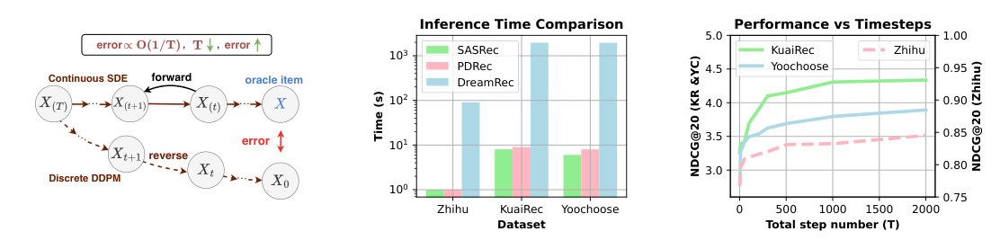
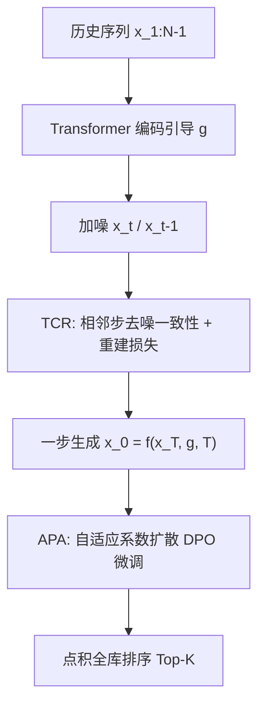
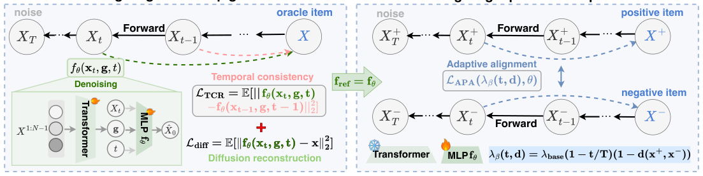

# On Efficiency-Effectiveness Trade-off of Diffusion-based Recommenders (扩散推荐器的效率-效果权衡)

- **会议/期刊**: NeurIPS 2025
- **作者与机构**: Wenyu Mao, Jiancan Wu, Guoqing Hu, Zhengyi Yang, Wei Ji, Xiang Wang（中国科学技术大学、合肥国家科学中心数据空间研究院、南京大学）
- **推荐链路定位**: 生成式端到端（Next-Item 生成式召回）
- **研究方向**: 生成式推荐与离散语义ID / 序列推荐
- **论文原文**: [论文原文链接](https://arxiv.org/abs/2510.17245v3)
- **开源代码**: [开源代码仓库链接](https://github.com/maowenyu-11/TA-Rec)

## TL;DR (1分钟核心速览)

扩散式序列推荐依赖多步离散近似，步数 $T$ 越小离散化误差越大，形成"效率-效果"硬权衡（DreamRec 需 1000 步才追平 SASRec）。本文提出两阶段框架 TA-Rec：预训练用时间一致性正则（TCR）平滑去噪函数，使噪声一步映射到 oracle item 且误差有界；微调用自适应偏好对齐（APA）按时间步与偏好对相似度动态调节 DPO 强度。在 YooChoose/KuaiRec/Zhihu 的 8:1:1 划分、HR@20/NDCG@20 全库排序下，相对最强基线提升 4.65%–31.82%，推理较 DreamRec 快约 100 倍。

## Background & Motivation (背景与核心矛盾)

- **主流范式**: 扩散推荐（DreamRec/DiffuRec/PreferDiff）把下一物品生成建模为连续 SDE，实践中用 DDPM 多步离散近似实现，以历史序列为引导 $g$ 逐步去噪。
- **前人局限**: ① 离散求解器的高阶截断误差在反向链上累积，$E_{\text{disc}}(0)\sim O(\Delta t)$，步数$T$ 减小则误差放大、轨迹偏离；② 免训练采样器（DPM++ 等）只能压到 20–50 步，蒸馏类一致性模型（CM）依赖确定性 ODE 与良好预训练模型，难以直接迁移到随机 DDPM 推荐场景。
- **核心洞察 (Key Insight)**: 若去噪函数在相邻时间步上满足 Lipschitz 连续性（"平滑"），则任意噪声点都可被一致地投影到目标物品，一步生成误差仍被全局离散化误差 $O(\Delta t)$ 界住——加速不必以效果为代价。
- **本文切入点**: 用"平滑去噪函数 + 偏好对齐修正轨迹"两阶段解耦效率与效果，而非单纯减少采样步数。

<figure class="paper-figure" markdown="span">
  <figcaption>图1：本文工作的整体动机，包括离散化误差的存在、基于扩散的推荐器的高推理成本，以及有效性-效率权衡。</figcaption>
</figure>

## Method (核心方法设计)

### 1. 整体框架 (Overall Architecture)

输入用户历史 $x_{1:N-1}$，经 Transformer 编码得到引导信号$g$；前向过程对真实下一物品$x$加噪得$x_t$。预训练阶段以重建损失$\mathcal{L}_{\text{diff}}$联合 TCR 损失训练 MLP 去噪器，使其在任意步都一致地输出$\hat{x}_0$，从而支持一步生成；微调阶段冻结 Transformer，用批内负采样构造偏好对$(x^+,x^-)$，以自适应系数$\lambda_\beta(t,d)$的扩散 DPO 损失微调去噪器。推理时仅需$x_0=f_\theta(x_T,g,T)$ 一次前向，再与候选库做点积取 Top-K。

<figure class="paper-figure" markdown="span">
  <figcaption>图2：我们提出的 TA-Rec 框架概览，该框架通过两个阶段缓解基于扩散的推荐器的效率与有效性权衡。在预训练阶段，TA-Rec 通过时间一致性正则化实现一步生成。在微调阶段，TA-Rec 采用自适应系数 λβ(t, d) 使生成的物品与用户偏好对齐。</figcaption>
</figure>

### 2. 关键设计拆解 (Key Designs)

1. **时间一致性正则 TCR（把多步压成一步）**：痛点在于多步反向链累积截断误差。TCR 对相邻噪声表示强制去噪输出一致：
$\mathcal{L}_{\text{TCR}}=\mathbb{E}_{x_t,g,t}\big[\|f_\theta(x_t,g,t)-f_\theta(x_{t-1},g,t-1)\|_2^2\big],\quad \mathcal{L}_{\text{pre}}=\mathcal{L}_{\text{diff}}+\lambda_c\mathcal{L}_{\text{TCR}}$在 Lipschitz 与局部平滑假设下可证$\sup_{s,x}\|f_\theta(x_{s/\Delta t},g,s/\Delta t)-x\|_2=O(\Delta t)$，即一步生成误差不超过原多步过程的全局离散化误差——这是"加速不掉点"的理论支点。

2. **自适应偏好对齐 APA（修正轨迹偏差）**：固定强度的 Diffusion-DPO 会对难分偏好对与高噪声输入过拟合。APA 令对齐强度随步数 $t$与偏好对余弦相似度$d(x^+,x^-)$ 自适应：
$\lambda_\beta(t,d)=\lambda_{\text{base}}\big[(1-t/T)+(1-d(x^+,x^-))\big]$并代入扩散 DPO 损失$\mathcal{L}_{\text{APA}}$（以$\lambda_\beta(t,d)$替换常数系数）。定理 2 表明梯度范数$\|\nabla_\theta\mathcal{L}\|\propto\lambda_\beta$，故当偏好对难区分、噪声大时自动放缓参数更新，避免被模糊偏好与随机噪声带偏。

3. **训练目标、负采样与推理效率**：总目标为 $\mathcal{L}_{\text{pre}}$预训练 +$\mathcal{L}_{\text{APA}}$微调；负样本从批内随机抽取用户未交互物品（In-batch 随机负采样，非难负采样）；微调阶段 Transformer 冻结，参考模型$f_{\text{ref}}$ 由预训练去噪器初始化。推理仅 1 次前向，训练每 epoch 开销与 SASRec 同量级。

## Experimental Setup & Evaluation Protocol (实验设置与评估协议)

- **数据集与预处理**: 过滤交互数少于 5 的物品与长度短于 3 的序列（缓解冷启动），序列按时间排序后 8:1:1 划分；序列长度截断/填充至 10。

| 数据集 | #Users | #Items | #Interactions | 稀疏度/密度 | 特征/场景说明 |
| :--- | :---: | :---: | :---: | :---: | :--- |
| YooChoose | 见附录 C.1 | 见附录 C.1 | 见附录 C.1 | 见附录 C.1 | 电商点击流 |
| KuaiRec | 见附录 C.1 | 见附录 C.1 | 见附录 C.1 | 见附录 C.1 | 短视频 |
| Zhihu | 见附录 C.1 | 见附录 C.1 | 见附录 C.1 | 见附录 C.1 | 问答社区 |

- **数据划分与防穿越 (Splitting Strategy)**: 按时间排序后 `比例划分`（8:1:1），避免未来信息泄漏。
- **排名评测协议 (Ranking Protocol)**: 生成 $\hat{x}_0$ 后与全库候选做点积，采用 `Full-Ranking (全库未交互排序)`，指标 HR@20 与 NDCG@20，五次重复取均值与标准差。
- **对比基线与超参设置**: 三类基线——传统序列（GRU4Rec/Caser/SASRec/Bert4Rec/CL4SRec）、扩散（DiffRec/DiffuRec/DreamRec）、偏好类（DiffuASR/PDRec/DimeRec/PreferDiff）。Embedding 维度 Zhihu 为 256、其余 64；$T\in\{500,1000,2000\}$，$\lambda_c\in[0.1,1]$，$\lambda_{\text{base}}=1/2$。

## Key Experimental Results (实验关键数据)

### 1. 主实验对比 (Main Results)

| 方法 | YooChoose HR@20 | YooChoose NDCG@20 | KuaiRec HR@20 | KuaiRec NDCG@20 | Zhihu HR@20 | Zhihu NDCG@20 |
| :--- | :---: | :---: | :---: | :---: | :---: | :---: |
| SASRec | 3.79 | 1.71 | 4.02 | 1.79 | 1.85 | 0.77 |
| CL4SRec | 4.67 | 2.12 | 4.43 | 2.66 | 2.11 | 0.76 |
| DiffuRec | 4.63 | 2.23 | 4.51 | 3.40 | 2.23 | 0.81 |
| DreamRec | 4.78 | 2.23 | 5.16 | 4.11 | 2.26 | 0.79 |
| PDRec | 5.43 | 3.08 | 4.48 | 3.68 | 2.12 | 0.76 |
| DimeRec | 5.33 | 3.86 | 4.17 | 3.64 | 2.06 | 0.78 |
| PreferDiff | 5.74 | 3.07 | 4.87 | 3.81 | 2.22 | 0.83 |
| **TA-Rec (Ours)** | **6.15** | **4.06** | **5.40** | **4.42** | **2.43** | **0.91** |
| Improv. | +7.14% | +31.82% | +4.65% | +7.54% | +7.52% | +9.64% |

### 2. 消融实验 (Ablation Study)

| 变体 | YooChoose HR@20 | YooChoose NDCG@20 | KuaiRec HR@20 | KuaiRec NDCG@20 | Zhihu HR@20 | Zhihu NDCG@20 |
| :--- | :---: | :---: | :---: | :---: | :---: | :---: |
| DDPM (1k 步) | 5.68 | 3.81 | 5.23 | 4.23 | 2.33 | 0.86 |
| DDIM (10–20 步) | 5.34 | 3.75 | 5.05 | 3.91 | 2.38 | 0.81 |
| w/o TCR | 5.72 | 3.82 | 5.24 | 4.23 | 2.39 | 0.87 |
| w/o APA | 5.89 | 3.82 | 5.33 | 4.30 | 2.41 | 0.89 |
| w/o td (固定 $\lambda_\beta$) | 6.10 | 4.04 | 5.36 | 4.39 | 2.28 | 0.87 |
| w/o d (仅步数自适应) | 6.11 | 4.05 | 5.38 | 4.40 | 2.38 | 0.89 |
| w/o t (仅相似度自适应) | 6.12 | 4.04 | 5.39 | 4.41 | 2.35 | 0.89 |
| **TA-Rec** | **6.15** | **4.06** | **5.40** | **4.42** | **2.43** | **0.91** |

### 3. 关键实验发现 (Key Findings)

1. **一步生成不劣于千步扩散**：TA-Rec 单步推理在三个数据集上全面超过 1000 步的 DreamRec（如 KuaiRec NDCG@20 4.42 vs 4.11），验证 TCR 的误差界在真实数据上成立；而 DDIM 压到 10–20 步反而掉点（KuaiRec NDCG 3.91），说明单纯减少步数会放大离散化误差。
2. **两阶段缺一不可且 APA 贡献更大**：去掉 TCR 后性能回落到 DDPM 水平（YooChoose HR 5.72 vs 5.68），说明平滑是加速的前提；去掉 APA 后 KuaiRec NDCG 从 4.42 降至 4.30，说明偏好对齐是效果增益的主要来源。
3. **自适应系数优于固定系数**：`w/o td` 在 Zhihu 上 HR 仅 2.28，显著低于完整模型 2.43，且图 4 中固定 $\lambda_\beta$ 曲线随取值剧烈波动，而自适应曲线整体位于其上——证明按步数与相似度调节强度能规避对模糊偏好对的过拟合。

## Highlights & Limitations (亮点、对比与审稿批判)

- **与代表作对比 (vs. Prior Work)**: 相比 DreamRec（1000 步 DDPM，效果尚可但推理 23 分钟级），TA-Rec 用 TCR 把随机 DDPM 压到 1 步且误差有界；相比 PreferDiff（DDIM 10–20 步 + BPR/偏好优化），TA-Rec 的 APA 在步级与对级双重自适应，避免固定强度 DPO 的过拟合；相比一致性模型蒸馏，TCR 不要求确定性 ODE，直接适配推荐场景的随机前向过程。
- **可迁移亮点**: ① "相邻步输出一致性"可作为通用正则，迁移到任何迭代式生成推荐（如流匹配、多步自回归精排）；② 按"样本难度 × 噪声水平"调节偏好优化强度的思路，可复用到 LLM4Rec 的 DPO 微调。
- **审稿级局限批判**: ① 负样本仅批内随机采样，未探索难负样本，偏好对质量可能限制 APA 上限；② 理论误差界依赖 Lipschitz 与局部平滑假设，实际去噪器是否满足缺乏实证检验；③ 数据集统计与部分 RQ5 结果置于附录，主文对多步泛化的证据偏薄。

## Rating (四维评分)

- **方法创新性 (Novelty)**: ⭐⭐⭐⭐ （把"平滑去噪函数 + 有界误差"引入扩散推荐，并用步级/对级自适应 DPO 修正轨迹，机制清晰且有定理支撑）
- **评估协议与实验扎实度 (Protocol & Experiments)**: ⭐⭐⭐⭐ （三数据集、三类基线、全库排序、五次重复与完整消融，但缺难负样本与统计显著性检验细节）
- **写作与数学规范度 (Clarity & Rigor)**: ⭐⭐⭐⭐ （离散化误差定义与两个定理推导完整，符号统一；部分证明与统计表下放附录略影响可读性）
- **工业落地与复现价值 (Industrial & Practical Value)**: ⭐⭐⭐⭐⭐ （推理与 SASRec 同量级、较 DreamRec 快约 100 倍，代码已开源，直接契合线上低延迟生成式召回需求）

