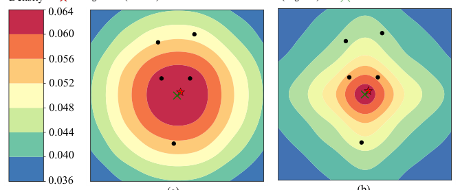
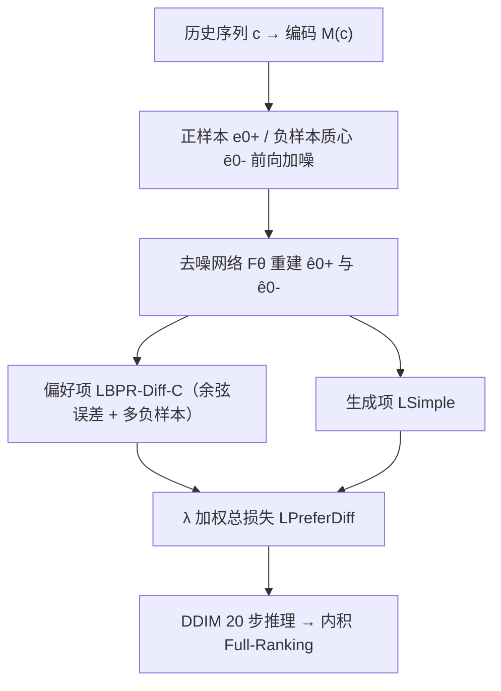

# Preference Diffusion for Recommendation (面向推荐的偏好扩散优化目标)

- **会议/期刊**: ICLR 2025
- **作者与机构**: Shuo Liu, An Zhang, Guoqing Hu, Hong Qian, Tat-Seng Chua（华东师范大学 / 新加坡国立大学 / 中国科学技术大学）
- **推荐链路定位**: 端到端生成式（扩散式下一物品生成召回）
- **研究方向**: 生成式推荐与离散语义ID / 序列与会话推荐
- **论文原文**: [https://arxiv.org/abs/2410.13117v2](https://arxiv.org/abs/2410.13117v2)
- **开源代码**: [https://github.com/lswhim/PreferDiff](https://github.com/lswhim/PreferDiff)

## TL;DR (1分钟核心速览)

扩散推荐器（DreamRec 等）沿用 MSE 或直接套用 BPR/CE，前者与内积检索失配、后者把扩散模型降格为"抗噪打分器"，二者都未让模型理解"用户不喜欢什么"。本文提出 PreferDiff：把 BPR 的评分差改写为对数似然差（LBPR-Diff），用变分推断导出可训练上界，以余弦误差替代 MSE，并用负样本质心替代逐条去噪以支持多负样本，最终以 $\lambda$ 平衡生成与偏好学习。在 Amazon 三域 Full-Ranking 协议下 R@5 相对最强基线提升 5.66%–19.35%，收敛快约 2 倍。

## Background & Motivation (背景与核心矛盾)

- **主流范式**: 以 DreamRec 为代表的扩散推荐器对用户历史序列做条件引导，前向加噪目标物品嵌入、反向去噪生成 $\hat{e}_0$，再与全库物品做最大内积检索；训练目标多为$\mathcal{L}_{\text{Simple}}$（MSE 去噪）或直接搬用 BPR/BCE。
- **前人局限**: 其一，纯生成目标只建模正样本，去噪采样倾向落入高密度区域，预测嵌入可能反而更靠近负样本（图 1(a)）；其二，直接套用 BPR/BCE 只把扩散当抗噪打分器，浪费了似然建模与泛化能力，且 BPR 仅拉大评分 margin，易给负样本高分。
- **核心洞察 (Key Insight)**: 推荐的本质是建模"正样本分布与负样本分布的条件可分性"，而扩散模型恰是似然模型——只要把排序目标写成对数似然比，就能同时获得排序判别力与生成式泛化性。
- **本文切入点**: 将 BPR 的评分函数替换为 softmax 概率，得到 LBPR-Diff，再用变分上界使其可优化。

<figure class="paper-figure" markdown="span">
  <figcaption>图 1：基于 DM 的推荐器所建模的用户偏好分布示意图。(a) 忽略负样本分布会导致预测物品可能更接近负样本。(b) 引入负采样增强了对用户偏好的理解。</figcaption>
</figure>

## Method (核心方法设计)

### 1. 整体框架 (Overall Architecture)

输入为用户历史序列 $c$编码$M(c)$与正/负物品嵌入；前向过程对正样本$e_0^+$与负样本（或其质心$\bar{e}_0^-$）分别加噪至$t$步，去噪网络$F_\theta$在$M(c)$引导下重建两者；训练损失由"生成项$\mathcal{L}_{\text{Simple}}$"与"偏好项$\mathcal{L}_{\text{BPR-Diff-C}}$"按$\lambda$加权；推理时从纯高斯噪声出发用 DDIM（20 步）生成$\hat{e}_0$，与全库物品内积取 Top-K。

### 2. 关键设计拆解 (Key Designs)

1. **LBPR-Diff：把 BPR 从评分排序升级为似然排序**：BPR 只比较打分 $f_\theta$，与扩散的似然目标脱节。定义$p_\theta(e_0|c)=\exp(f_\theta)/Z_\theta$ 代入 BPR 得
$$\mathcal{L}_{\text{BPR-Diff}}=-\mathbb{E}\big[\log\sigma\big(\log p_\theta(e_0^+|c)-\log p_\theta(e_0^-|c)\big)\big]$$
直觉上它要求正样本的对数概率显著高于负样本，而非仅 margin 为正，从而抑制"负样本高分"。

2. **变分上界 + 余弦误差**：上式需对全部扩散路径边缘化而不可解。引入隐变量 $e_{1:T}$、用 Jensen 不等式把期望外提，得到可训练上界
$$\mathcal{L}_{\text{Upper}}=-\mathbb{E}_{t}\big[\log\sigma\big(-(S(\hat{e}_0^+,e_0^+)-S(\hat{e}_0^-,e_0^-))\big)\big]$$
并将 $S$ 由 MSE 换成余弦误差——因为线上检索用最大内积，余弦误差对向量模长与维度不敏感，与召回度量对齐。

3. **多负样本质心近似与训练目标**：逐条对 $|\mathcal{H}|$个负样本去噪代价高且易受假阴性干扰，故用质心$\bar{e}_0^-=\frac{1}{|\mathcal{H}|}\sum_v e_0^{-v}$作为扩散目标，由 Jensen 不等式得$\mathcal{L}_{\text{BPR-Diff-V}}\le\mathcal{L}_{\text{BPR-Diff-C}}$，最小化后者即可。最终
$$\mathcal{L}_{\text{PreferDiff}}=\lambda\mathcal{L}_{\text{Simple}}+(1-\lambda)\mathcal{L}_{\text{BPR-Diff-C}}$$
负样本取自同 batch 内其他序列的下一物品（in-batch，免额外采样器）；梯度权重 $w_\theta=1-\sigma(\cdot)$对"负样本似然反超正样本"的难样本自动加权，故收敛更快。理论上当$\beta=1$、$p_{\text{ref}}$ 为均匀分布时 LBPR-Diff 是 DPO 的特例。

## Experimental Setup & Evaluation Protocol (实验设置与评估协议)

- **数据集与预处理**: 六个公开基准（Amazon Sports/Beauty/Toys、Steam、ML-1M、Yahoo!R1），均做 `5-core` 过滤；主表报告前三者。

| 数据集 | #Users | #Items | #Interactions | 稀疏度/密度 | 特征/场景说明 |
| :--- | :---: | :---: | :---: | :---: | :--- |
| Sports | 25,898 | 18,311 | 296,337 | 6.25e-4 | Amazon 2014 评论，ID 嵌入 |
| Beauty | 22,363 | 12,101 | 198,502 | 7.33e-4 | Amazon 2014 评论，ID 嵌入 |
| Toys | 19,412 | 11,924 | 167,597 | 7.24e-4 | Amazon 2014 评论，ID 嵌入 |

- **数据划分与防穿越 (Splitting Strategy)**: 主表采用 `user-split` 比例划分（8:1:1），每用户按时间排序、保留最后 10 次交互作为历史序列；附录另给 `Leave-One-Out` 结果作交叉验证。
- **排名评测协议 (Ranking Protocol)**: 无偏 `Full-Ranking`（全库未交互物品排序），指标 Recall@5/10 与 NDCG@5/10；负样本训练采用 in-batch 策略。
- **对比基线与超参设置**: 覆盖五类基线——传统序列（GRU4Rec/SASRec/BERT4Rec）、对比学习（CL4SRec）、生成式（TIGER）、扩散式（DiffRec/DreamRec/DiffuRec）、文本式（MoRec/LLM2BERT4Rec）。扩散步数 2000、DDIM 20 步、$p_u=0.1$、$\beta$线性$[10^{-4},0.02]$；非扩散模型$d=64$，扩散模型用更大维度；显著性用$t$-test（$p<0.05$）。

## Key Experimental Results (实验关键数据)

### 1. 主实验对比 (Main Results)

| Model | Sports R@5 | Sports N@5 | Beauty R@5 | Beauty N@5 | Toys R@5 | Toys N@5 |
| :--- | :---: | :---: | :---: | :---: | :---: | :---: |
| SASRec | 0.0047 | 0.0036 | 0.0138 | 0.0090 | 0.0133 | 0.0097 |
| BERT4Rec | 0.0101 | 0.0060 | 0.0174 | 0.0112 | 0.0226 | 0.0139 |
| TIGER | 0.0093 | 0.0073 | 0.0236 | 0.0151 | 0.0185 | 0.0135 |
| DiffRec | 0.0125 | 0.0068 | 0.0195 | 0.0121 | 0.0268 | 0.0142 |
| DiffuRec | 0.0093 | 0.0078 | 0.0286 | 0.0215 | 0.0330 | 0.0262 |
| DreamRec | 0.0155 | 0.0130 | 0.0406 | 0.0299 | 0.0440 | 0.0323 |
| LLM2BERT4Rec | 0.0118 | 0.0076 | 0.0379 | 0.0262 | 0.0339 | 0.0246 |
| **PreferDiff** | **0.0185** | **0.0147** | **0.0429** | **0.0323** | **0.0473** | **0.0367** |
| Improv.% | +19.35% | +16.94% | +5.66% | +9.36% | +7.50% | +13.62% |

### 2. 消融实验 (Ablation Study)

| 变体 | Sports R@5 | Sports N@5 | Beauty R@5 | Beauty N@5 | Toys R@5 | Toys N@5 |
| :--- | :---: | :---: | :---: | :---: | :---: | :---: |
| PreferDiff | **0.0185** | **0.0147** | **0.0429** | **0.0323** | **0.0473** | **0.0367** |
| w/o-N（去偏好项） | 0.0165 | 0.0139 | 0.0415 | 0.0304 | 0.0445 | 0.0349 |
| w/o-C（MSE 替余弦） | 0.0180 | 0.0139 | 0.0393 | 0.0282 | 0.0458 | 0.0356 |
| w/o-C&N（=DreamRec） | 0.0155 | 0.0130 | 0.0406 | 0.0299 | 0.0440 | 0.0323 |

### 3. 关键实验发现 (Key Findings)

1. **偏好项是主要增益来源**：去掉负样本偏好学习（w/o-C&N）后 Beauty R@5 从 0.0429 掉到 0.0406、Sports 从 0.0185 掉到 0.0155，说明"让扩散模型理解负样本"比单纯换度量函数贡献更大；而 w/o-N 与 w/o-C&N 的差距（Sports 0.0165 vs 0.0155）则量化了余弦误差的独立价值。
2. **收敛速度约快 2 倍**：PreferDiff 约 35 epoch / 8 分钟收敛，DreamRec 需约 65 epoch / 15 分钟，且验证集更优——与梯度分析中难负样本获得更高权重 $w_\theta$ 的结论一致。
3. **零样本跨域迁移成立**：仅把 ID 嵌入换成 OpenAI text-embedding-3-large 的 PreferDiff-T，在域内提升 2%–8%、域外（同平台）2%–10%、跨平台 Steam 3%–6%，且训练数据扩 5 倍时 NDCG@5/HR@5 提升近 500%，逼近全监督 SASRec。

## Highlights & Limitations (亮点、对比与审稿批判)

- **与代表作对比 (vs. Prior Work)**: 相较 DreamRec（纯 MSE 生成目标，无负样本意识）与 DiffuRec（直接套 BCE，把扩散当分类器），PreferDiff 首次把排序信号以似然比形式注入扩散训练；相较 TIGER 的语义 ID 自回归路线，本文保留连续嵌入扩散范式但补齐了判别性目标，二者互补而非替代。
- **可迁移亮点**: ①"质心替代逐样本去噪"的多负样本近似技巧可迁移到任何基于扩散/流匹配的召回模型以控制训练开销；②用余弦误差替代 MSE 以对齐内积检索，是生成式召回中低成本高回报的工程改动。
- **审稿级局限批判**: ①对嵌入维度高度敏感，降到 64 维（业界常用）性能骤降，意味着显存与训练成本上升；②对 $\lambda$ 依赖强（最优仅在 0.4/0.6 附近），且需 2000 步扩散 + 20 步 DDIM 推理，实时性弱于 SASRec 类单塔模型；③主实验仅三个 Amazon 域，Steam/ML-1M/Yahoo!R1 置于附录，跨平台结论的证据强度略弱于标题宣称的"six benchmarks"。

## Rating (四维评分)

- **方法创新性 (Novelty)**: ⭐⭐⭐⭐ （首次为扩散推荐器定制个性化排序损失，变分上界推导与 DPO 联系的理论刻画扎实）
- **评估协议与实验扎实度 (Protocol & Experiments)**: ⭐⭐⭐⭐ （Full-Ranking + 五类基线 + 消融 + 零样本迁移完整，但主表仅三域、缺线上验证）
- **写作与数学规范度 (Clarity & Rigor)**: ⭐⭐⭐⭐ （从 BPR 到上界的推导链条清晰，梯度与 DPO 分析有说服力，符号略密）
- **工业落地与复现价值 (Industrial & Practical Value)**: ⭐⭐⭐ （代码开源、收敛快是加分项，但维度敏感与多步去噪推理延迟制约大规模部署）

