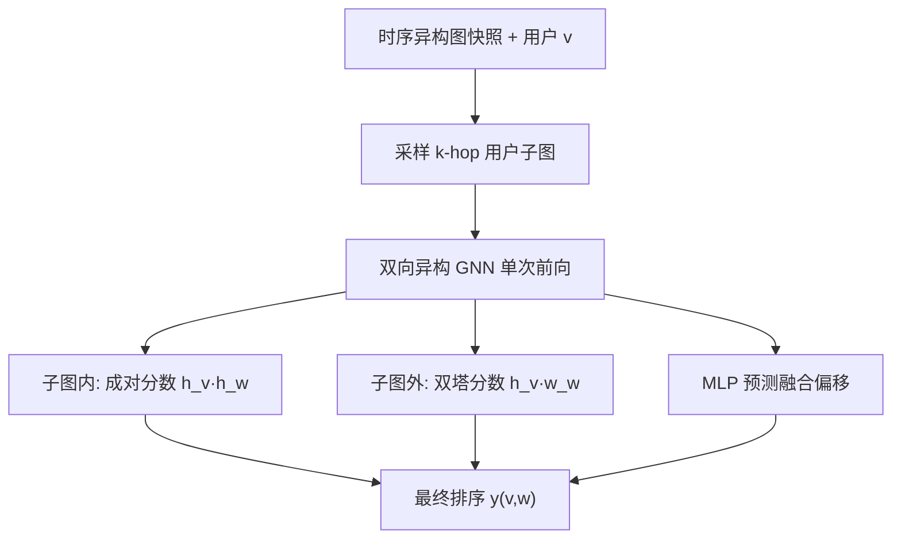
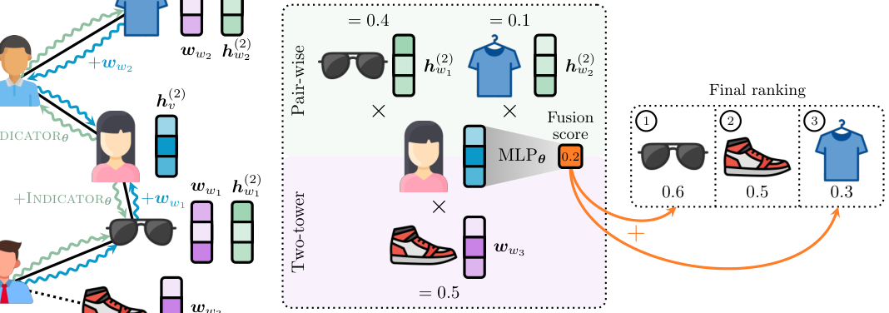

# ContextGNN: Beyond Two-Tower Recommendation Systems (超越双塔推荐系统的上下文图神经网络)

- **会议/期刊**: ICLR 2025
- **作者与机构**: Yiwen Yuan, Zecheng Zhang, Xinwei He, Akihiro Nitta, Weihua Hu, Dong Wang, Manan Shah, Shenyang Huang, Blaž Stojanovič, Alan Krumholz, Jan Eric Lenssen, Jure Leskovec, Matthias Fey (Kumo.AI / Stanford)
- **推荐链路定位**: 召回（单阶段端到端排序）
- **研究方向**: 图神经网络与知识图谱推荐 / 协同过滤与双塔召回
- **论文原文**: [https://arxiv.org/abs/2411.19513v1](https://arxiv.org/abs/2411.19513v1)
- **开源代码**: [https://github.com/kumo-ai/ContextGNN](https://github.com/kumo-ai/ContextGNN)

## TL;DR (1分钟核心速览)

双塔模型学习的是 pair-agnostic 表征，无法区分"复购/熟悉物品"与"探索性物品"；而成对表征虽能建模用户-物品交互细节，却因二次复杂度或候选集受限而难以覆盖全库。ContextGNN 提出混合架构：在用户 $k$-hop 局部子图内用成对表征（pair-wise）精确打分，对子图外"远距离"物品回退到浅层物品嵌入的双塔表征，并用 MLP 学习用户个性化融合分数。在 RelBench 十个任务上，平均 MAP 较最强成对基线 NBFNet 提升 20%，较最强双塔基线提升 344%。

## Background & Motivation (背景与核心矛盾)

- **主流范式**: 推荐系统以双塔架构为主流，用户/物品各自独立编码后经内积解码，推理时可预计算向量并用 MIPS 快速检索。
- **前人局限**: 双塔的用户表征不感知具体候选物品，无法刻画"该用户对该物品"的细粒度依赖；成对表征（如 NBFNet）虽能上下文化预测，但候选集被限制在用户子图内，探索性推荐与冷启动物品完全失效。
- **核心洞察 (Key Insight)**: 作者提出 **locality score** 量化"未来真实物品落在用户 $k$-hop 子图内的比例"，在 RelBench 全部任务上该分数均不超过 0.5（如 rel-amazon 的$k=3$仅 0.168），说明多数真实交互是探索性的、无法被任何长度$\leq 3$ 的路径覆盖。
- **本文切入点**: 既然局部成对表征与全局双塔表征各自覆盖不同物品区间，就让二者共享同一 GNN 骨干、按物品是否在子图内分工，并学习用户级融合权重。

## Method (核心方法设计)

### 1. 整体框架 (Overall Architecture)

模型在异构时序图快照 $G^{(-\infty,T]}$上做下一时刻链接预测。对每个用户$v$采样$k$-hop 子图$\tilde{G}$，经双向异构 GNN 一次前向得到用户表征$h_v^{(k)}$与子图内物品的用户条件表征$h_w^{(k)}$；子图内物品用成对分数$y^{(pair)}=h_v^{(k)}\cdot h_w^{(k)}$排序，子图外物品用双塔分数$y^{(tower)}=h_v^{(k)}\cdot \boldsymbol{w}_w$排序，最后由 MLP 从$h_v^{(k)}$ 预测个性化融合偏移量，端到端训练。

<figure class="paper-figure" markdown="span">
  <figcaption>图1：基于上下文的图神经网络概述。CONTEXTGNN 利用双向 GNNθ 学习用户 h(2)</figcaption>
</figure>

### 2. 关键设计拆解 (Key Designs)

1. **成对表征的时序异构扩展**：在 NBFNet 基础上，向种子用户注入 $d$维 INDICATOR 表征以区分种子与其他采样用户，并将采样子图转为双向图以便读出物品节点表征；同时读出用户与物品两侧表征（而非仅物品侧），使模型能利用完整$k$-hop 用户信息。由于仅需一次 GNN 前向即可为子图内全部物品打分，复杂度为$O(|L|)$而非双塔的$O(|L|\cdot|R|)$。

2. **浅层物品嵌入的双塔回退**：物品侧不跑 GNN，直接用嵌入矩阵 $\mathbf{W}\in\mathbb{R}^{|R|\times d}$。理由有三：物品连接极稠密（热门物品可达百万级交互）易致过平滑与采样困难；浅层嵌入已能捕获流行度、季节性与物品相似度；更重要的是，浅层嵌入使负采样规模可扩至约 1M，而双塔 GNN 因需对每个负样本跑前向，内存上仅能支撑极少负样本。浅层嵌入同时注入用户 GNN 前向（$h_w^{(0)}\leftarrow h_w^{(0)}+\boldsymbol{w}_w$），使两侧表征空间对齐。

3. **用户个性化融合与训练目标**：最终分数为
$$y(v,w)=\begin{cases}y^{(pair)}(v,w)+\mathrm{MLP}_\theta(h_v^{(k)}) & w\in\tilde{V}\cap R\\ y^{(tower)}(v,w) & \text{otherwise}\end{cases}$$
融合偏移量刻画"该用户偏熟悉还是偏探索"，由用户表征直接预测。训练用 sampled softmax 交叉熵，负类集合按优先队列构造：必含全部正样本与 batch 内子图物品并集，其余从子图外均匀采样填充，$C$ 可扩至约 1M（15GB GPU）。推理时双塔分数经 MIPS 检索后与成对分数后处理合并。

## Experimental Setup & Evaluation Protocol (实验设置与评估协议)

- **数据集与预处理**: 采用 RelBench 的 6 个数据集、10 个任务，覆盖电商、服装、技术问答、临床试验等域，均为含多表关系结构的真实时序数据：

| 数据集 | 任务数 | 域说明 | 关键特征 |
| :--- | :---: | :--- | :--- |
| rel-amazon | 3 | 电商购买/评分/评论 | 多行为边类型 |
| rel-hm | 1 | 时尚服装购买 | 高复购率 |
| rel-stack | 2 | 技术社区评论/帖子关联 | 高局部性 |
| rel-trial | 2 | 临床试验申办/机构 | 极低局部性 |

- **数据划分与防穿越 (Splitting Strategy)**: 时序切分，模型仅可访问时间戳 $T$之前的历史，预测$(T,T+i]$ 区间内的真实交互，严格防穿越。
- **排名评测协议 (Ranking Protocol)**: 主实验用 `MAP@k`（$k$ 按任务设定）；IJCAI Contest 上用 `Sampled Ranking`（每实体 99 个采样负样本）报告 HR@k 与 NDCG@k；Amazon-Book 静态任务用 Recall@20 / NDCG@20。
- **对比基线与超参设置**: 基线含 LightGBM、MultiVAE、GraphSAGE、NGCF、NBFNet、Shallow Item；所有 GNN 基线共享同一异构 GraphSAGE 骨干（ResNet 表格编码器 + sum 聚合）以保证公平。隐藏维度 $\{32,64,128,256,512\}$，batch$\{256,512,1024\}$，学习率$\{0.001,0.01\}$，Adam 训练最多 20 epoch。

## Key Experimental Results (实验关键数据)

### 1. 主实验对比 (Main Results)

RelBench 测试集 MAP（%）：

| 任务 | LightGBM | MultiVAE | GraphSAGE | NGCF | NBFNet | Shallow Item | **ContextGNN** | Improv. |
| :--- | :---: | :---: | :---: | :---: | :---: | :---: | :---: | :---: |
| amazon-purchase | 0.16 | 0.23 | 0.74 | 0.88 | 2.06 | 0.56 | **2.93** | +42% |
| amazon-rate | 0.17 | 0.24 | 0.87 | 0.86 | 1.24 | 0.74 | **2.25** | +81% |
| amazon-review | 0.09 | 0.10 | 0.47 | 0.55 | 1.57 | 0.40 | **1.63** | +4% |
| hm-purchase | 0.38 | 0.28 | 0.80 | 0.75 | 2.81 | 0.40 | **2.93** | +4% |
| stack-comment | 0.04 | 0.01 | 0.11 | 0.13 | 12.72 | 0.03 | **13.34** | +5% |
| trial-condition | 4.82 | 2.47 | 2.89 | 3.88 | 11.36 | 0.85 | **11.65** | +3% |
| trial-site | 8.40 | 6.17 | 10.70 | 6.54 | 19.06 | 10.66 | **28.02** | +47% |
| **平均** | 2.01 | 1.29 | 2.08 | 1.72 | 7.71 | 1.81 | **9.23** | +20% |

IJCAI Contest 时序下一物品预测（99 负采样）：

| 模型 | HR@1 | HR@10 | NDCG@10 |
| :--- | :---: | :---: | :---: |
| BERT4Rec | 0.141 | 0.467 | 0.297 |
| MATN | 0.142 | 0.489 | 0.309 |
| TGT | 0.148 | 0.519 | 0.330 |
| **ContextGNN** | **0.411** | **0.667** | **0.534** |

### 2. 消融实验 (Ablation Study)

ContextGNN 与两组件单独使用的对比（测试集 MAP，%）：

| 任务 | 仅成对 (NBFNet) | 仅双塔 (Shallow Item) | **完整 ContextGNN** |
| :--- | :---: | :---: | :---: |
| amazon-purchase | 2.06 | 0.56 | **2.93** |
| amazon-rate | 1.24 | 0.74 | **2.25** |
| hm-purchase | 2.81 | 0.40 | **2.93** |
| stack-comment | 12.72 | 0.03 | **13.34** |
| trial-site | 19.06 | 10.66 | **28.02** |
| **平均** | 7.71 | 1.81 | **9.23** |

效率对比（1000 步优化耗时，秒）：

| 模型 | rel-hm | rel-stack |
| :--- | :---: | :---: |
| GraphSAGE (1 负样本) | 275 | 37 |
| GraphSAGE (100 负样本) | OOM | OOM |
| NBFNet | 77 | 21 |
| **ContextGNN** | **94** | **23** |

### 3. 关键实验发现 (Key Findings)

1. **融合带来正交增益，低局部性任务收益最大**：trial-site 任务上成对与双塔各自已较强（19.06 / 10.66），融合后近乎翻倍至 28.02，说明两组件捕获正交信号；而 locality score 最低的三个任务（0.168/0.170/0.229）上 ContextGNN 较 NBFNet 提升 42%–80%，高局部性任务（0.417/0.298/0.280）仅提升 3%–5%，验证了双塔回退机制恰好在成对表征覆盖不足时发挥作用。
2. **物品侧 GNN 收益有限，浅层嵌入足够且更省**：Shallow Item 与 GraphSAGE/NGCF 等双塔 GNN 表现相当，佐证物品侧深 GNN 信息增益有限；但 trial-condition 任务上 Shallow Item 明显落后，说明少数任务仍需物品侧深度建模，而该信号被 ContextGNN 的成对分支吸收。
3. **单次前向带来显著效率优势**：ContextGNN 仅需一次 GNN 前向，耗时（94s/23s）与单组件 NBFNet（77s/21s）接近，而 GraphSAGE 在 100 负样本时直接 OOM；ContextGNN 可支撑约 1M 负类，这是其排序质量领先的关键工程前提。

## Highlights & Limitations (亮点、对比与审稿批判)

- **与代表作对比 (vs. Prior Work)**: 相较 NBFNet，本文补上了"子图外物品无法排序"的致命短板，并以共享骨干将额外开销压到最低；相较 GraphSAGE/NGCF 等双塔 GNN，本文引入用户条件化的成对表征，突破了 pair-agnostic 的表达上限；相较需多阶段召回+精排的工业方案，本文是单阶段端到端架构，避免了候选生成召回率瓶颈。
- **可迁移亮点**: (1) locality score 可作为数据集诊断指标，先判断任务偏"复购"还是"探索"，再决定是否值得引入成对表征；(2) 用浅层物品嵌入替代物品侧 GNN 以换取百万级负采样，这一"以负采样规模换表征深度"的权衡可直接迁移到大规模召回训练。
- **审稿级局限批判**: (1) 浅层物品嵌入使模型处于 transductive 设定，新物品无法在预测时处理（作者仅提出用物品特征网络替换作为扩展，未实验验证）；(2) 在 Amazon-Book 静态小规模任务上不及 UltraGCN/LightGCL，说明本文优势依赖时序异构与丰富特征，在纯 ID 协同过滤场景下未必占优；(3) 融合分数仅由用户表征预测，未显式建模物品侧不确定性。

## Rating (四维评分)

- **方法创新性 (Novelty)**: ⭐⭐⭐⭐ （以 locality score 实证诊断驱动架构设计，成对+双塔共享骨干的融合思路简洁且有数据支撑，但各组件本身多为已有技术的组合扩展）
- **评估协议与实验扎实度 (Protocol & Experiments)**: ⭐⭐⭐⭐ （RelBench 十任务 + 两个额外数据集覆盖充分，时序防穿越严格，但缺少融合模块的细粒度消融与显著性检验）
- **写作与数学规范度 (Clarity & Rigor)**: ⭐⭐⭐⭐ （locality score 定义清晰、动机链条完整，公式简洁；部分扩展设计仅文字描述缺乏形式化）
- **工业落地与复现价值 (Industrial & Practical Value)**: ⭐⭐⭐⭐⭐ （代码开源、单次前向推理、支持百万级负采样，已在 Kumo.AI 生产环境服务数十客户，工程价值突出）

