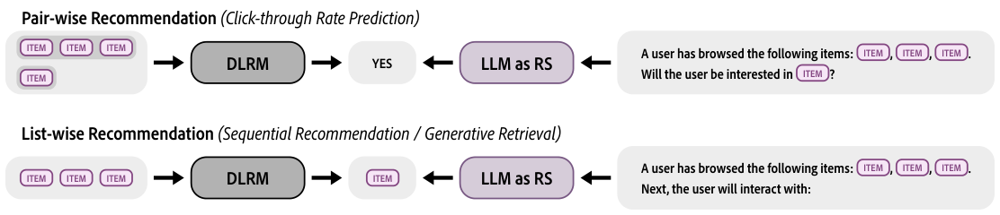
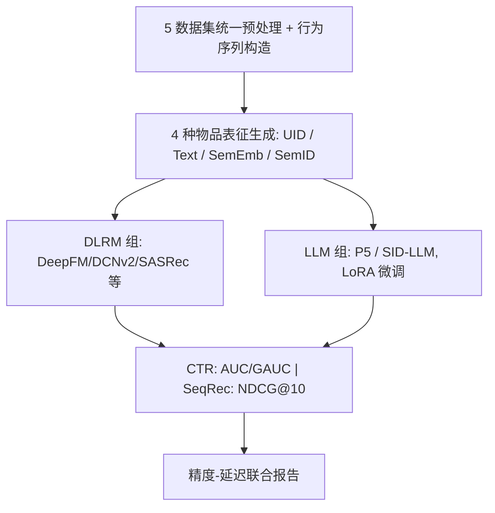

# Can LLMs Outshine Conventional Recommenders? A Comparative Evaluation (大模型能否胜过传统推荐器？一项对比评测)

- **会议/期刊**: NeurIPS 2025 Datasets & Benchmarks Track
- **作者与机构**: Qijiong Liu, Jieming Zhu, Lu Fan, Kun Wang, Hengchang Hu, Wei Guo, Yong Liu, Xiao-Ming Wu（香港理工大学、华为诺亚方舟实验室、南洋理工大学、新加坡国立大学）
- **推荐链路定位**: 精排（CTR 预估）+ 生成式端到端（SeqRec）
- **研究方向**: 大语言模型推荐 / 生成式推荐
- **论文原文**: [论文原文链接](https://arxiv.org/abs/2503.05493v2)
- **开源代码**: [开源代码仓库链接](https://recbench.github.io)

## TL;DR (1分钟核心速览)

本文针对 LLM4Rec 领域"各家自说自话、缺乏统一横评"的痛点，提出 RecBench 基准：统一 4 种物品表征（唯一 ID / 文本 / 语义嵌入 / 语义标识符）、2 类任务（Pair-wise CTR、List-wise SeqRec）、5 个跨域数据集、最多 17 个 LLM 与 10 个 DLRM。结论是 LLM 推荐器在 CTR 上最高提升约 5% AUC、在 SeqRec 上最高提升约 170% NDCG@10，但推理延迟高出传统模型近千倍，LLM-as-RS 在实时场景尚不可行。

## Background & Motivation (背景与核心矛盾)

- **主流范式**: LLM+RS 分两支——LLM-FOR-RS（LLM 作特征编码器/插件增强 DLRM，高效）与 LLM-AS-RS（LLM 直接当推荐器，擅长冷启动与可解释交互）。
- **前人局限**: 现有基准（LLMRec、PromptRec、OpenP5、RSBench 等）存在三重碎片化：(i) 多数只覆盖单一推荐场景；(ii) 物品表征仅限唯一 ID 或纯文本，从未系统纳入语义嵌入与语义标识符；(iii) 对比的 DLRM/LLM/数据集数量少，且几乎不测效率。
- **核心洞察 (Key Insight)**: 物品表征形式是连接推荐系统与 LLM 的"接口"，不同表征会根本性改变 LLM 能否发挥语义理解优势；同时精度提升必须与推理开销放在同一坐标系下衡量才有工程意义。
- **本文切入点**: 构建一个可复用、标准化的横评平台，把"表征 × 任务 × 模型 × 数据集 × 效率"五维拉平到同一实验协议下。

<figure class="paper-figure" markdown="span">
  <figcaption>图1：DLRM与LLM推荐系统在两种场景下的示意图。每个ITEM代表一个占位符，可填入各种物品表示，包括唯一标识符、文本、语义嵌入或语义标识符。</figcaption>
</figure>

## Method (核心方法设计)

### 1. 整体框架 (Overall Architecture)

RecBench 本身不是新模型，而是一套统一实验协议：先对 5 个数据集做等规模预处理与行为序列构造，再按 4 种物品表征生成输入（唯一 ID 走随机初始化嵌入；文本走 GloVe 词表分词但不加载预训练向量；语义嵌入用 Llama-1 7B 抽取；语义标识符用 SentenceBERT + RQ-VAE 离散化），随后分别喂入 DLRM 组（A/B/C/G/H）与 LLM 组（D/E/F/I/J）在 CTR 与 SeqRec 两任务上训练，最后同时记录精度指标与 CPU/GPU 单次推理延迟。

### 2. 关键设计拆解 (Key Designs)

1. **四类物品表征的统一算子化（本文的评测骨架）**：前人基准只比 UID 与文本，本文把语义嵌入与语义标识符纳入同一框架。语义嵌入直接以 LLM 编码初始化物品向量 $\mathbf{t}=g(\mathbf{w}_t)$，让 DLRM 免费获得通用语义；语义标识符则用 4 层、每层 256 码本的 RQ-VAE 把物品压成离散 token 序列，词表仅$V=256\times4=1{,}024$，既压缩词表又保留"内容相近则公共子序列更长"的层级语义。直觉上，前者是"连续语义注入"，后者是"离散语义压缩"，分别对应 LLM-FOR-RS 与生成式检索两条路线。

2. **条件束搜索 CBS（Conditional Beam Search）**：SeqRec 中语义标识符是语义树上的路径，标准 beam search 会产生不对应任何真实物品的非法 token 序列。CBS 在每步解码时只保留能扩展为语义树合法前缀的候选 token，且仅叶节点 token 可贡献正预测 logit。这一约束把"生成自由文本"收紧为"在合法物品空间内检索"，是 SID 类 LLM 推荐器精度能真正兑现的关键工程算子。

3. **训练目标、负采样与推理效率**：CTR 用二元交叉熵 $\mathcal{L}=-\sum_{(u,t)}[y_{u,t}\log\hat{y}_{u,t}+(1-y_{u,t})\log(1-\hat{y}_{u,t})]$，LLM 侧以 YES/NO token 的 softmax 概率$\hat{y}_{u,t}=e^{l_{yes}}/(e^{l_{yes}}+e^{l_{no}})$给出点击率；SeqRec 用类别交叉熵做 next-item 预测。负采样上，MicroLens 与 H&M 无现成负例，按 1:2 负正比采样，行为序列截断至 20。LLM 全部用 LoRA 微调（CTR rank=32/alpha=128，SeqRec 128/128），学习率$1\times10^{-4}$，DLRM 为$1\times10^{-3}$，单卡 A100 训练，非 zero-shot 结果取 5 次均值并做$p<0.05$ 显著性检验。

## Experimental Setup & Evaluation Protocol (实验设置与评估协议)

- **数据集与预处理**: 五域各取约等规模样本以消除规模偏差：

| 数据集 | 领域 | 特征/场景说明 |
| :--- | :---: | :--- |
| MIND | 新闻 | 标题文本，点击行为 |
| MicroLens | 短视频 | 无现成负例，按 1:2 采样 |
| Goodreads | 图书 | 稀疏交互，序列由正反馈时序构造 |
| Amazon CDs | 音乐 | 评论驱动正反馈 |
| H&M | 时尚 | 无现成负例，按 1:2 采样 |

- **数据划分与防穿越 (Splitting Strategy)**: 按用户正反馈时间顺序构造行为序列，序列内做时序切分（next-item 预测），序列截断长度 20。
- **排名评测协议 (Ranking Protocol)**: CTR 用 AUC/GAUC（pair-wise 二分类，非全库排序）；SeqRec 用 NDCG@10、MRR、Recall、F1，正文仅报 NDCG@10，完整结果在网页附录。效率以 1,000 次推理的平均延迟（ms）计。
- **对比基线与超参设置**: DLRM 侧含 DNN/PNN/DCN/DCNv2/DeepFM/MaskNet/FinalMLP/AutoInt/GDCN 及 SASRec 3L–24L；LLM 侧含 P5 系列（BERT/OPT/Llama/Qwen）、SID-BERT/SID-Llama、以及 zero-shot 的 Llama-1/2/3、Mistral、GLM-4、Qwen-2、Phi-2、GPT-3.5、RecGPT 等，共 17 个 LLM。

## Key Experimental Results (实验关键数据)

### 1. 主实验对比 (Main Results)

CTR 场景（AUC，Overall 列为五数据集均值）：

| 表征 | 模型 | MIND | MicroLens | Goodreads | CDs | H&M | Overall | GPU 延迟(ms) |
| :--- | :--- | :---: | :---: | :---: | :---: | :---: | :---: | :---: |
| UID | GDCN | 0.6704 | 0.7571 | 0.5948 | 0.5784 | 0.8120 | 0.6825 | 2.02 |
| Text | GDCN_text | 0.6783 | 0.7842 | 0.5796 | 0.5641 | 0.8555 | 0.6923 | 3.77 |
| SemEmb | DNN_emb | 0.7154 | 0.8141 | 0.5997 | 0.5848 | 0.8717 | 0.7171 | 2.09 |
| Text | Llama-3 7B | 0.7345 | **0.8328** | **0.6826** | 0.6268 | 0.8771 | 0.7508 | 65.11 |
| Text | **Mistral-2 7B** | **0.7353** | 0.8295 | 0.6680 | **0.6754** | **0.8810** | **0.7578** | 76.14 |
| SemID | SID-BERT_base | 0.5704 | 0.5860 | 0.4914 | 0.5042 | 0.5401 | 0.5384 | 8.33 |

SeqRec 场景（NDCG@10）：

| 表征 | 模型 | MIND | MicroLens | Goodreads | CDs | H&M | Overall | CPU 延迟(ms) |
| :--- | :--- | :---: | :---: | :---: | :---: | :---: | :---: | :---: |
| UID | SASRec 24L | 0.0119 | 0.0312 | 0.0601 | 0.1267 | 0.1191 | 0.0698 | 103.41 |
| SemID | SID-SASRec 12L-CBS | 0.0695 | 0.0234 | 0.0140 | 0.0324 | 0.0598 | 0.0398 | 1340 |
| UID | P5-BERT_base | 0.0430 | **0.1867** | **0.0557** | 0.1198 | 0.1075 | 0.1025 | 41.54 |
| SemID | SID-BERT_base-CBS | **0.1682** | 0.1195 | 0.0059 | **0.4616** | **0.1834** | **0.1877** | 1900 |
| SemID | SID-Llama-3 7B-CBS | 0.1677 | 0.0827 | 0.0508 | 0.3898 | 0.1125 | 0.1607 | 177540 |

### 2. 消融实验 (Ablation Study)

以 SeqRec 的 CBS 与表征替换为主轴（NDCG@10，Overall）：

| 配置 | Overall NDCG@10 | 说明 |
| :--- | :---: | :--- |
| SID-SASRec 3L | 0.0081 | 无语义树约束 |
| SID-SASRec 3L-CBS | 0.0306 | +CBS，提升约 278% |
| SID-SASRec 12L | 0.0117 | 加深层数 |
| SID-SASRec 12L-CBS | 0.0398 | +CBS，提升约 240% |
| SID-BERT_base | 0.0941 | 无 CBS |
| SID-BERT_base-CBS | 0.1877 | +CBS，提升约 99% |
| SID-Llama-3 7B | 0.0742 | 无 CBS |
| SID-Llama-3 7B-CBS | 0.1607 | +CBS，提升约 117% |

### 3. 关键实验发现 (Key Findings)

1. **CBS 是 SID 路线的"精度开关"**：所有 SID 模型加上 CBS 后 NDCG@10 普遍翻倍甚至近三倍（SID-BERT_base 0.0941→0.1877），说明离散语义标识符的收益高度依赖"解码必须落在合法物品空间"这一约束，否则 beam search 大量产出非法序列直接稀释精度。
2. **语义嵌入是性价比之王**：DNN_emb 以 2.09 ms 的 GPU 延迟拿到 0.7171 AUC，达到最强 LLM（Mistral-2 7B，0.7578）约 95% 的精度，却快数千倍；这直接支撑了"LLM-FOR-RS 比 LLM-AS-RS 更适合工业落地"的结论。
3. **表征与模型规模存在耦合**：CTR 中语义标识符配小模型（SID-BERT_base 0.5384）反而垫底，说明小模型无力学习离散语义；而 SeqRec 中语义标识符让浅层 SID-SASRec 3L 就超过 24 层 SASRec，但随着层数加深其优势收窄（12L 时 SASRec 反超），表明深层网络可自行从交互中学到序列模式，预训练语义的边际价值递减。

## Highlights & Limitations (亮点、对比与审稿批判)

- **与代表作对比 (vs. Prior Work)**: 相比 OpenP5（仅 UID、仅 SeqRec）、PromptRec（仅文本、仅冷启动）、LLMRec（仅 Beauty 单数据集、无语义标识符），RecBench 首次把语义嵌入与语义标识符纳入统一横评，并把"效率"作为一等评测维度；相比 RSBench（单 LLM、无 DLRM 对比），其模型与数据集覆盖广度是数量级差异。
- **可迁移亮点**: (1) CBS 的"合法前缀过滤"思路可直接迁移到任何基于语义树/码本的生成式检索解码；(2) 用 LLM 编码初始化 DLRM 物品向量（SemEmb 组）是低成本高回报的通用增强手段，几乎不改架构即可涨点。
- **审稿级局限批判**: (1) 效率对比以 CPU/GPU 单次延迟为主，未给出吞吐、批处理与量化/蒸馏后的加速结果，"千倍慢"的结论在工程优化后可能被显著压缩；(2) 数据集被统一裁剪到近似规模，可能削弱各域原生分布特性，且 SeqRec 部分数据集 NDCG@10 绝对值极低（如 Goodreads 0.0059），指标噪声与结论稳健性存疑。

## Rating (四维评分)

- **方法创新性 (Novelty)**: ⭐⭐⭐ （本身不提出新模型，创新在于表征维度扩展与 CBS 工程算子，属基准贡献而非算法突破）
- **评估协议与实验扎实度 (Protocol & Experiments)**: ⭐⭐⭐⭐⭐ （17 LLM × 5 数据集 × 4 表征 × 2 任务，5 次均值 + 显著性检验 + 效率度量，覆盖度在同类基准中领先）
- **写作与数学规范度 (Clarity & Rigor)**: ⭐⭐⭐⭐ （分组 A–J 的组织清晰、公式简洁，但部分表格排版拥挤、正文仅报单一指标略损完整性）
- **工业落地与复现价值 (Industrial & Practical Value)**: ⭐⭐⭐⭐⭐ （开源代码与数据、明确给出"SemEmb 增强 DLRM 保留 95% 精度且快千倍"的可落地结论，对工业选型极具参考价值）

