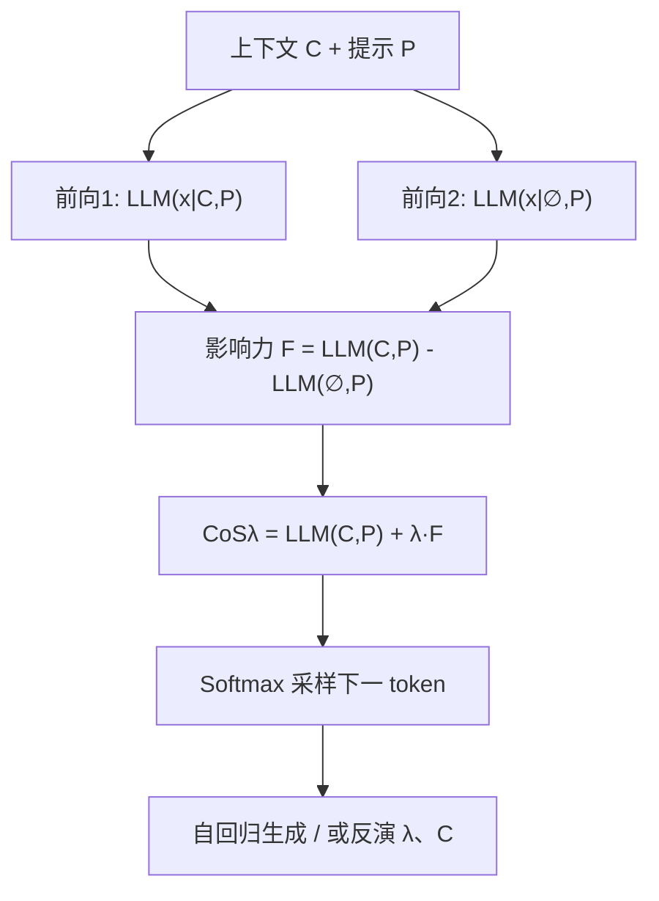

# Context Steering: Controllable Personalization at Inference Time (上下文引导：推理期可控个性化)

- **会议/期刊**: ICLR 2025
- **作者与机构**: Jerry Zhi-Yang He, Sashrika Pandey, Mariah L. Schrum, Anca Dragan (UC Berkeley)
- **推荐链路定位**: 端到端生成式（LLM 解码期干预）
- **研究方向**: 大语言模型推荐 / 对话推荐与智能体
- **论文原文**: [https://arxiv.org/abs/2405.01768v3](https://arxiv.org/abs/2405.01768v3)
- **开源代码**: [https://github.com/sashrikap/context-steering](https://github.com/sashrikap/context-steering)

## TL;DR (1分钟核心速览)

LLM 个性化推荐的两难在于：上下文（"我是幼儿/素食者/喜剧片爱好者"）用得太弱则回答泛化无个性，用得太强则牺牲事实性与通用性；而 prompt 工程与微调都需收集"上下文-响应"配对样本，昂贵且难以按场景灵活调节强度。本文提出 Context Steering (CoS)：对同一 LLM 做两次前向（含上下文 $C$与空上下文$\varnothing$），取 logits 差作为"上下文影响力"，再以标量$\lambda$线性放大/抑制后重新 softmax 解码，全程零训练、零样本。在电影个性化摘要的用户研究中，个性化评分随$\lambda$单调上升（Spearman$\rho=0.67$,$p<.001$），GPT-4 成对胜率评估中 CoS 稳定优于 in-context 与多轮追问基线；隐式仇恨推文分类上 CoS 达 82%/47%/60.5%，显著超过纯 LLM 分类（50%/37%/62%）。

## Background & Motivation (背景与核心矛盾)

- **主流范式**: LLM 个性化依赖 prompt 拼接上下文、in-context 示例、多轮追问或 SFT/RLHF 微调，本质都是"把上下文塞进输入"或"把偏好烧进权重"。
- **前人局限**: 其一，微调与示例法需预先采集高质量上下文相关响应，跨用户/跨场景迁移时需重训，成本高且不灵活；其二，prompt 拼接只有"全有或全无"两档，无法在"高度个性化"与"保持通用事实性"之间连续调节，而推荐系统恰恰需要这种可调性（既要贴合偏好，又要保留探索空间）。
- **核心洞察 (Key Insight)**: LLM 的 next-token 似然本身就编码了上下文与后续文本的关联强度——含上下文与不含上下文的 logits 之差，就是一个可直接读取、可线性缩放的"上下文影响力向量"。
- **本文切入点**: 把个性化从"训练/提示问题"重构为"解码期概率重加权问题"，用一个标量 $\lambda$ 作为连续旋钮。

## Method (核心方法设计)

### 1. 整体框架 (Overall Architecture)

给定用户上下文 $C$（如"I like comedy movies"）与提示$P$（如"Tell me about Blade Runner 2049"），CoS 在每一步解码时并行执行两次前向：一次输入$(C,P)$，一次输入$(\varnothing,P)$，两者 logits 相减得到上下文影响力$F_{C,P}(x_i)$；再以$\lambda$线性缩放叠加回原 logits，softmax 后采样下一 token，自回归直至结束。反向使用时，固定生成文本$X$，对候选$\lambda$或候选上下文$C$ 计算前向似然并取 MAP，即得贝叶斯反演。整个流程不更新任何参数，仅增加一次前向开销。

### 2. 关键设计拆解 (Key Designs)

1. **上下文影响力函数与线性缩放解码**：痛点是 prompt 拼接无法调节强度。CoS 定义 $F_{C,P}(x_i)=\mathrm{LLM}(x_i|C,P)-\mathrm{LLM}(x_i|\varnothing,P)$，并令
$$\mathrm{CoS}_\lambda(x_i|C,P)=(1+\lambda)\,\mathrm{LLM}(x_i|C,P)-\lambda\,\mathrm{LLM}(x_i|\varnothing,P).$$
$\lambda=-1$退化为无上下文、$\lambda=0$等价于普通拼接、$\lambda>0$放大个性化。直觉上这是在 logit 空间沿"上下文方向"做外推，等价于对概率分布做几何插值/外推：$P_{\mathrm{CoS}}(X|C,P)\propto P(X|\varnothing,P)\big(P(X|C,P)/P(X|\varnothing,P)\big)^{\lambda}$，因此既保留语言模型的基础流畅性，又能连续调节个性化强度。

2. **贝叶斯反演：从生成到意图量化**：痛点在于开放式文本的隐式立场难以分类。将前向模型视为生成模型后，可反解 $\lambda$的后验$P(\Lambda=\lambda|X,C,P)=\frac{1}{Z_\Lambda}\mathrm{CoS}_\lambda(X|C,P)$，或反解上下文$P(C=c|\lambda,X,P)=\frac{1}{Z_C}\mathrm{CoS}_\lambda(X|C=c,P)$，实践中以候选集上的 MAP 替代不可解归一化常数。为消除"主题词本身提升所有相关 token"的混淆，采用上下文对差分$\bar{C}=C^+-C^-$（如"高 STEM 熟练度"减"低 STEM 熟练度"），使影响力只捕捉方向性差异。

3. **训练目标、负采样与推理效率**：无训练损失、无负采样，纯推理期方法。单上下文开销为两次前向（约为普通生成的 2 倍，实测每字符耗时约为 in-context 的 2 倍但低于多轮追问的累积开销）；扩展到 $N$个上下文时复杂度$O\big(N(\max_i L_{C_i}+L_p+L)^2 d\big)$，随上下文数线性增长；反演复杂度随候选集$|\Lambda|$或$|C|$线性增长。数值稳定区间经验上为$-4\le\lambda\le4$，超出后出现词语粘连、外语乱码等退化。

## Experimental Setup & Evaluation Protocol (实验设置与评估协议)

- **数据集与预处理**: 本文非传统 ID 型推荐基准，评估由三部分组成：

| 数据集/场景 | 规模 | 构造方式 | 评估对象 |
| :--- | :---: | :---: | :--- |
| 电影个性化摘要（自建） | 10 部电影 × 7 类型，随机采样 (movie, genre) 对 | 刻意选取正交对（如"喜欢喜剧"×"Blade Runner 2049"） | 15 名用户 Likert 1–5 打分 + GPT-4 成对评判 |
| Implicit Hate (ElSherief et al., 2021) | 按 target group 分组，Black(2)/Immigrant(3)/Muslim(2) 类隐式陈述 | 众包隐式仇恨推文，含反讽/双关 | 分类准确率 + 与 3 名专家评分的相关性 |
| LaMP / OpenbookQA / BBQ | 标准公开集 | 个性化基准、事实性、去偏 | Rouge-1/L、准确率、偏见率 |

- **数据划分与防穿越 (Splitting Strategy)**: 用户研究采用组内随机打乱呈现顺序以隐藏 $\lambda$；LaMP 的$\lambda$ 在训练集上选取、在留出集报告；隐式仇恨分类为组内多类判别，无时间切分。
- **排名评测协议 (Ranking Protocol)**: 非 Full-Ranking 检索式评测，而是生成质量评测——人类 Likert 评分、GPT-4 成对胜率（与人类判断一致率 68%，含平局 77%）、分类准确率与 MAP 排序相关性。
- **对比基线与超参设置**: 基线为 (1) 无上下文 $\lambda=-1$、(2) 直接拼接$\lambda=0$、(3) 多轮追问"make it more personalized"、(4) in-context 单示例学习；主模型 Llama-2-7B / Llama-2-7B-chat，温度 0.6，泛化性另测 Mistral、T0pp、GPT-J、Olmo-7B。

## Key Experimental Results (实验关键数据)

### 1. 主实验对比 (Main Results)

隐式仇恨分类准确率（$\lambda=-0.5$，$N_c$ 为候选隐式陈述数）：

| 方法 | Black (2) | Immigrant (3) | Muslim (2) |
| :--- | :---: | :---: | :---: |
| 纯 LLM 分类 | 50% | 37% | **62%** |
| **CoS** | **82%** | **47%** | 60.5% |
| 人类标注 | 88% | 64% | 63% |

个性化生成（GPT-4 成对胜率与计算开销）：

| 方法 | 相对个性化胜率 | 每字符耗时 |
| :--- | :---: | :---: |
| 直接拼接 ($\lambda=0$) | 基准 | 1× |
| In-context 单示例 | 可退化 | ~1× |
| 多轮追问 | 中等 | 累积膨胀 |
| **CoS ($\lambda$ 调优)** | **稳定领先** | ~2× |

用户研究：个性化评分随 $\lambda\in\{-1,3\}$上升，Spearman$\rho=0.67$（$p<.001$），且在多数单部电影上成立。

### 2. 消融实验 (Ablation Study)

| 配置 | 关键指标 | 说明 |
| :--- | :---: | :--- |
| $\lambda=-1$（无上下文） | 个性化最低、事实性最高 | 退化为通用回答 |
| $\lambda=0$（拼接） | 中等个性化 | 常规 prompt 基线 |
| $\lambda=1\sim3$ | 个性化单调上升 | 用户评分与 GPT 胜率同步提升 |
| $\lambda=3$ 于 OpenbookQA | 准确率下降 ≤4.6% | 事实性代价可控 |
| $\lambda=\pm6\sim8.5$ | 输出退化（粘连/乱码） | 数值不稳定 |
| LaMP 推文改写 | $\lambda=-0.5$ 最优（R-1 0.42 vs 拼接 0.39） | 长上下文含噪声时需负向衰减 |
| 上下文位置 $\alpha$ 变化 | Rouge 基本不变 | 位置不敏感 |

### 3. 关键实验发现 (Key Findings)

1. **$\lambda$是有效且单调的个性化旋钮**：用户评分与$\lambda$强相关（$\rho=0.67$），且 CoS 不只是"风格化"——高$\lambda$ 下模型会主动挖掘"非喜剧片中的幽默元素"（如 Blade Runner 2049 的反讽与黑色幽默），说明影响力作用于内容层面而非仅语气。
2. **生成式反演优于判别式分类**：在隐式仇恨任务上 CoS 在 Black/Immigrant 组分别比纯 LLM 高 32 与 10 个百分点，因其建模的是"上下文→文本"的逻辑蕴含而非表层模式匹配；但在 Muslim 组略逊（60.5% vs 62%），说明候选陈述语义重叠时 MAP 判别仍有边界。
3. **负 $\lambda$与长上下文场景需谨慎**：LaMP 上最优为$\lambda=-0.5/-0.2$而非 0，表明当上下文含大量无关历史时，适度衰减反而过滤噪声；而"低 STEM 熟练度 + 负$\lambda$"并不能等价于"高熟练度 + 正$\lambda$"，因语义空间反向量无明确含义，负向控制的可解释性弱于正向。

## Highlights & Limitations (亮点、对比与审稿批判)

- **与代表作对比 (vs. Prior Work)**: 与 steering vector（Turner et al., 2023；Subramani et al., 2022）在激活层加向量的做法不同，CoS 直接改 logits，更可解释且无需学习探针；与 Contrastive Decoding（Li et al., 2023）用"业余/专家模型"对比不同，CoS 的对比项是"有/无上下文"的同一模型，服务于个性化而非流畅性；与 SFT/DPO 类个性化相比，CoS 零样本、可即时切换强度。
- **可迁移亮点**: (1) 用"上下文对差分 $\bar{C}=C^+-C^-$"消除主题词混淆，可直接迁移到推荐中的偏好方向建模（如"喜欢/不喜欢"对比）；(2) 负$\lambda$ 作为"上下文去噪器"，可用于长用户历史中无关行为的抑制。
- **审稿级局限批判**: 其一，评估以人类小样本（15 人）与 GPT-4 评判为主，缺乏标准推荐基准（如 LaMP 仅作附录小规模验证），且 GPT-4 原始打分分布偏斜、仅成对比较可靠；其二，推理需双倍前向，且 $\lambda$需按任务/场景人工调参、稳定区间窄（$|\lambda|>4$ 即退化），多上下文组合时语义不平衡会导致一个上下文覆盖另一个，工程部署的自动化调参仍是开放问题。

## Rating (四维评分)

- **方法创新性 (Novelty)**: ⭐⭐⭐⭐ （把个性化重构为解码期概率外推，公式极简但视角新颖，且有贝叶斯生成模型的理论包装）
- **评估协议与实验扎实度 (Protocol & Experiments)**: ⭐⭐⭐ （用户研究+GPT 评判+多任务覆盖较全面，但缺标准推荐基准的大规模定量对比，样本量偏小）
- **写作与数学规范度 (Clarity & Rigor)**: ⭐⭐⭐⭐ （影响力函数与反演公式推导清晰，$\lambda$ 的边界语义与数值稳定区间交代明确）
- **工业落地与复现价值 (Industrial & Practical Value)**: ⭐⭐⭐⭐ （代码开源、零训练即插即用，代价仅为 2 倍前向，适合作为 LLM 推荐系统的轻量个性化层）

