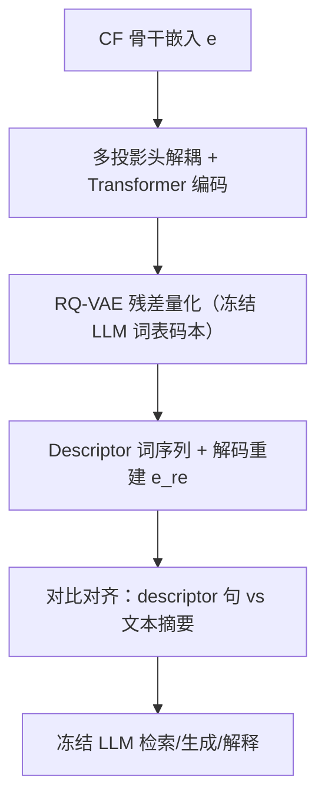
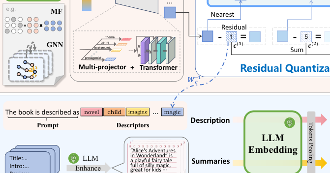

# FACE: A General Framework for Mapping Collaborative Filtering Embeddings into LLM Tokens (将协同过滤嵌入映射为 LLM Token 的通用框架)

- **会议/期刊**: NeurIPS 2025
- **作者与机构**: Chao Wang, Yixin Song, Jinhui Ye, Chuan Qin, Dazhong Shen, Lingfeng Liu, Xiang Wang, Yanyong Zhang（USTC / HKUST-GZ / 中科院计算机网络信息中心 / NJUAA）
- **推荐链路定位**: 召回（表征增强与可解释生成）
- **研究方向**: 大语言模型推荐 / 协同过滤
- **论文原文**: [https://arxiv.org/abs/2510.15729v1](https://arxiv.org/abs/2510.15729v1)
- **开源代码**: [https://github.com/YixinRoll/FACE](https://github.com/YixinRoll/FACE)

## TL;DR (1分钟核心速览)

CF 嵌入是稠密、非语义的隐向量，LLM 无法直接理解；现有 MLP/Q-Former 单向对齐得到的向量偏离 LLM 原生 token 空间，仍需微调才能被解读。FACE 提出模型无关框架：先用多投影头+Transformer 将纠缠的 CF 嵌入解耦为 $n$ 个概念向量，再用以冻结 LLM 词表为码本的残差量化自编码器（RQ-VAE）将其转为离散 token（descriptor），最后用对比学习把 descriptor 与文本摘要语义对齐。在 Amazon-book/Yelp/Steam 三个数据集、全库排序协议下，为 GMF/LightGCN/SimGCL/LightGCL/RLMRec 五种骨干带来最高 7.31%/11.55%/8.00% 的相对提升，且无需微调 LLM。

## Background & Motivation (背景与核心矛盾)

- **主流范式**: 一类工作（TALLRec 等）直接把物品标题等文本喂给 LLM 做推荐，丢失协同信号；另一类（ELM、RLMRec、CoLLM、ILM）用 MLP/Q-Former 把 CF 隐空间单向对齐到 LLM 嵌入空间。
- **前人局限**: ① 单向映射得到的向量偏离 LLM 预训练 token 空间，冻结 LLM 无法真正"读懂"其内在语义，必须微调；② CF 嵌入本身是多偏好纠缠的单一向量，难以分离出可解释的方面；③ 连续嵌入与离散高维 token 嵌入之间存在表示鸿沟。
- **核心洞察 (Key Insight)**: LLM 的词表嵌入本身就携带丰富语义，若把 CF 嵌入"翻译"成词表中的真实 token 序列，冻结 LLM 即可凭其字面知识直接理解，无需任何微调。
- **本文切入点**: 用"解耦投影 + 以 LLM 词表为码本的残差量化 + 对比语义对齐"三件套，把连续 CF 嵌入离散化为可读的 descriptor 词序列。

## Method (核心方法设计)

### 1. 整体框架 (Overall Architecture)

输入是任意 CF 骨干（MF/GNN）输出的用户/物品最终嵌入 $e$。映射阶段：多投影头把$e$拆成$n$个概念方向向量，经 Transformer 编码器建模相互关系后，用冻结 LLM 词表构成的码本做多级残差量化，得到离散 token 序列（descriptor），再由解码器重建回$e_{re}$。对齐阶段：把 descriptor 经伪逆映射回 LLM 词嵌入空间拼成"句子"，与 LLM 生成的用户/物品文本摘要做对比学习对齐。训练采用三步课程式策略（预训练骨干 → 无对齐映射 → 联合对齐优化），推理时 descriptor 可直接供冻结 LLM 做检索、生成与解释。

<figure class="paper-figure" markdown="span">
  <figcaption>图 1：我们的 FACE 框架整体架构。(a) 映射阶段。我们采用类似 RQ-VAE 架构的框架，使用冻结的 LLM 码本对 CF 模型的最终嵌入进行处理，将 CF 嵌入编码为预训练的 LLM token。(b) 对齐阶段。我们利用对比学习实现描述符与摘要的语义对齐。</figcaption>
</figure>

### 2. 关键设计拆解 (Key Designs)

1. **解耦投影 + 冻结词表残差量化（Disentangled RQ Mapping）**：针对 CF 嵌入纠缠且连续不可读的问题，先用正交初始化的 $n$个投影头$e_i = W_i e$拆分概念方向，再经 Transformer 编码得$z_{e_i}$；量化时以 LLM 词表过滤（仅保留 COCA 中有实义的整词）后的嵌入$C_0 = E_{LLM}(D)$为码本，经可训练线性变换$C = W_c C_0$降维（冻结$C_0$、只学$W_c$，借鉴 SimVQ 缓解码本坍缩）。第$h$ 级残差量化取最近码字：
$$r^{(h+1)} = r^{(h)} - c^{(h)}_k,\quad k = \arg\min_j \|r^{(h)} - c_j\|_2^2$$
   多级共享同一码本、逐级叠加 $z_q = \sum_h c^{(h)}$，第一级码字即主 descriptor。直觉：把"一个稠密向量"翻译成"几个真实英文词"，LLM 天然能读；残差多级保证重建精度与语义层次。

2. **对比语义对齐（Contrastive Alignment）**：仅量化得到的词可能语义漂移，故将 descriptor 经伪逆 $W_c^{-1}=(W_c^\top W_c)^{-1}W_c^\top$映回 LLM 词嵌入空间、拼接提示词后送入 LLM 编码器得$h_d$，与固定摘要嵌入$h_s$做温度$\tau$ 的 InfoNCE：
$$\mathcal{L}_{align} = -\frac{1}{|\Omega|}\sum_{v\in\Omega}\log\frac{\phi(d_v,s_v)}{\sum_{v'\in\Omega}\phi(d_v,s_{v'})},\quad \phi(d,s)=\exp\!\big(\tfrac{1}{\tau}\cos(h_d,h_s)\big)$$
   摘要作为稳定语义锚点，迫使 descriptor 强调该用户/物品的判别性属性而非泛化词。

3. **训练目标、负采样与推理效率**：总损失 $\mathcal{L}=\mathcal{L}_R+\mu\mathcal{L}_{map}+\lambda\mathcal{L}_{align}$，其中$\mathcal{L}_{map}=\|e_{re}-e\|_2^2+\sum_h(\|sg[r^{(h)}]-c^{(h)}_k\|_2^2+\beta\|sg[c^{(h)}_k]-r^{(h)}\|_2^2)$，量化处用 STE 反传；对齐负样本为 in-batch 其他实体（免额外负采样）。三步训练避免骨干与离散映射同时从零学习的不稳定。复杂度对实体总数$N$ 线性，量化仅需码本最近邻检索。

## Experimental Setup & Evaluation Protocol (实验设置与评估协议)

- **数据集与预处理**:

| 数据集 | #Users | #Items | #Interactions | 密度 | 场景说明 |
| :--- | :---: | :---: | :---: | :---: | :--- |
| Amazon-book | 11,000 | 9,332 | 120,464 | 1.2e-3 | 图书，含标题/描述/评论 |
| Yelp | 11,091 | 11,010 | 166,620 | 1.4e-3 | 本地商户，含类别属性/评论 |
| Steam | 23,310 | 5,237 | 316,190 | 2.6e-3 | 游戏，含玩法评论 |

- **数据划分与防穿越**: 按 3:1:1 比例划分训练/验证/测试（非时间戳切分）。
- **排名评测协议**: 无偏 `Full-Ranking`（全库未交互物品作为候选），指标 Recall@{5,20} 与 NDCG@{5,20}。
- **对比基线与超参**: 骨干含 GMF、LightGCN、SimGCL、LightGCL、RLMRec（均用 BPR 损失），嵌入维度统一 256；FACE 用 LLaMA2-7B 嵌入模型，descriptor 数 $n=16$、码本维度$d=256$、$\tau=0.02$、$\beta=0.25$、$\mu=1$、$\lambda=0.1$；结果跑 3 次取均值。

## Key Experimental Results (实验关键数据)

### 1. 主实验对比 (Main Results)

| 骨干 | Amazon R@20 | Amazon N@20 | Yelp R@20 | Yelp N@20 | Steam R@20 | Steam N@20 |
| :--- | :---: | :---: | :---: | :---: | :---: | :---: |
| GMF | 0.1531 | 0.0922 | 0.1052 | 0.0660 | 0.1343 | 0.0844 |
| GMF + FACE | 0.1553 | 0.0955 | 0.1120 | 0.0717 | 0.1411 | 0.0888 |
| LightGCN | 0.1563 | 0.0961 | 0.1141 | 0.0726 | 0.1361 | 0.0862 |
| LightGCN + FACE | **0.1622** | **0.1009** | **0.1203** | **0.0766** | **0.1439** | **0.0912** |
| SimGCL | 0.1617 | 0.1001 | 0.1209 | 0.0775 | 0.1420 | 0.0899 |
| SimGCL + FACE | 0.1670 | 0.1047 | 0.1225 | 0.0781 | 0.1487 | 0.0951 |
| LightGCL | 0.1712 | 0.1114 | 0.1228 | 0.0780 | 0.1234 | 0.0815 |
| LightGCL + FACE | 0.1759 | 0.1148 | 0.1253 | 0.0793 | 0.1238 | 0.0818 |
| RLMRec | 0.1572 | 0.0981 | 0.1165 | 0.0737 | 0.1408 | 0.0887 |
| RLMRec + FACE | 0.1581 | 0.0985 | 0.1196 | 0.0755 | 0.1432 | 0.0901 |

（表中加粗为各列最优；FACE 对每个骨干均带来一致提升，最大相对增益 Amazon 7.31%、Yelp 11.55%、Steam 8.00%。）

### 2. 消融实验 (Ablation Study)

| 数据集 | 变体 | Recall@20 | NDCG@20 |
| :--- | :--- | :---: | :---: |
| Amazon-book | Full | **0.1622** | **0.1009** |
| Amazon-book | w/o trans | 0.1611 | 0.0994 |
| Amazon-book | w/o recons | 0.1586 | 0.0981 |
| Amazon-book | w/o align | 0.1565 | 0.0962 |
| Yelp | Full | **0.1203** | **0.0766** |
| Yelp | w/o trans | 0.1200 | 0.0762 |
| Yelp | w/o recons | 0.1191 | 0.0760 |
| Yelp | w/o align | 0.1171 | 0.0741 |

### 3. 关键实验发现 (Key Findings)

1. **对齐是性能主引擎**：去掉对比对齐后 Amazon R@20 从 0.1622 掉到 0.1565（-3.5%）、Yelp 从 0.1203 掉到 0.1171，说明文本语义注入是增益主来源，量化映射本身只是"通道"。
2. **重建解码器不可省**：w/o recons 在 Amazon 掉到 0.1586，因单向映射丢失信息、descriptor 多样性下降；Transformer 影响最小（0.1611），仅起概念间通信的微调作用。
3. **可解释性可量化**：descriptor 仅 16 个 token，LLM 在 10 候选物品检索准确率高达 0.87–0.93（50 候选仍 0.62–0.74）；生成任务中生成物品与真值摘要余弦相似度显著高于随机物品；40 用户真实标注中 FACE descriptor 解释排名（1.915）略优于 RLMRec 段落 profile（1.935），以 1/10 长度达到同等解释力。

## Highlights & Limitations (亮点、对比与审稿批判)

- **与代表作对比 (vs. Prior Work)**: 相比 RLMRec（对比/生成式对齐隐空间）与 ELM/CoLLM（MLP/Q-Former 单向适配器），FACE 的关键差异是把 CF 嵌入落到 LLM **原生离散 token 空间**而非连续嵌入空间，因此冻结 LLM 即可解读；相比 BinLLM 的 IP 式数字串编码，FACE 用真实词表 token，无需微调即可理解。
- **可迁移亮点**: ① "冻结词表 + 可训练线性变换"的码本设计（SimVQ 思路）可迁移到任何需要把连续表征离散化的场景（语义 ID、生成式召回）；② 解码器可反向作为"文本→CF 嵌入"生成器，天然支持零样本冷启动（附录中 Amazon R@5 0.0630 vs AlphaRec 0.0505）。
- **审稿级局限批判**: ① 实验仅用 7B 级嵌入模型，更大 LLM 与序列推荐场景未验证；② 主实验提升幅度偏小（部分骨干 <1%），且未报告显著性检验；③ 三步训练与多超参（$n,d,\lambda$）增加调参成本，码本最近邻检索在超大词表下的开销未量化。

## Rating (四维评分)

- **方法创新性 (Novelty)**: ⭐⭐⭐⭐ （首次把 CF 嵌入直接映射为 LLM 原生词表 token，解耦+RQ+对比三件套组合新颖，但各组件均为已有技术迁移）
- **评估协议与实验扎实度 (Protocol & Experiments)**: ⭐⭐⭐⭐ （三数据集、五骨干、全库排序、消融与多 LLM 泛化齐全，但缺显著性检验且增益幅度有限）
- **写作与数学规范度 (Clarity & Rigor)**: ⭐⭐⭐⭐ （RQ-VAE 与对比损失公式清晰、伪逆映射推导完整，复杂度分析到位；部分符号与 RLMRec 重叠需对照阅读）
- **工业落地与复现价值 (Industrial & Practical Value)**: ⭐⭐⭐⭐ （模型无关插件、代码开源、复杂度对实体数线性，descriptor 可支撑冷启动与可控推荐；但依赖 LLM 嵌入服务带来额外工程成本）

