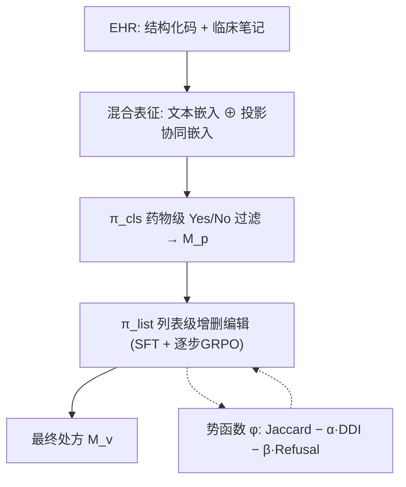
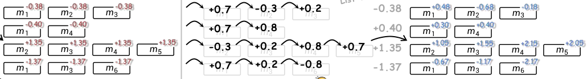

# Fine-grained List-wise Alignment for Generative Medication Recommendation (面向生成式用药推荐的细粒度列表级对齐)

- **会议/期刊**: NeurIPS 2025 (Spotlight)
- **作者与机构**: Chenxiao Fan, Chongming Gao, Wentao Shi, Yaxin Gong, Zihao Zhao, Fuli Feng (中国科学技术大学)
- **推荐链路定位**: 端到端生成式（两阶段：药物级过滤 + 列表级精修）
- **研究方向**: 大语言模型推荐 / 强化学习与动态探索推荐
- **论文原文**: [https://arxiv.org/abs/2505.20218v2](https://arxiv.org/abs/2505.20218v2)
- **开源代码**: [https://github.com/cxfann/Flame](https://github.com/cxfann/Flame)

## TL;DR (1分钟核心速览)

现有多病共存用药推荐普遍采用 point-wise 范式，逐药独立打分再聚合，天然无法建模药物协同与 DDI 安全约束；LLM 方案虽引入临床文本，但仍沿用该范式。本文提出 FLAME，把处方生成重构为"逐药增删"的序列决策过程，用**逐步 GRPO + 势函数奖励塑形**为每个药物决策分配细粒度优势，并以混合表征注入结构化协同信号。在 MIMIC-III 上 Jaccard 0.4836 / F1 0.6408 全面超越 LAMO 等 9 个基线，且通过调节惩罚系数 $\alpha$ 实现安全-精度可控权衡，跨时间（MIMIC-IV）与跨机构（eICU）泛化均领先。

## Background & Motivation (背景与核心矛盾)

- **主流范式**: 以 LEAP/GAMENet/SafeDrug/MoleRec 为代表的结构化编码方法，以及 LAMO 等 LLM 方法，均采用 point-wise 预测——对每个药物独立输出分数或二分类标签，再取高分药物组成处方集。
- **前人局限**: 其一，point-wise 设计**结构性忽视药物间协同与冗余**（如 Piperacillin 与 Cefepime/Meropenem 适应症重叠却可能被同时推荐），也无法约束 DDI 风险；其二，标准 GRPO 在**序列级**给整条输出打一个标量奖励，同一次补全内所有 token 共享同一优势，无法区分"哪一步加药加对了"。
- **核心洞察 (Key Insight)**: 处方本质是一个**列表级联合决策**，其质量可分解为逐步累积的势能变化；若把每个药物名视为一个决策步，则可用势函数差分提供稠密中间信号，且由 Ng 等奖励塑形理论保证不改变最优策略。
- **本文切入点**: 用"逐药增删"的 MDP 重构生成过程，将 Jaccard 正确性、DDI 安全性、候选集依从性三项打包进势函数 $\phi$，以$\phi$ 的步间差分替代 GRPO 的均匀优势。

## Method (核心方法设计)

### 1. 整体框架 (Overall Architecture)

FLAME 采用级联两阶段：第一阶段药物级分类器 $\pi_{cls}$对候选集$\mathcal{M}_C$中每个药物做 Yes/No 判定，得到个性化子集$\mathcal{M}_p$；第二阶段列表级策略$\pi_{list}$以$\pi_{cls}$初始化，接收"Add Drug / Remove Drug"指令对$\mathcal{M}_p$做增删编辑，最终$\mathcal{M}_v=(\mathcal{M}_p\cup\Delta\mathcal{M}_{add})\setminus\Delta\mathcal{M}_{remove}$。患者表征由 LLM 文本 token 与外部协同嵌入经投影拼接而成。训练上先 SFT 对齐任务格式，再用逐步 GRPO 做偏好对齐。

<figure class="paper-figure" markdown="span">
  <figcaption>图1：GRPO与逐步GRPO中优势计算的对比。(a) GRPO中基于结果的优势为一次补全中的所有药物分配统一奖励。(b) 逐步GRPO将生成视为一系列用药决策，其中每个mi表示一种不同药物并同时定义一个决策步。每一步被赋予一个势函数，其变化反映加入该药物的增量质量（“评估每一步”），这些基于势的信号与列表级结果奖励聚合，得到最终的逐步优势，从而实现</figcaption>
</figure>

### 2. 关键设计拆解 (Key Designs)

1. **逐步 GRPO 与势函数奖励塑形（核心贡献）**：标准 GRPO 的优势 $\hat{A}_{i,t}=\tilde{r}_i$对整条输出恒定，无法定位错误步。本文将输出按药物名切分为$N_i$ 个决策步，定义势函数
$$\phi(\text{step}(t))=\text{Jaccard}(\mathcal{M}_n,\mathcal{M}_{GT})-\alpha\cdot\text{DDI}(\mathcal{M}_n,D)-\beta\cdot\text{RefusalRate}(\mathcal{M}_n,\mathcal{M}_C)$$
并将优势改写为 $\hat{A}_{i,t}=\tilde{r}_i+\lambda\big(\phi(\text{step}(t))-\phi(\text{step}(t)-1)\big)$。直觉上，每加/删一个药，势能增量即刻画该动作对"正确性-安全性"的边际贡献，从而把终端稀疏奖励摊薄为稠密步级信号；定理 4.1 证明该塑形与纯终端奖励诱导相同最优策略（策略不变性），故不牺牲理论最优性。

2. **两阶段级联与可控安全旋钮**：$\pi_{cls}$逐药独立判定，天然无法处理共处方冗余；$\pi_{list}$仅做约 2.03 次/人的轻量编辑，却专门修复这类依赖问题（如移除冗余的 Piperacillin、补回缺失的 Cefepime）。更关键的是，$\pi_{cls}$拟合真实分布导致 DDI 率 0.1336 逼近数据固有 0.1369，而$\pi_{list}$通过势函数中的$\alpha$ 显式调节安全等级，形成可部署的"安全-精度"连续旋钮。

3. **多源知识融合与训练目标**：对每个结构化实体同时构造文本嵌入 $e_{text}$与领域编码器协同嵌入$e_{collab}$（患者级来自 RAREMed、诊断/手术级来自 MICRON、药物级来自 Mole-BERT），经线性投影拼接$e_{fused}=\text{Concat}(e_{text},P(e_{collab}))$注入 LLM 词空间。总目标沿用 GRPO 的裁剪重要性采样形式加 KL 正则，负样本无需显式采样（RL 在线采样$G=8$条补全），$\lambda=5$、$\beta=0.5$、$\alpha\in[0,50]$ 可调。

## Experimental Setup & Evaluation Protocol (实验设置与评估协议)

- **数据集与预处理**: 训练与主评测用 MIMIC-III，泛化测试用 MIMIC-IV 与 eICU；DDI 关系取自 TWOSIDES。结构化码经 GPT-4o 压缩为简短标题，临床笔记抽取现病史/既往史/过敏/入院用药四段。

| 数据集 | #Visits | #Patients | 诊断/手术/药物空间 | 平均就诊数 | 平均药物数/次 |
| :--- | :---: | :---: | :---: | :---: | :---: |
| MIMIC-III | 14,207 | 6,226 | 1676 / 511 / 151 | 2.28 | 23.36 |
| MIMIC-IV | — | — | 跨 ICD-9→10 编码漂移 | — | — |
| eICU | — | — | 多中心分布差异 | — | — |

- **数据划分与防穿越 (Splitting Strategy)**: MIMIC-III 按 4:1:1 比例划分训练/验证/测试；泛化实验采用**时间切分**（MIMIC-III 训练 → MIMIC-IV 按 2008–2019 分时段评测）与**跨机构划分**（eICU 外部验证）。
- **排名评测协议 (Ranking Protocol)**: 非检索式排序任务，采用**集合级指标**——Jaccard、F1（基于 precision/recall）衡量正确性，DDI rate 衡量安全性；无负采样，直接在候选药物全集上评估。
- **对比基线与超参设置**: 8 个传统基线（LEAP、GAMENet、SafeDrug、COGNet、MICRON、MoleRec、NLA-MMR、RAREMed）+ 1 个 LLM 基线 LAMO；骨干为 Llama3.1-Aloe-Beta-8B，bf16 + LoRA，SFT 学习率 5e-4，GRPO 学习率 1e-5、batch 16、num_generations 8。

## Key Experimental Results (实验关键数据)

### 1. 主实验对比 (Main Results)

MIMIC-III 正确性对比（#Med 为预测平均药数，真值 23.43）：

| 模型 | Jaccard | F1 | #Med |
| :--- | :---: | :---: | :---: |
| LEAP | 0.3073 | 0.4610 | 19.69 |
| SafeDrug | 0.3556 | 0.5135 | 22.94 |
| GAMENet | 0.3851 | 0.5422 | 20.02 |
| MoleRec | 0.4081 | 0.5677 | 24.73 |
| RAREMed | 0.4174 | 0.5776 | 23.03 |
| LAMO (LLM) | 0.4701 | 0.6294 | 23.66 |
| **FLAME** | **0.4836** | **0.6408** | **22.24** |
| Improv. vs LAMO | +2.87% | +1.81% | — |

### 2. 消融实验 (Ablation Study)

| 变体 | Jaccard | F1 | 说明 |
| :--- | :---: | :---: | :--- |
| (a) w/o $\pi_{cls}$ | 0.3473 | 0.5024 | 去掉药物级过滤，跌幅最大 |
| (b) w/o $\pi_{list}$ | 0.4785 | 0.6354 | 去掉列表精修 |
| (d) w/o step-wise GRPO | 0.4789 | 0.6367 | 仅 SFT 无 RL |
| (e) 标准 GRPO 替代 | 0.4813 | 0.6385 | 序列级均匀优势 |
| (f) w/o 结构化码 | 0.4535 | 0.6122 | 缺协同信号 |
| (g) w/o 非结构化笔记 | 0.4104 | 0.5692 | 缺临床语义 |
| (j) 随机协同嵌入 | 0.4653 | 0.6231 | 嵌入无领域知识 |
| (k) 换 LLaMA2 骨干 | 0.4591 | 0.6168 | 通用模型弱于医学 LLM |
| **FLAME** | **0.4836** | **0.6408** | — |

### 3. 关键实验发现 (Key Findings)

1. **列表精修的增益小但不可替代**：去掉 $\pi_{list}$仅掉 0.0051 Jaccard，看似边际，但$\pi_{list}$ 平均只做 2.03 次编辑；在 28 个含 Piperacillin 的列表上编辑正确率达 89%，说明其价值集中在 point-wise 无法捕捉的药物冗余/缺失这类"少数关键修正"上。
2. **逐步 GRPO 的相对增益远大于绝对值**：相比标准 GRPO 绝对提升仅 0.0023 Jaccard，但"列表精修相对 point-wise 分类"的优势从 0.0028 扩大到 0.0051，**相对增益 82.1%**；训练曲线（图 6）显示奖励收敛更快更稳，验证稠密中间信号对长编辑序列的必要性。
3. **知识融合与骨干选择均有实质贡献**：去掉非结构化笔记跌幅（0.4836→0.4104）远大于去掉结构化码（→0.4535），说明临床文本是 LLM 路线的主要信息来源；随机协同嵌入（0.4653）显著劣于真实领域嵌入，证明协同信号并非"多一路输入"的形式增益，而是携带了真实共现知识。

## Highlights & Limitations (亮点、对比与审稿批判)

- **与代表作对比 (vs. Prior Work)**: 相比 SafeDrug/GAMENet 用图模块硬约束 DDI，FLAME 把安全约束写进奖励势函数，实现**连续可调**而非固定权衡点；相比 LAMO 仅把临床笔记喂给 LLM 做 point-wise 生成，本文引入列表级 MDP 与步级信用分配；相比 StepGRPO/DAPO 等 token 级改进，本文的切分单元是**语义完整的药物决策步**，且势函数直接编码领域约束（DDI/依从性），而非通用正确性奖励。
- **可迁移亮点**: (1) 势函数奖励塑形 + 策略不变性定理，可迁移到任何"列表生成 + 集合级约束"场景（如组合推荐、多约束套餐生成）；(2) 用外部协同嵌入投影拼接进 LLM 词空间，是低成本注入 ID 类协同信号、避免全参数微调的实用范式。
- **审稿级局限批判**: (1) 8B LLM + 两阶段推理（$\pi_{cls}$ 需对 151 个候选逐一判定）带来显著训练与推理开销，实时临床部署受限，论文自认此为局限；(2) 评测为静态 EHR 数据集上的集合级指标，缺乏真实临床工作流或医生在环的在线验证，且非结构化文本抽取依赖 GPT-4o 外部 API，可扩展性与一致性存疑。

## Rating (四维评分)

- **方法创新性 (Novelty)**: ⭐⭐⭐⭐ （将 GRPO 从序列级优势推进到语义步级势函数塑形，并有策略不变性定理支撑，但势函数设计本身较工程化）
- **评估协议与实验扎实度 (Protocol & Experiments)**: ⭐⭐⭐⭐ （9 个基线 + 12 项消融 + 时间/跨机构双泛化 + 安全-精度曲线，覆盖全面；缺在线或人评验证）
- **写作与数学规范度 (Clarity & Rigor)**: ⭐⭐⭐⭐ （MDP 形式化与定理证明清晰，公式符号统一；部分超参（$\lambda,\beta$）敏感性未系统分析）
- **工业落地与复现价值 (Industrial & Practical Value)**: ⭐⭐⭐ （代码已开源、安全旋钮具临床部署吸引力，但 8B 模型两阶段推理成本高，落地需蒸馏或候选剪枝）

