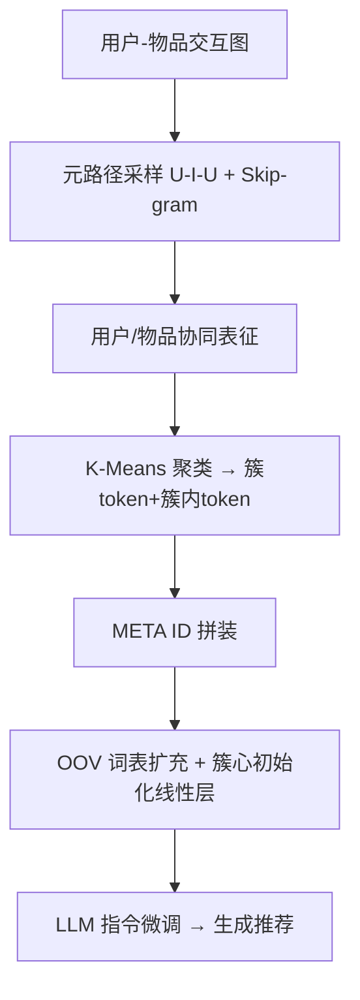
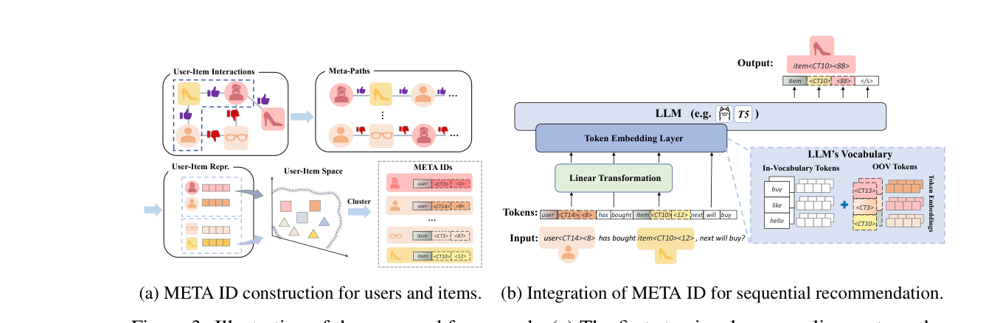

# Improving LLMs for Recommendation with Out-Of-Vocabulary Tokens (用词表外 Token 改进 LLM 推荐)

- **会议/期刊**: arXiv 预印本（投稿中）
- **作者与机构**: Ting-Ji Huang, Jia-Qi Yang, Chunxu Shen, Kai-Qi Liu, De-Chuan Zhan, Han-Jia Ye（南京大学 LAMDA、腾讯微信技术架构部）
- **推荐链路定位**: 端到端生成式（LLM 指令微调）
- **研究方向**: 大语言模型推荐 / 序列推荐
- **论文原文**: [https://arxiv.org/abs/2406.08477v1](https://arxiv.org/abs/2406.08477v1)
- **开源代码**: 暂未开源

## TL;DR (1分钟核心速览)

LLM 推荐普遍用词表内数值 token（如 `item 20 24`）表征用户/物品，导致不同物品共享 token、连续数值被 LLM 近似处理，表征既无区分度（diversity）又丢失协同关联（memorization）。本文提出 META ID：在用户-物品交互图上采样元路径训练 skip-gram，再对表征做 K-Means 聚类，用「簇 token + 簇内序号 token」两级 OOV token 构造用户与物品 ID，并以簇心初始化 OOV 嵌入。在 Amazon Sports/Beauty/Toys 三数据集、全库排序（all-item）协议下，序列推荐 HR@10 相对最强基线 CID 提升 28.8%（Sports 0.0378→0.0487），并同步改善直接推荐、评分预测与解释生成。

## Background & Motivation (背景与核心矛盾)

- **主流范式**: P5 类工作把推荐统一为 Q&A 指令微调，用户/物品用词表内数值 token 拼成的 ID（RID/SID）表征，LLM 通过 token embedding 学习个性化信息。
- **前人局限**: ① 数值 token 数量有限，数千物品被迫复用同一 token 组合，产生「语义冲突」，不同物品表征高度相似（图 1b 热力图）；② CID 虽引入 OOV token 提升区分度，但 token 随机/谱聚类生成，缺乏协同关联，LLM 难以在微调中学到用户-物品相关性。
- **核心洞察 (Key Insight)**: 作者提出 ID 表征应同时具备 **memorization（捕捉用户/物品关联）** 与 **diversity（区分不同物品）** 两个正相关属性，并用 DS（KL 散度均值）与 MS（与调整余弦相似度的 MSE）两个指标量化，实验证明二者之和与 NDCG@10 正相关（图 4）。
- **本文切入点**: 用交互图元路径学到的协同表征做层次聚类，让「相似用户/物品共享 OOV token」，一次性兼顾记忆性与多样性。

## Method (核心方法设计)

### 1. 整体框架 (Overall Architecture)

先在用户-物品评分图上按「相同评分」关系采样 U-I-U 元路径，用 skip-gram 学到共享空间的用户/物品向量；再对全部用户与物品向量联合 K-Means 聚类，为每个簇分配粗粒度 token `⟨CT_i⟩`、簇内按到簇心余弦距离升序分配细粒度 token `⟨y_i⟩`，拼成 `⟨Item⟩⟨CT_i⟩⟨y_i⟩` 形式的 META ID；最后把 OOV token 扩充进 LLM 词表，经线性层（簇心初始化）映射后接入 token embedding，端到端指令微调完成生成式推荐。

<figure class="paper-figure" markdown="span">
  <figcaption>图 3：所提框架示意图：(a) 第一步涉及采样元路径以训练 skip-gram 模型来学习用户和物品的表征。随后，通过聚类其表征，用户和物品由 OOV token 组合构成的 META ID 表示。(b) 结合 META ID 的大型语言模型 (LLM) 被用于序列推荐。LLM 首先将输入序列编码为 token，然后通过 token 嵌入层查找其嵌入。此处，OOV token 在进入之前会经过一个额外的变换层。</figcaption>
</figure>

### 2. 关键设计拆解 (Key Designs)

1. **元路径协同表征（Memorization 来源）**：直接用随机 OOV token 无法携带协同信号。本文定义 U-I-U 元路径 $p=\{U_1\xrightarrow{R_i}I_2\xrightarrow{R_i}U_3\cdots\}$（仅当用户对物品给出相同评分$R_i$时连边），随机游走生成长度 64 的序列训练 skip-gram，最大化$\sum_{v}\sum_{n_i\in N_v}\log P(n_i|v)$。直觉：同评分路径把「口味相近的用户/被同类用户偏好的物品」拉近，使聚类结果天然编码协同结构。

2. **两级 OOV Token 构造（Diversity 来源）**：单一独立 token（IID）需为每个物品新建 token，词表爆炸且学不动（表 7 中 IID HR@10 仅 0.0208 vs META ID 0.0520）。本文用簇心 $\mu_g=\frac{1}{|\mathcal{I}(g_i=g)|}\sum_{(w_i,g_i)\in(W,G)}w_i\cdot\mathbb{I}(g_i=g)$做粗粒度划分，簇内按距离排序给细粒度序号，仅需$G+|I|$ 量级 token（Sports 仅 1600 个）即可唯一标识全部用户与物品，实现「少 token、强区分」。

3. **簇心初始化与训练目标**：随机初始化 OOV 嵌入会让预训练语义被破坏（图 7 显示 Random Init. 在 Sports/Toys 上掉点）。本文将 OOV token 先过线性层 $F(\cdot)$并以簇心$\mu_g$初始化，再送入扩展后的 embedding 层$E'$，目标为$\theta'^*=\arg\min_{(\theta',F)}-\sum_{j=1}^{|y|}\log P_{\theta'}(y_j\mid y_{<j},E'(x),F(x_{\text{OOV}}))$。训练用标准下一 token 交叉熵（无负采样），推理用 beam search + 约束解码（非法 ID 概率置零），T5 单用户序列推荐推理约 74ms。

## Experimental Setup & Evaluation Protocol (实验设置与评估协议)

- **数据集与预处理**（Amazon 2019 年交易记录，沿用 P5 过滤）：

| 数据集 | #Users | #Items | #Reviews | 稀疏度 | 场景说明 |
| :--- | :---: | :---: | :---: | :---: | :--- |
| Sports | 35,598 | 18,357 | 296,337 | 0.0453% | 运动户外 |
| Beauty | 22,363 | 12,101 | 198,502 | 0.0734% | 美妆 |
| Toys | 19,412 | 11,924 | 167,597 | 0.0724% | 玩具 |

- **数据划分与防穿越**: 序列/直接推荐采用 **Leave-One-Out**（用户序列最后一项作测试，构造训练数据时避免泄漏）；评分/解释/评论任务按 **8:1:1 比例随机划分**，保证每用户/物品至少一条训练样本。
- **排名评测协议**: **Full-Ranking（all-item 全库排序）**，beam search 生成候选，约束解码屏蔽非法 ID；指标 HR@5/10、NDCG@5/10。评分任务用 RMSE，文本任务用 BLEU-1/4。
- **对比基线与超参**: 传统序列模型 Caser/HGN/GRU4Rec/BERT4Rec/FDSA/SASRec/S3-Rec/CL4SRec，LLM 基线为 P5 配 RID/SID/CID 三种 ID 策略；骨干为 T5-small（60.75M，全参微调）与 LLaMA2-7b（LoRA，dim=16, α=32）；聚类数 $G=100$（Toys 为 200），skip-gram 窗口 5、负采样 5、学习率 1e-3。

## Key Experimental Results (实验关键数据)

### 1. 主实验对比 (Main Results)

序列推荐（T5 骨干，全库排序）：

| 方法 | Sports HR@10 | Sports N@10 | Beauty HR@10 | Beauty N@10 | Toys HR@10 | Toys N@10 |
| :--- | :---: | :---: | :---: | :---: | :---: | :---: |
| SASRec | 0.0350 | 0.0192 | 0.0605 | 0.0318 | 0.0675 | 0.0374 |
| S3-Rec | 0.0385 | 0.0204 | 0.0647 | 0.0327 | 0.0700 | 0.0376 |
| CL4SRec | 0.0358 | 0.0182 | 0.0546 | 0.0270 | 0.0617 | 0.0305 |
| P5+RID | 0.0288 | 0.0153 | 0.0479 | 0.0277 | 0.0062 | 0.0035 |
| P5+SID | 0.0294 | 0.0196 | 0.0573 | 0.0354 | 0.0088 | 0.0043 |
| P5+CID | 0.0378 | 0.0231 | 0.0507 | 0.0281 | 0.0279 | 0.0143 |
| **META ID (T5)** | **0.0487** | **0.0277** | **0.0753** | **0.0429** | **0.0742** | **0.0429** |
| META ID (LLaMA2-7b) | 0.0561 | 0.0332 | 0.0678 | 0.0391 | 0.0535 | 0.0312 |
| **Improv.% (vs 最强基线)** | **+28.8%** | **+19.9%** | **+16.4%** | **+21.2%** | **+6.0%** | **+14.1%** |

直接推荐（无历史交互）上 META ID 同样全面领先：Sports HR@10 0.0520 vs CID 0.0342（+52.0%），Toys 0.0803 vs SID 0.0041（数量级差距）。评分预测 RMSE 在 Sports 降至 1.0327（CID 1.0383），解释生成 BLEU-1 在 Beauty 达 19.51（CID 19.35）。

### 2. 消融实验 (Ablation Study)

| 变体 | Sports HR@10 | Beauty HR@10 | Toys HR@10 | 说明 |
| :--- | :---: | :---: | :---: | :--- |
| DBSCAN 聚类 | 0.0145 | 0.0428 | 0.0304 | 密度聚类簇不均 |
| Spectral 聚类 | 0.0336 | 0.0588 | 0.0514 | 谱聚类次优 |
| RQ-VAE 分组 | 0.0171 | 0.0536 | 0.0667 | 自实现，量化码本 |
| **K-Means（本文）** | **0.0487** | **0.0753** | **0.0742** | 简单且最优 |
| IID（独立 token） | 0.0208 | 0.0494 | 0.0217 | 词表爆炸、学不动 |
| 仅索引 Item | — | 0.0588* | — | 缺用户侧协同 |
| **User & Item 联合** | — | **0.0753** | — | 双向协同最优 |

（*Beauty 上仅 Item 索引的 HR@10 取自图 5b 对比。）

### 3. 关键实验发现 (Key Findings)

1. **词表内 token 在稀疏数据上崩溃**：Toys 上 RID/SID 的 HR@10 仅 0.0062/0.0088，远低于传统 SASRec 的 0.0675——数值 token 复用导致语义冲突，LLM 微调无法弥补；而 META ID 达 0.0742，反超所有传统模型。
2. **记忆性与多样性可量化且与性能正相关**：CID 的 DS 高但 MS 差（Beauty MS 0.41 vs META ID 0.79），RID/SID 两者皆低；MS+DS 之和与 NDCG@10 呈明显正相关（图 4），验证了双指标设计的有效性。
3. **用户侧索引不可省略**：仅索引物品时 Beauty HR@10 为 0.0588，联合索引用户与物品提升至 0.0753（+28%），说明用户 ID 携带的个性化偏好对生成式推荐同样关键；此外 OOV token 规模存在最优值（图 5a），过大反而引入噪声。

## Highlights & Limitations (亮点、对比与审稿批判)

- **与代表作对比 (vs. Prior Work)**: 相比 P5（纯词表内数值 ID，无语义）、CID（OOV token 但无协同记忆）、RQ-VAE 类语义 ID（仅索引物品、码本与协同脱节），META ID 首次把「图协同表征 → 层次聚类 → 两级 OOV token」串成闭环，并同时覆盖用户与物品两侧。
- **可迁移亮点**: ① DS/MS 双指标可作为评估任意 LLM 推荐 ID 方案表征质量的通用诊断工具；② 簇心初始化 OOV 嵌入的技巧可迁移到任何「新增特殊 token」的 LLM 微调场景（如领域词表扩充）。
- **审稿级局限批判**: ① 元路径依赖评分相等关系，在只有隐式反馈（无评分）的大规模工业场景需重新设计路径定义；② 用户/物品集合固定，新用户/新物品无交互历史即无法聚类（冷启动未解决，作者自认）；③ 仅在 Amazon 三子集、T5/LLaMA2 上验证，缺乏线上 A/B 与更大规模（千万级物品）的可扩展性证据。

## Rating (四维评分)

- **方法创新性 (Novelty)**: ⭐⭐⭐⭐ （首次系统论证 OOV token 的记忆性-多样性权衡，并提出元路径聚类构造方案，思路清晰但组件均为现成技术组合）
- **评估协议与实验扎实度 (Protocol & Experiments)**: ⭐⭐⭐⭐ （三数据集 + 五类下游任务 + 全库排序 + 标准误差报告，消融覆盖聚类方法/token 规模/索引范围，但缺冷启动与线上验证）
- **写作与数学规范度 (Clarity & Rigor)**: ⭐⭐⭐⭐ （DS/MS 指标定义与复杂度优化（$O(|I|^2)$）交代清楚，公式规范；部分符号在正文与附录间略有重复）
- **工业落地与复现价值 (Industrial & Practical Value)**: ⭐⭐⭐ （T5 推理 74ms/用户可接受，token 压缩显著；但代码未开源、依赖评分元路径，工业隐式反馈场景需改造）

