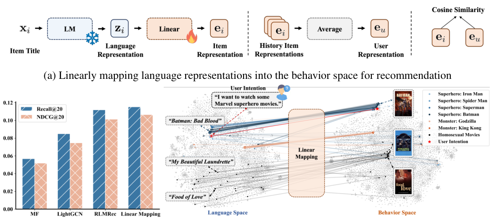
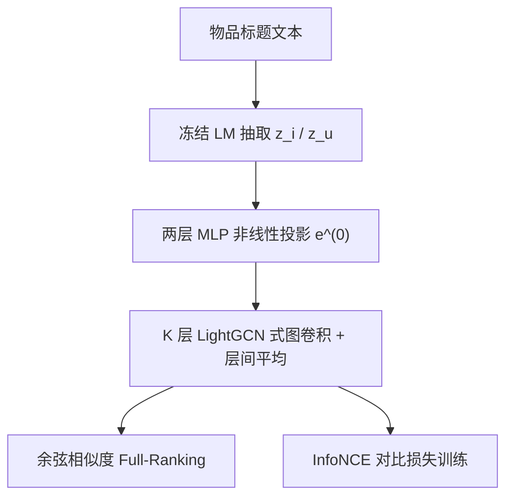

# Language Representations Can be What Recommenders Need: Findings and Potentials (语言表征可以是推荐系统所需之物：发现与潜力)

- **会议/期刊**: ICLR 2025 (Oral)
- **作者与机构**: Leheng Sheng, An Zhang, Yi Zhang, Yuxin Chen, Xiang Wang, Tat-Seng Chua (NUS & USTC)
- **推荐链路定位**: 召回（CF 表征生成）
- **研究方向**: 大语言模型推荐 / 协同过滤
- **论文原文**: [https://arxiv.org/abs/2407.05441v4](https://arxiv.org/abs/2407.05441v4)
- **开源代码**: [https://github.com/LehengTHU/AlphaRec](https://github.com/LehengTHU/AlphaRec)

## TL;DR (1分钟核心速览)

本文挑战"语言空间与行为空间彼此独立"的主流认知，用线性映射探针证明先进 LM 的物品标题表征经线性投影后即可超越 LightGCN，暗示语言空间与推荐行为空间存在**同构 (homomorphism)**、协同信号已被隐式编码。据此提出**纯语言表征、无 ID embedding** 的 AlphaRec（两层 MLP + 图卷积 + InfoNCE），在 Amazon 三数据集 Full-Ranking 协议下 Recall@20 相对最强 ID-based 基线提升 **6.79%–9.75%**，并额外揭示快速收敛、零样本迁移与意图感知三大潜力。

## Background & Motivation (背景与核心矛盾)

- **主流范式**: 推荐系统长期由 ID-based CF 主导（MF / LightGCN / SGL / XSimGCL），物品表征由 one-hot ID 查表 + 图卷积生成；LM 仅被当作辅助语义特征（KAR、RLMRec）或直接当生成式推荐器。
- **前人局限**: ① ID 表征缺乏语义，**跨域不可迁移**、无法感知文本意图；② 现有 LM-enhanced 方法只是把语言表征"拼接"进 ID 模型，鲜有工作证明语言表征**单独**能打赢 ID 表征；③ 语言空间与行为空间的关系在推荐领域几乎未被显式研究。
- **核心洞察 (Key Insight)**: 作者用**线性映射**（仅一个矩阵 $W$）把冻结 LM 的物品标题表征投影到行为空间，发现先进 LM（Llama2-7B、text-embeddings-3-large）的投影表征在多数指标上已超越 LightGCN，且 BERT 时代模型不行——说明**协同信号是近期大模型才涌现的能力**；t-SNE 显示语义不相似但用户共现高的电影（如同性恋题材）在投影后聚拢，即语言空间编码了**超越 STS 的行为相似性**。
- **本文切入点**: 既然存在同构，就用"合适模型设计"（而非简单替换输入）把语言表征的推荐潜力完全释放出来。

<figure class="paper-figure" markdown="span">
  <figcaption>图1：将语言表示空间中的项目标题线性映射到行为空间，在 Movies &amp; TV（Ni et al., 2019）数据集上取得更优的推荐性能。(1a) 线性映射框架。(1b) 领先的 CF 推荐器与线性映射的推荐性能对比。(1c) 电影表示的 t-SNE（Van der Maaten &amp; Hinton, 2008）可视化，彩色线条连接语言空间（左）与用于推荐的线性投影行为空间（右）中的相同电影或用户意图。</figcaption>
</figure>

## Method (核心方法设计)

### 1. 整体框架 (Overall Architecture)

输入仅为物品**标题文本**：冻结 LM 抽取语言表征 $z_i$，用户语言表征取历史物品均值$z_u=\frac{1}{|\mathcal{N}_u|}\sum_{i\in\mathcal{N}_u}z_i$；随后经**两层 MLP 非线性投影**得$e^{(0)}$，再经$K$ 层轻量图卷积在用户-物品二部图上传播，层间平均得最终表征，用余弦相似度打分、InfoNCE 损失端到端优化投影器与图卷积参数（LM 全程冻结）。推理时对全库物品算内积排序。

### 2. 关键设计拆解 (Key Designs)

1. **非线性投影替代线性映射**：线性映射已证明同构存在，但线性变换挖掘行为相似性不充分；改用 MLP 后 $e_i^{(0)}=W_2\,\text{LeakyReLU}(W_1 z_i+b_1)+b_2$，用户侧共享同参数。直觉是语言空间中行为信号是**非线性纠缠**的，MLP 提供更充分的解耦能力（消融显示去掉 MLP 掉点最明显）。
2. **极简图卷积 + 层间平均**：沿用 LightGCN 的对称归一化聚合 $e_u^{(k+1)}=\sum_{i\in\mathcal{N}_u}\frac{1}{\sqrt{|\mathcal{N}_u|}\sqrt{|\mathcal{N}_i|}}e_i^{(k)}$，最终$e_u=\frac{1}{K+1}\sum_{k=0}^{K}e_u^{(k)}$。作用是把语言表征作为**高质量初值**，仅需少量高阶协同传播即可逼近行为空间，无需复杂网络。
3. **训练目标与效率**：仅用 InfoNCE（无图增广）：
$\mathcal{L}=-\sum_{(u,i)\in\mathcal{O}^+}\log\frac{\exp(s(e_u,e_i)/\tau)}{\exp(s(e_u,e_i)/\tau)+\sum_{j\in\mathcal{S}_u}\exp(s(e_u,e_j)/\tau)}$，
$\mathcal{S}_u$为均匀随机负采样集，$\tau$ 为温度。因语言表征已是好初值，收敛 epoch 数远少于 SGL/XSimGCL（图 3b），训练开销低；推理为一次前向 + 全库内积。

## Experimental Setup & Evaluation Protocol (实验设置与评估协议)

- **数据集与预处理**（用户交互数 <20 剔除，验证/测试中未在训练集出现的物品剔除以规避冷启动）：

| 数据集 | #Users | #Items | #Interactions | 密度 | 场景说明 |
| :--- | :---: | :---: | :---: | :---: | :--- |
| Books | 71,306 | 26,073 | 2,209,030 | 0.0008 | Amazon 图书 |
| Movies & TV | 26,073 | 12,464 | 876,027 | 0.0026 | Amazon 影视 |
| Video Games | 40,834 | 14,344 | 390,013 | 0.0007 | Amazon 游戏 |
| Industrial & Scientific | 15,141 | 5,163 | 82,578 | 0.0010 | 零样本目标域 |
| MovieLens-1M | 6,040 | 3,043 | 995,492 | 0.0542 | 意图实验 |
| Book Crossing | 6,273 | 5,335 | 253,057 | 0.0076 | 零样本目标域 |

- **数据划分与防穿越**: 每用户历史按 **4:3:3 比例划分** train/valid/test（非 Leave-One-Out），测试集剔除训练未见物品。
- **排名评测协议**: 无偏 **Full-Ranking（全库未交互物品排序）**，指标 Recall@20 / NDCG@20 / HR@20；意图实验用 HR@5 / NDCG@5。
- **对比基线与超参**: 经典 CF（MF、MultVAE、LightGCN）、CL-based（SGL、BC Loss、XSimGCL/XSimGCLt）、LM-enhanced（KAR、RLMRec）、无训练 EMB-KNN；默认 LM 为 text-embeddings-3-large；显著性 $p \ll 0.05$。

## Key Experimental Results (实验关键数据)

### 1. 主实验对比 (Main Results)

| 模型 | Movies Recall | Movies NDCG | Games Recall | Games NDCG | Books Recall | Books NDCG |
| :--- | :---: | :---: | :---: | :---: | :---: | :---: |
| MF | 0.0568 | 0.0519 | 0.0323 | 0.0195 | 0.0437 | 0.0391 |
| MultVAE | 0.0853 | 0.0776 | 0.0908 | 0.0531 | 0.0722 | 0.0597 |
| LightGCN | 0.0849 | 0.0747 | 0.1007 | 0.0590 | 0.0723 | 0.0608 |
| SGL | 0.0916 | 0.0838 | 0.1089 | 0.0634 | 0.0789 | 0.0657 |
| XSimGCL | 0.1057 | 0.0984 | 0.1138 | 0.0662 | 0.0879 | 0.0745 |
| KAR | 0.1084 | 0.1001 | 0.1181 | 0.0693 | 0.0852 | 0.0734 |
| RLMRec | 0.1119 | 0.1013 | 0.1384 | 0.0809 | 0.0928 | 0.0774 |
| **AlphaRec** | **0.1221** | **0.1144** | **0.1519** | **0.0894** | **0.0991** | **0.0828** |
| Improv.% (Recall) | +6.79% | +5.34% | +9.12% | +10.75% | +9.75% | +10.51% |

### 2. 消融实验 (Ablation Study)

| 变体 (Books) | Recall@20 | 说明 |
| :--- | :---: | :--- |
| AlphaRec 完整 | **0.0991** | 全组件 |
| w/o MLP（退化为线性映射） | 显著下降 | 非线性投影最关键 |
| w/o 图卷积 | 下降 | 高阶协同传播有增益 |
| w/o InfoNCE（换 BPR 类） | 下降 | 对比损失是核心 |
| XSimGCLt（仅换输入） | 0.0900 | 简单替换 ID 输入无效 |

### 3. 关键实验发现 (Key Findings)

1. **"换输入"不等于"换范式"**：XSimGCLt 把 ID embedding 换成语言表征后仅 0.0900，远低于 AlphaRec 的 0.0991，说明语言表征的威力必须靠 MLP + 图卷积 + InfoNCE 的**配套设计**才能释放，而非即插即用。
2. **零样本能力惊人**：在三源数据集联合训练后直接在全新数据集测试，AlphaRec 在 Industrial & Scientific 上 Recall@20=0.0913，相对最佳零样本基线 VQ-Rec 提升 **157.09%**，甚至超过在该域全量训练的 LightGCN（0.0785）；MovieLens-1M 上 0.1486 亦超全量 LightGCN 的 0.2019 之外的多数基线水平。
3. **意图感知与快速收敛**：引入文本意图表征 $\tilde{e}_u^{(0)}=(1-\alpha)e_u^{(0)}+\alpha e_u^{\text{Intention}}$ 后，MovieLens-1M 上 HR@5 从 0.0793 跃升至 **0.4704**，且无需搜索任务训练即超 TEM（0.2738）；同时 AlphaRec 收敛 epoch 数比 SGL/XSimGCL 更少，验证"语言表征=好初值"的假设。

## Highlights & Limitations (亮点、对比与审稿批判)

- **与代表作对比 (vs. Prior Work)**: 相比 RLMRec/KAR 把语言表征当**辅助特征**拼进 ID 模型，本文彻底抛弃 ID embedding，证明纯语言表征可独立胜任；相比 ZESRec/UniSRec 用 BERT 做零样本序列推荐，本文指出 BERT 时代 LM 未编码协同信号，必须用先进大模型 + CF 专用设计。
- **可迁移亮点**: ① 用"线性映射探针"快速诊断任意 LM 是否编码了某域的行为信号，可作为选型工具；② 语言表征初始化 ID embedding 可显著加速收敛，可直接用于工业冷启动与训练加速。
- **审稿级局限批判**: ① 缺乏理论保证，同构仅为经验观察，且未设计全新 CF 机制（组件均为现成）；② 所有用户共享单一 MLP，缺乏个性化，意图实验中 $\alpha$ 全局固定不够实用；③ 依赖闭源 text-embeddings-3-large API，存在成本与可复现性隐患，且未讨论 LM 预训练数据与评测集重叠的泄漏风险（虽附录用 Amazon 2023 做了补充）。

## Rating (四维评分)

- **方法创新性 (Novelty)**: ⭐⭐⭐⭐ （"语言-行为空间同构"的实证发现极具启发性，但模型组件本身均为现成拼接）
- **评估协议与实验扎实度 (Protocol & Experiments)**: ⭐⭐⭐⭐⭐ （Full-Ranking 无偏协议、6 数据集、零样本/意图/收敛多维分析、显著性检验齐全）
- **写作与数学规范度 (Clarity & Rigor)**: ⭐⭐⭐⭐ （公式简洁清晰，但理论支撑薄弱，同构论证停留在经验层面）
- **工业落地与复现价值 (Industrial & Practical Value)**: ⭐⭐⭐⭐ （代码开源、收敛快、零样本迁移价值高，但依赖闭源 embedding API 增加落地成本）

