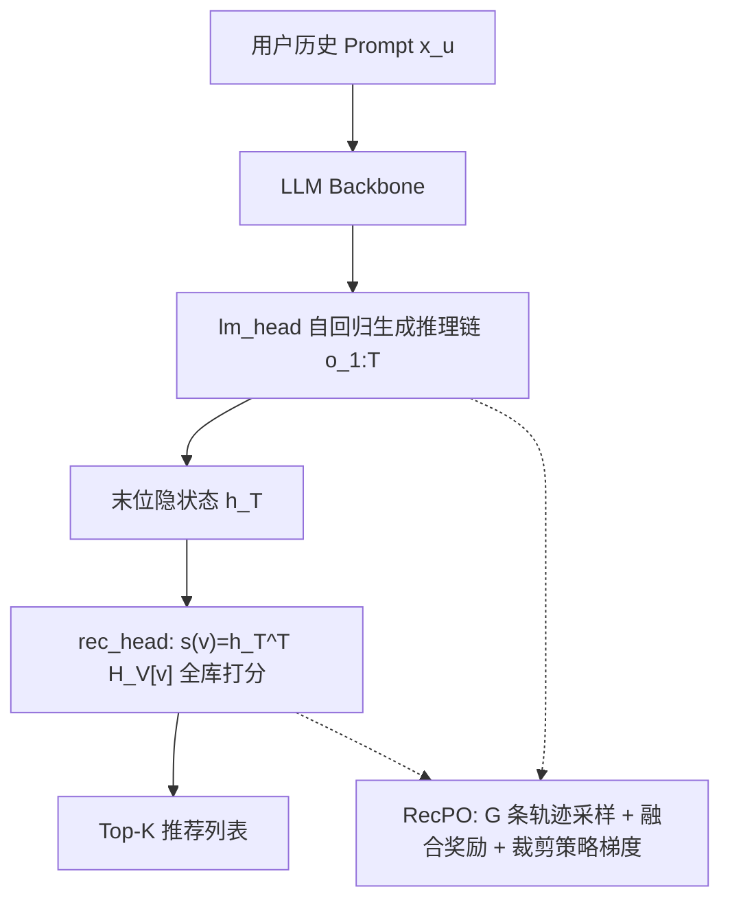
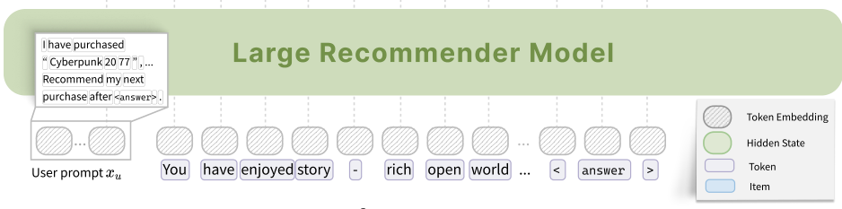

# R$^2$ec: Towards Large Recommender Models with Reasoning (面向具备推理能力的大型推荐模型)

- **会议/期刊**: NeurIPS 2025
- **作者与机构**: Runyang You, Yongqi Li 等（香港理工大学、新加坡国立大学、中国科学技术大学、哈尔滨工业大学（深圳））
- **推荐链路定位**: 端到端生成式（推理链生成 + 单步物品打分）
- **研究方向**: 大语言模型推荐 / 生成式推荐
- **论文原文**: [https://arxiv.org/abs/2505.16994v3](https://arxiv.org/abs/2505.16994v3)
- **开源代码**: [https://github.com/YRYangang/RRec](https://github.com/YRYangang/RRec)

## TL;DR (1分钟核心速览)

现有"推理增强推荐"把推理模型与推荐模型拆成两个模块串行服务，既带来双份显存/延迟开销，又因交替冻结训练导致梯度无法贯通。R$^2$ec 在单个 LLM 上挂载 `lm_head`（生成推理链）与 `rec_head`（内积打分物品）双头，推理结束后用最后隐状态一步完成全库打分，避免物品 ID 自回归解码；并提出 RecPO——以"离散 NDCG 奖励 + 连续 softmax 相似度奖励"融合信号驱动的 RL 框架，无需人工推理标注。在 Amazon 三数据集 Full-Ranking 协议下，NDCG@10 相对最优基线最高提升 72.26%，推理延迟 1.67s（VLLM 下 0.0945s），优于 LangPTune/D3/LLaRA。

## Background & Motivation (背景与核心矛盾)

- **主流范式**: 大型推荐模型分两派——LLM 作编码器（LLaRA、SPRec 用对比学习对齐用户/物品嵌入）与物品 ID 自回归生成（TIGER、D3、BigRec）。
- **前人局限**: 推理增强方案（LangPTune 等）将推理模型与推荐模型解耦为两个独立模块，① 需并行训练、存 checkpoint 与服务，显存与延迟翻倍；② 只能"冻结一个更新另一个"交替优化，梯度无法跨管线流动，推理目标与排序目标难以细粒度对齐。
- **核心洞察 (Key Insight)**: 推理链与推荐共享同一隐状态空间时，推理会直接重塑最终隐状态 $h_T$，从而"免费"改善打分质量；而推荐域缺乏可标注的推理过程，RL 是天然替代，但纯排序指标奖励对同一 top-K 内不同质量轨迹无区分度。
- **本文切入点**: 用双头共享 backbone 把"生成式推理"与"判别式打分"塞进一个模型，再用融合奖励 RL 端到端联合优化。

## Method (核心方法设计)

### 1. 整体框架 (Overall Architecture)

输入用户历史（物品标题序列 + 相对时间戳 + 显式评分）构造 prompt $x_u$，经 decoder-only backbone 得到$h_0$；`lm_head` 自回归生成$T$个推理 token$o_{1:T}$，其末位隐状态$h_T$送入 `rec_head`，与物品嵌入表$H_V\in\mathbb{R}^{|V|\times d}$做内积$s(v)=h_T^\top H_V[v]$一步完成全库排序。训练阶段对每个用户采样$G$ 条"推理-推荐"轨迹，用融合奖励算优势，再以裁剪策略梯度同时更新推理 token 与推荐动作。物品嵌入由模型自身编码物品描述 prompt 的末位隐状态初始化，支持增删改实现零样本物品更新。

<figure class="paper-figure" markdown="span">
  <figcaption>图 1：R2ec 的架构概览，该架构通过两个任务特定头在自回归过程中促进交错推理与推荐：1）用于推理生成的语言建模头（lm_head）；2）用于物品预测的推荐头（rec_head）。</figcaption>
</figure>

### 2. 关键设计拆解 (Key Designs)

1. **双头紧耦合架构（推理即打分前置）**：痛点在于物品 ID 自回归解码开销大、推理会进一步加剧延迟。本文让 `lm_head` 与 `rec_head` 共享同一隐状态空间，推理链生成完毕后仅用一次内积完成打分，把"逐 token 解码物品"降为"单步 next-item prediction"。物理直觉：推理 token 的生成过程等价于对 $h_T$的连续精炼，推理质量直接体现在$h_T$ 的判别性上，二者天然可联合优化。

2. **融合奖励机制（Fused Reward）**：纯 NDCG 奖励是离散的，大量不同质量轨迹落在同一 top-K 排名而获得相同奖励，梯度信号分辨率不足。本文线性融合离散排序奖励与连续相似度奖励：
$$R=\beta R_c+(1-\beta)R_d,\quad R_d=\mathrm{NDCG}@k\big(\mathrm{rank}(v^+)\big),\quad R_c=\frac{\exp(h_T^\top h_{v^+}/\tau)}{\sum_{v\in\mathcal{V}}\exp(h_T^\top h_v/\tau)}$$
其中 $\beta\approx 0.05$保持排序项主导、相似度项仅作同分轨迹间的"破平"信号。消融显示仅用$R_c$会引入噪声反而劣于仅用$R_d$，小权重融合才最优。

3. **联合策略梯度目标与推理/推荐非对称更新**：将整条 $(x_u,o_1,\dots,o_T,v^+)$视为单条 RL 轨迹，重要性比在$t\le T$为 token 级、$t=T+1$ 为推荐动作级（in-batch softmax 概率）。总目标为
$$J(\theta)=\mathbb{E}\Big[\tfrac{1}{G}\sum_{i=1}^{G}\big(\sum_{t=1}^{T}\ell_\epsilon(r_{i,t},A_i)+\delta_{i,i^\star}\ell_\epsilon(r_{i,T+1},A_i)\big)\Big],\quad i^\star=\arg\max_j A_j$$
即所有 $G$ 条轨迹都贡献推理 token 的梯度以保持探索多样性，但**仅优势最高的那条轨迹**对推荐动作回传梯度，把推荐学习聚焦到最有希望的推理路径上。负采样采用 in-batch 全库 softmax（免显式负采样），推理时全库内积排序。

## Experimental Setup & Evaluation Protocol (实验设置与评估协议)

- **数据集与预处理**: Amazon 三域，沿用 TIGER/D3 的预处理与过滤流程（详见原文附录 B）：

| 数据集 | 领域 | 特征/场景说明 |
| :--- | :---: | :--- |
| Instruments | Musical Instruments | 乐器，序列较短、类目集中 |
| CDs and Vinyl | CDs | 音乐唱片，长尾明显 |
| Video Games | Games | 电子游戏，交互最密集 |

- **数据划分与防穿越 (Splitting Strategy)**: 沿用前人工作的序列推荐划分（按用户交互序列切分训练/验证/测试，末位交互作测试目标）。
- **排名评测协议 (Ranking Protocol)**: 无偏 **Full-Ranking（全库未交互物品排序）**，指标 Hit Rate 与 NDCG，截断 $K\in\{5,10,20\}$。
- **对比基线与超参设置**: 传统序列模型（GRU4Rec、Caser、SASRec）、LLM 推荐（TIGER、BigRec、D3、SDPO*、LLaRA*、SPRec）、推理增强（LangPTune）；backbone 为 Gemma2-2B-Instruct 与 Qwen2.5-3B-Instruct，LoRA 微调；显著性 $p<0.05$。

## Key Experimental Results (实验关键数据)

### 1. 主实验对比 (Main Results)

Gemma2-2B backbone 下核心指标（完整 18 列见原文表 1）：

| 方法 | Instruments H@5 | Instruments N@10 | CDs H@5 | CDs N@10 | Games H@5 | Games N@10 |
| :--- | :---: | :---: | :---: | :---: | :---: | :---: |
| SASRec | 0.0175 | 0.0162 | 0.0076 | 0.0119 | 0.0129 | 0.0105 |
| TIGER | 0.0171 | 0.0132 | 0.0067 | 0.0055 | 0.0123 | 0.0116 |
| BigRec | 0.0068 | 0.0058 | 0.0030 | 0.0037 | 0.0156 | 0.0138 |
| D3 | 0.0072 | 0.0080 | 0.0216 | 0.0164 | 0.0117 | 0.0141 |
| SDPO* | 0.0066 | 0.0054 | 0.0022 | 0.0025 | 0.0166 | 0.0155 |
| LLaRA* | 0.0078 | 0.0074 | 0.0097 | 0.0049 | 0.0275 | 0.0223 |
| LangPTune | 0.0130 | 0.0107 | 0.0350 | 0.0274 | 0.0068 | 0.0059 |
| **R$^2$ec** | **0.0264** | **0.0203** | **0.0573** | **0.0472** | **0.0326** | **0.0271** |
| Improv.% | +50.86% | +25.31% | +63.71% | +72.26% | +18.98% | +21.52% |

### 2. 消融实验 (Ablation Study)

| 变体 | Instruments N@5 | CDs N@5 | Games N@5 | 说明 |
| :--- | :---: | :---: | :---: | :--- |
| w/ClsHead | 0.0023 | 0.0025 | 0.0008 | 用分类头替代统一打分，性能崩塌 |
| w/oReasoning | 0.0121 | 0.0321 | 0.0174 | 去推理 token，仅对比学习 |
| w/o $R_d$ | 0.0124 | 0.0338 | 0.0196 | 仅连续相似度奖励 |
| w/o $R_c$ | 0.0160 | 0.0382 | 0.0202 | 仅离散排序奖励 |
| **R$^2$ec** | **0.0161** | **0.0388** | **0.0205** | 融合奖励最优 |

### 3. 关键实验发现 (Key Findings)

1. **推理带来约 15% 平均增益**：`w/oReasoning` 在全部指标上平均落后 R$^2$ec 约 15%，证明 test-time scaling 在推荐域同样成立；而 `w/ClsHead` 几乎归零，说明"推理-推荐共享隐状态 + 内积打分"的紧耦合形式不可替代，分类头切断了推理对打分的直接塑造。
2. **奖励设计存在"分辨率-噪声"权衡**：仅 $R_c$反而劣于仅$R_d$（CDs N@5 0.0338 vs 0.0382），说明连续相似度单独使用会引入噪声；以$\beta=0.05$ 小权重融合后取得最优，验证"排序项主导 + 相似度破平"的设计直觉。
3. **效率与规模双重优势**：R$^2$ec 单卡延迟 1.67s，低于 LangPTune(1.90s)/D3(4.62s)/LLaRA(5.23s)，VLLM 部署后降至 0.0945s，逼近 SASRec 的 0.014s；组大小$G=6\sim8$即饱和，Gemma 因预训练见过更多推理场景，在$G=1$ 时已显著强于 Qwen。

## Highlights & Limitations (亮点、对比与审稿批判)

- **与代表作对比 (vs. Prior Work)**: 相比 LangPTune 的"推理模型 + 推荐模型"两段式串行，R$^2$ec 用单模型双头消除双份服务开销并打通梯度；相比 TIGER/D3 的语义 ID 自回归生成，R$^2$ec 用可增删的物品嵌入表替代硬编码 tokenization，避免大词表解码延迟并支持零样本物品更新；相比 LLaRA 的纯对比学习编码器范式，R$^2$ec 引入 RL 显式优化排序目标。
- **可迁移亮点**: ① "生成头 + 判别头共享隐状态"的双头范式可迁移到任何需要"先解释后决策"的推荐场景（如可解释推荐、对话推荐）；② 融合奖励中"离散指标主导 + 连续相似度小权重破平"的技巧，对任何以排序指标为 RL 奖励的任务都有直接参考价值。
- **审稿级局限批判**: ① 推理链长度 $T$与组大小$G$ 直接决定训练成本，论文未给出显存/训练时长定量对比，且 RL 训练曲线方差大（原文图 2 自承）；② 评测仅限 Amazon 三域、两个 2B–3B 小 backbone，未验证工业级千万物品库下的全库内积检索开销与更大模型上的可扩展性，跨域鲁棒性仅置于附录。

## Rating (四维评分)

- **方法创新性 (Novelty)**: ⭐⭐⭐⭐ （首个将推理与推荐在单模型内紧耦合的工作，双头 + 非对称轨迹更新设计巧妙，但 RL 框架本身沿用 GRPO/RLOO 骨架）
- **评估协议与实验扎实度 (Protocol & Experiments)**: ⭐⭐⭐⭐ （Full-Ranking 无偏协议 + 三类基线 + 9 项分析充分，但数据集仅 3 个 Amazon 域、缺线上验证）
- **写作与数学规范度 (Clarity & Rigor)**: ⭐⭐⭐⭐ （双头与联合目标的公式推导清晰，重要性比分段定义严谨，奖励权重 $\beta$ 的选取依据略偏经验）
- **工业落地与复现价值 (Industrial & Practical Value)**: ⭐⭐⭐⭐ （代码与 checkpoint 开源，VLLM 下延迟接近传统模型，物品嵌入表可增量更新，落地路径明确）

