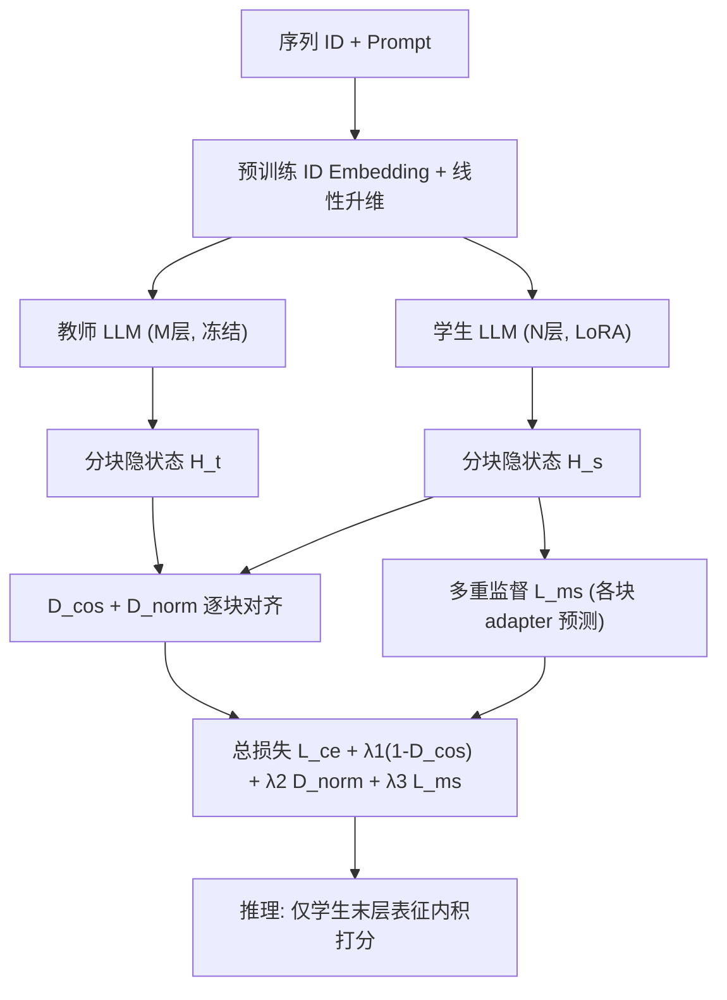

# SLMRec: Distilling Large Language Models into Small for Sequential Recommendation (将大语言模型蒸馏为小模型用于序列推荐)

- **会议/期刊**: ICLR 2025
- **作者与机构**: Wujiang Xu, Qitian Wu, Zujie Liang, Jiaojiao Han, Xuying Ning, Yunxiao Shi, Wenfang Lin, Yongfeng Zhang（Rutgers / Broad Institute / Ant Group / UIUC / UTS）
- **推荐链路定位**: 精排（E-LLMRec 式用户表征 + 内积打分）
- **研究方向**: 大语言模型推荐 / 序列推荐
- **论文原文**: [https://arxiv.org/abs/2405.17890v4](https://arxiv.org/abs/2405.17890v4)
- **开源代码**: [https://github.com/WujiangXu/SLMRec](https://github.com/WujiangXu/SLMRec)

## TL;DR (1分钟核心速览)

LLM4Rec 虽带来约 20% 提升，但参数量暴涨近 70 倍（0.1B→7B+），日处理十亿级流量的工业平台难以部署。本文通过动机实验发现 LLM 中间层存在大量冗余：8 层与 24 层性能几乎持平。据此提出 SLMRec，用「逐层分块特征蒸馏 + 多重监督」把 8 层教师压成 4 层学生，仅用 13% 参数即在 Amazon 四域 1:999 采样排序上追平甚至略超 32 层 E4SRec，训练/推理分别加速 6.6x/8.0x。

## Background & Motivation (背景与核心矛盾)

- **主流范式**: LLM4Rec 分两支——G-LLMRec（P5/LLaRa，把推荐当 next-token 生成）与 E-LLMRec（E4SRec，取 LLM 末层隐状态作用户表征，接 TSR 内积预测头）。后者因可直接全库打分而更受工业青睐。
- **前人局限**: ① 推荐域 scaling law 研究最大只验证到 <1B 参数，且只看 test loss 不看排序指标，无法回答「到底需不需要 7B」；② 即便用 LoRA，7B 模型在每日数十亿日志、持续新物品的平台上仍硬件成本过高、推理不可行。
- **核心洞察 (Key Insight)**: 作者在 Amazon 工业数据上做剪层实验（图 2）：直接取中间层推理会掉点，但**保留前若干层重新训练**时，$l=8$与$l=24$的 HR/NDCG/MRR 几乎重合；甚至$l=2$ 就已超过同层数的 SASRec。说明 LLM 的增益主要来自大隐维度（4096 vs 128）、LLM 初始化与 PEFT，而非深度本身，深层解码器在推荐任务上高度冗余。
- **本文切入点**: 既然深层冗余，就让浅层学生通过**中间层特征蒸馏**去模仿深层教师的表征抽取能力，而非仅模仿其 logits。

## Method (核心方法设计)

### 1. 整体框架 (Overall Architecture)

沿用 E-LLMRec 骨架：预训练 ID embedding 层（来自 SASRec/BERT4Rec）把定长序列 $S\in\mathbb{R}^T$映射为$\mathbb{R}^{T\times d_0}$，线性升维到$d_1$后与 prompt 文本 embedding 拼接送入 LLaMa 解码器；取末层时序输出$h_M$经线性层降回$d_0$作为用户表征，与物品表征内积得$\bar{p}$，softmax 后交叉熵优化。SLMRec 在此骨架上做「教师-学生」双塔：教师$M$层、学生$N$ 层，二者按块对齐中间隐状态，学生额外挂轻量 adapter 做多重监督。训练为离线蒸馏（教师先训好冻结），推理时只保留学生。

### 2. 关键设计拆解 (Key Designs)

1. **逐层分块特征蒸馏（Layer-wise Block Distillation）**：痛点在于 logits 蒸馏只传「答案」不传「怎么编码」，学生学不到教师的表征抽取能力。做法是把教师每 $m$层、学生每$n$层各划一块，共$B=\lfloor M/m\rfloor=\lfloor N/n\rfloor$块，块对块对齐。方向对齐用余弦损失$D_{cos}=\frac{1}{B}\sum_{k=1}^{B}\frac{h_t^{(km)}\cdot h_s^{(kn)}}{\|h_t^{(km)}\|_2\|h_s^{(kn)}\|_2}$，幅度对齐用$D_{norm}=\frac{1}{B}\sum_{k=1}^{B}\|h_t^{(km)}-h_s^{(kn)}\|_2^2$。直觉：余弦管「表征指向同一语义方向」，L2 管「数值尺度不塌缩」，二者互补避免学生只学到方向而丢失能量信息。

2. **多重监督（Multiple Supervision）**：仅对齐中间层仍可能让浅层表征「像教师但不懂推荐」。为此对每个块的表征各接一个降维 adapter $W_a$，独立做一次 next-item 预测，损失$L_{ms}=\frac{1}{B-1}\sum_{k=1}^{B-1}L_{ce}(y,\hat{p}_t^{(km)})$（末块已由主损失覆盖故排除）。这让学生的前几层就被迫编码任务感知的推荐语义，而非单纯模仿。

3. **训练目标、负采样与推理效率**：总损失 $\min_{\Theta_s,W_a}\left[L_{ce}(\Theta_s)+\lambda_1(1-D_{cos})+\lambda_2 D_{norm}+\lambda_3 L_{ms}\right]$。训练采用**全候选 softmax + 交叉熵**（非 BPR/采样负例），评估时另做 1:999 采样排序。学生用 LoRA 更新少量参数，教师冻结；推理仅跑 4 层学生，参数量 0.944B（教师 6.631B），且与量化/剪枝正交可叠加。

## Experimental Setup & Evaluation Protocol (实验设置与评估协议)

- **数据集与预处理**: Amazon 2018 四域，评分 >3 视为正反馈，按时间戳排序，过滤交互 <5 的用户与物品（`5-core`）：

| 数据集 | #Users | #Items | #Interactions | 密度 | 场景说明 |
| :--- | :---: | :---: | :---: | :---: | :--- |
| Cloth | 1,219,678 | 376,858 | 11,285,464 | 0.002% | 服装，极稀疏大规模 |
| Movie | 297,529 | 60,175 | 3,410,019 | 0.019% | 电影 |
| Music | 112,395 | 73,713 | 1,443,755 | 0.017% | 音乐 |
| Sport | 332,447 | 12,314 | 146,639 | 0.008% | 运动，物品极少 |

- **数据划分与防穿越 (Splitting Strategy)**: `Leave-One-Out` 时序切分——最后一条交互作测试、倒数第二条作验证、其余全部训练；按验证集 MRR 选最优模型再报测试集。
- **排名评测协议 (Ranking Protocol)**: `Sampled Ranking`，每用户随机采 999 个未交互负例 + 1 个正例组成 1000 候选排序，指标 HR@{1,5}、NDCG@{5}、MRR。
- **对比基线与超参设置**: 三类基线——TSR（Caser/GRU4Rec/BERT4Rec/SASRec/HGN/LightSANs）、自监督（S3-Rec/DuoRec/MAERec）、G-LLMRec（Open-P5_LLaMa）、E-LLMRec（E4SRec 及 E4SRec8/E4SRec4 剪层版）。学生 4 层、教师 8 层，块数 $B=4$ 最优，LoRA 微调，A100 上 batch 256 训练 / 512 推理。

## Key Experimental Results (实验关键数据)

### 1. 主实验对比 (Main Results)

Cloth / Movie 核心结果（%，加粗为最优）：

| Model | Cloth HR@1 | Cloth HR@5 | Cloth NDCG@5 | Cloth MRR | Movie HR@1 | Movie HR@5 | Movie NDCG@5 | Movie MRR |
| :--- | :---: | :---: | :---: | :---: | :---: | :---: | :---: | :---: |
| SASRec | 13.08 | 16.94 | 15.01 | 15.76 | 5.57 | 16.80 | 11.17 | 12.08 |
| S3-Rec | 14.10 | 18.67 | 16.10 | 16.95 | 7.75 | 20.39 | 15.69 | 14.34 |
| DuoRec | 13.06 | 18.29 | 15.79 | 15.42 | 10.07 | 20.37 | 17.96 | 16.61 |
| MAERec | 13.29 | 18.35 | 15.68 | 16.13 | 8.89 | 20.24 | 16.03 | 15.28 |
| Open-P5 | 14.13 | 17.68 | 17.02 | - | 12.66 | 21.98 | 17.13 | - |
| E4SRec (32层) | **16.71** | 19.45 | **18.09** | **18.77** | 14.74 | 23.79 | 19.45 | 19.74 |
| E4SRec8 | 15.30 | 18.54 | 16.91 | 17.60 | 13.32 | 22.49 | 17.99 | 18.46 |
| E4SRec4 | 14.58 | 18.05 | 16.32 | 17.01 | 11.80 | 21.54 | 16.73 | 17.20 |
| **SLMRec4←8** | 16.69 | **19.47** | 18.07 | 18.74 | **15.29** | **24.25** | **19.90** | **20.36** |

Music / Sport 上 SLMRec4←8 同样全面领先：Music HR@1 5.72 / NDCG@5 7.48 / MRR 8.03（E4SRec 为 5.62/7.50/7.98），Sport HR@1 6.62 / HR@5 9.83 / NDCG@5 8.25 / MRR 8.89（E4SRec 为 6.40/9.67/8.05/8.70）。四域平均排名 SLMRec 为 1.25–1.50，优于 E4SRec 的 1.75。

**效率对比（四域平均，A100）**：

| Method | 训练时间(h) | 推理时间(h) | 训练参数(B) | 推理参数(B) |
| :--- | :---: | :---: | :---: | :---: |
| Open-P5_LLaMa | 0.92 | 4942 | 0.023 | 7.237 |
| E4SRec | 3.95 | 0.415 | 0.023 | 6.631 |
| **SLMRec4←8** | **0.60** | **0.052** | **0.003** | **0.944** |

### 2. 消融实验 (Ablation Study)

Cloth / Movie 上逐项加入正则项（%）：

| 配置 | Cloth HR@1 | Cloth HR@5 | Cloth NDCG@5 | Cloth MRR | Movie HR@1 | Movie HR@5 | Movie NDCG@5 | Movie MRR |
| :--- | :---: | :---: | :---: | :---: | :---: | :---: | :---: | :---: |
| +D_cos | 16.10 | 18.85 | 17.48 | 18.17 | 14.83 | 23.08 | 19.08 | 19.45 |
| +D_cos, D_norm | 16.28 | 19.12 | 17.69 | 18.40 | 14.86 | 23.89 | 19.36 | 19.84 |
| +D_cos, L_ms | 16.85 | 19.05 | 17.96 | 18.59 | 15.05 | 23.48 | 19.40 | 19.76 |
| +D_cos, D_norm, L_ms | **16.69** | **19.47** | **18.07** | **18.74** | **15.29** | **24.25** | **19.90** | **20.36** |

### 3. 关键实验发现 (Key Findings)

1. **蒸馏让学生反超教师**：SLMRec4←8 相对教师 E4SRec8 在 Cloth/Movie 上约提升 8%（如 Movie HR@1 13.32→15.29），且略优于 32 层 E4SRec（Movie HR@1 14.74→15.29）。原因是中间层约束只在隐空间施加、不约束预测头，末层表征可自由向标签漂移，形成「正则化红利」。
2. **三项正则缺一不可且互补**：仅 D_cos 时 Cloth HR@1 为 16.10，加 D_norm 升至 16.28（补尺度），加 L_ms 升至 16.85（补任务语义），三者齐上在 HR@5/NDCG/MRR 上取得最优（19.47/18.07/18.74），说明方向、幅度、任务监督分别覆盖不同失效模式。
3. **块数 B=4 是甜点，生成式推理是效率陷阱**：B=1/2 时块内约束过弱性能下降，B=4 最优；Open-P5 训练仅 0.92h 但推理高达 4942h（需逐 token 生成 1000 候选），而 SLMRec 推理仅 0.052h，印证生成式 LLMRec 不适合全库排序、E-LLMRec + 蒸馏才是工业可行路径。

## Highlights & Limitations (亮点、对比与审稿批判)

- **与代表作对比 (vs. Prior Work)**: 相比 E4SRec（直接用 7B 末层表征），本文不改架构、只加蒸馏，把「大模型必要性」问题量化回答；相比 Open-P5 的生成式范式，本文坚持内积全库打分，推理快 5 个数量级；相比 NLP 域的层剪枝（Men et al.），本文首次在推荐域用排序指标而非 test loss 验证深度冗余，并给出 Proposition 1/2 的理论解释——多层注意力等价于对 $\min_H\|H-\hat{A}^{(k)}H^{(k-1)}\|_2^2$ 的逐步梯度下降，多层各自优化不同去噪目标反而引入冗余，单层一步到位即可。
- **可迁移亮点**: ① 「分块余弦 + L2 + 块级辅助预测」三件套可无缝迁移到任何「大 backbone 提表征 + 轻头打分」的推荐场景（如多模态、图推荐）；② 用剪层重训而非直接取中间层来验证深度必要性，是低成本、可信的动机实验范式。
- **审稿级局限批判**: ① 评估仅用 1:999 采样排序，未做 Full-Ranking，负例采样可能高估绝对指标，且未报告方差/显著性检验；② 学生需针对每个新数据集/新流量全量重训，缺乏 few-shot 或增量适应能力（作者自认）；③ 教师固定为 LLaMa-7B 系，未验证跨 backbone（如 Qwen、Mistral）与跨隐维度的泛化性，块对齐要求师生隐维度一致 $d$，限制了异构蒸馏。

## Rating (四维评分)

- **方法创新性 (Novelty)**: ⭐⭐⭐⭐ （动机实验扎实、理论 Proposition 给出多层冗余的优化视角解释，但蒸馏算子本身较 vanilla，创新在「分块 + 多重监督」的组合与推荐域适配）
- **评估协议与实验扎实度 (Protocol & Experiments)**: ⭐⭐⭐ （四域工业级数据 + 效率/在线蒸馏/块数多维分析完整，但仅采样排序、无 Full-Ranking 与显著性检验，略欠严谨）
- **写作与数学规范度 (Clarity & Rigor)**: ⭐⭐⭐⭐ （公式简洁、符号统一、Proposition 推导清晰，复杂度与效率表完备，动机图与架构图表意明确）
- **工业落地与复现价值 (Industrial & Practical Value)**: ⭐⭐⭐⭐⭐ （13% 参数、6.6x/8.0x 加速、与量化剪枝正交、代码开源，直击十亿级流量部署痛点，落地价值极高）

