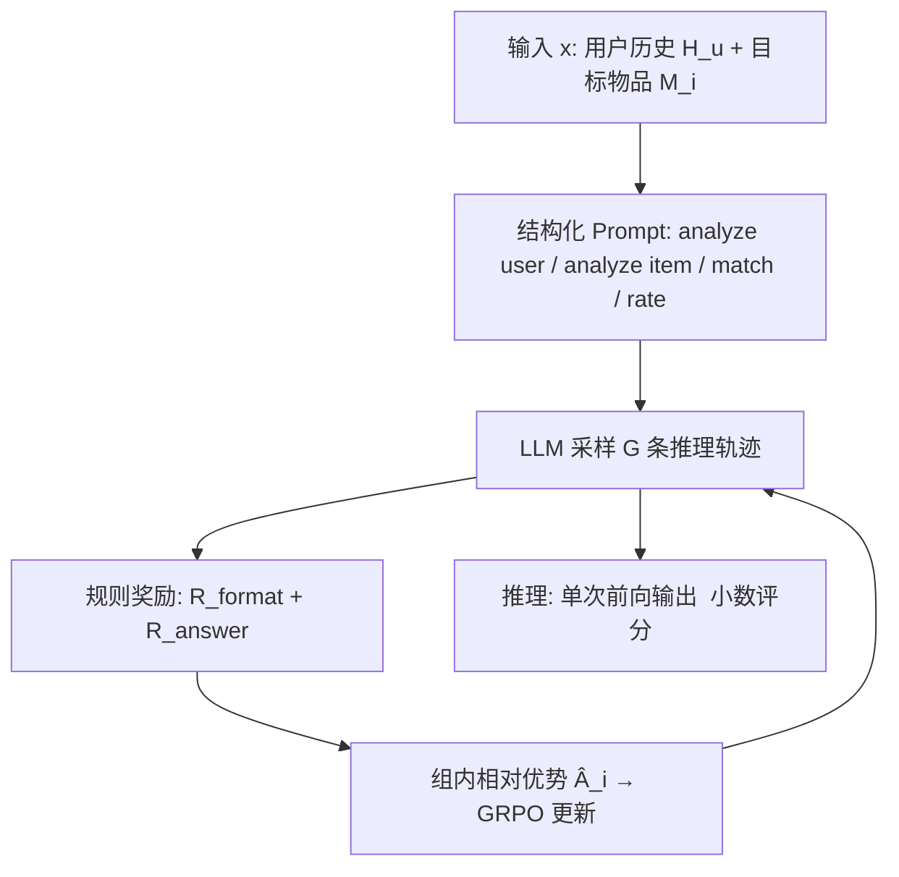
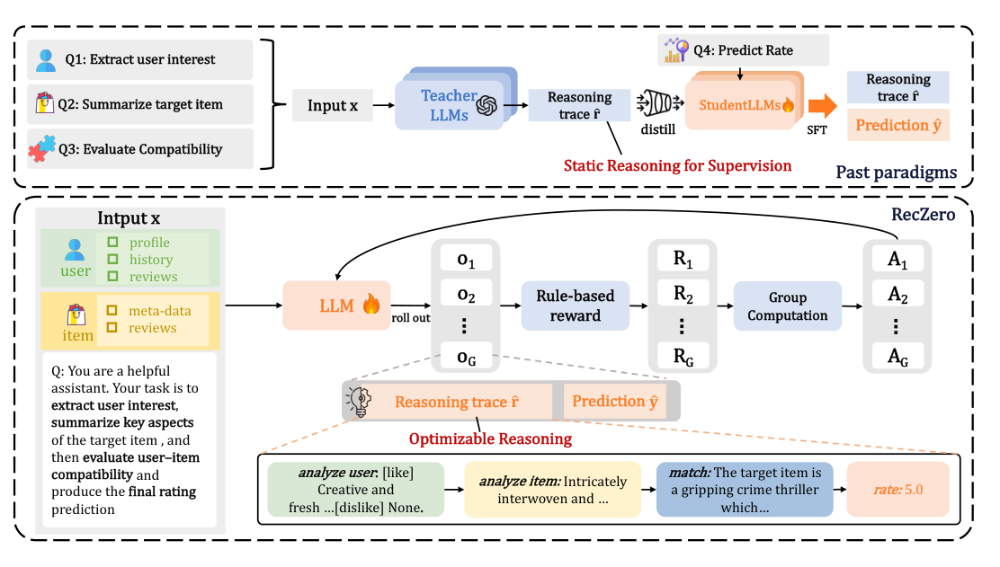

# Think before Recommendation: Autonomous Reasoning-enhanced Recommender (先思考再推荐：自主推理增强推荐器)

- **会议/期刊**: NeurIPS 2025 (Poster)
- **作者与机构**: Xiaoyu Kong, Junguang Jiang, Bin Liu, Ziru Xu, Han Zhu, Jian Xu, Bo Zheng (阿里淘天)；Jiancan Wu (合肥国家科学中心/上海数据科学重点实验室)；Xiang Wang (新加坡国立大学)
- **推荐链路定位**: 精排（评分预测 / Rating Prediction）
- **研究方向**: 大语言模型推荐 (LLM4Rec) / 强化学习与动态探索推荐
- **论文原文**: [https://arxiv.org/abs/2510.23077v1](https://arxiv.org/abs/2510.23077v1)
- **开源代码**: [https://github.com/AkaliKong/RecZero](https://github.com/AkaliKong/RecZero)

## TL;DR (1分钟核心速览)

现有 LLM 推理增强推荐普遍走「教师模型生成推理链 → 学生 SFT 蒸馏」路线，但教师缺乏推荐领域知识、监督数据昂贵且静态、学生只学到表面模仿。本文提出 **RecZero**：抛弃多模型多阶段蒸馏，用**纯 GRPO 强化学习**训练单个 LLM，配合「Think-before-Recommendation」结构化标签模板与**规则化奖励**（格式奖励 + 连续评分误差奖励），让模型自主习得推理能力；进一步提出 SFT 冷启动 + RL 精调的混合范式 **RecOne**。在 Book/Music/Yelp 三个数据集上，RecOne 将最强基线 Reason4Rec 的 MAE 分别再降 **16.8% / 29.9% / 7.5%**，且仅用 12% 标注量。

## Background & Motivation (背景与核心矛盾)

- **主流范式**: 以 Rec-SA VER、EXP3RT、Reason4Rec 为代表，先用 ChatGPT/DeepSeek 等通用教师模型为每条样本生成「用户偏好提取 + 物品特征总结 + 匹配推理」的思维链，再构造指令样本 SFT 蒸馏到小模型。
- **前人局限一（教师能力错配）**: 通用教师缺乏推荐域知识，其生成的推理链与评分预测目标不对齐，次优推理直接成为学生的性能天花板。
- **前人局限二（监督昂贵且静态）**: 高质量推理数据依赖人工标注或 LLM API 调用，成本高；学生只能被动消费静态教师输出，无法主动修正推理过程，且易过拟合教师指令分布、泛化差。
- **核心洞察 (Key Insight)**: 评分预测的奖励信号（预测值与真实评分的误差）本身是**可计算、稠密、无需标注**的，因此完全可以把「推理链质量」交给 RL 通过最终预测误差反向优化，而非依赖教师示范。
- **本文切入点**: 用 GRPO + 规则奖励，把用户分析、物品分析、匹配、打分四个步骤放进**同一个可微优化目标**下联合训练，实现「推理为推荐服务」的端到端对齐。

## Method (核心方法设计)

### 1. 整体框架 (Overall Architecture)

输入为用户历史交互序列 $H_u$（含物品元信息、评分、评论）与目标物品元信息$M_i$，拼接为 prompt$x_{u,i}$。LLM 在结构化系统提示约束下依次生成四段带特殊标签的输出：`<analyze user>`（逐条抽取历史物品的 [like]/[dislike] 并汇总为 [pos]/[neg] 偏好）、`<analyze item>`（预测目标物品可能被喜欢/讨厌的方面）、`<match>`（显式连接用户偏好与物品属性做匹配论证）、`<rate>`（输出小数评分）。RecZero 直接用 GRPO 对该策略做纯 RL 优化；RecOne 则先用 DeepSeek-R1 生成的少量高质量推理轨迹做 SFT 冷启动，再接入同一 RL 流程精调。推理时单模型单阶段前向解码即得评分，无需 logit 加权。

<figure class="paper-figure" markdown="span">
  <figcaption>图1：RecZero 与传统范式的比较。传统范式使用多样化的基于查询的数据集和推理轨迹训练多个学生 LLM，而 RecZero 使用纯强化学习训练单个 LLM 完成整个工作流。与传统方法依赖教师模型不同，RecZero 利用奖励信号联合优化推理轨迹和预测，提高效率和性能。</figcaption>
</figure>

### 2. 关键设计拆解 (Key Designs)

1. **「Think-before-Recommendation」结构化标签模板**：前人用冻结 LLM few-shot 做偏好抽取，输出格式漂移、无法优化。本文将推理强制切分为四个标签段，把评分预测分解为离散可验证步骤，使每一步输出都可被规则解析、被奖励函数定位，从而让 RL 能精确作用于「推理链」而非仅最终答案。

2. **规则化奖励建模（格式 + 连续误差）**：这是全文最关键的算子改动。格式奖励为二值惩罚：
$$R_{\text{format}}=\begin{cases}0.5 & \text{格式正确}\\ -0.5 & \text{格式错误}\end{cases}$$
答案奖励放弃「整数对错」的稀疏信号，改为连续误差奖励：
$$R_{\text{answer}}=1-\frac{|y-\hat{y}|}{\text{max\_error}},\quad R=R_{\text{format}}+R_{\text{answer}}$$
其中评分域 1–5 时 $\text{max\_error}=4$。物理直觉：连续奖励使模型有动力输出**小数评分**逼近真值，而非像 SFT 那样模仿整数标签再靠 logit 加权解码，直接优化 MAE 目标且省去后处理。

3. **GRPO 组相对优化与训练目标**：对同一 prompt 采样 $G$条轨迹，用组内标准化优势$\hat{A}_i=\frac{R_i-\text{mean}(\{R_1..R_G\})}{\text{std}(\{R_1..R_G\})}$ 替代 critic 网络，目标为带 clip 与 KL 正则的 PPO 式代理损失：
$$J_{\text{GRPO}}(\theta)=\mathbb{E}\Big[\tfrac{1}{G}\sum_{i}\tfrac{1}{|y_i|}\sum_{t}\min\big(\rho_{i,t}\hat{A}_{i,t},\ \text{clip}(\rho_{i,t},1-\epsilon,1+\epsilon)\hat{A}_{i,t}\big)-\beta D_{\text{KL}}\big]$$
其中 $\rho_{i,t}=\pi_\theta(y_{i,t}|x,y_{i,<t})/\pi_{\theta_{\text{old}}}(\cdot)$。**免负采样、免奖励模型、免标注**，仅需组内相对比较即可稳定训练。RecOne 冷启动阶段额外构造对齐/纠偏两类轨迹$\mathcal{D}_{\text{align}}$与$\mathcal{D}_{\text{misalign}}$（后者由教师看到真值后重写合理化推理），以自回归损失做 SFT 初始化。

## Experimental Setup & Evaluation Protocol (实验设置与评估协议)

- **数据集与预处理**: 沿用 Reason4Rec 发布的版本，覆盖 Book、Music（Amazon 子集）与 Yelp 三个域，每条样本含用户历史（元信息 + 评分 + 评论）与目标物品元信息。原文未给出显式 $k$-core 过滤与交互量统计表，仅说明冷启动实验从训练/测试集之外另取 1000 条样本。

| 数据集 | 域 | 输入构成 | 评分域 | 用途 |
| :--- | :---: | :--- | :---: | :--- |
| Book | Amazon 图书 | 历史评分+评论+元信息 | 1–5 | 主实验 |
| Music | Amazon 音乐 | 历史评分+评论+元信息 | 1–5 | 主实验 + 成本分析 |
| Yelp | 本地生活 | 历史评分+评论+元信息 | 1–5 | 主实验 |

- **数据划分与防穿越 (Splitting Strategy)**: 沿用 Reason4Rec 的样本级划分（训练/测试），冷启动 1000 条样本严格排除在训练与测试集之外，避免泄漏。
- **排名评测协议 (Ranking Protocol)**: 本文任务是**评分预测**而非排序，故不涉及 Full-Ranking / Sampled Ranking；采用回归指标 **MAE** 与 **RMSE**（越小越好），对每条测试样本单次前向解码取 `<rate>` 数值。
- **对比基线与超参设置**: 基线覆盖三类——CF（MF）、评论建模（DeepCoNN / NARRE / DAML）、LLM 推理增强（Rec-SA VER / EXP3RT / Reason4Rec）。骨干为 **Qwen2.5-7B-Instruct-1M**，batch size 8，学习率 2e-6，每样本 8 次 rollout，采样温度 1.0，KL 系数 0，训练 1 epoch；RecOne 冷启动数据由 DeepSeek-R1 生成。硬件为 8×H20。

## Key Experimental Results (实验关键数据)

### 1. 主实验对比 (Main Results)

| 方法 | 类别 | Book RMSE | Book MAE | Music RMSE | Music MAE | Yelp RMSE | Yelp MAE |
| :--- | :---: | :---: | :---: | :---: | :---: | :---: | :---: |
| MF | CF | 0.8565 | 0.6277 | 0.8142 | 0.6188 | 1.0711 | 0.7980 |
| NARRE | Review | 0.8435 | 0.6242 | 0.7881 | 0.5799 | 1.0785 | 0.8177 |
| DAML | Review | 0.8371 | 0.6214 | 0.7848 | 0.5703 | 1.0405 | 0.7964 |
| Rec-SA VER | LLM | 0.9356 | 0.6645 | 0.9262 | 0.6463 | 1.1282 | 0.8295 |
| EXP3RT | LLM | 0.9346 | 0.6042 | 0.8312 | 0.5548 | 1.1420 | 0.8236 |
| Reason4Rec | LLM | 0.8325 | 0.5937 | 0.7647 | 0.5352 | 0.9972 | 0.7473 |
| **RecZero** | RL | 0.8387 | **0.5253** | 0.7058 | 0.4271 | 1.0521 | 0.7429 |
| **RecOne** | SFT+RL | **0.7784** | **0.5017** | **0.6776** | **0.3816** | **0.9774** | **0.7012** |
| **Improv.% (vs 最强基线)** | — | **-6.5%** | **-15.5%** | **-11.4%** | **-28.7%** | **-2.0%** | **-6.2%** |

> 注：原文摘要口径为 RMSE 降 6.7%/12.2%/6.2%、MAE 降 16.8%/29.9%/7.5%（以 Reason4Rec 为参照的官方报告值）；上表按表 1 原始数值复算，差异源于四舍五入与参照基线选取。

### 2. 消融实验 (Ablation Study)

| 变体 | 关键改动 | Book MAE | Music MAE | Yelp MAE | 结论 |
| :--- | :--- | :---: | :---: | :---: | :--- |
| **RecOne (full)** | 三步推理 + 连续奖励 + RL | **最优** | **最优** | **最优** | 完整范式最佳 |
| No Thinking Process | 直接输出评分 | 显著变差 | 显著变差 | 显著变差 | 推理链本身有增益 |
| No Multi-step Thinking | 单步 `<think>` 替代三步 | 居中 | 居中 | 居中 | 三步分解优于单步 |
| Correctness Reward Only | 仅整数对错奖励（对 2 分/错 0 分） | 明显下降 | 明显下降 | 明显下降 | 连续奖励是关键 |
| Only SFT warm-start | 去掉 RL，仅教师蒸馏 SFT | 最差 | 最差 | 最差 | 纯模仿不如 RL 优化 |

（原文消融以图 4 柱状图呈现，未给具体数值，此处按趋势归纳。）

### 3. 关键实验发现 (Key Findings)

1. **纯 RL 已能超越全部蒸馏基线**：RecZero 无任何教师示范、无冷启动，在三个数据集 MAE 上均优于 Reason4Rec（0.5253 vs 0.5937 / 0.4271 vs 0.5352 / 0.7429 vs 0.7473），说明「可计算奖励 + 组相对优化」足以替代静态监督。
2. **连续误差奖励是 MAE 增益的主因**：Correctness Reward Only 变体明显劣化，因为整数对错奖励诱导模型输出整数评分而非逼近真值的小数，抑制了 MAE 优化方向；这解释了 RecZero 在 MAE 上大幅领先却在部分 RMSE 上不敌 Reason4Rec 的现象。
3. **冷启动显著抬高 RL 上限且更省成本**：RecOne 全程优于 RecZero（图 3，200 步内持续领先）；成本侧，RecZero(early-stop) 仅用 0.48K 标注（-97.6%）、0.4 GPU 时（-33%）、331 推理 token 即达 MAE 0.5419，已优于耗 20K 标注、0.6 GPU 时、597 token 的 RecOne(SFT)（MAE 0.6472），单位标注的误差下降效率超 5 倍。

## Highlights & Limitations (亮点、对比与审稿批判)

- **与代表作对比 (vs. Prior Work)**: 与 Rec-SA VER / EXP3RT / Reason4Rec 的本质区别在于**优化信号来源**——前两者靠教师示范（离线、静态、与推荐目标弱对齐），本文靠推荐任务自身的可计算奖励（在线、可迭代、目标强对齐）；与 DeepSeek-R1-Zero 的区别在于把 RL 从数学/代码域迁移到推荐域，并设计了领域专用的四段式标签与连续评分奖励。
- **可迁移亮点**: (1) 把「结构化标签 + 规则解析」作为 RL 的可验证中间表示，可迁移到任何需要可解释中间步骤的推荐任务（如列表重排理由生成）；(2) 连续误差奖励替代离散对错奖励，适用于所有回归型推荐目标（停留时长、GMV 预估）。
- **审稿级局限批判**: (1) 仅在 7B 骨干与三个评分预测数据集上验证，未评估更大基座、排序/生成式任务，也未与工业级 CTR 模型对比，泛化边界不明；(2) 单样本需采样 8 条轨迹做组内比较，训练开销与推理 token 数（310–412）远高于传统精排，线上高 QPS 场景部署成本存疑；(3) 奖励函数中 `max_error` 与格式奖惩系数为手工设定，缺乏敏感性分析。

## Rating (四维评分)

- **方法创新性 (Novelty)**: ⭐⭐⭐⭐ （首次将纯 GRPO 范式系统迁移到推理增强评分预测，四段式标签 + 连续误差奖励设计贴合任务本质，但 RL 算法本身沿用 DeepSeek 体系）
- **评估协议与实验扎实度 (Protocol & Experiments)**: ⭐⭐⭐ （三域数据集 + 三类基线 + 消融 + 成本分析较完整，但缺少数据统计表、显著性检验，消融仅以柱状图呈现无具体数值）
- **写作与数学规范度 (Clarity & Rigor)**: ⭐⭐⭐⭐ （GRPO 目标、奖励函数与冷启动数据构造公式清晰，符号统一；部分实验数值口径在摘要与表 1 间存在轻微不一致）
- **工业落地与复现价值 (Industrial & Practical Value)**: ⭐⭐⭐⭐ （代码开源，单模型单阶段免教师流水线工程开销低，支持数百条新交互快速再优化；但推理 token 成本对高并发精排仍是门槛）

