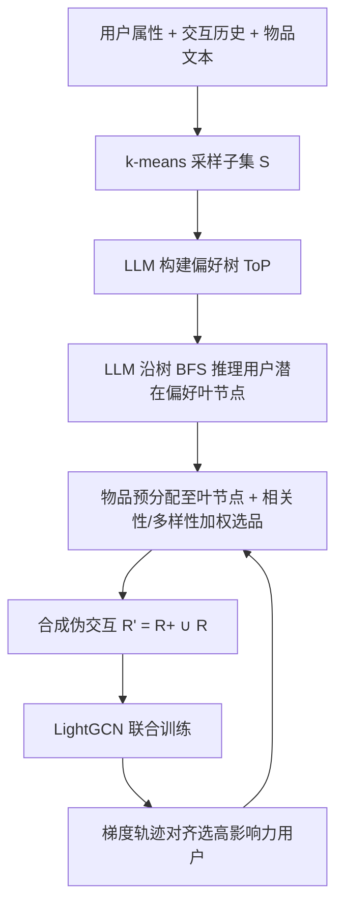
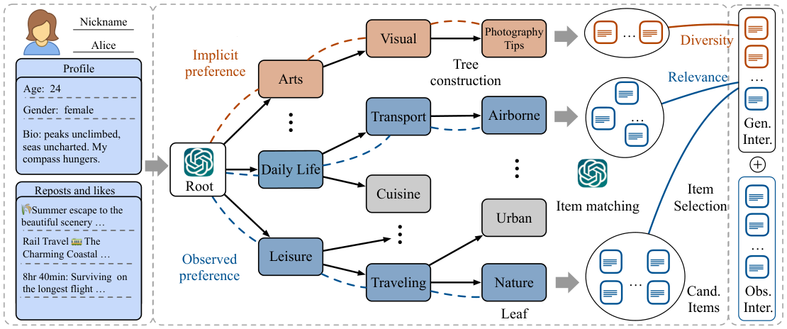

# Tree of Preferences for Diversified Recommendation (面向多样化推荐的偏好树)

- **会议/期刊**: NeurIPS 2025
- **作者与机构**: Hanyang Yuan, Ning Tang, Tongya Zheng, Jiarong Xu 等（浙江大学 / 复旦大学 / 浙大城市学院 / 南洋理工大学）
- **推荐链路定位**: 训练数据侧（数据增强）→ 通用召回/匹配骨干
- **研究方向**: 大语言模型推荐 / 去偏与可信推荐
- **论文原文**: [https://arxiv.org/abs/2601.02386v1](https://arxiv.org/abs/2601.02386v1)
- **开源代码**: [https://github.com/xxx08796/ToP_Rec_NIPS](https://github.com/xxx08796/ToP_Rec_NIPS)

## TL;DR (1分钟核心速览)

多样化推荐长期受困于「观测数据偏差」：曝光偏差与选择偏差使欠探索兴趣被主导兴趣淹没，纯靠交互数据推断偏好必然导致推荐同质化。本文提出 ToP-Rec，用 LLM 构建全局「偏好树 (Tree of Preferences)」做粗到细的偏好空间划分，沿树自顶向下推理用户行为动因、挖掘潜在兴趣，再以「相关性-多样性」加权打分挑选候选物品合成伪交互，注入通用推荐器（LightGCN）训练。在 Twitter/Weibo/Amazon 三数据集上，ToP-Rec 在 R@50/100 与 CE@50/100 上多数指标最优（如 Twitter CE@100 相对 LightGCN 提升约 3.3%），且推理延迟接近传统方法、远低于 LLM 重排基线。

## Background & Motivation (背景与核心矛盾)

- **主流范式**: 多样化推荐分两派——重排侧（MMR、DPP、图聚类重排）与匹配侧（多向量表示、Box 嵌入、类别-物品两阶段匹配、重平衡采样），均只依赖已观测交互。
- **前人局限**: ① 曝光偏差使「匹配某兴趣但从未曝光」的物品缺失反馈；② 选择偏差使不同用户交互策略不同（只评鞋不评日用品），观测数据无法完整反映兴趣，导致推荐陷入「兔子洞」。
- **核心洞察 (Key Insight)**: 不相似 ≠ 不相关。若能用外部世界知识还原用户行为背后的 rationale，就能在保持相关性的前提下引入多样性；LLM 的零样本世界知识恰好可补足数据偏差。
- **本文切入点**: 不做 LLM 直接生成/重排（延迟高、依赖候选质量），而是把 LLM 当作「偏好标注器」，产出合成交互去训练轻量推荐器——数据为中心 (data-centric) 的路线。

## Method (核心方法设计)

### 1. 整体框架 (Overall Architecture)

ToP-Rec 分三步闭环：先用 k-means 对 BERT 物品嵌入聚类采样出文本丰富子集 $S$，提示 LLM 递归划分偏好空间，构建全局共享的偏好树$T(V,E)$；再对每个用户沿树做广度优先搜索，逐层选出最能解释其行为的节点直至叶节点，并回访补全未观测偏好；随后将全库物品预分配到最匹配叶节点，按相关性-多样性加权分数挑选物品合成伪交互，与原始交互合并训练 LightGCN。为控成本，训练中按梯度轨迹对齐动态挑选高影响力用户才做增强。

<figure class="paper-figure" markdown="span">
  <figcaption>图1：我们的方法示意图：面向多样化推荐的偏好树（ToP-Rec）。给定“Alice”及其属性和交互物品，ToP-Rec通过提示LLMs沿构建的ToP全面挖掘其偏好直至叶节点，从而推断其理由。随后匹配与其偏好一致的物品，生成关于多样性和相关性的合成用户-物品交互，并与观测交互整合。合并后的数据使推荐器能够提供多样化建议。</figcaption>
</figure>

### 2. 关键设计拆解 (Key Designs)

1. **偏好树 ToP 构建与推理（粗到细偏好空间划分）**：前人用 LLM 做类别级粗粒度匹配，宽泛偏好引入噪声伤相关性。本文令 LLM 从根节点递归划分偏好空间至叶节点，树为全局一次性结构（所有用户共享同一物品属性塑造的偏好空间）；用户侧用 BFS 逐层激活子节点，公式化为 $\{v_1,\dots,v_n\}=\mathrm{LLM}(\mathrm{Prompt}_{PR}(A_u,R_u)),\ v_k\in V_{Leaf}$。直觉：层级化把「解释行为」拆成一系列小判断，降低 LLM 单步推理的语义漂移，叶节点即细粒度兴趣锚点。

2. **相关性-多样性加权合成交互（去偏数据增强）**：直接让 LLM 生成嵌入或重排代价高且不稳。本文改为物品预分配 $\mathrm{LLM}(\mathrm{Prompt}_{IM}(A_i))\to v_i\in V_{Leaf}$（一次性完成），再对候选物品打分：
$$s(u,i)=(1-\lambda)\cdot s_{rel}(u,i)+\lambda\cdot s_{div}(u,i),\quad s_{div}(u,i)\propto 1/\mathrm{freq}_i$$
其中 $s_{rel}=\langle \mathrm{Enc}(A_u),\mathrm{Enc}(A_i)\rangle$为语义余弦相似度，$\mathrm{freq}_i$为该物品所属偏好在用户历史中的出现频次。低频偏好物品得分高，从而定向补足欠探索兴趣；超过阈值的物品并入$R'_u=R^+\cup R_u$ 参与训练。

3. **训练目标与高影响力用户选择**：骨干用 BPR 损失 $\mathcal{L}=-\sum_u\sum_{(u,i)\in R_u}\sum_{(u,j)\notin R_u}\ln\sigma(\hat{y}_{ui}-\hat{y}_{uj})$，负采样 1:50 均匀采样。为控 LLM 调用成本，定义$k$步影响力$\mathrm{Inf}_u=\sum_{i=t-k}^{t}\langle\nabla\ell(u;\theta_{i-1}),\theta_i-\theta_{i-1}\rangle$，即用户局部梯度与实际参数更新轨迹的对齐度（比对齐下游损失梯度更准），配合梯度降维与用户分组，仅对 Top 影响力用户生成合成交互。

## Experimental Setup & Evaluation Protocol (实验设置与评估协议)

- **数据集与预处理**: 三数据集均按 [16] 抽取子集，丢弃缺失属性物品，Twitter 用 `5-core`、Weibo/Amazon 用 `10-core` 过滤；并用 LLM 重写用户/物品摘要以降噪。

| 数据集 | 场景 | 过滤 | 划分 | 说明 |
| :--- | :---: | :---: | :---: | :--- |
| Twitter | 社交媒体 | 5-core | 0.6:0.2:0.2 | 用户属性(昵称/简介)+帖子，点赞/转发为反馈 |
| Weibo | 社交媒体 | 10-core | 0.6:0.2:0.2 | 同上，中文社交场景 |
| Amazon | 电商 | 10-core | 0.6:0.2:0.2 | 合并 7 个类目 |

- **数据划分与防穿越 (Splitting Strategy)**: 按用户交互做 `比例划分`（0.6/0.2/0.2），非全局时间戳切分，存在轻度时序泄漏风险。
- **排名评测协议 (Ranking Protocol)**: 采用 `Sampled Ranking`（1:50 随机负采样），指标为 Recall@50/100（相关性）与 Category-Entropy@50/100（多样性），非 Full-Ranking。
- **对比基线与超参设置**: 9 个基线分三类——启发式（Random/MMR/DPP）、传统多样化（Box/LCD-UC/CDM）、LLM 类（LLM4Rerank-A/AD、LLMRec-MMR）；骨干 LightGCN（2 层，$d=32$，lr=5e-3），LLM 统一用 Qwen2.5-32B-Instruct，重复 5 次报均值±标准差。

## Key Experimental Results (实验关键数据)

### 1. 主实验对比 (Main Results)

| 方法 | Twitter R@100 | Twitter CE@100 | Weibo R@100 | Weibo CE@100 | Amazon R@100 | Amazon CE@100 |
| :--- | :---: | :---: | :---: | :---: | :---: | :---: |
| LightGCN* | 0.0830 | 1.3413 | 0.1669 | 1.0763 | 0.2105 | 0.5609 |
| MMR | 0.0790 | 1.3550 | 0.1578 | 1.1005 | 0.2115 | 0.5755 |
| DPP | 0.0765 | 1.3532 | 0.1530 | 1.1150 | 0.2035 | 0.5748 |
| CDM | 0.0814 | 1.3461 | 0.1620 | 1.0912 | 0.2103 | 0.5816 |
| LCD-UC | 0.0768 | 1.3784 | 0.1625 | 1.0956 | 0.2065 | 0.5842 |
| LLMRec-MMR | 0.0820 | 1.3551 | 0.1662 | 1.1182 | 0.2113 | 0.5836 |
| LLM4Re-AD | 0.0822 | 1.3466 | 0.1652 | 1.0823 | 0.2042 | 0.5827 |
| **ToP-Rec** | **0.0841** | **1.3852** | 0.1667 | **1.1369** | **0.2120** | **0.5902** |
| Improv.% (vs LightGCN) | +1.33% | +3.27% | −0.12% | +5.63% | +0.71% | +5.22% |

### 2. 消融实验 (Ablation Study)

| 变体 | 相关性 (R@100) | 多样性 (CE@100) | 结论 |
| :--- | :---: | :---: | :--- |
| w/o Div（去掉多样性项） | 较高 | 明显下降 | 只追相关性则多样性退化 |
| w/o Rel（去掉相关性项） | 明显下降 | 较高 | 只追多样性则相关性崩 |
| w/o US（随机选用户增强） | 低于 Ours | 低于 Ours | 高影响力用户选择有效 |
| w/o PR（随机选叶节点） | 最差 | 中等 | 偏好推理是相关性保障 |
| **Ours** | **最优平衡** | **最优平衡** | 两目标协同 |

### 3. 关键实验发现 (Key Findings)

1. **多样性增益主要来自 LLM 细粒度推理而非重排**：LLM4Rerank 系列相关性尚可但 CE 提升有限（Twitter CE@100 仅 1.3466 vs. ToP-Rec 1.3852），说明粗类别级偏好分析会选入冗余物品；ToP 的叶节点级划分才真正拉开多样性差距。
2. **消融显示「偏好推理」是相关性护栏**：w/o PR 相关性跌幅最大，证明随机叶节点等价于随机多样性注入，会重蹈传统方法「多样但不相关」的覆辙；而 w/o US 双指标均降，说明增强应集中在梯度轨迹对齐的高影响力用户上。
3. **超参呈清晰权衡曲线**：$\lambda$ 从 0.2 增至 0.8 时多样性单调升、相关性单调降；每用户合成交互数增加时多样性先升后稳、相关性持续降——存在约 5–7 条/用户的最优区间，且 ToP-Rec 在 Twitter 上以更大多样性边际同时保持相关性高于 LightGCN 骨干（图 2 右上角最优）。

## Highlights & Limitations (亮点、对比与审稿批判)

- **与代表作对比 (vs. Prior Work)**: 相比 Box/LCD-UC 等匹配侧方法，本文跳出观测数据、引入 LLM 世界知识补偏；相比 LLM4Rerank（图结构重排）与 DLCRec（类别级多样性控制），本文以层级偏好树实现细粒度 rationale 推理，且不依赖候选集质量；相比 CDM（MMR 蒸馏），本文是数据增强而非教师蒸馏，可插拔任意骨干。
- **可迁移亮点**: ①「全局共享层级树 + 逐用户 BFS 路径」是把 LLM 推理结构化的通用范式，可迁移到冷启动画像与可解释推荐；② 基于梯度轨迹对齐的影响力用户选择，可复用于任何昂贵的 LLM 数据增强场景以控成本。
- **审稿级局限批判**: ① 评测用 1:50 采样排序而非 Full-Ranking，Recall 绝对值偏低且可能高估；划分非时间切分，存在信息泄漏隐患；② 合成交互由 LLM 打分阈值决定，$\lambda$ 与阈值敏感，且 LLM 生成的伪正例可能引入新的确认偏差；③ 偏好树构建与物品预分配需全库 LLM 调用，冷启动新物品需重新分配，工程上仍有离线批处理成本。

## Rating (四维评分)

- **方法创新性 (Novelty)**: ⭐⭐⭐⭐ （偏好树把 LLM 推理结构化为粗到细空间划分，data-centric 去偏视角新颖，但组件多为已有技术的组合）
- **评估协议与实验扎实度 (Protocol & Experiments)**: ⭐⭐⭐ （三数据集 + 9 基线 + 消融 + 超参 + 延迟分析较完整，但采样排序与非时间切分削弱结论强度）
- **写作与数学规范度 (Clarity & Rigor)**: ⭐⭐⭐⭐ （框架图与公式清晰，影响力定义有推导支撑，符号表完备；部分实现细节下放附录）
- **工业落地与复现价值 (Industrial & Practical Value)**: ⭐⭐⭐⭐ （代码开源、骨干可插拔、推理延迟接近传统方法，但离线 LLM 批处理成本与树维护需工程权衡）

