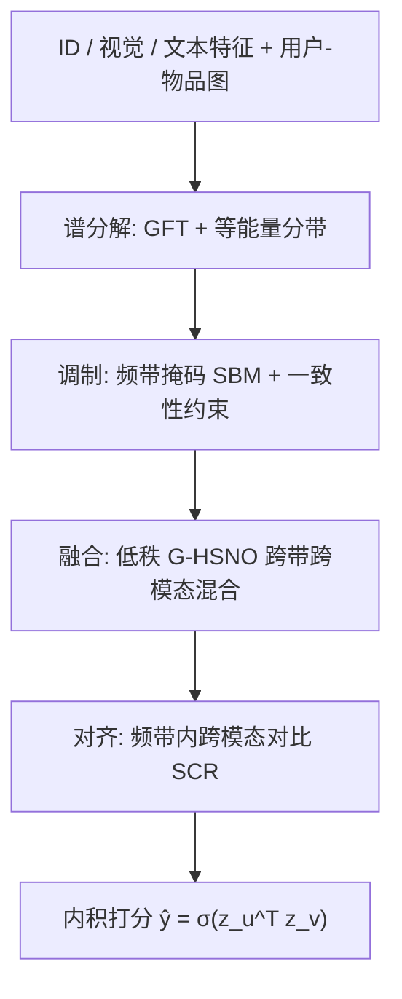
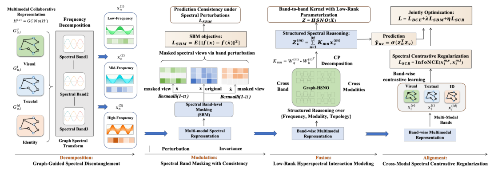

# Structured Spectral Reasoning for Frequency-Adaptive Multimodal Recommendation (面向频率自适应的多模态推荐的结构化谱推理)

- **会议/期刊**: NeurIPS 2025
- **作者与机构**: Wei Yang, Rui Zhong, Yiqun Chen, Chi Lu, Peng Jiang（快手科技、中国人民大学）
- **推荐链路定位**: 召回（图协同过滤表征学习）
- **研究方向**: 多模态推荐 / 冷启动与长尾推荐
- **论文原文**: [https://arxiv.org/abs/2512.01372v3](https://arxiv.org/abs/2512.01372v3)
- **开源代码**: [https://github.com/llm-ml/SSR.git](https://github.com/llm-ml/SSR.git)

## TL;DR (1分钟核心速览)

多模态图推荐中，视觉/文本噪声会沿用户-物品图扩散，而现有频域方法（SMORE、ChebyCF）只做静态低通滤波或重加权，无法推理频带语义与跨频带依赖。SSR 把 ID/视觉/文本信号统一投影到图傅里叶域，按等能量划分为 $M$ 个频带，依次做频带掩码一致性训练（SBM）、低秩图超谱算子融合（G-HSNO）与谱对比正则（SCR）。在 Amazon Baby/Sports/Clothing 三个数据集的全库排序协议下全面超越 15 个基线，Clothing 上 Recall@10 较 SMORE 提升 +5.0%，冷启动用户 Recall@20 在 Baby 上较 SMORE 提升 +10.0%。

## Background & Motivation (背景与核心矛盾)

- **主流范式**: 多模态推荐以 LightGCN 式图传播融合 ID 与视觉/文本特征，近期引入频域视角，认为低频编码全局偏好、高频编码细粒度变化。
- **前人局限**: 其一，SMORE/ChebyCF 采用静态低通滤波或固定重加权，频带被视为静态视图，无法区分哪些频带可靠；其二，频带划分本身是启发式的，缺乏跨频带、跨模态的显式交互建模，导致有用细节被压制、不稳定分量被保留。
- **核心洞察 (Key Insight)**: 作者通过 t-SNE 与模态中心距离分析发现——低频段三模态各自成簇（模态特异语义），中频段模态边界模糊（跨模态共享语义最强、中心距离最小），高频段模态高度纠缠（判别性强但噪声敏感）。即频带语义角色高度非均匀。
- **本文切入点**: 把"频带"从静态视图升级为可推理、可调制、可对齐的结构化对象，用四阶段流水线（分解-调制-融合-对齐）替代一次性滤波。

## Method (核心方法设计)

### 1. 整体框架 (Overall Architecture)

输入为用户-物品二部图的 ID 嵌入与视觉/文本特征，先经对称归一化拉普拉斯 $L=I-D^{-1/2}AD^{-1/2}$的图傅里叶变换投影到谱域，按等能量分位切分为$M$ 个频带；训练时对频带做随机掩码并施加表征一致性约束（SBM）；随后由低秩参数化的 G-HSNO 在"频带×模态"两轴上做跨带混合与图感知重加权，输出融合表征；最后用频带内跨模态对比损失（SCR）对齐视觉与文本谱特征。推理阶段无掩码、无额外开销，仅保留一次谱变换与轻量算子。

<figure class="paper-figure" markdown="span">
  <figcaption>图1：我们提出的框架的整体架构。该模型遵循结构化的四阶段流水线：(i) 分解阶段对图信号执行模态特定的谱变换，以解耦多频率分量；(ii) 调制阶段以任务自适应方式应用谱带掩码（SBM）扰动并降低不可靠频带的权重；(iii) 融合阶段利用低秩图超谱神经算子（G-HSNO）推理跨频带与跨模态依赖关系；(iv) 对齐阶段引入谱对比正则化（SCR）以强制语义一致性。</figcaption>
</figure>

### 2. 关键设计拆解 (Key Designs)

1. **等能量频带划分（Decompose）**：固定频带数或等宽切分会让少数特征模占据绝大部分能量，频带间信号质量失衡。SSR 按累积能量分位切分，使每个频带承载近似相等的信号质量：
$$\sum_{k\in\mathcal{F}_m}E_k \approx \frac{1}{M}\sum_{k=1}^{|\mathcal{N}|}E_k,\quad E_k=\|\hat{\mathbf{x}}_k\|_2^2$$
直觉是让每个频带都"有话可说"，避免高频带沦为纯噪声桶。大图上用 Chebyshev 多项式滤波器组近似，规避 $O(|\mathcal{N}|^3)$ 特征分解。

2. **频带掩码一致性训练（SBM）**：标准 BCE 会放大最易利用的窄频带相关性，形成 shortcut。训练时对每个样本独立采样伯努利掩码 $\gamma_m\sim\mathrm{Bernoulli}(1-\pi)$ 整带丢弃，并强制掩码视图与全谱视图表征一致：
$$\mathcal{L}_{\mathrm{SBM}}=\mathbb{E}_{\gamma}\big\|h(\mathbf{x})-h(\tilde{\mathbf{x}})\big\|_2^2,\quad \tilde{\mathbf{x}}=\sum_{m=1}^{M}\gamma_m\mathbf{x}^{(m)}$$
这等价于频带级 dropout + 一致性正则，迫使证据分散到更稳健的分量上，且推理零成本。

3. **低秩图超谱算子（G-HSNO）与训练目标**：普通 GCN 在空间域均匀聚合，无法刻画跨频带交互。G-HSNO 将核矩阵对角近似为 $\mathbf{K}_{mn}=\mathrm{Diag}(\mathbf{k}_{mn})$，并把$\mathbf{k}_{mn}=a_{mn}\sum_{i=1}^{r}\rho_i\mathbf{v}^{(i)}$分解为"带间混合权重$a_{mn}$（softmax 归一化的$q$-$k$打分）×$r$个秩基对角滤波器"，参数量从$O(M^2d)$降到$O(M^2+rd)$。随后用节点条件门控$g_v^{(m)}$重加权并做尺度归一化，得到$\mathbf{z}_v=\sum_m g_v^{(m)}\mathbf{Z}_v^{(m)}$。总损失为
$$\mathcal{L}=\mathcal{L}_{\mathrm{BCE}}+\lambda\mathcal{L}_{\mathrm{SBM}}+\eta\mathcal{L}_{\mathrm{SCR}}+\gamma\mathcal{L}_{\mathrm{Reg}}$$
训练采用批内负采样（标准 BPR/BCE 式），无额外难负采样设计；SCR 的负样本取自同频带其他物品或同物品其他频带，温度 $\tau$ 控制锐度。

## Experimental Setup & Evaluation Protocol (实验设置与评估协议)

- **数据集与预处理**: 三个 Amazon 子集，均按 `5-core` 过滤：

| 数据集 | #Users | #Items | #Interactions | 稀疏度/密度 | 特征/场景说明 |
| :--- | :---: | :---: | :---: | :---: | :--- |
| Amazon-Baby | 19,445 | 7,050 | 160,792 | 1.17e-3 | 母婴，视觉+文本 |
| Amazon-Sports | 35,598 | 18,357 | 296,337 | 4.53e-4 | 运动户外，视觉+文本 |
| Amazon-Clothing | 39,387 | 23,033 | 278,677 | 3.07e-4 | 服装，最稀疏 |

- **数据划分与防穿越 (Splitting Strategy)**: 采用 `Leave-One-Out` 式划分（每用户最后一条交互为测试、倒数第二条为验证），属该系列基准的标准协议。
- **排名评测协议 (Ranking Protocol)**: 无偏 `Full-Ranking`（对全部未交互物品排序），报告 Recall@{10,20} 与 NDCG@{10,20}。
- **对比基线与超参设置**: 覆盖 15 个基线，含协同过滤（BPR、LightGCN）、多模态 GNN（VBPR、MMGCN、GRCN、DualGNN、LATTICE、BM3）、频域方法（FREEDOM、SMORE）、生成/对齐类（DiffMM、MMIL、AlignRec）。频带数 $M$、$\lambda$、$\eta$ 在附录 C.1 做敏感性分析，正文称在宽区间内稳定。

## Key Experimental Results (实验关键数据)

### 1. 主实验对比 (Main Results)

选取 8 个代表性基线（完整 15 列见原文表 1），指标为 Recall@10 / NDCG@10：

| 数据集 | 指标 | LightGCN | LATTICE | BM3 | FREEDOM | DiffMM | MMIL | AlignRec | SMORE | **SSR** | Improv. |
| :--- | :--- | :---: | :---: | :---: | :---: | :---: | :---: | :---: | :---: | :---: | :---: |
| Baby | R@10 | 0.0479 | 0.0561 | 0.0624 | 0.0617 | 0.0670 | 0.0674 | 0.0680 | 0.0728 | **0.0765** | +5.1% vs SMORE |
| Baby | N@10 | 0.0257 | 0.0305 | 0.0324 | 0.0321 | 0.0361 | 0.0363 | 0.0365 | 0.0395 | **0.0424** | +7.3% |
| Sports | R@10 | 0.0569 | 0.0628 | 0.0705 | 0.0687 | 0.0747 | 0.0758 | 0.0762 | 0.0825 | **0.0832** | +0.8% |
| Sports | N@10 | 0.0311 | 0.0339 | 0.0382 | 0.0357 | 0.0405 | 0.0414 | 0.0408 | 0.0449 | **0.0439** | −2.2% |
| Clothing | R@10 | 0.0361 | 0.0503 | 0.0616 | 0.0593 | 0.0643 | 0.0651 | 0.0659 | 0.0708 | **0.0765** | +8.1% |
| Clothing | N@10 | 0.0197 | 0.0277 | 0.0333 | 0.0325 | 0.0348 | 0.0356 | 0.0360 | 0.0386 | **0.0424** | +9.8% |

冷启动用户（交互 ≤ 5 条）子集上，SSR 在三个数据集全部 12 个指标上领先：Baby R@20 为 0.1125（SMORE 0.1019，+10.4%），Sports R@20 为 0.1227（SMORE 0.1158，+6.0%），Clothing R@20 为 0.1012（SMORE 0.0983，+3.0%）。

### 2. 消融实验 (Ablation Study)

原文消融以图 2 左图呈现（未给数值表），此处按趋势归纳：

| 配置 | 性能趋势 | 说明 |
| :--- | :---: | :--- |
| w/o SAF（语义感知融合） | 下降最大 | 等能量分带 + 门控聚合是收益主源 |
| w/o G-HSNO | 明显下降 | 跨带跨模态推理不可替代 |
| w/o SBM | 小幅下降 | 主要贡献在稀疏/冷启动鲁棒性 |
| w/o SCR | 小幅下降 | 主要贡献在跨模态对齐 |
| w/o 多模态输入（仅 ID） | 最差 | 内容信号确有互补价值 |

### 3. 关键实验发现 (Key Findings)

1. **稀疏度越高收益越大**：Clothing（密度 3.07e-4）上 R@10 相对 SMORE 提升 +8.1%，而 Sports（4.53e-4）仅 +0.8% 且 N@10 反降 2.2%，说明频带结构化建模的边际价值与交互稀疏度强相关，稠密场景下与强基线基本打平。
2. **冷启动是最大受益场景**：KDE 分析（图 4 右）显示冷启动用户门控权重偏向低/中频，非冷启动用户偏向高频；SSR 的自适应门控正好匹配这一分布差异，故 Baby 冷启动 R@20 提升达 +10.4%，显著高于全量用户上的提升幅度。
3. **中频带是跨模态对齐的黄金区**：模态中心距离在中间频带最小（图 4 左），验证了把 G-HSNO 融合与 SCR 正则重点作用在中频的设计选择；同时高频段模态纠缠最强，也解释了为何必须用 SBM 压制脆弱高频分量。

## Highlights & Limitations (亮点、对比与审稿批判)

- **与代表作对比 (vs. Prior Work)**: 相比 SMORE 的静态频域投影融合，SSR 把频带变成可掩码、可门控、可对比的结构化单元；相比 AlignRec/MMIL 的时域对齐，SSR 在谱域做频带内对齐，天然区分语义粒度；相比 ChebyCF 的纯低通滤波，G-HSNO 保留了高频判别信息而非一刀切丢弃。
- **可迁移亮点**: ①"等能量分带 + 频带掩码一致性"是一套与骨干无关的通用正则，可直接插到任意图推荐模型上；②低秩对角核分解（带间混合 × 秩基滤波）为跨视图融合提供了 $O(M^2+rd)$ 的轻量参数化模板。
- **审稿级局限批判**: ①主实验提升幅度不均，Sports 上 NDCG 实际低于 SMORE，摘要"consistent gains"表述偏强；②消融仅以柱状图呈现、缺少数值表与显著性检验，且大图依赖 Chebyshev 近似，近似误差对频带划分质量的影响未量化；③冷启动定义为"≤5 条交互"，与严格 zero-shot 冷启动仍有距离。

## Rating (四维评分)

- **方法创新性 (Novelty)**: ⭐⭐⭐⭐ （把频带从静态滤波对象升级为可调制/可对齐的结构化单元，四阶段流水线自洽，且有 t-SNE 与模态中心距离的实证支撑）
- **评估协议与实验扎实度 (Protocol & Experiments)**: ⭐⭐⭐ （三数据集 + 15 基线 + 全库排序较规范，但消融缺数值表、无显著性检验，部分指标未全面领先）
- **写作与数学规范度 (Clarity & Rigor)**: ⭐⭐⭐⭐ （四阶段符号体系清晰，G-HSNO 低秩分解推导完整，复杂度讨论到位）
- **工业落地与复现价值 (Industrial & Practical Value)**: ⭐⭐⭐⭐ （推理零额外开销、代码已开源、Chebyshev 近似可扩展到大图，工程友好）

