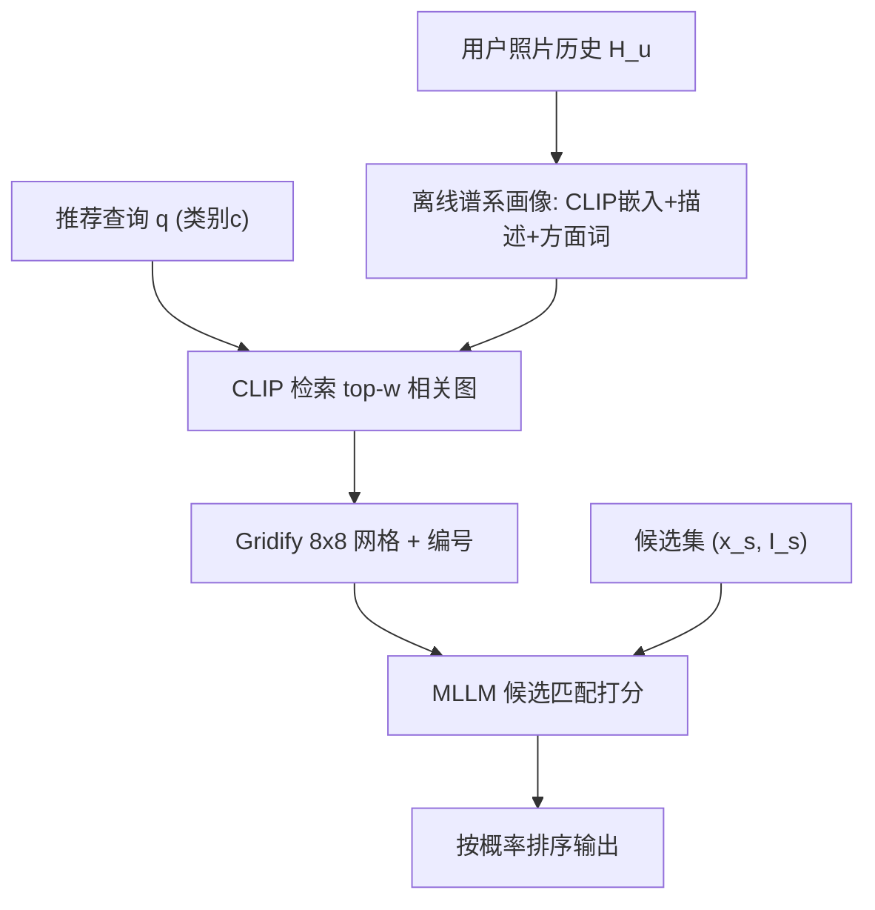

# VisualLens: Personalization through Task-Agnostic Visual History (基于任务无关视觉历史的个性化推荐)

- **会议/期刊**: NeurIPS 2025
- **作者与机构**: Wang Bill Zhu, Deqing Fu, Kai Sun, Yi Lu, Zhaojiang Lin, Seungwhan Moon, Kanika Narang, Mustafa Canim, Yue Liu, Anuj Kumar, Xin Luna Dong (Meta / USC)
- **推荐链路定位**: 重排（候选集给定下的列表排序）
- **研究方向**: 多模态推荐 / 大语言模型推荐
- **论文原文**: [https://arxiv.org/abs/2411.16034v2](https://arxiv.org/abs/2411.16034v2)
- **开源代码**: 暂未开源

## TL;DR (1分钟核心速览)

现有推荐依赖物品交互日志或文本信号，但物品历史并非总是可得且难以跨域泛化。本文提出 VisualLens，用 MLLM 从用户**任务无关的日常照片历史**中抽取“图像-描述-方面词”谱系画像，经 CLIP 检索相关图、$8\times8$ 网格化压缩、联合微调方面词生成与候选匹配，实现个性化推荐。在新建的 Google Review-V / Yelp-V 基准上，8B 模型 Hit@3 较 UniMP 提升约 5-10%，较 GPT-4o 提升 1.6-4.6%。

## Background & Motivation (背景与核心矛盾)

- **主流范式**: 多模态推荐（UniMP、COURIER、PC2L）依赖**物品级交互历史**（购买/点击记录）与物品图文特征做联合嵌入或生成式匹配。
- **前人局限**: ①物品历史在跨域场景（如餐厅推荐无购物记录）不可得，无法泛化到任意推荐任务；②视觉历史本身**多样且含噪**（垃圾桶、背景物），在“保留丰富视觉内容”与“抽取干净可解释兴趣”间存在张力；③MLLM 上下文窗口仅容少量图像，无法直接吞下整段历史。
- **核心洞察 (Key Insight)**: 用户随手拍的照片隐含跨任务的稳定偏好信号（审美、场景、活动类型），可作为**任务无关**的通用用户画像来源；且“原始图→描述→方面词”构成信息丰富度递减、语义清晰度递增的谱系，可按需取用。
- **本文切入点**: 用谱系画像 + 查询相关检索 + 网格化压缩，把长视觉历史塞进单张图喂给 MLLM，并以联合微调让方面词真正服务于推荐。

## Method (核心方法设计)

### 1. 整体框架 (Overall Architecture)

离线阶段为每张历史照片生成 CLIP 嵌入、LLaVA 短描述（≤30 词）与方面词，构成谱系三元组；运行时先按查询类别用 CLIP 余弦相似度检索 top-$w$张相关图，将其拼成$d\times d$网格（$d^2=w$，不足补黑）并编号，与对应描述/方面词拼接为查询相关画像；最后将画像（图像通道）与候选列表（文本通道）打包进 MLLM，取候选特殊 token `<I1>...<I100>` 的首 token 概率作为排序分数。

### 2. 关键设计拆解 (Key Designs)

1. **谱系画像与网格化压缩 (Spectrum Profile + Gridify)**：痛点在于 MLLM 单图 4096 token、8K 上下文仅容 2 张图，无法处理数十张历史照片。做法是把 $w=64$张检索图拼成$8\times8$单图$G(\mathcal{I})$，每张子图 112×112 并编号以对齐文本描述，使 64 张图仅占 1 个图像槽位。直觉上网格保留了全局视觉上下文，编号则建立了图文 grounding 锚点。

2. **迭代方面词精炼 (Iterative Aspect Refinement)**：零样本生成的方面词质量参差（如“blue, sky”无区分度）。做法是用 Llama-3.1-70B 以“哪些方面词有助于预测 ground truth”为准则，对 LLaVA 初始方面词做多轮筛选，约 4 轮收敛得到训练目标 $W_i$，再以交叉熵微调生成器：
$$\mathcal{L}_{\text{asp}}=\frac{1}{|\mathcal{I}|}\sum_{i\in\mathcal{I}}\text{CE}\big(W_i,\,p_\theta(x_{\text{asp}},i)\big)$$
其有效性在于把“通用视觉描述”蒸馏为“判别性偏好线索”。

3. **联合训练与推理**：方面词生成与候选匹配共享同一 backbone（LoRA 微调），匹配用 BCE 处理多正样本：
$$\mathcal{L}_{\text{joint}}=\mathcal{L}_{\text{asp}}+\lambda\mathcal{L}_{\text{pred}},\quad \lambda=2$$
训练前先在 DOCCI 密集描述数据上做多图 caption 持续预训练，教会模型读网格。推理时仅需一次前向取首 token 概率，**免负采样**，候选上限 100 个。

## Experimental Setup & Evaluation Protocol (实验设置与评估协议)

- **数据集与预处理**: 基于 Google Local Review 与 Yelp 构建两个新基准，过滤历史 <10 张图、类别歧义（如 "place"、"spot"）的样本：

| 数据集 | #Train | #Test | #Categories | 平均历史图数 | 平均 GT 数 | 平均候选数 |
| :--- | :---: | :---: | :---: | :---: | :---: | :---: |
| Google Review-V | 15.69M | 200K | 66 | 157.0 | 2.7 | 43.1 |
| Yelp-V | 4.12M | 100K | 35 | 263.6 | 8.2 | 66.7 |

- **数据划分与防穿越 (Splitting Strategy)**: 默认 **User ID 划分**（训练/测试用户完全不重叠，测新用户泛化）；另设 LongHis（时间戳切分，训练至某时刻、测之后）与 Category（按用户留出类别）两种迁移测试。
- **排名评测协议 (Ranking Protocol)**: **Sampled Ranking**——候选为同类别地理邻近商家（30-100 个随机采样），GT 为用户未来实际到访者；指标 Hit@1/3/10 与 MRR，MRR 差异 >0.4 对应 $p<0.04$。
- **对比基线与超参**: Random、Rank-by-rating；微调类 UniMP(3B)、Llama-3.1-8B、PaliGemma(3B)、MiniCPM-V2.5(8B)；直接推理类 Llama-3.1-70B、GPT-4o；另有人工标注 oracle（50 例）。$w=64$、$n=10k$、$\lambda=2$、LoRA rank 16。

## Key Experimental Results (实验关键数据)

### 1. 主实验对比 (Main Results)

| 模型 | 模态 | 规模 | GR-V Hit@3 | GR-V MRR | Yelp-V Hit@3 | Yelp-V MRR |
| :--- | :---: | :---: | :---: | :---: | :---: | :---: |
| Random | - | - | 21.0 | 21.2 | 33.6 | 30.0 |
| Rank by rating | - | - | 15.8 | 17.7 | 28.0 | 25.9 |
| UniMP (SOTA) | T+I | 3B | 34.1 | 30.5 | 48.5 | 38.3 |
| PaliGemma | T+I | 3B | 32.0 | 28.4 | 46.7 | 37.5 |
| MiniCPM-V2.5 | T+I | 8B | 36.4 | 33.2 | 53.0 | 40.3 |
| GPT-4o | T+I | - | 37.3 | 34.3 | 54.5 | 41.7 |
| **VisualLens (PaliGemma)** | T+I | 3B | 36.3 | 33.5 | **58.8** | **44.3** |
| **VisualLens (MiniCPM-V2.5)** | T+I | 8B | **38.9** | **35.4** | 59.1 | 44.9 |
| Human Oracle | - | - | 45.0 | - | 66.0 | - |

VisualLens(8B) 较 UniMP 在 Hit@3 上提升 **+4.8% (GR-V) / +10.6% (Yelp-V)**，较 GPT-4o 提升 **+1.6% / +4.6%**，并填补了约 75% 的随机基线到人类 oracle 的差距。

### 2. 消融实验 (Ablation Study, PaliGemma)

| 配置 | GR-V Hit@3 | GR-V MRR | Yelp-V Hit@3 | Yelp-V MRR |
| :--- | :---: | :---: | :---: | :---: |
| Full (Asp+Cap+Img+Iter+Joint+Ret) | **36.3** | **33.5** | **58.8** | **44.3** |
| w/o Joint | 35.8 | 33.0 | 57.9 | 43.3 |
| w/o Iter & Joint | 35.2 | 32.5 | 57.5 | 42.9 |
| w/o Asp (留 Cap+Img) | 34.7 | 31.9 | 55.3 | 41.2 |
| w/o Cap (留 Asp+Img) | 33.9 | 31.2 | 53.9 | 40.4 |
| w/o Asp & Cap (仅 Img) | 32.5 | 29.6 | 48.2 | 38.8 |
| w/o Retrieval | 27.9 | 25.9 | 45.7 | 36.8 |

### 3. 关键实验发现 (Key Findings)

1. **检索是最大增益项**：去掉历史检索后 GR-V Hit@3 从 35.2 跌至 27.9（-7.3%）、Yelp-V 从 57.5 跌至 45.7（-11.8%），说明任务无关历史中大量噪声图必须靠查询相关检索剔除，否则反而稀释信号。
2. **方面词比描述更关键**：仅去描述降 1.3%（GR-V），仅去方面词降 0.5% 但 Yelp-V 上方面词贡献更大（55.3 vs 53.9），验证“判别性语义线索”优于“通用视觉描述”。
3. **历史越长越强、候选数收敛**：MRR 随历史图数增长并在 ~100 张后趋平（检索已滤噪）；候选数超 50 后 MRR 收敛；LongHis 设置下 MRR 反升至 38.0/47.2，说明模型能利用更长历史，且跨类别迁移（37.1/45.5）优于跨用户迁移（35.4/44.9）。

## Highlights & Limitations (亮点、对比与审稿批判)

- **与代表作对比 (vs. Prior Work)**: UniMP/COURIER 依赖物品级多模态历史做联合嵌入，本文改用**任务无关照片**并输出 QA 式排序；相较 ReLLa 等文本行为检索，本文首次把“视觉历史检索+网格压缩”作为 MLLM 个性化入口；相较 GPT-4o 直接推理，本文以 8B 微调模型在同等输入下反超，证明任务微调比模型规模更关键。
- **可迁移亮点**: ①Gridify 把任意多图压成单图槽位，可迁移到任何受上下文窗口限制的多图推荐/检索场景；②“LLM 筛选方面词→小模型蒸馏”的迭代精炼范式可复用于标签稀缺的语义特征抽取。
- **审稿级局限批判**: ①候选集仅 30-100 个且为地理邻近同类商家，Sampled Ranking 协议偏乐观，未验证全库千级候选下的延迟与精度；②依赖 CLIP 类别平均嵌入做检索，对“area/station”等歧义类别 MRR 显著偏低，且跨域迁移（GR-V→Yelp-V 仅 29.4）暴露视觉域偏移脆弱性；③隐私与照片授权在真实部署中仍是硬约束。

## Rating (四维评分)

- **方法创新性 (Novelty)**: ⭐⭐⭐⭐ （首次系统化“任务无关视觉历史”推荐范式，谱系画像+网格化设计新颖，但各组件多为已有模型的工程组合）
- **评估协议与实验扎实度 (Protocol & Experiments)**: ⭐⭐⭐⭐ （两个新基准+三种迁移划分+人工 oracle 较完整，但 Sampled 候选规模偏小、缺全库排序验证）
- **写作与数学规范度 (Clarity & Rigor)**: ⭐⭐⭐⭐ （流程与公式清晰，损失定义简洁；理论分析较少，主要靠消融支撑设计合理性）
- **工业落地与复现价值 (Industrial & Practical Value)**: ⭐⭐⭐ （8B 模型+64 图网格推理开销可观，未开源，但模块化设计与检索降噪思路对工业多图画像有直接借鉴）

