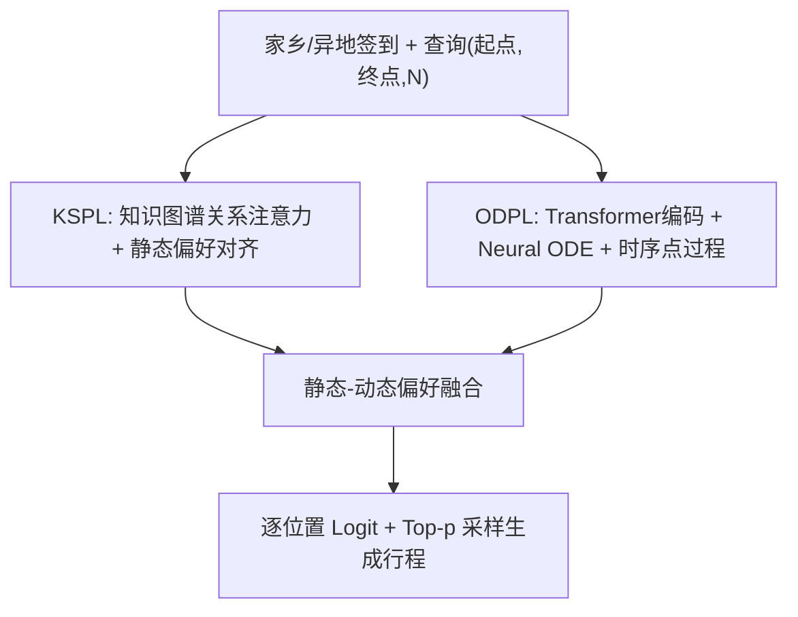
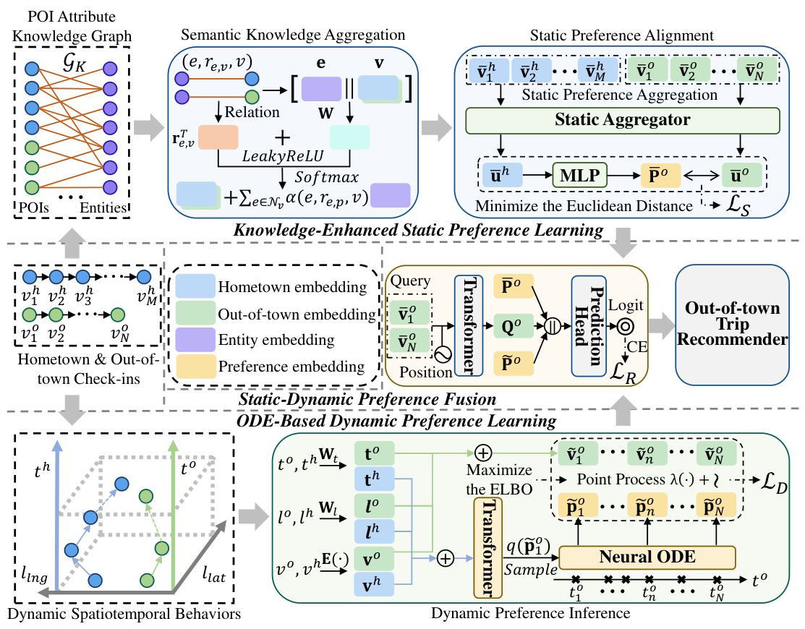

# SPOT-Trip: Dual-Preference Driven Out-of-Town Trip Recommendation (双偏好驱动的异地行程推荐)

- **会议/期刊**: NeurIPS 2025
- **作者与机构**: Yinghui Liu, Hao Miao, Guojiang Shen, Yan Zhao, Xiangjie Kong, Ivan Lee（浙江工业大学、香港理工大学、电子科技大学、南澳大学）
- **推荐链路定位**: 端到端生成式（给定起点/终点/停留数，生成中间 POI 序列）
- **研究方向**: 时空轨迹与 POI 推荐 / 图神经网络与知识图谱推荐
- **论文原文**: [https://arxiv.org/abs/2506.01705v3](https://arxiv.org/abs/2506.01705v3)
- **开源代码**: [https://github.com/gcooq/GraphTrip](https://github.com/gcooq/GraphTrip)

## TL;DR (1分钟核心速览)

本文首次系统研究**异地行程推荐**：用户从家乡前往陌生区域，给定起点、终点与停留数，需生成中间 POI 序列。核心痛点是异地签到极度稀疏且存在兴趣漂移，而现有方法把静态（家乡长期兴趣）与动态（旅途短期行为）偏好纠缠在一起学习。SPOT-Trip 用 POI 属性知识图谱+关系注意力建模静态偏好并做跨区域对齐，用 Neural ODE+时序点过程建模动态偏好的连续演化，再并行融合。在 Foursquare/Yelp 上 F1 最高提升 **17.01%**、PairsF1 提升 **15.96%**。

## Background & Motivation (背景与核心矛盾)

- **主流范式**: 异地推荐（out-of-town rec）聚焦"下一个 POI"预测，靠兴趣漂移建模（LDA/神经主题）与地理鸿沟迁移（KDDC、CAPTOR）缓解冷启动；行程推荐（trip rec）则用 Transformer 做序列补全（AR-Trip、Bert-Trip）。
- **前人局限**: ① 现有异地方法只做 next-POI，无法给出完整中间行程；② 行程推荐方法仅用位置/周期嵌入刻画动态性，无法处理签到数据的**不规则采样**；③ 两类方法都把静态与动态偏好混在一个表征里学，稀疏数据下互相干扰。
- **核心洞察 (Key Insight)**: 用户偏好天然二分——静态偏好（家乡长期稳定兴趣，可迁移）与动态偏好（旅途短期、对时空上下文敏感）。显式解耦二者既能缓解兴趣漂移，又能借家乡知识补足异地稀疏。
- **本文切入点**: 用知识图谱只承载**语义**静态偏好、用 ODE 只承载**时空**动态偏好，二者并行建模后融合，避免语义与空间信号冲突。

## Method (核心方法设计)

### 1. 整体框架 (Overall Architecture)

输入为用户家乡签到序列 $\vec{c}_h$、异地签到序列$\vec{c}_o$与查询$Q_o=\{v_s^o,v_e^o,N\}$。KSPL 模块先在 POI 属性知识图谱上做关系感知聚合得到语义增强 POI 嵌入，再经静态聚合器与 MLP 把家乡偏好对齐到异地；ODPL 模块把时空行为映射到隐空间，用 Neural ODE 演化隐状态、用时序点过程刻画行为发生强度，变分推断重建异地行为序列；最后融合模块拼接查询表征、静态偏好与动态偏好序列，逐位置打分并用 Top-p 采样生成中间 POI。

<figure class="paper-figure" markdown="span">
  <figcaption>图2：SPOT-Trip的框架。CE表示交叉熵损失。</figcaption>
</figure>

### 2. 关键设计拆解 (Key Designs)

1. **关系感知语义聚合 + 静态偏好对齐（KSPL）**：痛点是用 TransE 类方法直接混入空间信息会与语义冲突。本文在知识图谱 $\mathcal{G}_K$上对 POI$v$ 的邻居实体做关系条件注意力聚合：
$\bar{v}=v+\sum_{e\in\mathcal{N}_v}\alpha(e,r_{e,v},v)\,e,\quad \alpha=\mathrm{softmax}_e\big(\phi(r_{e,v}^{\top}\mathbf{W}[e\|v])\big)$再以平均池化得家乡/异地静态表征$\bar{u}_h,\bar{u}_o$，用 MLP 从$\bar{u}_h$推断异地偏好$\bar{P}_o$，并以欧氏距离$\mathcal{L}_S=\sum_u\|\bar{P}_o-\bar{u}_o\|_2^2$ 拉近推断值与真实值。直觉：知识图谱只补语义、空间留给动态模块，避免信号打架；对齐损失把家乡知识"翻译"到异地，直接对抗冷启动。

2. **Neural ODE + 时序点过程动态偏好（ODPL）**：痛点是签到时间不规则，位置/小时嵌入无法刻画真实连续演化。本文令隐偏好状态满足 $\frac{d\tilde{p}_t}{dt}=f(\tilde{p}_t)$，行为时刻服从非齐次泊松过程$t_n\sim\mathrm{NHPP}(\lambda(\tilde{p}_{t_n}))$，观测$\tilde{v}_{t_n}\sim\mathcal{N}(\tilde{p}_{t_n},\sigma^2_{\tilde{v}_o}I)$。用 Transformer 编码家乡序列+AGG token 做摊销变分推断，最大化 ELBO：
$\mathcal{L}_D=-\sum_u\big(\underbrace{\mathbb{E}_q[\ln p(\tilde{v}_n|t_n,\tilde{p}_1)]}_{(i)}+\underbrace{\mathbb{E}_q[\sum_n\ln\lambda(\tilde{p}_n)-\int\lambda(\tilde{p})dt]}_{(ii)}-\underbrace{\mathrm{KL}[q\|p]}_{(iii)}\big)$
直觉：ODE 给出连续轨迹、点过程给出"何时发生"的瞬时概率，二者共同把稀疏、不规则的行为序列变成可微的连续动力学。

3. **训练目标、负采样与推理效率**：总损失 $\mathcal{L}=\beta_1\mathcal{L}_S+\beta_2\mathcal{L}_D+\beta_3\mathcal{L}_R$，主推荐损失$\mathcal{L}_R$为逐位置 softmax 交叉熵（全区域 POI 归一化，等价全库排序，无显式负采样）；知识图谱侧用 TransE 与聚合器交替训练。推理时无真实时间戳，用查询位置$n$ 归一化作为代理时间网格，ODE 用 dopri5 求解器，逐位置 Top-p 采样，开销主要在 ODE 数值积分。

## Experimental Setup & Evaluation Protocol (实验设置与评估协议)

- **数据集与预处理**: 过滤异地签到 <3 次、行程时长 <1h 或 >30 天的用户；POI 被访问 <2 次剔除；要求 $|\vec{c}_h|\ge4$、$|\vec{c}_o|\ge3$、$(a_h,a_o)$频次$\ge10$。

| 数据集 | #Users | #POIs | #Check-ins | 家乡/异地签到 | 知识图谱(关系/实体/三元组) |
| :--- | :---: | :---: | :---: | :---: | :--- |
| Foursquare | 3,007 | 23,884 | 126,219 | 109,225 / 16,994 | 2 / 411 / 47,768 |
| Yelp | 4,417 | 29,930 | 78,882 | 58,403 / 20,479 | 8 / 53,549 / 353,918 |

- **数据划分与防穿越**: 按用户随机划分 **80%/10%/10%**（训练/验证/测试），非时间戳切分。
- **排名评测协议**: 逐位置在目标区域内对全部 POI 打分（区域级全库排序），指标为 F1、PairsF1（剔除起终点，只评中间 POI）及 Full-F1、Full-PairsF1（含起终点）。
- **对比基线与超参设置**: 9 个基线（Popularity、POIRank、GraphTrip、MatTrip、AR-Trip、Base，及 Base+KDDC/CNN-ODE/PPROC）；嵌入维度 $d=32$，ODE 隐维 128，Transformer 4 层 4 头，$\sigma_{\tilde{v}_o}$在 Foursquare/Yelp 分别取 0.6/0.4，$\beta_1=\beta_2=\beta_3=1$；三次重复实验，双侧 t 检验$p<0.05$。

## Key Experimental Results (实验关键数据)

### 1. 主实验对比 (Main Results)

| Method | FSQ F1 | FSQ PairsF1 | FSQ Full-F1 | FSQ Full-PairsF1 | Yelp F1 | Yelp PairsF1 | Yelp Full-F1 | Yelp Full-PairsF1 |
| :--- | :---: | :---: | :---: | :---: | :---: | :---: | :---: | :---: |
| Popularity | 0.0261 | 0.0013 | 0.4423 | 0.1565 | 0.0257 | 0.0056 | 0.5065 | 0.2058 |
| GraphTrip | 0.0295 | 0.0048 | 0.4498 | 0.1620 | 0.0289 | 0.0126 | 0.5107 | 0.2184 |
| MatTrip | 0.0311 | 0.0037 | 0.4530 | 0.1656 | 0.0301 | 0.0119 | 0.5117 | 0.2191 |
| AR-Trip | 0.0304 | 0.0045 | 0.4512 | 0.1673 | 0.0307 | 0.0153 | 0.5115 | 0.2204 |
| Base + KDDC | 0.0375 | 0.0079 | 0.4606 | 0.1822 | 0.0341 | 0.0156 | 0.5126 | 0.2256 |
| Base + CNN-ODE | 0.0367 | 0.0094 | 0.4578 | 0.1843 | 0.0326 | 0.0168 | 0.5124 | 0.2237 |
| **SPOT-Trip** | **0.0400** | **0.0109** | **0.4723** | **0.1960** | **0.0399** | **0.0190** | **0.5261** | **0.2347** |
| Improv.% | +6.67% | +15.96% | +2.54% | +6.34% | +17.01% | +13.90% | +2.63% | +4.03% |

### 2. 消融实验 (Ablation Study)

| 变体 | FSQ F1 | FSQ PairsF1 | Yelp F1 | Yelp PairsF1 |
| :--- | :---: | :---: | :---: | :---: |
| SPOT-Trip | **0.0400** | **0.0109** | **0.0399** | **0.0190** |
| w/o KS (去 KSPL) | 0.0369 | 0.0085 | 0.0359 | 0.0149 |
| w/o OD (去 ODPL) | 0.0372 | 0.0088 | 0.0365 | 0.0158 |
| w/o SI (去空间信息) | 0.0378 | 0.0081 | 0.0352 | 0.0163 |
| Base+KDDC+ODPL | 0.0385 | 0.0089 | 0.0361 | 0.0174 |
| Base+KSPL+CNN-ODE | 0.0390 | 0.0107 | 0.0351 | 0.0186 |
| SPOT-Trip (ODPL→KSPL 串行) | 0.0351 | 0.0078 | 0.0344 | 0.0153 |

### 3. 关键实验发现 (Key Findings)

1. **双偏好解耦是主要增益来源**：去掉 KSPL 在 Yelp 上 F1 掉 10.02%、PairsF1 掉 21.79%；把并行结构改成串行（ODPL→KSPL）后 Foursquare PairsF1 从 0.0109 跌至 0.0078，说明静态/动态信号必须解耦并行，串行会互相污染。
2. **空间信息不可省**：w/o SI 在 Foursquare PairsF1 与 Yelp F1 上跌幅显著，验证了"语义归静态、空间归动态"的分工设计；而用 KDDC 或 CNN-ODE 替换主模块分别造成 PairsF1 掉 22.47%、F1 掉 13.68%，证明两模块协同优于单点替换。
3. **稀疏鲁棒性突出**：仅用 40% 家乡数据时 SPOT-Trip 在 Foursquare 仍有 F1=0.0347、PairsF1=0.0073，已超过 100% 数据下的 Base+KDDC（0.0375/0.0079 接近持平）；且 80% 数据在部分指标上反超 100%，暗示随机采样滤除了家乡噪声签到。

## Highlights & Limitations (亮点、对比与审稿批判)

- **与代表作对比 (vs. Prior Work)**: 相比 KDDC（知识图谱+因果解耦，但只做 next-POI 且偏好纠缠），本文把知识图谱限定在静态语义、把 ODE 限定在动态时空，任务也从单点升级为整条行程；相比 AR-Trip（仅位置嵌入+先验位置矩阵抑制重复），本文用连续 ODE 处理不规则采样，且不依赖易误差传播的位置先验。
- **可迁移亮点**: ① "语义走 KG、时空走 ODE"的模块分工可迁移到任何跨域冷启动场景；② 用查询位置归一化作为代理时间网格，解决了训练有真实时间戳、推理无时间戳的错配问题，思路轻量通用。
- **审稿级局限批判**: ① 推理需对每个位置跑 ODE 数值积分并做区域级全库 softmax，POI 规模大时延迟与显存开销未量化；② 按用户随机划分而非时间切分，存在未来信息泄漏风险；③ 案例图显示相邻位置仍出现重复推荐，行程多样性不足，且仅给起点或仅给终点时性能明显下降。

## Rating (四维评分)

- **方法创新性 (Novelty)**: ⭐⭐⭐⭐ （首次形式化异地行程推荐，KG 静态+ODE/点过程动态的解耦范式清晰，但各组件均为已有技术的组合创新）
- **评估协议与实验扎实度 (Protocol & Experiments)**: ⭐⭐⭐⭐ （两数据集、9 基线、四指标、三次重复+t 检验、稀疏度与超参分析齐全，扣分在随机划分与区域级而非全局排序）
- **写作与数学规范度 (Clarity & Rigor)**: ⭐⭐⭐⭐ （ELBO 推导与算法伪代码完整，符号统一；部分公式排版与附录依赖略重）
- **工业落地与复现价值 (Industrial & Practical Value)**: ⭐⭐⭐ （基线代码开源但本文代码未明示，ODE 求解与全区域打分带来部署成本，落地需蒸馏或近似检索）

