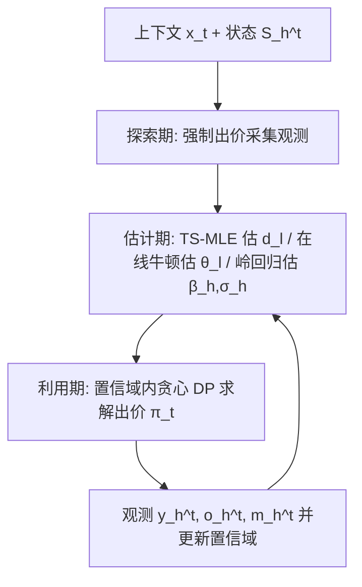

# Learning Personalized Ad Impact via Contextual Reinforcement Learning under Delayed Rewards (基于上下文强化学习与延迟奖励的个性化广告影响建模)

- **会议/期刊**: arXiv preprint (2025)
- **作者与机构**: Yuwei Cheng (University of Chicago), Zifeng Zhao (University of Notre Dame), Haifeng Xu (University of Chicago)
- **推荐链路定位**: 出价策略 / 广告拍卖决策（非传统召回-精排链路，属广告投放决策层）
- **研究方向**: 强化学习与动态探索推荐 / CTR与特征交叉（延迟转化建模）
- **论文原文**: [https://arxiv.org/abs/2510.20055v1](https://arxiv.org/abs/2510.20055v1)
- **开源代码**: 暂未开源

## TL;DR (1分钟核心速览)

本文针对自动出价中**延迟长期效应、累积广告影响（强化/疲劳）与用户异质性**三者未被联合建模的痛点，将出价建模为带延迟泊松奖励的 Contextual MDP (CMDP)，提出**两阶段最大似然估计 (TS-MLE) + 数据分割**策略，使延迟因子 $d_l$的估计误差仅依赖第一阶段$\hat{\theta}_l$的误差而不反向反馈，并设计 RL 算法达到近最优遗憾$\tilde{O}(dH^2\sqrt{T})$。仿真中拟合遗憾阶为 0.37（$\sqrt{T}$ 量级），显著优于 Aggressive/Random/Passive 三种线性遗憾基线。

## Background & Motivation (背景与核心矛盾)

- **主流范式**: "Learning to bid" 主流工作（Weed et al. 2016; Feng et al. 2018; Han et al. 2024; Zhang & Luo 2024）将出价建模为 (contextual) bandit，假设**即时奖励**（如 CTR），优化短期互动。
- **前人局限**: ① 即时奖励假设忽略广告的**延迟与长期效应**（转化峰值可滞后多轮），导致平台优化互动指标与广告主追求长期转化收益的激励错位；② 即便 Badanidiyuru et al. (2023) 用 MDP 建模延迟泊松奖励，仍假设**用户同质**，忽略个性化；③ 累积效应（重复曝光强化品牌 vs. 广告疲劳）在出价文献中长期被忽视。
- **核心洞察 (Key Insight)**: 心理学"近因效应 (recency effect)"表明用户决策更依赖最近曝光，故状态只需编码**最近两次曝光的时间间隔**即可紧凑刻画累积影响，避免将上下文并入状态导致状态空间爆炸。
- **本文切入点**: 用 CMDP 将上下文 $x_t$作为辅助信息（保持状态紧凑）、状态$S_h^t$ 编码累积效应、延迟泊松奖励刻画长期转化，三者首次联合建模。

## Method (核心方法设计)

### 1. 整体框架 (Overall Architecture)

模型将每位用户 $t$的$H$轮交互视为一个以$x_t$为条件的 MDP。状态$S_h^t=[S_{h,1}^t,S_{h,2}^t]$记录最近一次曝光距今轮数$S_{h,1}^t=h-G_{h,1}^t$与最近两次曝光间隔$S_{h,2}^t=G_{h,1}^t-G_{h,2}^t$。若本轮未赢得曝光（$o_h^t=0$），上次广告的延迟效应按$d_{S_{h,1}^t}$衰减延续；若赢得曝光（$o_h^t=1$），新广告效应覆盖旧效应但受前次曝光调节。转化$y_h^t\sim\text{Poi}(\mu_h^t)$。算法分**探索期**（前$(H+1)n_l$轮强制出价以采集足量观测）、**利用期**（在置信域内贪心求解$\pi_t=\arg\max_{\pi}\max_{\tilde{\Theta}\in\mathcal{C}_{t-1}}R(\pi;\tilde{\Theta},\hat{F}^{x_t}_{t-1})$）与**估计期**（三组参数在线更新）三阶段闭环。

### 2. 关键设计拆解 (Key Designs)

1. **延迟泊松奖励的 CMDP 建模（状态紧凑化 + 近因效应）**：痛点是将完整曝光史并入状态会爆炸。本文用两维状态 $S_h^t=[h-G_{h,1}^t,\,G_{h,1}^t-G_{h,2}^t]$ 刻画累积效应，期望转化率为
$$\mu_h^t=\begin{cases}d_{S_{h,1}^t}\,x_t^\top\theta_{S_{h,2}^t}, & o_h^t=0\\ x_t^\top\theta_{S_{h,1}^t}, & o_h^t=1\end{cases}$$
其中 $d_l$允许$>1$，从而刻画延迟转化峰值。直觉：近因效应使最近曝光主导决策，两维状态足以捕获"强化 vs. 疲劳"的权衡，且保持状态空间$\mathcal{O}(H^2)$ 可控。

2. **两阶段 MLE + 数据分割（切断误差反馈回路）**：直接对联合似然 $\mathcal{L}(\Theta)$求导非凹且无闭式解。本文按$S_{h,1}^t=l$且$o_h^t=0/1$将数据分为$D^{t,l}$（估$d_l$）与$W^{t,l}$（估$\theta_l$），先估$\hat{\theta}_l$ 再代入求
$$\hat{d}_l^t=\frac{\sum_{s=1}^t\sum_{h\in D^{s,l}}y_h^s}{\sum_{s=1}^t\sum_{h\in D^{s,l}}\langle\hat{\theta}_{S_{h,2}^s}^s,x_s\rangle}$$
关键技巧：分母用**渐进更新**的 $\hat{\theta}_{S_{h,2}^s}^s$而非最新$\hat{\theta}^t$，使$d_l$误差仅依赖$\theta_l$误差、$\theta_l$误差独立于$d_l$，避免双向反馈导致分析不可解。条件对数似然对$\{d_l\}$凹，故有闭式解且误差达$\tilde{O}(1/\sqrt{N^{t,l}})$ 参数收敛率。

3. **训练目标、负采样与推理效率**：无负采样（非检索任务）。$\theta_l$用截断均值在线牛顿法（CRTM，截断阈值$\Gamma$抑制重尾泊松极值），$\beta_h$用岭回归、$\sigma_h$用经验方差。总遗憾分解为转移误差项 (i)(iv) 与决策误差项 (iii)，分别由 Lemma 4.3/4.4 控制，得$\text{Reg}_T=O(dH^2\sqrt{T\log(TH/\delta)\log(1+T/2d)})$。单轮更新复杂度$O(d^2)$（$\theta,\beta$）与$O(d)$（$d_l$），利用期 DP 复杂度$\text{Poly}(H,|\mathcal{S}|,B_A/\epsilon)$。

## Experimental Setup & Evaluation Protocol (实验设置与评估协议)

- **数据集与预处理**: 无公开真实数据集，采用**仿真环境**（二阶价格拍卖）：

| 环境参数 | 取值 | 说明 |
| :--- | :---: | :--- |
|  horizon $H$ | 3 | 每用户最多曝光轮数（贴近真实） |
| 上下文维度 $d$| 2 |$x_t\in\mathbb{R}^2$ |
| 用户数 $T$ | 20,000 | 序贯到达 |
| 探索轮数 | 2,400 | 其余为利用期 |
| 参数采样 | $d_l,\beta_h,\sigma_h\sim|N(0,1)|+0.1$；$\theta_l\sim5|N(0,1)|+0.1$ | 保证正值，单次曝光瞬时收益约为成本 5 倍 |

- **数据划分与防穿越 (Splitting Strategy)**: 序贯在线到达，前 2,400 轮为探索期、其后为利用期；无离线训练/测试划分，属**在线序贯评估**。
- **排名评测协议 (Ranking Protocol)**: 非排名任务。采用**基于结果的 Oracle 遗憾**：因二阶价格拍卖下奖励仅取决于输赢结果而非出价，枚举全部 $2^H=8$ 种输赢序列，Oracle 取最大可达奖励，遗憾为 Oracle 与策略实际奖励的累积差。
- **对比基线与超参设置**: 对比 Aggressive（恒赢）、Random（均匀采样 8 种结果）、Passive（几乎不出价）三种固定策略；$\Gamma=10^5$，$B_\theta=10$，$\lambda=1.0$，$\theta$零初始化、$V_0=I$；20 次独立试验取均值 ±0.5 标准差，log-log 回归拟合遗憾阶。

## Key Experimental Results (实验关键数据)

### 1. 主实验对比 (Main Results)

平均累积遗憾（±0.5 标准差）与拟合遗憾阶 $T^\alpha$：

| $t$ | Algorithm 1 (本文) | Aggressive Bid | Random Bid | Passive Bid |
| :--- | :---: | :---: | :---: | :---: |
| 500 | 1770 [1174, 2379] | **228** [121, 336] | 1920 [1791, 2049] | 4630 [3391, 5869] |
| 5,000 | 8465 [5585, 11345] | **2373** [1243, 3502] | 19285 [17873, 20697] | 46179 [33850, 58508] |
| 10,000 | 8484 [5606, 11363] | **4741** [2477, 7005] | 38399 [35573, 41226] | 92468 [67735, 117201] |
| 15,000 | 8505 [5628, 11382] | **7142** [3724, 10561] | 57651 [53452, 61849] | 138652 [101576, 175729] |
| 20,000 | 8525 [5649, 11401] | **9568** [4991, 14146] | 76945 [71390, 82500] | 184873 [135414, 234332] |
| **拟合阶 $\alpha$** | **0.37** | 1.0 | 1.0 | 1.0 |

### 2. 消融实验 (Ablation Study)

原文未提供标准组件消融表，但通过**遗憾分解**与**参数设置**间接验证各模块必要性：

| 配置/变体 | 遗憾阶 | 说明 |
| :--- | :---: | :--- |
| 完整 Algorithm 1 | 0.37 | 探索+TS-MLE+置信域贪心 |
| 去掉探索期（观测不足） | — | $N^{t,l}<n_l$时 TS-MLE 误差界失效，无法保证$\sqrt{T}$ |
| 用最新 $\hat{\theta}^t$替代渐进$\hat{\theta}^s$ | — | 误差反馈回路，Theorem 4.1 界不成立 |
| Aggressive（非自适应） | 1.0 | 无学习，线性遗憾 |

### 3. 关键实验发现 (Key Findings)

1. **遗憾阶验证理论**：本文拟合 $\alpha=0.37$，接近理论$\sqrt{T}$（$\alpha=0.5$）量级，而三种基线均为$\alpha=1.0$ 线性遗憾，实证了 CMDP 自适应学习的次线性优势。
2. **短期劣势、长期反超**：$t=500$时 Aggressive 遗憾仅 228 远低于本文 1770（探索期代价），但到$t=20{,}000$时本文遗憾稳定在 ~8525 而 Aggressive 升至 9568，交叉点约在$t\approx1.5\times10^4$，说明探索投入在长周期被自适应收益覆盖。
3. **探索期成本可控**：本文遗憾在 $t\ge5000$后基本平台化（8465→8525），表明前 2,400 轮探索采集的观测已足以支撑后续近零增量遗憾，验证了$n_l$ 阈值设计的有效性。

## Highlights & Limitations (亮点、对比与审稿批判)

- **与代表作对比 (vs. Prior Work)**: 相比 Weed et al. (2016)/Feng et al. (2018)/Han et al. (2024) 的即时奖励 bandit，本文引入延迟长期效应；相比 Badanidiyuru et al. (2023) 的同质 MDP，本文用上下文实现个性化；相比 Levy et al. (2023) 的 CMDP（仅即时奖励），本文处理延迟泊松奖励并给出 $\tilde{O}(dH^2\sqrt{T})$ 近最优界。
- **可迁移亮点**: ① **数据分割 + 渐进估计**切断两阶段误差反馈回路的技巧，可迁移至任何"嵌套参数估计"场景（如延迟转化 + CTR 联合估计）；② 用近因效应将高维曝光史压缩为两维状态，是可迁移的状态设计范式。
- **审稿级局限批判**: ① **仅仿真验证**，无公开真实广告/出价数据集，线性转化率假设与"仅看最近两次曝光"的建模选择缺乏实证；② 未考虑**预算约束**（真实广告核心约束），且利用期 DP 复杂度随 $H,|\mathcal{S}|$ 多项式增长，大规模在线部署可行性存疑。

## Rating (四维评分)

- **方法创新性 (Novelty)**: ⭐⭐⭐⭐ （首次联合建模延迟效应+累积效应+异质性，TS-MLE 数据分割切断误差反馈回路的设计巧妙且有理论支撑）
- **评估协议与实验扎实度 (Protocol & Experiments)**: ⭐⭐⭐ （理论严谨、遗憾阶验证清晰，但仅仿真、无真实数据、无标准消融表，实验规模偏小）
- **写作与数学规范度 (Clarity & Rigor)**: ⭐⭐⭐⭐ （CMDP 建模与遗憾分解推导完整，定理证明详尽，符号略密集）
- **工业落地与复现价值 (Industrial & Practical Value)**: ⭐⭐⭐ （无开源代码，缺预算约束与真实数据验证，但出价决策框架与两阶段估计思路对广告平台有参考价值）

