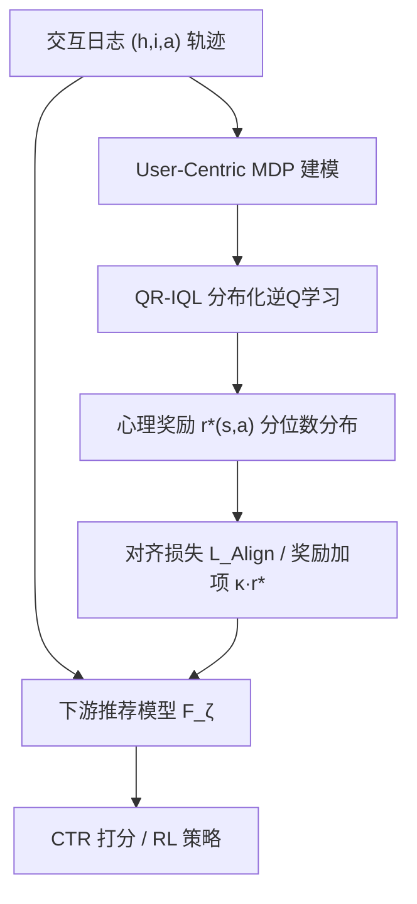
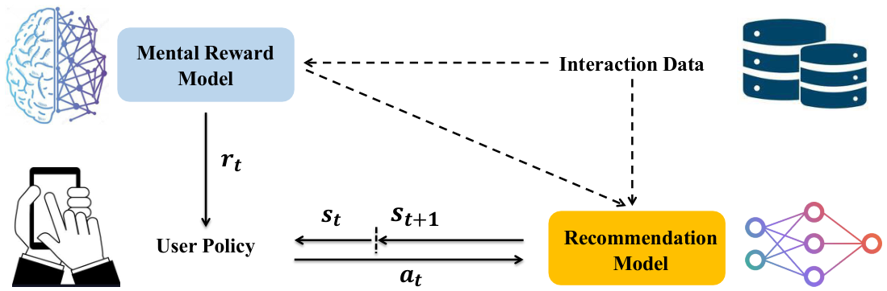
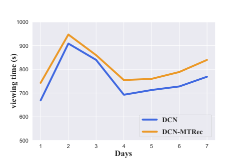

# MTRec: Learning to Align with User Preferences via Mental Reward Models (通过心理奖励模型学习对齐用户真实偏好)

- **会议/期刊**: NeurIPS 2025
- **作者与机构**: Mengchen Zhao, Yifan Gao, Yaqing Hou, Xiangyang Li, Pengjie Gu, Zhenhua Dong, Ruiming Tang, Yi Cai（华南理工、大连理工、华为诺亚方舟实验室、南洋理工）
- **推荐链路定位**: 精排（CTR 预估）/ RL 策略训练
- **研究方向**: 强化学习与动态探索推荐 / 去偏与可信推荐
- **论文原文**: [https://arxiv.org/abs/2509.22807v2](https://arxiv.org/abs/2509.22807v2)
- **开源代码**: 暂未开源

## TL;DR (1分钟核心速览)

隐式反馈（点击）常与用户真实满意度错位（标题党点击后不适），而现有去噪/多反馈融合只做数据层面修补，未建模用户内在满足感。本文把用户视为主动 Agent，构建 User-Centric MDP，提出**分布化逆强化学习 QR-IQL** 从行为轨迹反推"心理奖励"分布，再以辅助对齐损失注入 8 种 CTR 模型与 PPO/SAC。Amazon 两数据集上 NCIS 相对提升最高达 30%+（如 Wide&Deep 0.675→0.906），工业短视频 A/B 观看时长稳定 +7%。

## Background & Motivation (背景与核心矛盾)

- **主流范式**: 序列推荐以点击/观看等隐式信号做二分类或 RL 奖励，直接优化 CTR/CVR 等代理目标。
- **前人局限**: ① 去噪方法把错误反馈当随机噪声，但错误反馈本质非随机（是"诱导性偏差"），难以与真实负反馈区分；② 多反馈融合在信号冲突时失效；③ 现有 IRL 推荐工作把**系统**当 Agent 反推系统奖励，忽略用户本身也是策略性 Agent。
- **核心洞察 (Key Insight)**: 用户每次消费后内心产生一个私有"心理奖励"（O1：影响后续短期兴趣；O2：用户隐式最大化累计心理奖励），因此用户策略可视为专家策略，可用 IRL 反推其奖励函数；且该奖励受环境与偏好漂移影响，**本质是随机变量而非确定值**。
- **本文切入点**: 用分位数分布化 IRL 学一个"心理奖励模型"，把预测奖励作为补充监督信号对齐推荐模型。

## Method (核心方法设计)

### 1. 整体框架 (Overall Architecture)

MTRec 分三段闭环：先构建 User-Centric MDP（状态 $s_t=(h_t,i_t)$、动作$a\in\{a_P,a_N\}$、转移为历史追加、奖励为分布$R:S\times A\to\theta(r)$、用户策略$\pi$随机）；再用 QR-IQL 在离线轨迹上学习分布化 Q 函数并导出心理奖励$r^*$；最后将$r^*$ 以对齐损失（分类模型）或奖励加项（RL 模型）注入下游推荐器。训练数据与推荐模型共用同一份交互日志，仅多一条辅助损失，工程侵入性极低。

<figure class="paper-figure" markdown="span">
  <figcaption>图1：MTRec的整体框架。实线表示交互过程。虚线表示数据与模型之间的信息流。我们的目标是恢复心理奖励模型，并用其改进推荐模型。</figcaption>
</figure>

### 2. 关键设计拆解 (Key Designs)

1. **分布化 IRL 算子（把确定性奖励换成分布奖励）**：痛点在于 MaxEntIRL/IQ-Learn 只恢复标量 $r(s,a)$，无法刻画心理奖励的随机性。本文将 Eq.5 改写为分布算子$T^\pi r(s,a):\mathcal{D}=Q(s,a)-\gamma\mathbb{E}_{\rho_E}[\log\sum_{a}\exp Q(s',a)]$，即"学分布奖励"归约为"学分布 Q 函数"，用分位数分布$Z_\lambda$支撑于$\{\lambda_i(s,a)\}_{i=1}^{N}$，$Q_\lambda=\frac{1}{N}\sum_i\lambda_i$。直觉：同一 (状态,动作) 下用户满足感本身有方差，建模分布才能保留"点击但不满"的低分位尾部信息。

2. **QR-IQL 目标（可离线优化的分位数逆 Q 学习）**：对 IQ-Learn 目标做两处改造——用 $\mathbb{E}_{\rho_E}[V(s)-\gamma V(s')]$替换初始状态项以适配纯离线数据；正则取$\psi(x)=x-\frac{1}{4\alpha}x^2$ 以有界奖励并便于优化，得到
$$\max_{Q_\lambda}\ \mathbb{E}_{\rho_E}\Big[Q_\lambda(s,a)-\log\sum_{a}\exp Q_\lambda(s,a)\Big]-\frac{1}{4\alpha}\mathbb{E}_{\rho_E}\Big[\big(Q_\lambda(s,a)-\log\sum_{a}\exp Q_\lambda(s',a)\big)^2\Big]$$
配合 Pinball loss 回归各分位支撑，最终 $r^*(s,a)=Q^*_\lambda(s,a)-\gamma\mathbb{E}_{\rho_E}[\log\sum_{a}\exp Q^*_\lambda(s',a)]$。这是首个分布化 IRL 算法，二次正则项同时起到保守性约束（防 OOD 动作奖励爆炸）。

3. **对齐注入与训练目标**：分类模型在 CE 上叠加 $\mathcal{L}_{Align}(\zeta)=-\mathbb{E}[r^*(s,a_P)F_\zeta(i|h)+r^*(s,a_N)(1-F_\zeta(i|h))]$，总损失$\mathcal{L}_{Final}=\mathcal{L}_{CE}+\kappa\mathcal{L}_{Align}$；RL 模型直接把心理奖励加到环境奖励$\hat{r}+\kappa r^*$（Virtual Taobao 取$\kappa=0.2$）。心理奖励模型离线一次性训练，推理阶段**零额外开销**（仅训练期多一路 loss），无需人工标注、无需负采样改造。

## Experimental Setup & Evaluation Protocol (实验设置与评估协议)

- **数据集与预处理**: Amazon 两个子集（Books / Electronics），按序列推荐常规过滤与划分（细节见附录 A.4）；Virtual Taobao 用 10 万条平均 CTR>0.5 的高质量轨迹作专家数据。

| 数据集 | 场景 | 用途 | 说明 |
| :--- | :---: | :---: | :--- |
| Amazon-Books | 电商评论 | 离线 CTR | 序列推荐标准子集 |
| Amazon-Electronics | 电商评论 | 离线 CTR | 序列推荐标准子集 |
| Virtual Taobao | 仿真交互 | RL 策略 | 模拟器在线交互评估 |
| 工业短视频平台 | 千万级 DAU | 在线 A/B | DCN 基线，7 天观测 |

- **数据划分与防穿越 (Splitting Strategy)**: 离线采用序列推荐常规的按时间顺序划分（历史→下一行为预测），NCIS 仅用 10% 用户的完整轨迹计算以避免信息泄漏。
- **排名评测协议 (Ranking Protocol)**: 离线用 **AUC**（排序能力）+ **NCIS**（离线策略评估，$\tilde{J}_{NCIS}(M)=\sum_i\tilde{\rho}_i(M)L_i/\sum_i\tilde{\rho}_i(M)$，并减去未训练模型得分消除随机初始化影响）；仿真环境用 eCTR；线上用人均观看时长。
- **对比基线与超参设置**: 8 个 CTR 基线（Wide&Deep、PNN、DeepFM、SASRec、DIN、DIEN、LinRec、SIGMA），每个基线配 `-IRL`（IQ-Learn 确定性版）与 `-MTRec`（QR-IQL）三档对照；RL 基线 PPO、SAC，$\kappa=0.2$。

## Key Experimental Results (实验关键数据)

### 1. 主实验对比 (Main Results)

Amazon 两数据集（节选代表性基线，AUC / NCIS）：

| 模型 | Elec. AUC | Elec. NCIS | Books AUC | Books NCIS |
| :--- | :---: | :---: | :---: | :---: |
| Wide&Deep | 0.8290 | 0.6749 | 0.8605 | 2.0967 |
| Wide&Deep-MTRec | **0.8351** | **0.9063** | 0.8657 | 3.2043 |
| DeepFM | 0.8424 | 0.6993 | 0.8634 | 2.3146 |
| DeepFM-MTRec | **0.8468** | **0.8961** | **0.8742** | **3.7904** |
| SASRec | 0.8325 | 0.8243 | 0.8675 | 3.1755 |
| SASRec-MTRec | 0.8328 | **0.8833** | **0.8798** | **3.4634** |
| DIN | 0.8523 | 0.6044 | 0.8653 | 2.1324 |
| DIN-MTRec | **0.8542** | **0.8728** | **0.8732** | **3.2208** |
| LinRec | 0.8579 | 0.8077 | 0.8754 | 2.4653 |
| LinRec-MTRec | 0.8594 | **0.9782** | **0.8792** | 3.7928 |
| SIGMA | 0.8581 | 0.7946 | 0.8762 | 2.3975 |
| SIGMA-MTRec | **0.8604** | **0.9563** | **0.8814** | **3.8025** |

NCIS 相对提升幅度极大（Wide&Deep +34.3%、DIN +44.4%、SIGMA +20.4%），AUC 提升温和（+0.1~0.7pt）。Virtual Taobao：PPO 平均 CTR 0.5435→0.678，SAC 0.7055→0.909。线上 A/B：DCN-MTRec 人均观看时长稳定 **+7%**。

<figure class="paper-figure" markdown="span">
  <figcaption>图4：在线A/B测试结果。</figcaption>
</figure>

### 2. 消融实验 (Ablation Study)

以确定性 IRL（IQ-Learn）作为分布化 QR-IQL 的消融对照：

| 配置 | Elec. NCIS | Books NCIS | 说明 |
| :--- | :---: | :---: | :--- |
| Wide&Deep（无奖励） | 0.6749 | 2.0967 | 原始基线 |
| + 确定性 IRL | 0.8738 | 3.1264 | 已大幅优于基线 |
| + QR-IQL (MTRec) | **0.9063** | **3.2043** | 分布化再增益 |
| LinRec + 确定性 IRL | 0.9365 | 3.8005 | — |
| LinRec + QR-IQL | **0.9782** | 3.7928 | Elec. 显著增益 |
| SIGMA + 确定性 IRL | 0.9261 | 3.7556 | — |
| SIGMA + QR-IQL | **0.9563** | **3.8025** | 一致增益 |

### 3. 关键实验发现 (Key Findings)

1. **NCIS 增益远大于 AUC**：如 Wide&Deep 在 Electronics 上 NCIS +34.3% 而 AUC 仅 +0.6pt，说明心理奖励主要改善的是**长期累计满意度/轨迹跟随概率**，而非单点排序，与"对齐真实偏好"的动机自洽。
2. **分布化优于确定性**：QR-IQL 相对 IQ-Learn 在多数模型-数据集组合上 NCIS 再提升 1–5%（如 Wide&Deep Elec. 0.8738→0.9063），验证心理奖励的随机性建模是有效增量而非冗余。
3. **心理奖励模型的可解释验证**：图 3(a) 显示平均心理奖励随交互步数递减（用户疲劳）；图 3(b-e) 显示相当比例"实际点击"对应的 $r^*(s,a_{real}|a_{real})$ 偏低，直接量化了"点击≠满意"的错位现象，间接佐证模型学到了真实偏好信号。

## Highlights & Limitations (亮点、对比与审稿批判)

- **与代表作对比 (vs. Prior Work)**: 相比去噪类方法（把错误反馈当随机噪声）与多反馈融合（冲突信号失效），本文从**用户决策过程**层面建模满意度；相比 IQ-Learn 等确定性 IRL，首次给出分布化 IRL 算子与可离线优化目标；相比 RLHF 需人工标注奖励，本文奖励完全从行为日志自监督习得，工业友好。
- **可迁移亮点**: ① "心理奖励作为辅助对齐损失"的插件式设计可无缝挂到任意 CTR/RL 推荐器，训练期一次性成本、推理零开销；② 分位数分布 Q + 二次正则的离线 IRL 目标可迁移到其他"隐式信号≠真实效用"的场景（如广告转化、内容消费时长）。
- **审稿级局限批判**: ① 心理奖励无 ground-truth，仅靠步数递减与反事实分布做**间接验证**，缺乏定量可信度指标；② 动作空间被简化为二值 {click, skip}，难以刻画观看时长、滑走速度等细粒度满意度；③ 线上仅报告单一平台 7 天 +7% 观看时长，未披露延迟/训练成本与多业务泛化结果。

## Rating (四维评分)

- **方法创新性 (Novelty)**: ⭐⭐⭐⭐ （首个分布化 IRL 用于用户心理奖励建模，User-Centric MDP 视角新颖，但 QR-DQN+IQ-Learn 组合痕迹明显）
- **评估协议与实验扎实度 (Protocol & Experiments)**: ⭐⭐⭐⭐ （8 基线×2 数据集+仿真+工业 A/B 覆盖完整，NCIS 协议规范；但心理奖励本身缺直接验证、无显著性检验细节）
- **写作与数学规范度 (Clarity & Rigor)**: ⭐⭐⭐⭐ （MDP 与 IRL 推导链条清晰、附录给全推导；部分符号如 $\theta(r)$、$\psi$与$\phi$ 关系需对照附录才通顺）
- **工业落地与复现价值 (Industrial & Practical Value)**: ⭐⭐⭐⭐ （插件式辅助损失、推理零开销、千万 DAU 实测 +7%，落地价值高；但代码未开源、专家数据构造依赖 CTR 阈值需调参）

