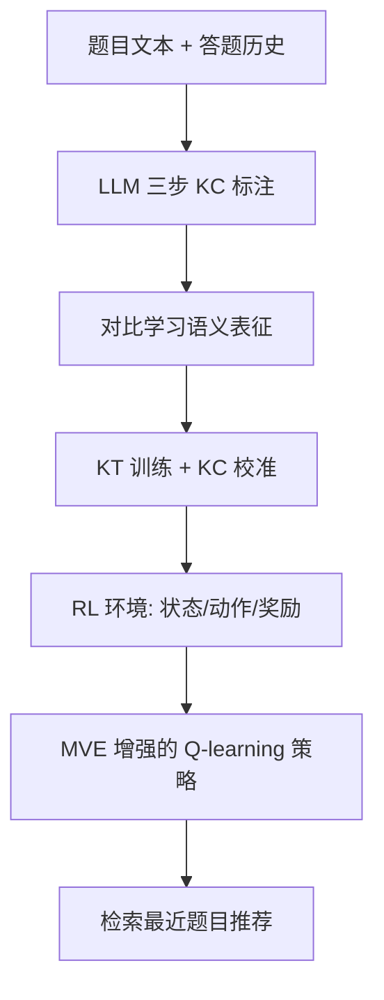

# Personalized Exercise Recommendation with Semantically-Grounded Knowledge Tracing (语义锚定的知识追踪个性化习题推荐)

- **会议/期刊**: ICLR/NeurIPS/ICML 2025 (Preprint, Under Review)
- **作者与机构**: Yilmazcan Ozyurt, Tunaberk Almaci, Stefan Feuerriegel, Mrinmaya Sachan (ETH Zürich; LMU Munich)
- **推荐链路定位**: 端到端策略优化（RL 序列决策）
- **研究方向**: 强化学习与动态探索推荐 / 大语言模型推荐
- **论文原文**: [论文原文链接](https://arxiv.org/abs/2507.11060v1)
- **开源代码**: [开源代码仓库链接](https://github.com/oezyurty/ExRec)

## TL;DR (1分钟核心速览)

现有 KT+RL 习题推荐依赖 ID 嵌入、以全历史为状态、奖励需对全题库推理，且仅支持单一 RL 算法。ExRec 构建 LLM 自动知识点标注 → 对比学习语义表征 → KT 校准 → RL 策略的端到端流水线，并提出用 KT 组件初始化 critic 的 Model-Based Value Estimation (MVE)。在 XES3G5M 上以 2048 名学生、10 步推荐、知识状态净增益为指标，MVE 使连续 Q-learning 方法在四个任务上全面超越离散方法与历史数据基线。

## Background & Motivation (背景与核心矛盾)

- **主流范式**: 将 KT 模型作为 RL 环境模拟学生答题，用 DQN/PPO 等学习习题选择策略，奖励定义为知识点掌握度提升。
- **前人局限**: ① 依赖题目 ID 嵌入，忽略题目语义，无法泛化到新题；② 状态定义为完整答题历史，长序列下计算不可行；③ 奖励计算需对某知识点下全部题目逐一推理，无法实时；④ 框架通常只绑定单一 RL 算法。
- **核心洞察 (Key Insight)**: 若题目与知识点共享同一语义嵌入空间，KT 模型可直接以知识点嵌入为查询预测掌握度，从而把"对全题库推理"降为"一次前向"，同时让 critic 复用 KT 结构。
- **本文切入点**: 用语义表征打通题目—知识点空间，再用 KT 模型本身充当可微环境与值函数先验。

## Method (核心方法设计)

### 1. 整体框架 (Overall Architecture)

输入为题目文本与答题历史。模块 1 用 GPT-4o 三步生成解题步骤、知识点 (KC) 及步骤—KC 映射；模块 2 用对比学习将题目、步骤、KC 编码到同一空间；模块 3 以语义嵌入替换 ID 嵌入训练 LSTM-KT，并通过 KC 校准损失使模型可直接预测 KC 掌握度；模块 4 将校准 KT 作为 RL 环境，状态为紧凑隐状态、动作为题目嵌入、奖励为 KC 掌握度增量，连续 Q-learning 方法额外接入 MVE critic。

### 2. 关键设计拆解 (Key Designs)

1. **语义锚定的对比表征 (Module 2)**：ID 嵌入无法刻画题目相似性。以题目/步骤为锚、关联 KC 为正样本，并用 HDBSCAN 对 KC 聚类消除同义 KC 假负例，损失为
$\mathcal{L}_q=-\log\frac{\exp(\mathrm{sim}(z_q,z_{c_j})/\tau)}{\exp(\mathrm{sim}(z_q,z_{c_j})/\tau)+\sum_{c_{j'}\in\mathcal{N}(c_j)}\exp(\mathrm{sim}(z_q,z_{c_{j'}})/\tau)}$
步骤侧损失同构，二者加权求和。聚类排除假负例使同类 KC 不被强行推开，检索 micro-F1 从 0.2305 升至 0.8865。

2. **KC 校准的 KT (Module 3)**：传统掌握度需对 KC 下全部题目推理。作者冻结语义嵌入，令 KT 直接以 KC 嵌入查询：$\hat{y}^c_{t+1}=F_\theta(s_t,z^c_{t+1})$，并以采样 20 题均值作为软标签，校准损失$\mathcal{L}_{calib}=\mathcal{L}_{pred}+\mathcal{L}_{KC}$。冻结嵌入虽使 AUC 从 82.13 微降至 81.26（仍远高于 ID 初始化的 78.33），但换来 KC 级 MAE 从 0.08 降至 0.028。

3. **Model-Based Value Estimation (Module 4.1)**：随机初始化 critic 在稀疏奖励下样本效率低。MVE 用 KT 的 $E_\theta$、$F_\theta$初始化 critic 的$E_\omega$、$F_\omega$，对答对/答错两种下一状态分别预测掌握度并按 KT 预测概率加权：
$Q(s_t,\tilde{z}^q_{t+1})=\hat{y}^q_{t+1}\cdot y^c_{t+1}(1)+(1-\hat{y}^q_{t+1})\cdot y^c_{t+1}(0)-\hat{y}^c_t$
该式即 Bellman 一步展开的解析近似，使值估计与学生学习动力学对齐，减少环境交互。训练采用 Tianshou 默认 RL 损失，无需负采样；推理时策略输出题目嵌入并在语料中检索最近邻，单步仅一次 KT 前向。

## Experimental Setup & Evaluation Protocol (实验设置与评估协议)

- **数据集与预处理**: XES3G5M 数学 KT 基准，中文题干经商业翻译转英文；原标注 1.16 KC/题，ExRec 重标注后多数题目 3 个 KC，共 5,139 个 KC 聚为 1,377 簇。

| 数据集 | #Users | #Items | #Interactions | 稀疏度/密度 | 特征/场景说明 |
| :--- | :---: | :---: | :---: | :---: | :--- |
| XES3G5M | 18,066 | 7,652 | 5.5M | 密度约 4.0e-5 | 865 叶级 KC，含题干/答案，在线数学 |

- **数据划分与防穿越 (Splitting Strategy)**: 沿用数据集官方划分；RL 环境取每名学生前 100 题编码，第 100 步隐状态为初始状态，交互 10 步，评估集 2048 名学生。
- **排名评测协议 (Ranking Protocol)**: 非传统 Top-N 排序，而是序列决策评估——指标为 10 步后目标 KC 知识状态净增益，归一化为最大可达增益百分比（任务 1–3 上界约 0.22，任务 4 最高 0.64）。
- **对比基线与超参设置**: 非 RL 基线 Random Policy、Historical Data；连续动作 DDPG/SAC/TD3/TRPO/PPO（前三者含 w/ MVE 变体）；离散动作 Discrete SAC/C51/Rainbow/DQN。嵌入维度 768，状态维度 300 经线性层升至 768，$\gamma=0.99$，学习率$5\times10^{-5}$–$1\times10^{-4}$。

## Key Experimental Results (实验关键数据)

### 1. 主实验对比 (Main Results)

原文以柱状图（图 3）呈现四任务结果，下表为按图读取的代表性数值（% of Max Improvement）：

| 方法 | Task 1 全局 | Task 2 已练 KC | Task 3 将学 KC | Task 4 最弱 KC |
| :--- | :---: | :---: | :---: | :---: |
| Random Policy | ~2 | ~1 | ~3 | ~1 |
| Historical Data | ~0 | ~-1 | ~1 | ~0 |
| PPO | ~18 | ~15 | ~20 | ~10 |
| DQN | ~30 | ~28 | ~33 | ~18 |
| Rainbow | ~33 | ~30 | ~36 | ~20 |
| SAC | ~35 | ~32 | ~38 | ~22 |
| TD3 | ~36 | ~33 | ~39 | ~23 |
| **TD3 w/ MVE** | **~48** | **~45** | **~52** | **~38** |
| **SAC w/ MVE** | **~47** | **~44** | **~50** | **~36** |

### 2. 消融实验 (Ablation Study)

| 配置 | AUC | KC 级 MAE | 检索 micro-F1 |
| :--- | :---: | :---: | :---: |
| ID 嵌入初始化 | 78.33 | — | — |
| 语义嵌入（冻结，无校准） | 81.26 | 0.080 | 0.8865 |
| 语义嵌入 + KC 校准 | **81.65** | **0.028** | 0.8865 |
| 语义嵌入（可训练） | 82.13 | — | — |
| 无表征学习（原始 LLM 嵌入） | — | — | 0.2305 |

### 3. 关键实验发现 (Key Findings)

1. **MVE 是最大增益来源**：在四个任务上，MVE 使 DDPG/SAC/TD3 平均提升约 10–15 个百分点；任务 4 中 TD3 w/ MVE 达 ~38%，反超最强离散方法 Rainbow（~20%），说明动态目标下解析值估计比试错学习更稳。
2. **语义表征决定泛化上限**：题库用 GPT-4o 扩增 3 倍后，默认模型性能下降（DDPG -7.4、TD3 -14.2），而 w/ MVE 变体反而提升（DDPG +0.1、TD3 +6.9），证明语义嵌入 + KT 先验可无缝吸收新题。
3. **校准以极小预测代价换取可解释掌握度**：冻结嵌入仅损失 0.87 AUC，却将 KC 级 MAE 从 0.08 压到 0.028，使奖励计算从"全题库推理"降为单次前向，是实时性的关键。

## Highlights & Limitations (亮点、对比与审稿批判)

- **与代表作对比 (vs. Prior Work)**: 相比 RCL4ER 的纯 ID 嵌入与 TGKT-RL 依赖预定义题目—KC 图，ExRec 无需人工图结构且支持新题；相比 Ai et al. 与 Cai et al. 仅支持单一 RL 算法且奖励需全库推理，本文统一框架兼容离散/连续动作并给出解析值估计。
- **可迁移亮点**: ① 用"环境模型组件初始化 critic"的 MVE 思路可迁移到任何有可微模拟器的推荐场景（如用户模拟器驱动的对话推荐）；② 冻结语义嵌入 + 轻量校准头，是兼顾可解释性与推理效率的通用范式。
- **审稿级局限批判**: ① 评估仅用单一数据集且题干经机器翻译，跨语言/跨学科泛化未验证；② 10 步短视界与模拟学生（KT 自答）存在 sim-to-real 偏差，缺乏真实教学 A/B；③ 依赖 GPT-4o 标注（约 50 USD）与 HDBSCAN 聚类超参，复现成本与敏感性未充分讨论。

## Rating (四维评分)

- **方法创新性 (Novelty)**: ⭐⭐⭐⭐ （语义锚定 KT + 解析式 MVE critic 的组合新颖，但各组件多为已有技术的巧妙拼接）
- **评估协议与实验扎实度 (Protocol & Experiments)**: ⭐⭐⭐ （四任务设计有教育意义、RL 算法覆盖广，但单数据集、模拟环境、无显著性检验）
- **写作与数学规范度 (Clarity & Rigor)**: ⭐⭐⭐⭐ （MDP 与 MVE 推导清晰，模块划分明确，部分超参与图表数值仅在附录）
- **工业落地与复现价值 (Industrial & Practical Value)**: ⭐⭐⭐⭐ （全流程开源、单步推理开销低、支持新题扩展，但 LLM 标注成本与模拟器偏差需工程化解）

