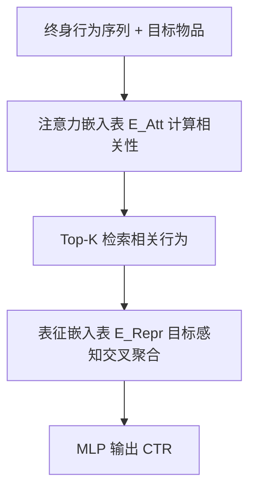
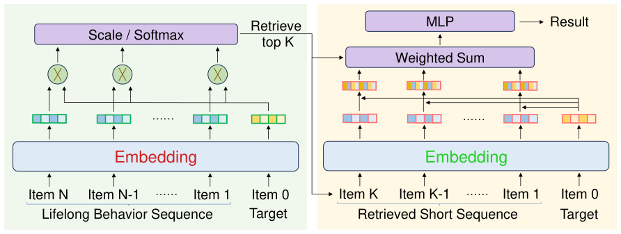

# Long-Sequence Recommendation Models Need Decoupled Embeddings (长序列推荐模型需要解耦嵌入)

- **会议/期刊**: ICLR 2025
- **作者与机构**: Ningya Feng, Junwei Pan, Jialong Wu, Baixu Chen, Ximei Wang, Qian Li, Xian Hu, Jie Jiang, Mingsheng Long（清华大学软件学院 BNRist / 腾讯）
- **推荐链路定位**: 精排（CTR 预估，含长序列检索 GSU + 序列建模 ESU 两阶段）
- **研究方向**: 序列与会话推荐 / CTR 预估与特征交叉
- **论文原文**: [https://arxiv.org/abs/2410.02604v3](https://arxiv.org/abs/2410.02604v3)
- **开源代码**: [https://github.com/thuml/DARE](https://github.com/thuml/DARE)

## TL;DR (1分钟核心速览)

长序列推荐普遍采用「注意力检索 top-k 行为 + 序列建模聚合」两阶段范式，但注意力模块（学相关性）与表征模块（学判别性）共享同一张嵌入表，本文首次从多任务学习视角证明二者梯度存在**支配（表征梯度约为注意力 5 倍）与冲突（64.31% 样本梯度余弦为负）**。作者提出 DARE，用两张独立嵌入表彻底解耦，在 Taobao/Tmall 全库 AUC 上较 SOTA TWIN 最高提升 9‰，检索 NDCG 提升 46.5%，并可将注意力嵌入降维实现检索加速 50%；腾讯广告线上 A/B 取得 1.47% GMV 提升。

## Background & Motivation (背景与核心矛盾)

- **主流范式**: SIM/TWIN 系列将终身行为序列拆为「GSU 软检索 top-k 相关行为」与「ESU 目标感知注意力聚合」两阶段，两阶段共用同一套 item 嵌入。
- **前人局限**: ① 注意力需学「目标-行为相关性」，表征需学「高维可判别向量」，二者目标异质却共享参数；② 直接照搬 NLP 的 Q/K/V 线性投影解耦，在推荐中因嵌入维度仅 ≤200（交互坍缩理论）导致投影矩阵容量严重不足而失效（Taobao AUC 反降近 2%）。
- **核心洞察 (Key Insight)**: 将两模块视作 MTL 双任务做梯度分析——表征梯度幅值约为注意力 5 倍形成**支配**，且 64.31% 的样本上二者梯度方向**冲突**（余弦为负），这正是注意力学不准、关键行为被误滤的根因。
- **本文切入点**: 放弃「投影解耦」的弱容量路线，直接在**嵌入表层**用两张独立表彻底解耦，使两模块各自获得充足容量。

## Method (核心方法设计)

### 1. 整体框架 (Overall Architecture)

输入为用户终身行为序列与目标物品；检索阶段仅用注意力嵌入表 $\mathbf{E}^{\text{Att}}$计算目标-行为相关性并取 top-$K$；序列建模阶段改用表征嵌入表$\mathbf{E}^{\text{Repr}}$，以目标感知交叉$e_i^{\text{Repr}} \odot v_t^{\text{Repr}}$ 加权聚合成用户兴趣向量，送入 MLP 输出 CTR。两表梯度互不干扰，训练收敛更快，且注意力表可独立降维以加速检索。

<figure class="paper-figure" markdown="span">
  <figcaption>图6：所提出的DARE模型架构。一个嵌入负责注意力，学习目标与历史行为之间的相关性；另一个嵌入负责表示，学习用于预测的判别性表示。解耦这两个嵌入使我们能够解决两个模块之间的冲突。</figcaption>
</figure>

### 2. 关键设计拆解 (Key Designs)

1. **双嵌入表完全解耦（DARE 核心）**：痛点在于共享表下梯度支配+冲突使注意力失真；本文令历史行为与目标分别从 $\mathbf{E}^{\text{Att}}$、$\mathbf{E}^{\text{Repr}}$ 取向量，注意力权重为
$$w_i=\frac{\exp(\langle e_i^{\text{Att}}, v_t^{\text{Att}}\rangle/\sqrt{|\mathbf{E}^{\text{Att}}|})}{\sum_{j=1}^{K}\exp(\langle e_j^{\text{Att}}, v_t^{\text{Att}}\rangle/\sqrt{|\mathbf{E}^{\text{Att}}|})}$$
直觉：梯度回传到不同表，从结构上消除任务干扰，且每表参数量翻倍补偿了投影矩阵的容量缺失。

2. **目标感知表征（Target-Aware Representation, TR）**：痛点在于 MLP 难以显式学习低阶交叉，拼接 $[\sum_i w_i e_i, v_t]$判别性弱；本文改为$h=\sum_{i=1}^{K} w_i \cdot (e_i^{\text{Repr}} \odot v_t^{\text{Repr}})$，让每个被检索行为与目标逐维交互后再聚合，显著提升表征可分性（互信息实验验证）。

3. **训练目标与推理效率**：采用标准 CTR 二元交叉熵 $\mathcal{L}=-\frac{1}{|D|}\sum (y\log\hat{y}+(1-y)\log(1-\hat{y}))$，负样本为随机采样目标物品（1:1），无需难负采样。推理时检索复杂度$O(K_A N)$，可将$|\mathbf{E}^{\text{Att}}|$ 降至表征维度的 1/2 甚至 1/4，实现 50%–75% 检索加速而 AUC 几乎无损。

## Experimental Setup & Evaluation Protocol (实验设置与评估协议)

- **数据集与预处理**: Taobao 与 Tmall 公开长序列行为数据集，含 item ID 与 category ID；输入为近期连续子序列 + 目标物品。

| 数据集 | 行为类型 | 特征 | 场景说明 |
| :--- | :---: | :---: | :--- |
| Taobao | 点击 | item/cate ID | 电商长序列，正样本为下一点击，负样本随机采样 |
| Tmall | 点击 | item/cate ID | 电商长序列，同上 |
| Tencent Ads | 广告+内容 | cate/行为类型/场景/时间编码 | 线上 A/B，日训练样本约 10 亿，序列均值 170/1500 |

- **数据划分与防穿越 (Splitting Strategy)**: 按时间划分训练/验证/测试（附录 B），正样本取用户真实下一次点击，负样本随机采样目标物品。
- **排名评测协议 (Ranking Protocol)**: 主指标为 AUC（二分类 CTR 协议），辅以 GAUC、Logloss；检索质量用 NDCG（以互信息 top-k 为最优检索的 ground truth）。
- **对比基线与超参设置**: 基线含 ETA、SDIM、DIN、TWIN、TWIN(hard)、TWIN(w/ proj.)、TWIN(w/o TR)、TWIN-V2、TWIN-4E；嵌入维度取 16/64/128 三档，报告 5 次均值±标准差。

## Key Experimental Results (实验关键数据)

### 1. 主实验对比 (Main Results)

| 模型 | Taobao@16 | Tmall@16 | Taobao@64 | Tmall@64 | Taobao@128 | Tmall@128 |
| :--- | :---: | :---: | :---: | :---: | :---: | :---: |
| ETA (2021) | 0.91326 | 0.95744 | 0.92300 | 0.96658 | 0.92480 | 0.96956 |
| SDIM (2022) | 0.90430 | 0.93516 | 0.90854 | 0.94110 | 0.91108 | 0.94298 |
| DIN (2018) | 0.90442 | 0.95894 | 0.90912 | 0.96194 | 0.91078 | 0.96428 |
| TWIN (2023) | 0.91688 | 0.95812 | 0.92636 | 0.96684 | 0.93116 | 0.97060 |
| TWIN (w/ proj.) | 0.89642 | 0.96152 | 0.87176 | 0.95570 | 0.87990 | 0.95724 |
| TWIN-V2 (2024) | 0.89434 | 0.94714 | 0.90170 | 0.95378 | 0.90586 | 0.95732 |
| TWIN-4E | 0.90414 | 0.96124 | 0.90356 | 0.96372 | 0.90946 | 0.96016 |
| **DARE (Ours)** | **0.92568** | **0.96800** | **0.92992** | **0.97074** | **0.93242** | **0.97254** |
| Improv.% (vs TWIN) | +0.96% | +1.03% | +0.38% | +0.40% | +0.14% | +0.20% |

### 2. 消融实验 (Ablation Study)

| 变体 | Taobao@64 | Tmall@64 | 说明 |
| :--- | :---: | :---: | :--- |
| TWIN (w/o TR) | 0.91590 | 0.96320 | 去掉目标感知表征 |
| TWIN (w/ proj.) | 0.87176 | 0.95570 | 线性投影解耦（容量不足） |
| TWIN-4E | 0.90356 | 0.96372 | 四表过度解耦，违背推荐先验 |
| **DARE** | **0.92992** | **0.97074** | 双表解耦 + TR |

### 3. 关键实验发现 (Key Findings)

1. **解耦是主要增益来源，TR 是必要补充**：TWIN(w/o TR)→TWIN 提升约 1‰–1.5‰，而 TWIN→DARE 再提升约 3.5‰–4‰；图 10(c) 显示 TR 与解耦分别贡献判别性提升的两大块，且 DARE 即便用拼接也优于 TWIN。
2. **检索质量大幅改善**：DARE 检索 NDCG 达 0.8124，较 TWIN 的 0.5545 提升 46.5%，较 DIN 的 0.6382 提升 27.3%；图 8 显示 TWIN 过度高估跨类目近期行为相关性，DARE 学到的语义-时间衰减模式更贴近互信息真值。
3. **效率与收敛双赢**：Tmall 上 TWIN 需 1300+ 迭代达 90% 验证准确率，DARE 仅约 450 迭代（1/3）；注意力嵌入降维后检索加速 50% 而 AUC 几乎不变，TWIN 同操作则显著掉点；线上 5 天 A/B 取得 1.47% GMV 提升、0.57% 成本下降。

## Highlights & Limitations (亮点、对比与审稿批判)

- **与代表作对比 (vs. Prior Work)**: 相较 TWIN（统一注意力度量但共享嵌入）与 TWIN-V2（视频场景优化），DARE 首次从梯度层面定位干扰并结构性消除；相较 NLP 式 Q/K/V 投影解耦，本文用合成实验（nanoGPT 降维至 2）证明投影仅在容量充足时有效，从而解释推荐场景失效原因。
- **可迁移亮点**: ① 「梯度幅值+余弦冲突」诊断法可直接用于其他共享嵌入的多模块推荐结构（如多目标精排）；② 检索/表征嵌入维度分离设计可迁移至任何 ANN 召回-精排级联系统做延迟优化。
- **审稿级局限批判**: ① 仅在电商点击与腾讯广告验证，缺乏短视频/新闻等强时效场景；② 双表使嵌入参数量翻倍，十亿级 ID 下存储与更新开销需额外工程权衡，论文未给出显存/吞吐量化分析。

## Rating (四维评分)

- **方法创新性 (Novelty)**: ⭐⭐⭐⭐ （首次用 MTL 梯度分析刻画长序列推荐嵌入干扰，双表解耦简洁且直击根因）
- **评估协议与实验扎实度 (Protocol & Experiments)**: ⭐⭐⭐⭐ （双公开集+三档维度+线上 A/B+检索/判别性/效率多维分析，但缺采样排序协议对比）
- **写作与数学规范度 (Clarity & Rigor)**: ⭐⭐⭐⭐ （梯度诊断与容量假设论证清晰，公式简洁；TWIN-4E 讨论体现对推荐先验的严谨思考）
- **工业落地与复现价值 (Industrial & Practical Value)**: ⭐⭐⭐⭐⭐ （代码开源，检索加速 50% 与 1.47% GMV 提升直接可落地，工程价值突出）

