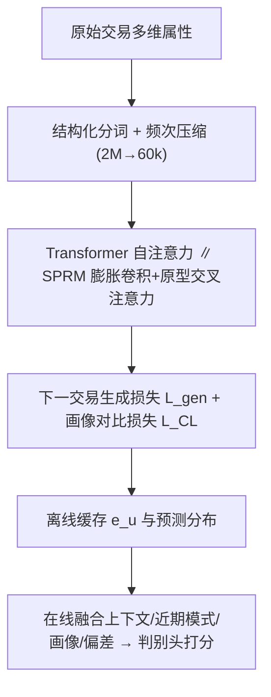
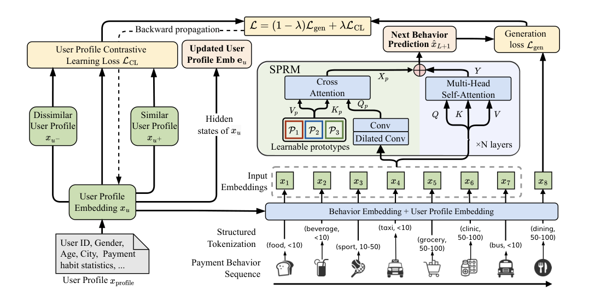

# PANTHER: Generative Pretraining Beyond Language for Sequential User Behavior Modeling (超越语言的生成式预训练：面向序列用户行为建模)

- **会议/期刊**: NeurIPS 2025
- **作者与机构**: Guilin Li, Yun Zhang, Xiuyuan Chen 等；上海交通大学、微信支付（腾讯）、上海创智学院、香港城市大学、香港科技大学（广州）
- **推荐链路定位**: 端到端生成式预训练 + 轻量判别式在线推理（召回/风险打分）
- **研究方向**: 序列与会话推荐 / 生成式推荐
- **论文原文**: [论文原文链接](https://arxiv.org/abs/2510.10102v2)
- **开源代码**: [开源代码仓库链接](https://github.com/WeChatPay-Pretraining/PANTHER)

## TL;DR (1分钟核心速览)

针对支付场景下标签稀缺、类别高基数、长序列截断与静态 embedding 四大痛点，PANTHER 把每笔交易视为多维属性构成的「行为 token」，用结构化分词（2M→60k 词表）+ SPRM（膨胀卷积 + 可学习原型交叉注意力）做下一笔交易生成式预训练，并以用户画像对比学习注入群体结构。离线缓存 embedding、在线毫秒级融合推理。微信支付线上欺诈 Top-0.1% 召回相对提升 38.6%，下一交易预测 HR@1 提升 25.6%；公开基准 MovieLens-1M HR@1 +21.8%、Yelp NDCG@5 +29.6%。

## Background & Motivation (背景与核心矛盾)

- **主流范式**: 工业界沿用 DeepFM/DCN/DIEN 等判别式精排模型做交易级分类，序列推荐则用 SASRec/BERT4Rec/HSTU 做 next-item 预测。
- **前人局限**: ① 判别式模型在十亿用户规模下正例极稀疏，高维类别特征易记忆虚假共现；② 标准 Transformer 自注意力逐 token 独立处理，缺乏对日/周周期等局部规律的归纳偏置，长序列信号被稀释，且 $O(T^2)$ 复杂度迫使线上截断历史。
- **核心洞察 (Key Insight)**: 用户行为序列虽无语法，却存在强周期性「行为 motif」（通勤、周末休闲等，见图 1）；且生成式目标此前多被当作**终点任务**，而非压缩用户知识为可迁移表征的**预训练手段**。
- **本文切入点**: 采用 pretrain→adapt 视角——离线用生成式目标学通用用户表征，在线仅用轻量判别头适配，兼顾表征能力与毫秒级延迟。

## Method (核心方法设计)

### 1. 整体框架 (Overall Architecture)

两阶段架构。**Stage 1 离线预训练**：交易经结构化分词压缩为行为 token 序列，前置可学习 profile token，经「多头自注意力 + SPRM 并行分支」的 Transformer 预测下一笔交易，同时输出用户画像 embedding $e_u$与行为预测分布。**Stage 2 在线推理**：缓存$e_u$与预测分布，实时将当前交易上下文$\psi(c_{new})$、近 100 笔 TextCNN 编码$f_{enc}$、长期画像$e_u$与行为偏差$\Delta(\hat{x}_{L+1},x_{new})$拼接送入下游判别模型$g_\phi$ 打分。

<figure class="paper-figure" markdown="span">
  <figcaption>图 2：PANTHER 的关键组件：结构化分词、SPRM 与用户画像嵌入模块（§3.3）优化：</figcaption>
</figure>

### 2. 关键设计拆解 (Key Designs)

1. **结构化分词与频次压缩**：交易无预定义语义单元，故将上下文与对手方属性做笛卡尔积构成 token $\tau=(c_i,a_j,m_k,r_l)\in\mathcal{C}\times\mathcal{A}\times\mathcal{M}\times\mathcal{R}$（如 `CreditCard_$50-100_Fuel_LowRisk`）。原始组合空间约 2M，保留频次 Top-$K=60{,}000$（覆盖 96% 交易），长尾映射 `[UNK]`，词表缩减 97%，既降稀疏又保留可解释金融信号。

2. **SPRM 序列模式识别模块**：针对自注意力缺乏局部/周期归纳偏置，与自注意力**并行**加性融合两路轻量偏置。(i) 多尺度深度可分离膨胀卷积聚合局部模式：$H_p=\mathrm{Concat}_k(\mathrm{Conv}_{dil=r_k,w=w_k}(H))$，小膨胀率抓即时簇、大膨胀率抓周期规律；(ii)$m$个可学习原型$P\in\mathbb{R}^{m\times d}$作交叉注意力 Key/Value，将局部片段压缩对齐到最近「消费 motif」：$X_p=\mathrm{Softmax}(QK^\top/\sqrt{d_k})V$。整体复杂度约$O(T)$（$m\ll T$，实测$m=64$），长序列下显存与延迟远优于 Transformer（表 6：序列 4096 时 Transformer OOM，SPRM 仅 5.7GB）。

3. **用户画像 embedding 与对比个性化 + 训练目标**：profile token 既作个性化位置编码，又作相似性锚点。对比损失拉近人口统计相似用户（年龄 ±2、同地区等正对）：
$\mathcal{L}_{CL}=-\sum_{(i,j)\in Pos}\log\frac{\exp(-\|\boldsymbol{e}_i-\boldsymbol{e}_j\|_2/\tau)}{\sum_{k\in\mathcal{U}\setminus\{i\}}\exp(-\|\boldsymbol{e}_i-\boldsymbol{e}_k\|_2/\tau)}$总目标$\mathcal{L}=(1-\lambda)\mathcal{L}_{gen}+\lambda\mathcal{L}_{CL}$，$\mathcal{L}_{gen}$ 为下一行为负对数似然。生成式目标本身即全词表 softmax，无需额外负采样；在线推理仅需缓存查表 + 轻量判别头，较基线仅增约 5ms。

## Experimental Setup & Evaluation Protocol (实验设置与评估协议)

- **数据集与预处理**: 微信支付内部 53 亿笔匿名交易（3800 万用户 / 6 个月）；公开集含 CCT（2000 用户 / 2000 万笔合成欺诈数据）、MBD-mini、MovieLens-1M、Yelp。Yelp 原始 40K token 压缩至 17K（覆盖 95% 交互）。

| 数据集 | #Users | #Items | #Interactions | 稀疏度/密度 | 特征/场景说明 |
| :--- | :---: | :---: | :---: | :---: | :--- |
| WeChat Pay | 38M | 60k tokens | 5.3B | 极稀疏 | 支付交易，6 类属性 |
| CCT | 2,000 | 16,847 tokens | 20M | 稀疏 | 合成信用卡欺诈 |
| MBD-mini | — | 40,791 tokens | — | 稀疏 | 银行月度产品购买 |
| MovieLens-1M | ~6k | ~3.7k | 1M | 1.0% | 电影评分 |
| Yelp | — | 17K tokens | 数百万 | 稀疏 | 商户评论 |

- **数据划分与防穿越 (Splitting Strategy)**: 全部数据集按**时间顺序**切分为 train/val/test（chronological split），严格防穿越。
- **排名评测协议 (Ranking Protocol)**: 采用 **Full-Ranking 全库排序**（Yelp 约 3,700 候选），与 HSTU 协议一致；论文明确指出 SASRec 原文更高 HR@10 源于 ~100 负采样排序，不可直接比较。
- **对比基线与超参设置**: 基线含 Transformer、SASRec、HSTU（序列预测），DCN、TabBERT-MLP/LSTM（下游任务）。PANTHER 公开集配置 4 层 / 2 头（MovieLens 为 2 层 / 1 头），batch 128，lr $1\times10^{-3}$；重复实验报告标准误。

## Key Experimental Results (实验关键数据)

### 1. 主实验对比 (Main Results)

**下一交易预测（WeChat Pay 内部，Table 1）**：

| Method | HR@1 | HR@5 | HR@10 |
| :--- | :---: | :---: | :---: |
| Transformer | 0.1952 | 0.4121 | 0.5308 |
| SASRec | 0.2041 | 0.4280 | 0.5347 |
| HSTU | 0.2089 | 0.4271 | 0.5320 |
| PANTHER (SPRM only) | 0.2243 (+14.9%) | 0.4493 (+9.03%) | 0.5421 (+2.13%) |
| + Profile as Pos. Enc. | 0.2351 (+20.4%) | 0.4774 (+15.85%) | 0.5568 (+4.90%) |
| **+ Profile + CL (full)** | **0.2452 (+25.6%)** | **0.4837 (+17.37%)** | **0.5647 (+6.39%)** |

**公开基准（Table 2，相对 Transformer）**：

| Dataset | Method | HR@1 | HR@5 | HR@10 |
| :--- | :--- | :---: | :---: | :---: |
| MBD-mini | HSTU | .0432 | .1713 | .2851 |
| MBD-mini | **PANTHER** | **.0454 (+2.95%)** | **.1766 (+1.79%)** | **.2923 (+2.06%)** |
| CCT | HSTU | .0537 | .1419 | .2025 |
| CCT | **PANTHER** | **.0576 (+15.20%)** | **.1554 (+12.53%)** | **.2176 (+9.95%)** |
| MovieLens-1M | HSTU | .0699 | .1972 | .3043 |
| MovieLens-1M | **PANTHER** | **.0705 (+21.76%)** | **.2103 (+15.17%)** | **.3078 (+11.01%)** |
| Yelp | HSTU | .0879 | .1878 | .2496 |
| Yelp | **PANTHER** | **.0929 (+9.17%)** | **.2204 (+24.63%)** | **.2924 (+27.14%)** |

**下游混合任务**：Yelp 上 DCN+PANTHER 的 NDCG@5 由 0.534 升至 0.692（+29.6%）；CCT 上 DCN+PANTHER 欺诈 F1 由 0.888 升至 0.911（+19.9%），Recall 0.931→0.978。

### 2. 消融实验 (Ablation Study)

| 配置 | HR@1 | HR@5 | HR@10 | 说明 |
| :--- | :---: | :---: | :---: | :--- |
| Transformer baseline | 0.1952 | 0.4121 | 0.5308 | 无 SPRM/画像 |
| w/o SPRM（仅画像+CL） | — | — | — | 由 Table 1 递推，SPRM 贡献最大 |
| SPRM only | 0.2243 | 0.4493 | 0.5421 | +14.9% HR@1 |
| + Profile (Pos. Enc.) | 0.2351 | 0.4774 | 0.5568 | 画像再 +5.5% |
| + Profile + CL | **0.2452** | **0.4837** | **0.5647** | CL 再 +4.3% |
| $\lambda=0.1/0.2/0.4/0.8$| 0.2452/0.2441/0.2435/0.2430 | — | — | 对$\lambda$ 不敏感 |

### 3. 关键实验发现 (Key Findings)

1. **SPRM 是最大增益来源**：单独引入即带来 HR@1 +14.9%，说明显式周期/局部模式归纳偏置比单纯堆叠自注意力更契合支付行为分布；画像位置编码与对比学习分别再贡献 +5.5% 与 +4.3%，三者叠加达 +25.6%。
2. **极端阈值下欺诈检测收益最大**：线上 A/B（10 天全流量）Top-0.01% 召回 +109.5%、Top-0.1% +38.6%、Top-1% +12.1%，增益随阈值收紧而放大，证明画像 embedding 与行为偏差分对低频高危欺诈的识别力；商户风险识别准确率由 50% 升至 76%。
3. **跨域迁移显著**：微信支付预训练后微调至 MBD-mini/CCT，平均 HR@1 +16.66%；跨用户冷启动场景 HR@1 相对提升 301%，验证生成式预训练确实压缩了可迁移的行为知识而非过拟合单用户。

## Highlights & Limitations (亮点、对比与审稿批判)

- **与代表作对比 (vs. Prior Work)**: 相较 HSTU/TIGER 将生成式目标作为**终点任务**，PANTHER 将其作为**预训练机制**并保留判别式在线头，兼顾表征与延迟；相较 SASRec/BERT4Rec，SPRM 以 $O(T)$ 复杂度注入周期归纳偏置，长序列显存优势明显（4096 长度下 5.7GB vs OOM）。
- **可迁移亮点**: ① 笛卡尔积 + 频次截断的结构化分词可复用于任意高基数多属性事件（广告曝光、物流轨迹）；② 可学习原型交叉注意力作为「motif 字典」可迁移到周期性强的时间序列推荐。
- **审稿级局限批判**: ① 核心收益主要来自微信支付私有数据与线上 A/B，公开集提升幅度有限（MBD-mini 仅 +2.95%），泛化证据偏弱；② 论文自承缺乏可解释性，高 stakes 金融场景下复杂表征难审计；③ 对比学习正对依赖人口统计属性，存在公平性/隐私隐忧，且未与图神经网络类序列基线对比。

## Rating (四维评分)

- **方法创新性 (Novelty)**: ⭐⭐⭐⭐ （将生成式预训练从语言迁移到行为模态，SPRM 原型交叉注意力设计新颖且有复杂度分析支撑）
- **评估协议与实验扎实度 (Protocol & Experiments)**: ⭐⭐⭐⭐ （Full-Ranking 协议规范、线上 A/B 与跨域迁移完整，但公开集增益偏小、缺 GNN 基线）
- **写作与数学规范度 (Clarity & Rigor)**: ⭐⭐⭐⭐ （公式与符号清晰、复杂度与效率分析到位，部分消融依赖 Table 1 递推而非独立表格）
- **工业落地与复现价值 (Industrial & Practical Value)**: ⭐⭐⭐⭐⭐ （十亿级线上部署、仅增 5ms 延迟、代码开源，工业参考价值极高）

