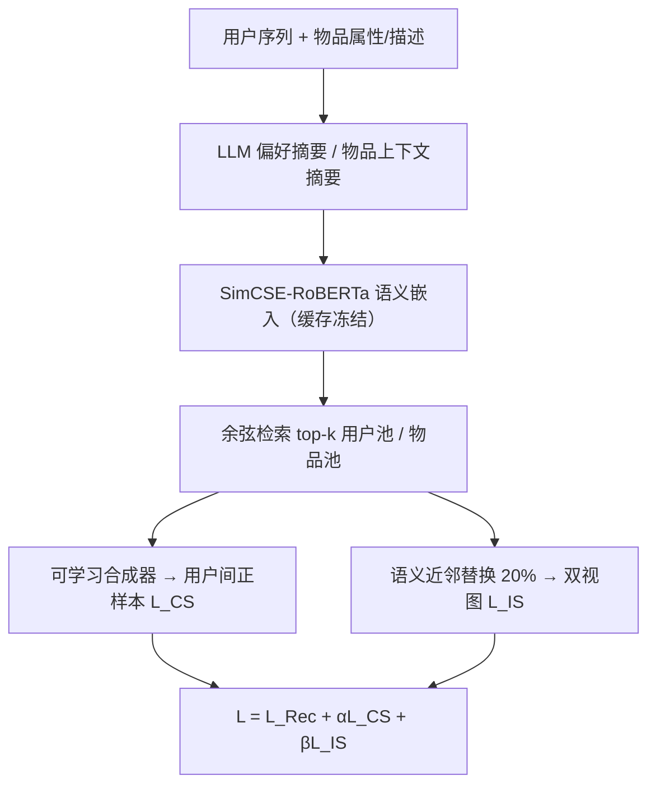

# Semantic Retrieval Augmented Contrastive Learning for Sequential Recommendation (语义检索增强的序列推荐对比学习)

- **会议/期刊**: NeurIPS 2025
- **作者与机构**: Ziqiang Cui, Yunpeng Weng, Xing Tang, Xiaokun Zhang, Shiwei Li, Peiyang Liu, Bowei He, Dugang Liu, Weihong Luo, Xiuqiang He, Chen Ma（香港城市大学、华中科技大学、腾讯、深圳技术大学、北京大学、深圳大学）
- **推荐链路定位**: 召回（序列召回表征学习）
- **研究方向**: 序列与会话推荐 / 自监督对比学习与交互去噪
- **论文原文**: [论文原文链接](https://arxiv.org/abs/2503.04162v5)
- **开源代码**: [开源代码仓库链接](https://github.com/ziqiangcui/SRA-CL)

## TL;DR (1分钟核心速览)

现有序列推荐对比学习的两条路线都有硬伤：用户内（intra-user）靠随机 Mask/Dropout 增广会破坏序列语义，用户间（inter-user）靠稀疏 ID 协同信号做 K-Means 聚类得到的正样本不可靠，且二者都依赖预设规则、不可学习。SRA-CL 用 LLM 生成用户偏好与物品上下文的语义嵌入，据此检索 top-$k$ 邻居构建候选池，再用注意力式可学习合成器动态生成用户间正样本；物品侧则用语义相似物品替换做语义一致的增广。在 Yelp/Sports/Beauty/Office 四个数据集、Leave-One-Out + 全库排序协议下，HR@20 相对最强基线最高提升 11.82%，且推理阶段零额外 LLM 开销。

## Background & Motivation (背景与核心矛盾)

- **主流范式**: 序列推荐以 SASRec/BERT4Rec 类 Transformer 为主干，叠加对比学习辅助任务；按正样本来源分为 inter-user（ICLRec/ICSRec 的意图聚类）与 intra-user（CL4SRec/CoSeRec 的随机增广、DuoRec 的 Dropout 双视图）两大类（图 1）。
- **前人局限一（语义漂移）**: 随机 Mask/Cropping/Dropout 在稀疏且强序列模式的场景下可能彻底改变序列语义，把偏好不同的序列拉近，反而削弱判别力；而基于稀疏 ID 协同信号的聚类本身表征质量低，簇内用户未必真相似。
- **前人局限二（不可学习）**: 正样本选择全靠预设规则（同簇即正、同 next-item 即正）。后者本质是复制 next-item 预测目标，不提供额外信息增益；刚性假设限制了模型自主寻找最优对比对。
- **核心洞察 (Key Insight)**: 语义信息（品类、品牌、描述）不依赖共现频次，在数据稀疏时依然有效，且与协同信号互补；而准确刻画用户偏好需要强理解推理能力，恰是 LLM 的强项。
- **本文切入点**: 把"对比对怎么造"从规则驱动改为 **LLM 语义检索 + 可学习合成**，且 LLM 只在训练前离线跑一次，不进入推理链路。

## Method (核心方法设计)

### 1. 整体框架 (Overall Architecture)

SRA-CL 是即插即用的双路对比增强框架。离线阶段：对每个用户序列按时间序拼接物品属性与描述构造 prompt，LLM（DeepSeek-V3，temperature=0）输出偏好摘要，再由 SimCSE-RoBERTa 编码为语义嵌入 $\tilde{h}_u$并缓存冻结；对每个物品，prompt 同时注入其属性与最多 10 条出现该物品的用户序列，得到上下文感知的物品语义嵌入$\tilde{e}_v$。训练阶段：语义嵌入仅用于余弦相似度检索 top-$k$候选池，用户侧经可学习合成器生成正样本参与$\mathcal{L}_{CS}$，物品侧用语义近邻替换 20% 物品生成两个增广视图参与$\mathcal{L}_{IS}$，与主推荐损失联合优化。推理阶段只保留推荐主干，对比分支与 LLM 全部剥离。

### 2. 关键设计拆解 (Key Designs)

1. **语义检索候选池（Semantic-based Retrieval）**：痛点是用 ID 协同信号聚类在稀疏数据上不可靠。改为在冻结语义空间做余弦检索，$\mathcal{N}_u=\{u'\in\mathcal{U}\setminus\{u\}\mid \mathrm{rank}(\cos(\tilde{h}_u,\tilde{h}_{u'}))\le k\}$，物品池$\mathcal{N}_v$同理。语义嵌入来自结构化知识而非共现统计，故不受训练动态与数据量影响，稀疏场景下依然稳定；$k\approx10$ 时最优，过大则邻居语义相关性衰减、引入噪声。

2. **可学习样本合成器（Learnable Sample Synthesizer）**：痛点是"池中随机取一个当正样本"是次优硬规则。先用可学习适配器 $W$ 把语义嵌入映射到推荐表征空间，再以当前用户为 query 对候选池做注意力打分：

$$w_{u,u'}=\mathrm{LeakyReLU}\big(\mathbf{a}^{\top}[W\tilde{h}_u\,\|\,W\tilde{h}_{u'}]\big),\quad p_{u,u'}=\mathrm{softmax}_{u'\in\mathcal{N}_u}(w_{u,u'})$$

正样本为候选表征的凸组合 $h_u^{+}=\sum_{u'\in\mathcal{N}_u}p_{u,u'}h_{u'}$，与主模型联合端到端训练。直觉上它把"选谁当正样本"变成可微的软选择，让模型自己学出最优对比对，而非依赖人工假设。值得注意的是，作者在物品侧尝试同类合成器无增益（表 4），因为物品语义比用户偏好更可解释、更易量化，直接检索替换已足够。

3. **双对比损失与训练目标**：用户间损失 $\mathcal{L}_{CS}=-\log\frac{\exp(h_u\cdot h_u^{+})}{\exp(h_u\cdot h_u^{+})+\sum_{h_u^{-}}\exp(h_u\cdot h_u^{-})}$，batch 内其余合成表征作负样本；物品侧$\mathcal{L}_{IS}$以同一序列的两个语义一致增广视图互为正样本、batch 内其余$2(N-1)$个为负。总目标$\mathcal{L}=\mathcal{L}_{Rec}+\alpha\mathcal{L}_{CS}+\beta\mathcal{L}_{IS}$，$\alpha,\beta\in[0.05,0.1]$ 最优。负采样为 in-batch 方式，无需额外负采样器；训练额外开销仅一个轻量合成器，推理零额外延迟。

## Experimental Setup & Evaluation Protocol (实验设置与评估协议)

- **数据集与预处理**: 四个公开数据集，均按前人惯例过滤交互数 $<5$ 的用户与物品（5-core）：

| 数据集 | #Users | #Items | #Interactions | 平均长度/密度 | 场景说明 |
| :--- | :---: | :---: | :---: | :---: | :--- |
| Yelp | 19,936 | 14,587 | 207,952 | 10.4 / 0.07% | 本地商户点评 |
| Sports | 35,598 | 18,357 | 296,337 | 8.3 / 0.05% | Amazon 运动户外 |
| Beauty | 22,363 | 12,101 | 198,502 | 8.8 / 0.07% | Amazon 美妆 |
| Office | 4,905 | 2,420 | 53,258 | 10.9 / 0.45% | Amazon 办公用品 |

- **数据划分与防穿越**: `Leave-One-Out`——最后一条交互作测试、倒数第二条作验证、其余训练；最大序列长度 20。
- **排名评测协议**: 无偏 `Full-Ranking`（全物品集排序，不采样），指标 HR@20 / NDCG@20（附录另报 @10）。
- **对比基线与超参**: 13 个基线分三类——经典（GRU4Rec、SASRec、BERT4Rec）、对比学习（S3-Rec、CL4SRec、CoSeRec、ICLRec、DuoRec、MCLRec、ICSRec）、LLM 增强（LRD、RLMRec、LLM-ESR）。嵌入维度 $d=64$，batch 256，Adam lr=0.001，dropout 0.5，早停 10 epoch；结果取 5 次均值，配对 t 检验$p<0.01$。

## Key Experimental Results (实验关键数据)

### 1. 主实验对比 (Main Results)

| Model | Yelp HR@20 | Yelp N@20 | Sports HR@20 | Sports N@20 | Beauty HR@20 | Beauty N@20 | Office HR@20 | Office N@20 |
| :--- | :---: | :---: | :---: | :---: | :---: | :---: | :---: | :---: |
| SASRec | 0.0899 | 0.0390 | 0.0498 | 0.0216 | 0.0887 | 0.0382 | 0.1329 | 0.0482 |
| BERT4Rec | 0.0913 | 0.0394 | 0.0578 | 0.0241 | 0.0933 | 0.0399 | 0.1436 | 0.0520 |
| CL4SRec | 0.0923 | 0.0395 | 0.0562 | 0.0235 | 0.0980 | 0.0416 | 0.1297 | 0.0488 |
| ICLRec | 0.0974 | 0.0432 | 0.0636 | 0.0284 | 0.1056 | 0.0482 | 0.1513 | 0.0559 |
| DuoRec | 0.1173 | 0.0493 | 0.0706 | 0.0302 | 0.1224 | 0.0535 | 0.1549 | 0.0653 |
| MCLRec | 0.1150 | 0.0486 | 0.0736 | 0.0318 | 0.1239 | 0.0536 | 0.1629 | 0.0684 |
| ICSRec | 0.1165 | 0.0495 | 0.0728 | 0.0304 | 0.1205 | 0.0528 | 0.1643 | 0.0690 |
| LLM-ESR | 0.1061 | 0.0451 | 0.0638 | 0.0277 | 0.1064 | 0.0515 | 0.1425 | 0.0602 |
| **SRA-CL** | **0.1282** | **0.0533** | **0.0823** | **0.0347** | **0.1314** | **0.0568** | **0.1702** | **0.0725** |
| Improv. | +9.29% | +7.68% | +11.82% | +9.12% | +6.05% | +5.97% | +3.59% | +5.07% |

### 2. 消融实验 (Ablation Study)

| 变体 | Yelp H@20 | Sports H@20 | Beauty H@20 | Office H@20 |
| :--- | :---: | :---: | :---: | :---: |
| w/o CL（去全部对比） | 0.1101 | 0.0745 | 0.1206 | 0.1476 |
| w/o $\mathcal{L}_{CS}$ | 0.1203 | 0.0780 | 0.1273 | 0.1621 |
| w/o $\mathcal{L}_{IS}$ | 0.1228 | 0.0795 | 0.1279 | 0.1619 |
| w/o learn.（随机选正样本） | 0.1253 | 0.0792 | 0.1273 | 0.1617 |
| w/o semantic（仅协同检索） | 0.1187 | 0.0772 | 0.1265 | 0.1624 |
| w/o LLM（去 LLM 摘要） | 0.1190 | 0.0781 | 0.1259 | 0.1643 |
| **Ours** | **0.1282** | **0.0823** | **0.1314** | **0.1702** |

### 3. 关键实验发现 (Key Findings)

1. **两路对比互补且缺一不可**：去掉全部对比学习（w/o CL）在 Yelp 上 HR@20 从 0.1282 跌至 0.1101（-14.1%），跌幅显著大于单独去掉 $\mathcal{L}_{CS}$（0.1203）或$\mathcal{L}_{IS}$（0.1228），说明用户间与用户内信号覆盖不同层面的监督。
2. **语义是增益主源，LLM 是语义质量的放大器**：仅用协同信号检索（w/o semantic）在 Yelp 掉到 0.1187，甚至低于随机选正样本的 0.1253，直接印证"稀疏 ID 聚类不可靠"的动机；再去掉 LLM 摘要（w/o LLM）进一步降至 0.1190，表明 LLM 的偏好推理对语义嵌入质量有实质贡献。
3. **稀疏用户获益更大**：按序列长度分桶后（图 5），SRA-CL 在交互数 $<7$ 与 7–10 的稀疏组相对 MCLRec/ICSRec 的提升幅度明显高于长序列组，说明语义检索恰好在协同信号最匮乏处补位；同时模型无关性实验（图 3）显示挂载到 GRU4Rec/SASRec/DuoRec 后 HR@20 提升 8.3%–27.3%。

## Highlights & Limitations (亮点、对比与审稿批判)

- **与代表作对比 (vs. Prior Work)**: 相比 ICLRec/ICSRec 用 K-Means 在稀疏 ID 空间聚类，本文把"谁相似"的判断迁移到冻结语义空间，规避了表征质量随训练波动的风险；相比 CL4SRec/CoSeRec 的随机增广，本文的替换由语义近邻引导，保证增广前后语义一致；相比 LRD/RLMRec/LLM-ESR 把 LLM 用于重构或蒸馏，本文严格限定 LLM 只服务于"对比对构造"这一环节，动机更聚焦。
- **可迁移亮点**: ①"LLM 离线生成语义嵌入 + 缓存冻结 + 仅训练期使用"的范式，可零推理成本地移植到任何需要辅助监督的召回模型；②用注意力软选择替代 top-1 硬选取，是处理"候选池内如何挑正样本"的通用可微技巧。
- **审稿级局限批判**: ①语义嵌入完全冻结，LLM 摘要质量与 prompt 设计强耦合（物品侧序列上限 10 条为经验截断），错误摘要无法在训练中纠正；②离线 LLM API 调用虽只需一次，但对百万级用户/物品的工业规模，成本与缓存存储仍是隐性门槛，论文未给出规模化耗时估算；③物品侧合成器无增益的解释偏定性，缺乏更细粒度的机理验证。

## Rating (四维评分)

- **方法创新性 (Novelty)**: ⭐⭐⭐⭐ （把对比对构造从规则驱动转为语义检索+可微合成，思路清晰且切中该子领域真实痛点，但各组件本身均为已有技术的组合）
- **评估协议与实验扎实度 (Protocol & Experiments)**: ⭐⭐⭐⭐ （四数据集 + 全库排序 + 5 次均值 + $p<0.01$ 检验 + 模型无关性与稀疏分桶分析齐全，唯缺线上 A/B 与更大规模验证）
- **写作与数学规范度 (Clarity & Rigor)**: ⭐⭐⭐⭐ （动机—方法—消融逻辑闭环，公式简洁；但式 (9)(11) 存在括号不配对等排版瑕疵，物品侧设计取舍仅置于附录）
- **工业落地与复现价值 (Industrial & Practical Value)**: ⭐⭐⭐⭐⭐ （即插即用、推理零额外延迟、代码已开源，LLM 仅离线一次性调用，工程落地路径明确）

