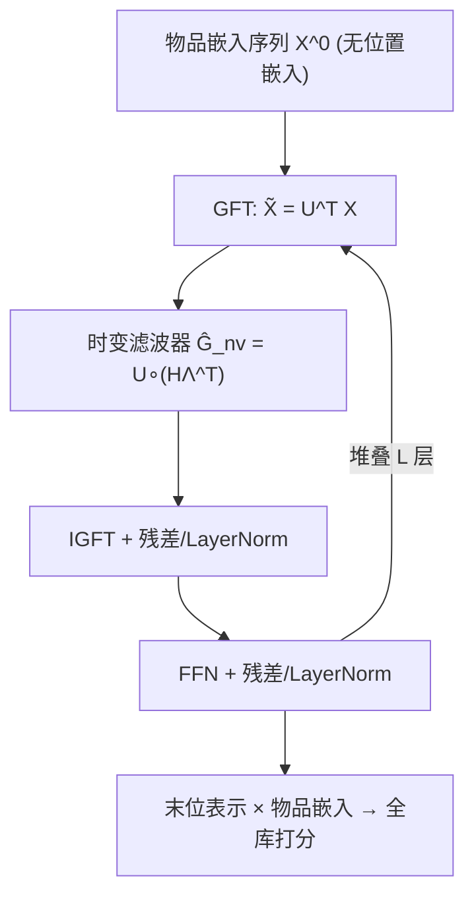
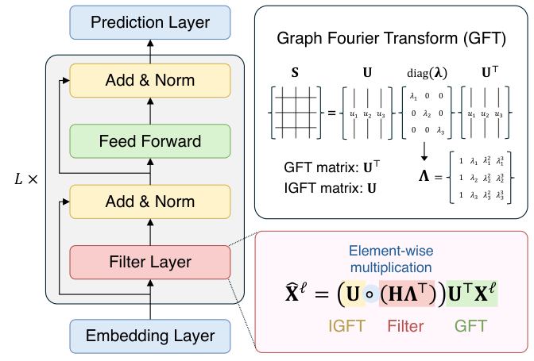

# TV-Rec: Time-Variant Convolutional Filter for Sequential Recommendation (面向序列推荐的时变卷积滤波器)

- **会议/期刊**: NeurIPS 2025
- **作者与机构**: Yehjin Shin, Jeongwhan Choi, Seojin Kim, Noseong Park (KAIST)
- **推荐链路定位**: 召回（序列编码器）
- **研究方向**: 序列与会话推荐
- **论文原文**: [论文原文链接](https://arxiv.org/abs/2510.25259v1)
- **开源代码**: [开源代码仓库链接](https://github.com/yehjin-shin/TV-Rec)

## TL;DR (1分钟核心速览)

序列推荐中固定卷积核缺乏位置自适应性、自注意力又无局部归纳偏置且推理昂贵，混合模型（AdaMCT/BSARec）虽兼顾二者却仍需自注意力。本文借图信号处理中的**节点可变（node-variant）图滤波器**，把用户序列视为有向循环图信号，为每个时间位置生成独立滤波器抽头，从而**同时替代固定卷积核与自注意力**。在 6 个公开基准、`Full-Ranking` 无偏全库排序协议下，HR/NDCG 平均相对提升 **7.49%**（LastFM HR@10 +19.13%，Foursquare HR@10 +22.17%），且推理时延与参数量均优于混合基线。

## Background & Motivation (背景与核心矛盾)

- **主流范式**: Transformer 系（SASRec/BERT4Rec）以自注意力建模全局依赖；卷积系（Caser/NextItNet/FMLPRec）以固定卷积核捕捉局部序列模式；近期 SOTA（AdaMCT/BSARec）走"卷积+自注意力"混合路线。
- **前人局限**: ① 固定卷积核在所有位置共享同一组权重，无法刻画"序列早期反映长期偏好、末端反映即时兴趣"的位置特异语义；② 自注意力对局部邻近性无归纳偏置，且 $O(nd^2+n^2d)$ 复杂度使推理昂贵，混合模型更是叠加两份开销。
- **核心洞察 (Key Insight)**: 序列可视为一条线图（line graph），每个时间位置是一个节点；若把图滤波器的标量抽头 $h_k$升级为**逐节点向量抽头**$\boldsymbol{h}_k$，则滤波器天然成为"时间的函数"，位置信息被内蕴编码，无需位置嵌入。
- **本文切入点**: 用节点可变图滤波器（即时变卷积滤波器）一次性取代固定核与自注意力，在保持线性算子可预计算的前提下获得更强表达力。

## Method (核心方法设计)

### 1. 整体框架 (Overall Architecture)

输入为用户最近 $N$个物品的嵌入序列$\mathbf{X}^0$（**不含位置嵌入**），经$L$个时变编码块堆叠：每块先做 GFT 变换到频域，用时变滤波器$\mathcal{G}_{nv}$做逐位置谱调制，再 IGFT 回时域，接残差+LayerNorm 与 FFN；最终取末位表示与物品嵌入内积打分。由于滤波器是线性算子，训练后可预计算$\mathcal{G}_{nv}$，推理复杂度降至$O(n^2d)$。

<figure class="paper-figure" markdown="span">
  <figcaption>图 2：本文提出的 TV-Rec 的架构。</figcaption>
</figure>

### 2. 关键设计拆解 (Key Designs)

1. **时变图滤波器（Time-Variant Filter）**：固定核的痛点是全位置共享抽头。本文将抽头由标量 $h_k$改为向量$\boldsymbol{h}_k$，滤波器写作$\mathcal{G}_{nv}=\sum_{k=0}^{K}\mathrm{diag}(\boldsymbol{h}_k)\mathbf{S}^k$，其频域响应为
$$\tilde{\mathbf{y}}=\mathbf{U}^{\top}\big(\mathbf{U}\circ(\mathbf{H}\boldsymbol{\Lambda}^{\top})\big)\tilde{\mathbf{x}},$$
其中 $\mathbf{H}\in\mathbb{C}^{N\times(K+1)}$为逐节点抽头矩阵、$\boldsymbol{\Lambda}_{ik}=\lambda_i^{k-1}$为 Vandermonde 矩阵。直觉：$\mathbf{U}\circ(\mathbf{H}\boldsymbol{\Lambda}^{\top})$ 让每个节点拥有自己的频率响应，等价于"每个时间步一套卷积核"，从而同时保留早期全局偏好与末端即时兴趣。

2. **低秩滤波器构造与正交正则**：直接学 $\mathbf{H}$参数量为$N(K+1)$且易过拟合。本文令$\mathbf{H}=\mathbf{C}\bar{\mathbf{B}}$，$\bar{\mathbf{B}}=\mathbf{B}/\|\mathbf{B}\|_2$，其中$\mathbf{C}\in\mathbb{R}^{N\times m}$为位置系数矩阵（视为时间的函数）、$\mathbf{B}\in\mathbb{C}^{m\times(K+1)}$为共享基，$m\ll N$ 控制表达力/开销。配合正交正则
$$\mathcal{L}_{ortho}=\big\|\mathbf{B}_{real}\mathbf{B}_{real}^{\top}-\mathbf{I}\big\|_F^2+\big\|\mathbf{B}_{imag}\mathbf{B}_{imag}^{\top}-\mathbf{I}\big\|_F^2,$$
保证基向量互不冗余，防止滤波器退化。

3. **DCG 替代线图 + 零填充防泄漏**：线图邻接矩阵秩为 $N-1$（首节点无入边）不可对角化，无法做谱滤波。本文改用有向循环图（DCG）使邻接矩阵成为循环矩阵从而可特征分解；但循环边会引入"未来→过去"的反向信息流，故对序列尾部补$K$个零后再滤波，取前$N$ 维输出，等价于线图上的因果卷积。此外 DCG 的 GFT 基即 DFT 基，与 Transformer 正弦位置编码张成同一函数空间，故**位置嵌入冗余**（消融已验证）。

4. **训练目标与推理效率**：总损失 $\mathcal{L}=\mathcal{L}_{ce}+\alpha\mathcal{L}_{ortho}$，$\mathcal{L}_{ce}$为全库 softmax 交叉熵（**免负采样**）。推理时$\mathcal{G}_{nv}$可预计算，复杂度$O(n^2d)$，优于自注意力的$O(nd^2+n^2d)$。

## Experimental Setup & Evaluation Protocol (实验设置与评估协议)

- **数据集与预处理**（沿用 FMLPRec/LRURec 的过滤流程）：

| 数据集 | #Users | #Items | #Interactions | 稀疏度 | 场景说明 |
| :--- | :---: | :---: | :---: | :---: | :--- |
| Beauty | 22,363 | 12,101 | 198,502 | 99.93% | 亚马逊美妆 |
| Sports | 25,598 | 18,357 | 296,337 | 99.95% | 亚马逊户外 |
| Yelp | 30,431 | 20,033 | 316,354 | 99.95% | 本地商户（2019 后） |
| LastFM | 1,090 | 3,646 | 52,551 | 98.68% | 音乐收听 |
| ML-1M | 6,041 | 3,417 | 999,611 | 95.16% | 电影（长序列） |
| Foursquare | 1,083 | 9,989 | 179,468 | 98.34% | NYC 签到 |

- **数据划分与防穿越**: 采用序列推荐的 `Leave-One-Out` 式末位预测（最后一项为测试目标，倒数第二项为验证），序列截断/补零至 $N=50$（长程实验$N=200$）。
- **排名评测协议**: 无偏 `Full-Ranking`（对全物品集排序，**不做负采样**），报告 HR@{5,10,20} 与 NDCG@{5,10,20}。
- **对比基线与超参**: 10 个基线覆盖 CNN（Caser/NextItNet）、RNN（GRU4Rec）、Transformer（SASRec/BERT4Rec）、全 MLP（FMLPRec）、对比学习（DuoRec）、线性循环（LRURec）、混合（AdaMCT/BSARec），另加 3 个 GNN 序列模型（SR-GNN/GC-SAN/GCL4SR）。嵌入维度 $D=64$、块数$L=2$、batch 256、$K=N$；10 次随机种子报告均值±标准差。

## Key Experimental Results (实验关键数据)

### 1. 主实验对比 (Main Results)

| 数据集 | 指标 | BSARec | AdaMCT | LRURec | DuoRec | TV-Rec | Improv. |
| :--- | :--- | :---: | :---: | :---: | :---: | :---: | :---: |
| Beauty | HR@20 | 0.1393 | 0.1299 | 0.1197 | 0.1279 | **0.1403** | +0.72% |
| Beauty | NDCG@20 | 0.0691 | 0.0664 | 0.0627 | 0.0654 | **0.0705** | +2.03% |
| Sports | HR@20 | 0.0865 | 0.0769 | 0.0698 | 0.0779 | **0.0880** | +1.73% |
| Yelp | HR@20 | 0.0718 | 0.0670 | 0.0656 | 0.0730 | **0.0777** | +6.44% |
| LastFM | HR@10 | 0.0679 | 0.0716 | 0.0532 | 0.0587 | **0.0853** | +19.13% |
| LastFM | NDCG@10 | 0.0405 | 0.0409 | 0.0312 | 0.0336 | **0.0484** | +18.34% |
| ML-1M | HR@5 | 0.1909 | 0.1773 | 0.1916 | 0.1821 | **0.2013** | +5.06% |
| Foursquare | HR@10 | 0.0212 | 0.0185 | 0.0166 | 0.0185 | **0.0259** | +22.17% |
| Foursquare | NDCG@10 | 0.0130 | 0.0113 | 0.0116 | 0.0124 | **0.0161** | +23.85% |

长程设定（$N=200$）下平均再提升 4.74%，Foursquare NDCG@20 提升达 11.27%；对 GNN 序列模型（SR-GNN/GC-SAN/GCL4SR）全面领先（如 Beauty HR@20 0.1403 vs. 0.1206）。

### 2. 消融实验 (Ablation Study)

| 变体 | Beauty H@20 | LastFM H@20 | ML-1M H@20 | Foursquare H@20 |
| :--- | :---: | :---: | :---: | :---: |
| TV-Rec 完整 | **0.1403** | **0.1202** | **0.4079** | **0.0314** |
| (1) 加位置嵌入 | 0.1408 | 0.1018 | 0.4017 | 0.0313 |
| (2) 退化为基础图滤波 | 0.1402 | 0.1165 | 0.3974 | 0.0212 |
| (3) 基矩阵设为单位阵 | 0.1400 | 0.1138 | 0.4015 | 0.0277 |
| (4) 去掉基归一化 | 0.1336 | 0.0963 | 0.3985 | 0.0305 |

### 3. 关键实验发现 (Key Findings)

1. **时变性是主要增益来源**：退化为固定基础图滤波（变体 2）在 Foursquare 上 HR@20 从 0.0314 暴跌至 0.0212（-32%），LastFM 从 0.1202 降至 0.1165，证明逐位置滤波器而非谱域本身带来收益。
2. **位置嵌入确属冗余**：加入可学习位置嵌入（变体 1）在 Beauty 上仅 +0.0005 的噪声级波动，却在 LastFM 上从 0.1202 掉到 0.1018，说明 DCG 的 GFT 基已内蕴位置信息，额外嵌入反而干扰。
3. **低秩基构造与归一化不可省**：单位基（变体 3）与去归一化（变体 4）分别使 LastFM HR@20 降至 0.1138/0.0963、Beauty 降至 0.1400/0.1336，验证 $\mathbf{H}=\mathbf{C}\bar{\mathbf{B}}$ 的低秩共享与 L2 归一化对数值稳定与泛化的双重作用。

## Highlights & Limitations (亮点、对比与审稿批判)

- **与代表作对比 (vs. Prior Work)**: 相较 BSARec（傅里叶卷积+自注意力）与 AdaMCT（1D 卷积+自注意力），TV-Rec 在理论上把二者视为本文固定滤波器的特例，且**彻底移除自注意力**；相较 FMLPRec 的固定频域滤波，本文滤波器随位置变化，LastFM HR@10 高出 27%（0.0853 vs. 0.0670）。
- **可迁移亮点**: ① "线性算子训练后预计算"的思路可直接用于任何频域/谱域序列编码器以压缩推理时延；② 零填充 DCG 实现"可对角化 + 因果无泄漏"的技巧，可迁移到其他需要谱分解的因果序列建模任务。
- **审稿级局限批判**: ① 滤波器生成**与序列内容无关**（仅依赖时间位置），对实例级不规则行为（如突发兴趣漂移）适应性受限，作者亦在附录承认；② 训练阶段需反复 GFT/IGFT 且 DCG 补零使谱域维度从 $N$增至$N+K$，训练时间与显存开销高于 SASRec/FMLPRec（如 Yelp 训练 21.89s vs. 16.74s），长序列$N=200$ 时该开销进一步放大。

## Rating (四维评分)

- **方法创新性 (Novelty)**: ⭐⭐⭐⭐ （将 GSP 节点可变滤波器首次系统引入序列推荐，理论上有 DCG 可对角化与位置编码等价性双重支撑，但"时变卷积"思想在信号处理领域并非全新）
- **评估协议与实验扎实度 (Protocol & Experiments)**: ⭐⭐⭐⭐⭐ （6 数据集 + 无偏全库排序 + 10 种子均值方差 + 长程/超长程/ GNN 对比 + 完整消融与复杂度分析，协议规范度很高）
- **写作与数学规范度 (Clarity & Rigor)**: ⭐⭐⭐⭐ （频域响应推导与 DCG 等价性证明完整，但正文将关键证明全部下放附录，主文公式密度偏高、符号 $\mathbf{H}/\bar{\mathbf{B}}/\mathbf{C}$ 的维度直觉需对照附录才清晰）
- **工业落地与复现价值 (Industrial & Practical Value)**: ⭐⭐⭐⭐ （代码已开源，推理时延与参数量均优于混合基线且滤波器可预计算，但训练期谱变换开销与"内容无关滤波器"的泛化边界需在真实业务中验证）

