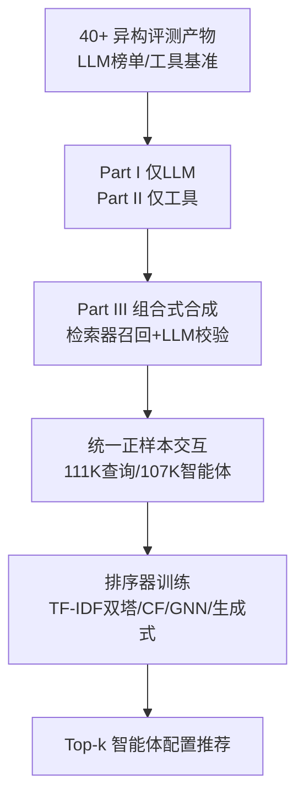
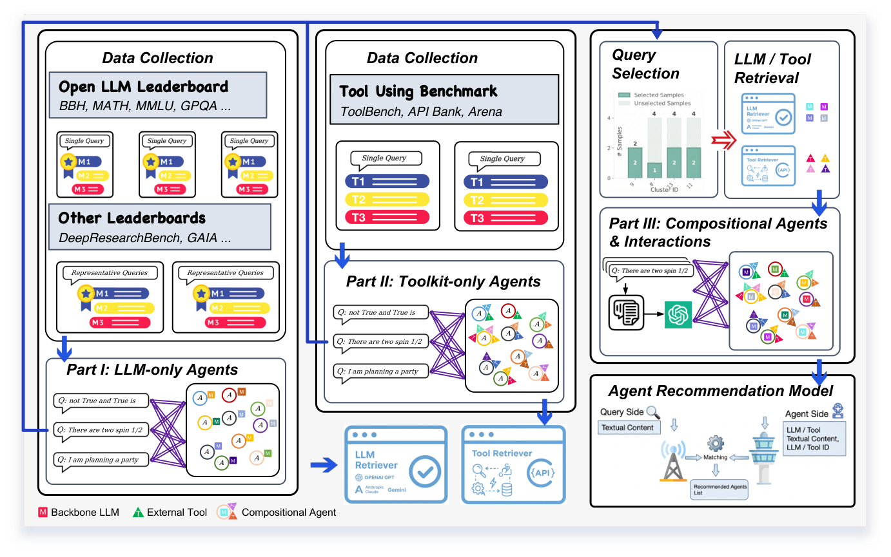

# AgentSelect: Benchmark for Narrative Query-to-Agent Recommendation (面向叙事查询到智能体推荐的基准)

- **会议/期刊**: ICML 2026
- **作者与机构**: Yunxiao Shi, Wujiang Xu, Tingwei Chen 等；University of Technology Sydney / Rutgers University 等
- **推荐链路定位**: 召回（查询到智能体配置的 Top-k 检索排序）
- **研究方向**: 对话推荐与智能体仿真 / 冷启动与长尾推荐
- **论文原文**: [https://arxiv.org/abs/2603.03761v2](https://arxiv.org/abs/2603.03761v2)
- **开源代码**: [https://github.com/Ancientshi/AgentSelect](https://github.com/Ancientshi/AgentSelect)

## TL;DR (1分钟核心速览)

LLM 智能体生态爆发，但"给定自然语言任务，该选哪个可部署智能体配置"缺乏查询级监督信号。本文提出 AgentSelect，把 40+ 异构评测产物（LLM 榜单、工具基准）统一重构为"叙事查询→智能体"的正样本隐式反馈基准：111,179 条查询、107,721 个可部署智能体、251,103 条交互。核心发现是监督分布从稠密头部复用转向长尾近一次性，ID 类 CF/GNN 方法在 Part II/III 崩塌（LightGCN nDCG 仅 0.0000），而显式 TF-IDF 双塔在 Part III 达 nDCG@10=0.8427，并在真实市场 MuleRun 上迁移提升 nDCG@10 从 0.7462 到 0.8216。

## Background & Motivation (背景与核心矛盾)

- **主流范式**: 现有 LLM 榜单（Open LLM Leaderboard）与工具基准（ToolBench、ToolHop）在**组件级**孤立评测模型或工具，RouterBench/RouterEval 做 LLM 路由，ToolRet 做工具检索。
- **前人局限**: ① 评测产物任务、指标、候选池高度异构，只能作诊断终点，无法复用为训练监督；② 路由与工具检索各自缩小搜索空间，**没有对完整 $(M,T)$ 配置的查询条件化偏好**，无法学习端到端排序器。
- **核心洞察 (Key Insight)**: 智能体选择本质是"叙事意图→能力画像"的匹配问题，且真实市场中智能体近乎一次性被选中（长尾），ID 共现信号天然稀疏。
- **本文切入点**: 把每个智能体抽象为可执行能力画像 $A=(M,T)$（骨干 LLM + 工具集，YAML 可实例化），将异构评测结果统一转写为正样本查询-智能体交互，构建首个智能体推荐基准。

## Method (核心方法设计)

### 1. 整体框架 (Overall Architecture)

AgentSelect 分三部分构建监督：Part I（仅 LLM）从 Open LLM Leaderboard 的查询粒度评测取每查询 Top-10 模型为正样本（4,426 模型过滤为 173 个知名机构模型），数据集粒度结果则经覆盖均衡 coreset 采样转为任务级弱监督；Part II（仅工具）从工具基准中取查询所需参考工具集，骨干置空以隔离工具贡献；Part III（组合式）用 Parts I/II 训练的两个轻量检索器分别召回骨干与工具候选，经 LLM 辅助合成与校验生成 $(M,T)$伪正样本。最终在统一特征下训练排序器，输出$\hat{R}_k(Q)=\text{Top-}k(\{s(Q,A):A\in\mathcal{A}(Q)\})$。

<figure class="paper-figure" markdown="span">
  <figcaption>图 1. AGENTSELECT 概览。我们构建了三个基准部分——仅 LLM（第 I 部分）、仅工具包（第 II 部分）以及组合式</figcaption>
</figure>

### 2. 关键设计拆解 (Key Designs)

1. **能力画像与可执行 YAML 抽象**：痛点是把智能体当抽象标签无法部署。本文将智能体存为 $(M,T,C)$的 YAML，但仅以能力核心$(M,T)$作为监督目标，$C$（提示、记忆、解码参数）视为框架相关的受控运行时设置。直觉：$(M,T)$ 是跨框架最稳定的"智能体能做什么"抽象，保证推荐结果可直接在 Agno/LangGraph 中实例化。

2. **组合式伪正样本的三阶段合成（Part III）**：Parts I/II 训练的信号碎片化在 $M$与$T$ 两侧，缺少完整配置的直接交互。本文先对查询做 facet 分解以暴露细粒度工具需求，聚合检索工具短名单，再与骨干短名单组合成查询专属候选池，最后由 LLM 校验器筛出满足能力需求的配置作为伪正样本。关键在于**不把笛卡尔积全部标正**，避免噪声爆炸。

3. **训练目标与推理效率**：采用正样本隐式反馈范式（BPR 类 pairwise 排序损失），无显式负采样，未观测即未标注。推理为双塔内积检索，TF-IDF 稀疏特征使查询与智能体编码开销极低，适合大规模目录的 ANN 召回。

## Experimental Setup & Evaluation Protocol (实验设置与评估协议)

- **数据集与预处理**:

| 数据集 | #Queries | #Agents | #Interactions | 拓扑特征 | 场景说明 |
| :--- | :---: | :---: | :---: | :---: | :--- |
| Part I (LLM-only) | 23,073 | 231 | 45.9% 正样本 | 稠密头部复用 | 骨干模型选择 |
| Part II (Toolkit-only) | 76,197 | 47,949 | 30.3% 正样本 | 稀疏长尾 | 工具集匹配 |
| Part III (Compositional) | 11,909 | 59,541 | 23.7% 正样本 | 近一次性 | 完整 $(M,T)$ 配置 |
| 合计 | 111,179 | 107,721 | 251,103 | 长尾 | 12,099 个唯一工具 |

- **数据划分与防穿越**: 比例划分 8:2（train:test），非时间切分；Part III 验证集含大量未见智能体，构成天然冷启动检验。
- **排名评测协议**: 全库候选排序（各 Part 内全智能体目录），报告 Precision/Recall/F1/nDCG/MRR@10；正样本数 Part I 取 Top-10、Part II 取 Top-1、Part III 取 Top-5。
- **对比基线与超参**: 六大类共 20+ 基线——隐因子（MF、LightFM）、内容神经（DNN、TwoTower，特征含 TF-IDF/BGE-M3/BERT）、图传播（NGCF、KGAT、LightGCN、SimGCL）、嵌入检索重排（BGE-Rerank、KaLM-v2.5、EasyRec，含 in-domain 微调版 `*`）、智能体推荐（AgentRec）、生成式（GenRec）。统一特征：查询/模型/工具内容 + 模型 ID + 工具 ID；图方法额外加智能体 ID，查询 ID 用 TF-IDF 检索 $N=3$ 近邻均值近似。

## Key Experimental Results (实验关键数据)

### 1. 主实验对比 (Main Results)

| 方法 | Part I nDCG@10 | Part II nDCG@10 | Part III nDCG@10 | Part III MRR@10 |
| :--- | :---: | :---: | :---: | :---: |
| MF | 0.3094 | 0.0977 | 0.0547 | 0.0802 |
| LightFM | 0.3643 | 0.4776 | 0.1422 | 0.1610 |
| DNN (TFIDF) | 0.3320 | 0.6696 | 0.2975 | 0.3090 |
| **TwoTower (TFIDF)** | **0.4422** | **0.9663** | **0.8427** | **0.9005** |
| LightGCN | 0.8820 | 0.3037 | 0.0000 | 0.0001 |
| NGCF | 0.9045 | 0.0755 | 0.0006 | 0.0003 |
| KaLM-v2.5* | 0.2787 | 0.8859 | 0.8116 | 0.8352 |
| EasyRec* | 0.2708 | 0.8552 | 0.6320 | 0.6501 |
| GenRec | **0.9404** | 0.5407 | 0.2780 | 0.3509 |

Part I 上 GenRec（0.9404）与图方法（NGCF 0.9045）领先；但 Part II/III 上二者全面崩塌，TwoTower (TFIDF) 以 0.9663/0.8427 反超所有基线，相对次优 KaLM-v2.5* 在 Part III 提升约 3.8%。

### 2. 消融实验 (Ablation Study)

Part III 上 TwoTower (TF-IDF) 的特征消融（Top@10）：

| 设置 | LLM内容 | 工具内容 | LLM ID | 工具 ID | nDCG@10 | MRR@10 |
| :--- | :---: | :---: | :---: | :---: | :---: | :---: |
| 全模态 | ✓ | ✓ | ✓ | ✓ | **0.9344** | **0.9453** |
| 去 LLM ID | ✓ | ✓ | ✗ | ✓ | 0.6162 | 0.6709 |
| 去工具 ID | ✓ | ✓ | ✓ | ✗ | 0.5903 | 0.6358 |
| 去全部 ID | ✓ | ✓ | ✗ | ✗ | 0.6071 | 0.6565 |
| 仅 ID | ✗ | ✗ | ✓ | ✓ | 0.5744 | 0.6300 |
| 仅工具 ID | ✗ | ✗ | ✗ | ✓ | 0.6040 | 0.6607 |
| 仅 LLM ID | ✗ | ✗ | ✓ | ✗ | 0.0857 | 0.1612 |

### 3. 关键实验发现 (Key Findings)

1. **ID 信号在稠密复用下有效、一次性监督下失效**：Part I 中 NGCF/LightGCN 达 nDCG 0.90+，但 Part II/III 骤降至 0.0006/0.0000；图 5 显示加入 AgentID 反而损害 MF/LightFM/DNN 在 Part II/III 的表现，因验证智能体大量未见，身份嵌入遭遇冷启动。TwoTower 是唯一例外——共享检索空间中 AgentID 帮助区分内容相似的智能体而非记忆流行度。
2. **显式稀疏特征胜过稠密预训练编码器**：TwoTower (TF-IDF) 全面优于 BGE-M3 版（Part III nDCG 0.8427 vs 0.8268）与端到端微调 DNN (BERT*)（0.1797）。原因是智能体能力描述含模型名、工具名等高判别性词法线索，TF-IDF 恰好捕获。
3. **内容与 ID 互补且工具 ID 主导**：全模态 nDCG 0.9344，去 ID 后跌至 0.6071，仅 ID 仅 0.5744；其中仅工具 ID 达 0.6040 而仅 LLM ID 仅 0.0857，说明工具身份携带远强于骨干身份的任务判别信息。Part III 伪正样本可学习性验证：I+II 训练在 Part III 仅 0.1329，加入 Part III 后跃升至 0.8427（+534%），且反事实编辑下移除关键工具/添加无关工具均产生方向正确的分数下降（一致性 64%/84%）。

## Highlights & Limitations (亮点、对比与审稿批判)

- **与代表作对比 (vs. Prior Work)**: 相比 RouterBench/RouterEval 仅做 LLM 路由、ToolRet 仅做工具检索，本文首次将二者统一为完整 $(M,T)$ 配置的查询条件化排序；相比 Agent4Rec/iAgent 等用户中心智能体推荐，本文是单次叙事查询匹配而非长程用户偏好建模，故 AgentRec 叠加 KaLM* 几乎无增益（0.8118 vs 0.8116）。
- **可迁移亮点**: ① "异构评测产物→统一正样本交互"的转写范式可迁移到任何缺乏查询级监督的新兴物品域；② 能力画像 $(M,T)$ + YAML 可执行化设计，使推荐结果直接落地为运行时配置。
- **审稿级局限批判**: ① Part III 伪正样本由 LLM 校验而非真实执行产生，仅验证了"合理性"而非全局最优，且 I+II+III 联合训练使 Part I nDCG 从 0.3399 升至 0.4422 但 Part II 略降 1.11%，存在监督分布冲突；② 评估完全基于离线 IR 指标，未穷举执行推荐配置，端到端验证仅 200 查询、Top-5 短名单内排序（Top-1 匹配率 0.364），绝对增益有限。

## Rating (四维评分)

- **方法创新性 (Novelty)**: ⭐⭐⭐⭐ （首个将智能体选择重构为查询到能力画像推荐的基准，任务定义与数据转写范式新颖，但排序模型本身为常规双塔）
- **评估协议与实验扎实度 (Protocol & Experiments)**: ⭐⭐⭐⭐ （20+ 基线覆盖六大范式、三部分分层评测、反事实与可学习性验证完整，但缺执行级端到端大规模验证）
- **写作与数学规范度 (Clarity & Rigor)**: ⭐⭐⭐⭐ （任务形式化与数据构建流程清晰，公式简洁；部分附录细节与主文符号衔接略松散）
- **工业落地与复现价值 (Industrial & Practical Value)**: ⭐⭐⭐⭐⭐ （数据与代码开源、YAML 可直接实例化、MuleRun 真实市场迁移验证 nDCG@10 提升 10%，工程价值突出）
