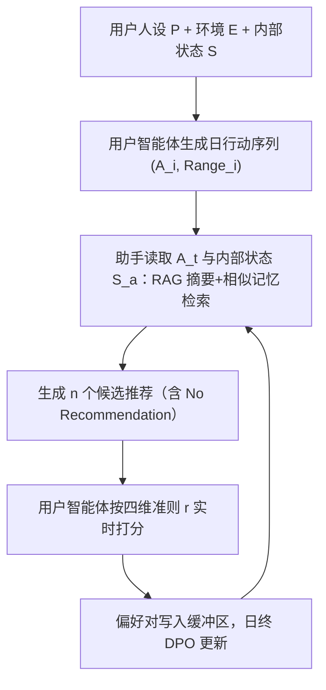
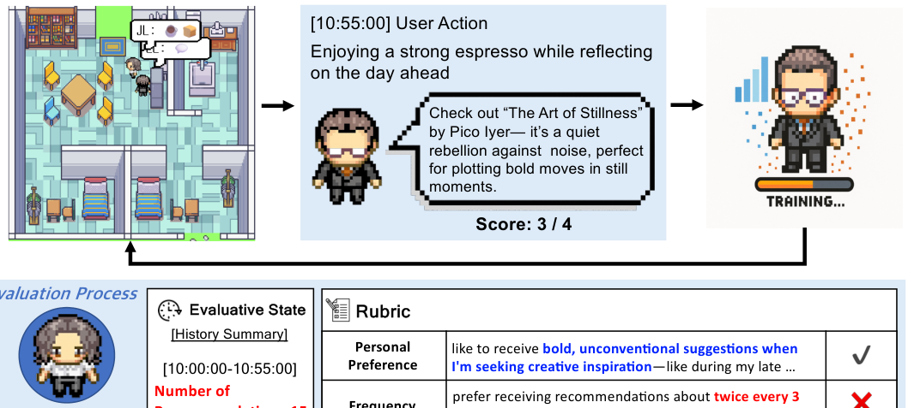

# ProPerSim: Developing Proactive and Personalized AI Assistants through User-Assistant Simulation (通过用户-助手仿真构建主动且个性化的 AI 助手)

- **会议/期刊**: ICLR 2026
- **作者与机构**: Jiho Kim, Junseong Choi, Woosog Chay, Daeun Kyung, Yeonsu Kwon, Yohan Jo, Edward Choi (KAIST / SNU)
- **推荐链路定位**: 端到端生成式（主动式对话推荐）
- **研究方向**: 对话推荐与智能体仿真 / 大语言模型推荐
- **论文原文**: [https://arxiv.org/abs/2509.21730v2](https://arxiv.org/abs/2509.21730v2)
- **开源代码**: [https://github.com/jiho283/ProPerSim](https://github.com/jiho283/ProPerSim)

## TL;DR (1分钟核心速览)

现有 LLM 助手要么"主动但不个性化"（在素食者面前推牛排馆），要么"个性化但不主动"（必须用户先开口），二者结合几乎无人探索。本文提出 **ProPerSim**：一个基于 Smallville 家居沙盒的仿真任务，用户智能体由大五人格+背景+生活目标构成 32 个丰富人设，按"个人偏好/频率/时机/沟通与安全"四维准则对助手推荐实时打分；并给出基线 **ProPerAssistant**（RAG 记忆 + DPO 偏好对齐）。在 32 个人设的 14 天仿真中，平均满意度从 Day 1 的 2.2 稳定爬升至 3.3/4，成功干预率由 51.06% 升至 71.51%，全面超越三种无训练记忆基线。

## Background & Motivation (背景与核心矛盾)

- **主流范式**: 主动性研究（如 Proactive Agent）让助手在用户动作触发时主动提议；个性化研究（prompt 定制、RAG 历史、RLHF 用户反馈）让回复贴合个体偏好。两条线各自独立推进。
- **前人局限**: ① 无个性化的主动推荐会在错误时机推送错误内容（图 1 的素食者牛排馆案例）；② 无主动性的个性化仍需用户先发起交互，无法在"用户尚未意识到需求"时提供帮助；③ 现有主动性工作以"用户动作触发"定义干预时机，而非真实时间流逝，难以模拟人类助手的实时响应节奏。
- **核心洞察 (Key Insight)**: 主动性与个性化本质耦合——"何时说"与"说什么"必须联合优化，而联合优化的瓶颈在于缺乏能同时标注时机与内容质量的偏好数据；真实人类数据采集成本高且涉隐私。
- **本文切入点**: 用 LLM 用户智能体仿真替代真人采集，把"时机+内容"统一编码进四维评分准则，并将评分转化为 DPO 偏好对，让助手在闭环中持续自我改进。

## Method (核心方法设计)

### 1. 整体框架 (Overall Architecture)

仿真以离散时间步 $t\in\{T,2T,3T,\dots\}$（$T=2.5$分钟）推进：用户智能体依据人设$P$、环境$E$、内部状态$S$生成带时间区间的日行动序列$\{(A_i,\text{Range}_i)\}$；每个时间步助手策略$A_\theta$读取当前动作$A_t$与自身内部状态$S^{(a)}_t$，输出推荐$R_t$（可为"No Recommendation"）；用户智能体依据人设$P$、个性化准则$r$、当前动作与评估状态$S^{(u)}_t$给出四维二值评分并聚合为$\text{Score}_t$；每日结束时把候选偏好对写入缓冲区，用 DPO 更新助手，次日继续闭环。

<figure class="paper-figure" markdown="span">
  <figcaption>图2：ProPerSim模拟概览。助手观察到用户正在享用浓咖啡的行为，并回应以书籍推荐。虽然该推荐在个人偏好、时机以及沟通与安全标准上表现良好，但超出了偏好频率，因此得分为4分中的3分。随着时间推移，助手利用累积的推荐和评估进行改进。</figcaption>
</figure>

### 2. 关键设计拆解 (Key Designs)

1. **时间驱动的主动性任务形式化**：前人把主动性绑定在"用户动作触发"上，本文改为绑定真实时间流逝，助手在每个 $t$必须显式决策"是否干预"。目标为$\max_\theta \mathbb{E}_t[\mathcal{E}(P,r,A_t,A_\theta(A_t,S^{(a)}_t),S^{(u)}_t)]$。直觉：把"沉默"也纳入动作空间，助手才能学会"不该说时不说"，这是频率与时机维度可被优化的前提。

2. **四维个性化评分准则（Rubric）**：先用 GPT-o1 生成 10 条候选准则，经 353 名 Mechanical Turk 众包用户投票，剔除支持率低于 50% 的 Diversity 与 Interruption，归并为 **Personal Preference / Frequency / Timing / Communication & Safety** 四维，再由 GPT-4o 按人设实例化为个性化描述（如"每 3 小时约两次""晚 9 点后偏好内省类内容"）。每维二值判定（Frequency 拆为 Over-/Under-Frequency 两个 prompt，均通过才得 1 分），总分 0–4。直觉：把模糊的"满意度"拆成可独立归因的正交维度，既提升 LLM-as-a-judge 的一致性（人工复核 90.54% 判定合理），又让 DPO 的偏好信号有明确语义。

3. **RAG 内部状态 + DPO 偏好对齐**：助手内部状态 $S^{(a)}_t$由两部分构成——近 10 分钟$(A_t,R_t)$明细 + 4 个 1 小时块与 3 个 4 小时块的 GPT-4o-mini 摘要，外加用 OpenAI embedding 检索最相似的 5 条历史$(A_t,R_t)$对。对每个$A_t$生成$n=2$个候选，用户打分后构成偏好对$(\text{chosen},\text{rejected})$ 存入缓冲区；日终随机抽 200 条用 LoRA 上的 DPO 训练：
   $$\mathcal{L}_{\text{DPO}}=-\mathbb{E}_{(x,y_w,y_l)\sim\mathcal{D}}\left[\log\sigma\left(\beta\log\frac{\pi_\theta(y_w|x)}{\pi_{\text{ref}}(y_w|x)}-\beta\log\frac{\pi_\theta(y_l|x)}{\pi_{\text{ref}}(y_l|x)}\right)\right]$$
   直觉：借鉴 RL 的 replay buffer 稳定训练，把"显式奖励信号"内化进参数，而非像 ARS Memory 基线那样把分数塞进 prompt 靠上下文学习——后者无法跨天累积策略改进。

## Experimental Setup & Evaluation Protocol (实验设置与评估协议)

- **数据集与预处理**: 本文为仿真基准，无传统交互数据集，核心统计如下：

| 仿真资源 | 规模/配置 | 说明 |
| :--- | :---: | :--- |
| 用户人设 (Personas) | 32 | 大五人格 × 6 项附加属性（年龄/背景/兴趣/生活方式/日计划要求/长期目标），GPT-4o 生成 + 作者审核 |
| 仿真天数 | 14 天/人设 | 每日约 10–30 分钟粒度行动序列 |
| 时间步长 $T$ | 2.5 分钟 | 每步决策一次是否推荐 |
| 候选数 $n$ | 2 | 控制 API 成本 |
| 基础模型 | LLaMA 3.3 70B (4-bit) + LoRA | 用户智能体与助手同源 |
| 评估裁判 | Gemini 2.0 Flash | LLM-as-a-judge，四维二值打分 |

- **数据划分与防穿越 (Splitting Strategy)**: 非传统划分，采用**按天在线闭环**：Day 1 为冷启动（无训练），每日结束后用当日累积缓冲区训练，Day 2–14 评估策略演化；训练样本从缓冲区随机抽 200 条，避免过拟合当日分布。
- **排名评测协议 (Ranking Protocol)**: 非全库排序任务，采用**逐时间步绝对分制**（0–4 分），报告日均分、成功干预率（推荐且得分 ≥3 的占比）与各维度分项得分；辅以 32 人设的分布分析（最好/最差人设、大五人格分组）。
- **对比基线与超参设置**: 三个无训练基线共享同一基础 LLM，仅内部状态不同——**No Memory**（$S^{(a)}_t$为空）、**AR Memory**（含$(A_t,R_t)$历史）、**ARS Memory**（额外把$\text{Score}_t$ 写入 prompt）。质量校验：10 名研究生评行动自然度 8.25/10、人设一致性 8.02/10，误生成率仅 5.11%。

## Key Experimental Results (实验关键数据)

### 1. 主实验对比 (Main Results)

下表为 32 人设平均分（满分 4），Day 1 为训练前、Day 14 为训练后：

| 方法 | Day 1 均分 | Day 14 均分 | 变化 | 成功干预率 (Day1→Day14) |
| :--- | :---: | :---: | :---: | :---: |
| No Memory | 2.06 | 2.19 | +0.13 | — |
| AR Memory | 2.24 | 2.28 | +0.04 | — |
| ARS Memory | 2.63 | 2.53 | −0.10 | — |
| **ProPerAssistant** | **2.24** | **3.38** | **+1.14** | **51.06% → 71.51%** |

逐人设看（表 1），ProPerAssistant 在 32 人中 31 人 Day 14 高于 Day 1，最高人设达 3.82（#10），最低仅 2.53（#3）；而 ARS Memory 起点虽高（2.63）却整体下滑，说明"把奖励塞进 prompt"无法带来持续增益。

### 2. 消融实验 (Ablation Study)

| 配置 | Day 14 均分 | 相对完整模型 | 结论 |
| :--- | :---: | :---: | :--- |
| **ProPerAssistant (完整)** | **3.38** | — | RAG 记忆 + DPO 缺一不可 |
| w/o DPO（即 AR Memory） | 2.28 | −1.10 | 偏好学习是主要增益来源 |
| w/o 显式奖励（即 AR Memory vs ARS） | 2.28 vs 2.53 | −0.25 | 无奖励信号时历史记忆几乎无用 |
| w/o 记忆（No Memory） | 2.19 | −1.19 | 仅靠当前动作无法个性化 |
| 仅 in-context 奖励（ARS Memory） | 2.53 | −0.85 | 上下文奖励不能替代参数内化 |

### 3. 关键实验发现 (Key Findings)

1. **显式偏好训练 >> 上下文奖励注入**：ARS Memory 起点最高（2.63）但 14 天后跌至 2.53，而 ProPerAssistant 从 2.24 升至 3.38，差距 0.85 分；AR Memory 与 No Memory 几乎无差（2.28 vs 2.19），证明"无奖励的历史交互"对偏好建模贡献极小，**奖励信号才是关键，且必须内化进参数**。
2. **策略学会了"少说但说对"**：推荐频率从训练前平均 24 次/小时降至约 6 次/小时，成功干预率反升 20.45 个百分点；分维度看 Frequency、Timing、Communication & Safety 提升显著，而 Personal Preference 因"No Recommendation"占比上升（其得分约 0.61，低于推荐动作的 0.83）在均值上被稀释——这是**分布偏移导致的统计假象，而非内容质量下降**。
3. **人设复杂度决定上限，人格特质影响增益分布**：偏好稳定、节奏规律的人设（如 #10，偏好哲学式创意提示）可达 3.82；偏好多维且时机苛刻的人设（如 #3，要求 6–9 点数据分析类、21 点后内省类）仅 2.53。大五人格分组显示低外向者增益最大（家居环境偏独处活动），低开放性者反而优于高开放性者——因当前准则未含 Diversity/Novelty 目标，个性化主要强化了已有高分推荐而非鼓励新奇。

## Highlights & Limitations (亮点、对比与审稿批判)

- **与代表作对比 (vs. Prior Work)**: 相比 Proactive Agent (Lu et al., 2024) 以"用户动作触发"定义主动性并用 reward model 离线评估，本文改为**时间驱动 + 在线闭环**，且首次把个性化纳入主动性评估；相比 PALR / LLM-Rec 等纯个性化工作，本文让助手自主决定干预时机；相比 Generative Agents (Park et al., 2023) 的社会仿真，本文把仿真目标从"行为逼真"转向"可训练的偏好信号生成"。
- **可迁移亮点**: ① "众包投票筛准则 + LLM 按人设实例化"的 rubric 构建流水线，可直接迁移到对话推荐的可解释评估；② 日终缓冲区 + DPO 的在线偏好学习范式，适用于任何有延迟用户反馈的推荐场景（如推送策略、时机敏感的通知系统）。
- **审稿级局限批判**: ① **成本与规模**：单人设单次仿真需单卡 A100 约 10 天、API 费用约 30 美元，32 人设全量实验难以被社区复现或扩展；② **评估闭环自洽性风险**：用户智能体与裁判均为 LLM，虽人工复核 90.54% 合理，但"LLM 评 LLM"仍可能存在系统性偏好（如偏好礼貌冗长回复），且仅即时奖励、无延迟长期满意度建模，与真实用户行为存在 gap。

## Rating (四维评分)

- **方法创新性 (Novelty)**: ⭐⭐⭐⭐ （首次将主动性与个性化统一为时间驱动的仿真任务，四维 rubric + DPO 闭环设计自洽，但各组件本身均为已有技术的组合）
- **评估协议与实验扎实度 (Protocol & Experiments)**: ⭐⭐⭐⭐ （32 人设 × 14 天闭环 + 三维人工质量校验 + 分维度/分人格细粒度分析扎实，但缺乏真人用户对照实验与延迟奖励评估）
- **写作与数学规范度 (Clarity & Rigor)**: ⭐⭐⭐⭐ （任务形式化清晰、rubric 构建流程透明、附录详尽，但核心公式较基础，缺少对 DPO 收敛性与缓冲区采样偏差的理论分析）
- **工业落地与复现价值 (Industrial & Practical Value)**: ⭐⭐⭐ （代码与数据已开源，rubric 与在线偏好学习范式对推送/通知类产品有直接借鉴价值，但单次仿真 10 天 + 30 美元的成本限制了大规模工业部署）

