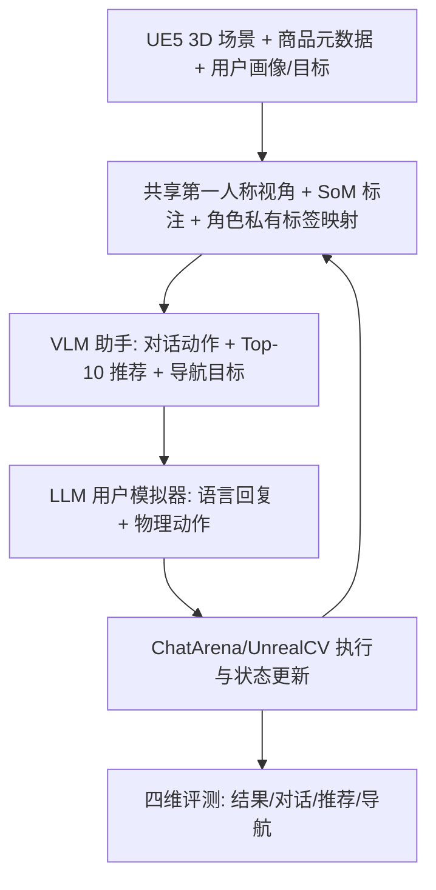
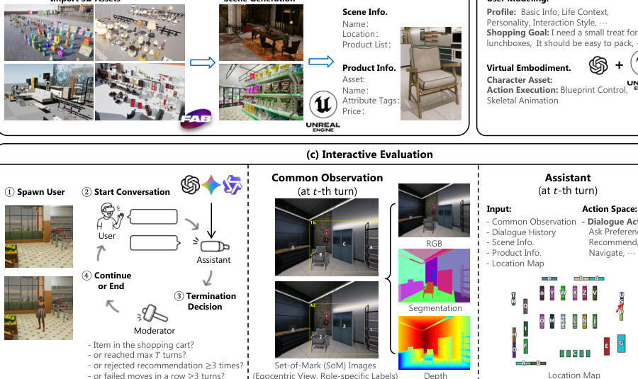

# SituRecBench: Evaluating Frontier Models as Situated Recommendation Assistants in 3D Environments (情境化推荐助手三维环境评测基准)

- **会议/期刊**: NeurIPS 2026 (Evaluations and Datasets Track)
- **作者与机构**: Jingtong Yang, Dongding Lin, Jian Wang, Wenjie Li (香港理工大学计算学系；四川大学计算机学院)
- **推荐链路定位**: 端到端生成式（对话式交互助手，无独立召回/精排级联）
- **研究方向**: 对话推荐与智能体仿真 / 多模态推荐
- **论文原文**: [https://arxiv.org/abs/2611.10349v1](https://arxiv.org/abs/2611.10349v1)
- **开源代码**: [https://github.com/Farama-Foundation/chatarena](https://github.com/Farama-Foundation/chatarena)（项目页 https://siturec.github.io/SituRecBench/）

## TL;DR (1分钟核心速览)

现有对话推荐基准要么只测对话与偏好挖掘（SIMMC-VR、SCREEN、MUSE），要么只测具身导航（MarketGen、DeliveryBench），**从未把"空间导航 + 视觉接地 + 多轮社交交互"三者联合评测**。本文提出 SituRecBench：基于 UE5 构建超市与家居店两个高保真 3D 场景，助手与用户共享第一人称视角，须通过对话挖掘隐式偏好、在环境中接地推荐、并引导用户走到货架。在 200 个任务、7 个前沿 VLM 上，最强模型 Gemini 3.1 Pro 成功率仅 80.0%/66.0%，R@5 仅 64.4%/49.8%，暴露空间接地与全局-局部信息融合的系统性短板。

## Background & Motivation (背景与核心矛盾)

- **主流范式**: 对话推荐正从静态排序转向交互式助手；多模态对话推荐（SIMMC、SCREEN）用共享场景图做产品指代，具身基准（MarketGen、Alexa Arena）用显式指令驱动导航与抓取。
- **前人局限**: (1) 情境对话基准把视觉接地与物理约束抽象掉，助手只需"说对"，不需"带对路"；(2) 具身基准的目标由显式指令给定，不涉及隐式偏好推断与推荐效用，且多为单轮指令跟随而非闭环多轮协商。
- **核心洞察 (Key Insight)**: 真实购物中"推荐什么"与"何时追问、往哪引导、如何解释"是耦合决策；助手与用户共享同一自我中心视角（类似智能眼镜），必须在线融合**全局上下文**（商品目录、地图、位置索引）与**局部观测**（当前 RGB 视野中的可见商品）。
- **本文切入点**: 把推荐重构为部分可观测的交互式决策过程，用 3D 仿真 + LLM 用户模拟器 + 统一四维评测协议，把上述耦合能力一次性纳入可复现的评测闭环。

## Method (核心方法设计)

### 1. 整体框架 (Overall Architecture)

一个 episode 形式化为 $\mathcal{T}=\langle E,\mathcal{I},\mathcal{U},\mathcal{A},\mathcal{O},\mathcal{S},P,R,\Gamma\rangle$：环境$E$含场景布局与可通行空间，商品$i$带类目、属性、价格、位置与可供性。用户配置$u=\langle z_u,g_u,b_u,\rho_u\rangle$（隐式偏好、购物目标、预算、行为特质）对助手不可见，须在线推断。每轮状态$s_t=\langle q_t,\theta_t,B_t,K_t,I_t,h_t\rangle$含用户位姿、购物篮、已揭示商品信息与历史；助手仅得部分观测$o_t=\Omega(s_t)$。助手策略$\pi_\theta(a_t\mid h_t,o_t)$输出混合动作$a_t=\langle a^{\text{lang}}_t,a^{\text{rec}}_t,a^{\text{nav}}_t,a^{\text{int}}_t\rangle$，用户模拟器据此产生语言回复与物理动作，环境按$s_{t+1}\sim P(\cdot\mid s_t,a_t,y_t)$转移，目标为最大化 episode 级效用$\max_{\pi_\theta}\mathbb{E}[R(\tau;u,E,\mathcal{I})]$。

<figure class="paper-figure" markdown="span">
  <figcaption>图2：SituRecBench概览。(a) 情境化3D购物环境构建；(b) 具有用户画像、目标和物理动作的用户模拟；(c) 基于VLM的推荐助手的交互式评估。</figcaption>
</figure>

### 2. 关键设计拆解 (Key Designs)

1. **角色私有 SoM 标签映射（防标签共享捷径）**：若两角色共用同一套视觉标记，助手可直接"念编号"而不真正理解空间。本文为每个商品/建筑分配固定 RGB 分割色，运行时在 RGB 视图上叠加轮廓与标签，但**用户与助手使用不同的标签映射**（用户见数字商品标签 + 字母货架标签，助手反之），且对话中禁止披露标签；运行时再把两套句柄映射到同一底层目标。这迫使助手必须用自然语言描述"货架第三层左侧的深色椅子"来完成接地。
2. **混合动作空间与结构化输出**：助手每轮输出 $\tilde{a}_t=\langle C^{\text{assistant}}_t,D^{\text{assistant}}_t,\hat{a}^{\text{user}}_t,R_t\rangle$，即面向用户的回复、唯一主对话动作（10 类：Greet/AskPreference/ClarifyNeed/Navigate/Recommend/Explain/AnswerQuestion/Compare/HandleRejection/ConfirmPurchase）、**期望用户动作**与内部 Top-10 排序。`Recommend` 必须给出 `display_name`、`visible_now` 与理由，`Navigate` 的即时目标必须当前可见——把"推荐"与"可执行性"硬绑定，杜绝推荐视野外商品。
3. **终止规则与闭环评测**：$\Gamma$ 含购物车加购、20 轮上限、**3 次显式推荐未成交**、moderator 判定放弃、连续 3 次位移可忽略的卡死。这使得早期推荐会改变用户后续观测与决策，评测是真正的闭环而非静态打分。

## Experimental Setup & Evaluation Protocol (实验设置与评估协议)

- **数据集与预处理**: 两个 UE5 场景，商品元数据对齐 Target/Walmart（超市）与 Wayfair/Home Depot/IKEA（家居）：

| 环境 | #Products | #Instances | #Nav. Targets | #Waypoints | #User Profiles | #Tasks |
| :--- | :---: | :---: | :---: | :---: | :---: | :---: |
| Supermarket | 233 | 1,324 | 29 | 42 | 25 | 100 |
| Home Furnishings | 222 | 244 | 31 | 38 | 25 | 100 |
| 合计 | 455 | 1,568 | 60 | 80 | 50 | 200 |

- **数据划分与防穿越**: 无训练/测试划分（纯评测基准）；每个 profile 配 4 个任务，按 seed 42 打乱后分入 4 个互斥子集（每子集 25 任务、覆盖全部 25 个 profile），所有助手与消融条件共用该划分，报告四子集均值的均值与样本标准差。
- **排名评测协议**: 非传统全库排序，而是**交互式 Top-10 列表评测**——每轮保存内部 Top-10 排序，与用户最终加购商品比对：R@5 为加购商品出现在前 5 的比例，NDCG@10 按首次出现位置折损；空列表或空购物车记 0。导航侧用 AFR（动作类型匹配率）、LNSR（动作 + 方向/目标参数双匹配率）、CGV（目标在后续 $h$ 轮内可见的累积率）。
- **对比基线与超参**: 7 个前沿 VLM——Gemini 3.1 Pro、GPT-5.6 Sol、Claude Opus 5、Qwen3.6-Plus、GPT-4o、Qwen3-VL-8B、Gemma 4 E4B；主实验 GPT-5.6 Sol 兼任用户模拟器与对话裁判，共 1,400 条轨迹；补充实验换 GPT-4o 作模拟用户（250 条轨迹）；人工评测 5 名被试 × 5 任务 × 5 助手 = 50 条轨迹。

## Key Experimental Results (实验关键数据)

### 1. 主实验对比 (Main Results)

GPT-5.6 Sol 作模拟用户，每环境 100 任务：

| 环境 | 模型 | SR (%) | Turn | AFR (%) | LNSR (%) | R@5 (%) | NDCG@10 (%) |
| :--- | :--- | :---: | :---: | :---: | :---: | :---: | :---: |
| Supermarket | Gemma 4 E4B | 28.0 | 9.0 | 49.2 | 10.0 | 17.3 | 15.0 |
| | Qwen3-VL-8B | 34.0 | 11.8 | 34.5 | 8.8 | 20.3 | 17.7 |
| | GPT-4o | 45.0 | 12.5 | 62.3 | 15.1 | 31.6 | 26.6 |
| | Qwen3.6-Plus | 65.0 | 12.1 | 65.9 | 28.5 | 49.6 | 42.4 |
| | Claude Opus 5 | 66.0 | 11.6 | 78.6 | 41.0 | 49.8 | 43.5 |
| | GPT-5.6 Sol | 69.0 | 10.9 | **89.0** | **53.5** | 56.3 | 48.2 |
| | **Gemini 3.1 Pro** | **80.0** | 9.8 | 80.1 | 48.4 | **64.4** | **56.0** |
| Home Furnishings | Qwen3-VL-8B | 29.0 | 8.3 | 47.0 | 26.3 | 15.3 | 13.7 |
| | Gemma 4 E4B | 31.0 | 9.6 | 40.0 | 29.0 | 17.3 | 16.4 |
| | GPT-4o | 35.0 | 9.9 | 56.9 | 53.0 | 23.0 | 20.2 |
| | Claude Opus 5 | 50.0 | 12.0 | 71.4 | 68.1 | 37.0 | 33.8 |
| | Qwen3.6-Plus | 54.0 | 11.6 | 71.6 | 70.9 | 39.4 | 35.5 |
| | GPT-5.6 Sol | 65.0 | 11.4 | **82.2** | **88.8** | 48.1 | 43.0 |
| | **Gemini 3.1 Pro** | **66.0** | 9.5 | 81.8 | 83.2 | **49.8** | **43.7** |

换 GPT-4o 作模拟用户后排序基本保持：Gemini 3.1 Pro 在超市 SR 达 **92.0%**、R@5 73.4%，家居店 SR 76.0%、R@5 60.5%，仍全面领先；GPT-5.6 Sol 仍保持最高 AFR（89.1%/71.6%）。

### 2. 消融实验 (Ablation Study)

超市环境，GPT-5.6 Sol 兼任助手与用户，每条件 100 任务：

| 条件 | SR (%) | AFR (%) | LNSR (%) | R@5 (%) | NDCG@10 (%) | Overall 对话分 |
| :--- | :---: | :---: | :---: | :---: | :---: | :---: |
| Full Context | 69.0 | **89.0** | 53.5 | **56.3** | **48.2** | **3.4** |
| w/o Ego. Visual View | **71.0** | 84.8 | 42.4 | 55.5 | 49.5 | 3.4 |
| w/o EVV & Textual Caption | 65.0 | 69.9 | **58.7** | 50.0 | 41.7 | 2.8 |

### 3. 关键实验发现 (Key Findings)

1. **"会带路"≠"会成交"**：GPT-5.6 Sol 的 AFR 最高（89.0%），但 SR 落后 Gemini 3.1 Pro 11 个百分点（69.0 vs 80.0）；Gemini 的 LNSR 反而更低（48.4 vs 53.5）。说明动作跟随率高不等于购物成功率高，助手可能"指令清晰但推荐不准"，单一导航指标会误判助手质量。
2. **第一人称信息的价值主要来自文本标注而非像素**：去掉自我中心视图后 SR 反升至 71.0%、NDCG@10 升至 49.5%，但 AFR 从 89.0 掉到 84.8、LNSR 从 53.5 掉到 42.4；再叠加去掉文本标注，SR 跌至 65.0、NDCG@10 跌至 41.7、Overall 对话分从 3.4 崩到 2.8。即当前 VLM 尚不能有效利用原始视觉流，真正起作用的是把全局目录/地图与可见目标连起来的**文本化接地信息**。
3. **模拟用户可作相对排序代理，但接地维度不可靠**：人工与模拟用户下助手排序的 Pearson 相关在 SR 上达 0.800、Overall 0.773、Ground. 0.807，但 AFR 仅 0.287、Spearman 仅 0.100；Groundedness 维度上人工与 LLM 裁判分歧最大——人类能对照图像核验商品外观与位置描述，纯文本裁判无法验证。这提示自动评测在"视觉接地"维度存在系统性盲区。

## Highlights & Limitations (亮点、对比与审稿批判)

- **与代表作对比 (vs. Prior Work)**: 相比 SCREEN/SIMMC-VR（有自我中心视图与对话，但无物理动作、无交互式闭环评测），本文补上了"动作改变状态、状态改变后续观测"的闭环；相比 MarketGen/DeliveryBench（有具身环境但目标由显式指令给定、不评推荐效用），本文把隐式偏好推断与推荐排序质量纳入同一协议；相比 Alexa Arena（有交互评测但无推荐任务），本文的评测维度覆盖对话-推荐-导航三轴。
- **可迁移亮点**: (1) **角色私有标签映射**是防止多模态智能体走"读编号"捷径的通用技巧，可直接移植到任何图文接地评测；(2) **"期望用户动作"字段 + AFR/LNSR 双指标**把"助手说了什么"与"用户是否照做、参数是否对"解耦，适合迁移到导购、客服、教学等引导型对话系统评测。
- **审稿级局限批判**: (1) 每轮仅提供**静态第一人称快照**而非连续视频流，无法刻画移动中的动态视觉变化，可能低估或高估助手的时序感知能力；(2) 场景规模有限（455 个商品、60 个导航目标、50 个 profile），且用户模拟器与对话裁判同为 GPT-5.6 Sol，存在自偏好风险；人工验证仅 50 条轨迹、5 名被试，统计功效偏弱，AFR 的 Spearman 相关仅 0.100 说明模拟用户在该维度几乎不可替代真人。

## Rating (四维评分)

- **方法创新性 (Novelty)**: ⭐⭐⭐⭐ （首个把空间导航、视觉接地、多轮社交交互与推荐效用联合闭环评测的基准，任务形式化与私有标签映射设计有巧思，但本质是基准构建而非算法创新）
- **评估协议与实验扎实度 (Protocol & Experiments)**: ⭐⭐⭐⭐ （四维指标 + 7 个前沿模型 + 双模拟用户 + 人工验证 + 消融，覆盖完整；扣分在人工样本量小、模拟器与裁判同源）
- **写作与数学规范度 (Clarity & Rigor)**: ⭐⭐⭐⭐ （POMDP 形式化清晰，指标定义含完整计数与聚合规则、分母约定明确；部分符号在正文与附录间略有重复）
- **工业落地与复现价值 (Industrial & Practical Value)**: ⭐⭐⭐⭐ （代码与场景开源、ChatArena/UnrealCV 链路成熟，可直接作为智能眼镜导购助手的离线评测沙盒；但 UE5 部署重、单轮静态视图与真实低延迟需求仍有距离）
