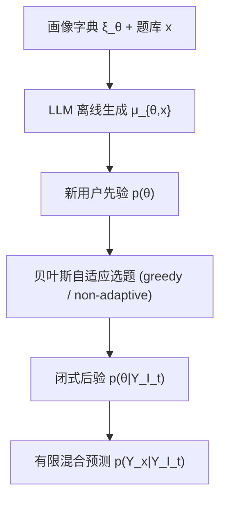

# Adaptive Querying with AI Persona Priors (基于 AI 人物画像先验的自适应查询)

- **会议/期刊**: ICML 2026
- **作者与机构**: Kaizheng Wang, Yuhang Wu, Assaf Zeevi（哥伦比亚大学 IEOR / 商学院）
- **推荐链路定位**: 冷启动用户建模 / 主动式偏好 elicitation（可视为召回前的用户画像构建）
- **研究方向**: 冷启动与长尾推荐 / 大语言模型推荐
- **论文原文**: [https://arxiv.org/abs/2605.00696v2](https://arxiv.org/abs/2605.00696v2)
- **开源代码**: [https://github.com/yw3453/adaptive-query-ai-persona-priors](https://github.com/yw3453/adaptive-query-ai-persona-priors)

## TL;DR (1分钟核心速览)

针对冷启动用户/新题目下"只能问极少量问题却要形成校准概率信念"的痛点，本文把用户状态建模为**有限 AI 人物画像字典上的隶属变量**，画像-题目响应分布由 LLM 离线生成，从而获得**闭式后验更新 + 有限混合预测**，使贝叶斯实验设计（BED）可在线高效执行。在 WorldValuesBench（88,459 用户、91 题）上，预算 $T=5$ 时 greedy 策略 log loss 为 1.019，显著优于最强 CAT 基线 MGRM 的 1.044；且无需任何题目校准数据即可直接部署新题。

## Background & Motivation (背景与核心矛盾)

- **主流范式**: 冷启动 elicitation 主流是计算机自适应测试（CAT/IRT），用低维参数化潜变量（常为单维能力 $\theta$）加参数化题目响应函数，配合网格后验做序贯选题。
- **前人局限**: ① IRT 的低维参数化假设难以刻画现代推荐中高维异构的响应模式，多维扩展（MIRT）的网格后验随维度指数爆炸；② 更灵活的贝叶斯模型需嵌套蒙特卡洛或变分近似，无法实时交互；③ CAT 必须对**每道题**做离线校准，新题上线即失效——恰是冷启动最痛的场景。
- **核心洞察 (Key Insight)**: LLM 在给定丰富文本画像时可模拟特定人群的响应分布，这本质上提供了一个**无需目标域历史数据、语义可解释、可离线批量生成**的结构化先验。
- **本文切入点**: 把"人物画像"从启发式模拟工具升级为**显式贝叶斯先验的混合分量**，用离散潜变量换取闭式推断，从而同时拿到表达力与可解性。

## Method (核心方法设计)

### 1. 整体框架 (Overall Architecture)

离线阶段：给定 $n$个人物画像字典$\{\xi_\theta\}_{\theta=1}^n$（Twin-2K-500，$n=2058$），对每个画像-题目对$( \xi_\theta, x)$提示 GPT-5-mini 直接输出四类 Likert 响应的概率分布$\boldsymbol{\mu}_{\theta,x}\in\Delta^3$。在线阶段：新用户到达时以$p(\theta)$为画像隶属先验，每答一题即用贝叶斯规则更新为后验$p(\theta\mid Y_{\mathcal{I}_t})$，并据此计算各候选题的期望后验不确定性，贪心或非自适应地选题；预算耗尽后用有限混合预测目标题分布。真实用户实验中先验$p(\theta)$ 由训练用户经经验贝叶斯（EM）学习。

### 2. 关键设计拆解 (Key Designs)

1. **人物画像诱导潜变量模型（把 LLM 输出变成似然）**：痛点在于一般高维先验的后验不可解。本文令潜变量 $\theta\in\{1,\dots,n\}$表示画像隶属，给定$\theta$时各题条件独立，响应服从$\text{Categorical}(\boldsymbol{\mu}_{\theta,x})$。于是后验与预测均为闭式：
$$p(\theta\mid Y_{\mathcal{I}_t})\propto p(\theta)\prod_{i\in\mathcal{I}_t}\mu_{\theta,i,Y_i},\qquad p(Y_x=k\mid Y_{\mathcal{I}_t})=\sum_{\theta=1}^{n}\mu_{\theta,x,k}\,p(\theta\mid Y_{\mathcal{I}_t}).$$
直觉：把"无限维非参数先验"压缩为"$n$个语义锚点的混合权重"，后验更新退化为$n$维向量的逐元素乘法再归一化，复杂度$O(nK)$，彻底绕开嵌套蒙特卡洛。

2. **闭式贪心自适应选题（把 BED 目标变成可枚举求和）**：BED 的一步前瞻期望不确定性原本需对响应空间积分。在离散画像模型下它化为对 $K$ 个类别的加权求和：
$$\Delta U(x\mid h_t)=\sum_{k=1}^{K}p(Y_x=k\mid Y_{\mathcal{I}_t})\,U\!\left(Z\mid h_t,Y_x=k\right),$$
其中 $U$取目标题边缘熵之和$\sum_{x'\in\mathcal{I}^\star}H(Y_{x'}\mid h_t)$。直觉：候选题只需枚举$K$种可能回答并重算$n$ 维后验，单步开销极低，使在线贪心可行。

3. **训练目标、先验学习与推理效率**：模型本身无梯度训练，唯一"学习"的是画像先验，通过最大化边缘似然 $\max_{p(\theta)\in\Delta^{n-1}}\sum_{j}\log\big(\sum_\theta p(\theta)p(Y^{(j)}\mid\theta)\big)$用 EM 求解（E 步责任度$\gamma_{j,\theta}\propto p(\theta)p(Y^{(j)}\mid\theta)$，M 步取均值），该先验会压低与真实人群不匹配的画像权重，缓解合成字典的误设定。无负采样概念；推理侧 greedy 需对每题每步重算前瞻目标，实测 17,692 测试用户$T=86$ 约 40 分钟，非自适应策略不足 1 分钟。

## Experimental Setup & Evaluation Protocol (实验设置与评估协议)

- **数据集与预处理**:

| 数据集 | #Users | #Items(题) | #Interactions | 稀疏度/缺失率 | 特征/场景说明 |
| :--- | :---: | :---: | :---: | :---: | :--- |
| WorldValuesBench | 88,459（训练 70,767 / 测试 17,692） | 91（可行 86 + 目标 5） | 约 784 万有效作答 | 缺失率 2.6% | 四类 Likert 价值观问卷；剔除缺失 >20% 的受访者 |
| Synthetic Users | 100,000（测试 20,000） | 91 | — | 无缺失 | 从画像模型采样，先验正确设定 |

- **数据划分与防穿越 (Splitting Strategy)**: 用户级 **80%/20% 比例划分**，全部指标仅在留出测试用户上计算；随机固定 5 题为目标集 $\mathcal{I}^\star$，其余 86 题为可行集，目标题永不进入查询池，杜绝信息泄漏。
- **排名评测协议 (Ranking Protocol)**: 非检索式任务，采用**概率预测评分**——Log Loss、Brier Score、Ordinal MSE（类别映射 $\{0,1,2,3\}$），在全部有真值的 (user, target-question) 对上平均；缺失题视为不可查询。
- **对比基线与超参设置**: 画像类方法含 random / random_fixed / non-adaptive / greedy / full（oracle 上界）；CAT 类含 GRM、GPCM、MGRM、MGPCM（多维取 $D=3$，网格后验，边际极大似然 EM 校准）。画像字典$n=2058$，LLM 为 GPT-5-mini，报告标准误与 95% 置信区间。

## Key Experimental Results (实验关键数据)

### 1. 主实验对比 (Main Results)

真实用户 WorldValuesBench 上的 Log Loss（越低越好，$N=17{,}692$）：

| Method | $T=5$|$T=10$|$T=15$|$T=20$|$T=30$|$T=50$ |
| :--- | :---: | :---: | :---: | :---: | :---: | :---: |
| random | 1.033 | 1.022 | 1.015 | 1.010 | 1.005 | 1.000 |
| non-adaptive | 1.039 | 1.020 | **.991** | **.977** | .981 | .988 |
| **greedy (Ours)** | **1.019** | **1.006** | 1.001 | .999 | .997 | .998 |
| CAT-GRM | 1.074 | 1.067 | 1.058 | 1.046 | 1.031 | 1.019 |
| CAT-GPCM | 1.149 | 1.122 | 1.104 | 1.092 | 1.067 | 1.048 |
| CAT-MGRM | 1.044 | 1.033 | 1.022 | 1.015 | 1.011 | 1.011 |
| CAT-MGPCM | 1.107 | 1.083 | 1.071 | 1.066 | 1.051 | 1.038 |

$T=5$时 greedy 相对最强 CAT 基线 MGRM 降低 log loss **2.4%**（1.019 vs 1.044）；合成用户（先验正确设定）上差距更大，$T=5$时 greedy 1.089 vs MGRM 1.164，降幅 **6.4%**，且$T=86$ 时画像类方法收敛至 1.006 的 full 上界，而 CAT 类停滞在 1.14 以上。

### 2. 消融实验 (Ablation Study)

真实用户 greedy 策略的 Log Loss 消融（$N=10{,}000$ 抽样）：

| 变体 | $T=5$|$T=15$|$T=30$|$T=50$|$T=86$ |
| :--- | :---: | :---: | :---: | :---: | :---: |
| current setup | **1.003** | **.987** | **.984** | .984 | .979 |
| cluster = 200 | 1.004 | .986 | .986 | **.978** | **.976** |
| cluster = 50 | 1.012 | .996 | .985 | .981 | .977 |
| det. $\varepsilon=0.1$ | 1.218 | 1.368 | 1.427 | 1.490 | 1.472 |
| det. $\varepsilon=0.3$ | 1.065 | 1.106 | 1.138 | 1.167 | 1.168 |
| temp $\tau=0.5$ | 1.052 | 1.097 | 1.107 | 1.101 | 1.085 |
| temp $\tau=2$ | 1.098 | 1.082 | 1.075 | 1.072 | 1.069 |

### 3. 关键实验发现 (Key Findings)

1. **分布形状本身携带信息，而非仅众数**：把 LLM 分布替换为"众数 + 均匀噪声"后性能崩塌（$\varepsilon=0.1$时$T=30$ 的 log loss 从 .984 飙至 1.427，劣化 45%），说明直接 elicitation 的完整概率向量是核心资产，点预测加噪声不可替代。
2. **LLM 分布已接近良校准，后处理反而有害**：温度缩放 $\tau=0.5$（锐化）与$\tau=2$（软化）在所有预算下均劣于原始分布（如$\tau=2$在$T=5$ 为 1.098 vs 1.003），暗示无需额外校准即可直接用于 BED 目标。
3. **误设定下存在"贪心—非自适应"交叉现象**：真实数据上 greedy 在 $T\le15$领先（$T=15$时 1.001 vs 1.039），但$T=20$起被 non-adaptive 反超（.977 vs .999），且 non-adaptive 在$T>20$ 后随预算增加反而变差——短视自适应会过早锁定错误画像区域，形成局部最优级联。

## Highlights & Limitations (亮点、对比与审稿批判)

- **与代表作对比 (vs. Prior Work)**: 相比 CAT/IRT（低维参数化 + 逐题校准），本文用 $n=2058$个语义锚点获得表达力却保持$O(nK)$ 闭式推断；相比神经 BED（Foster 2021 / Ivanova 2021 的学习式代理策略网络），本文保留**精确后验**、无策略网络；相比 LCA 有限混合（Goodman 1974），混合分量由 LLM 离线给定而非从数据估计，故天然适配冷启动新题。
- **可迁移亮点**: ① "LLM 离线生成分量似然 + 离散潜变量 + EM 学混合权重"这一配方可直接迁移到冷启动用户分群与 lookalike 扩量；② 用 proper scoring rule 与不确定性泛函的对偶性来保证"选题目标 = 评估指标"，是设计 elicitation 系统的通用准则。
- **审稿级局限批判**: ① 计算开销不对称——greedy 推理 40 分钟 vs 非自适应 <1 分钟，且 $n=2058$ 的字典使每步需重算全量后验，大规模在线场景需近似；② 强假设"给定画像条件独立 + 单一画像硬指派"，忽略题目间相关与用户跨画像的连续混合；③ 画像字典与 LLM 分布可能放大训练数据偏见，对代表性不足群体系统性低概率，论文仅作定性讨论而无公平性量化实验。

## Rating (四维评分)

- **方法创新性 (Novelty)**: ⭐⭐⭐⭐ （把 LLM 画像从启发式模拟提升为有限混合贝叶斯先验，闭式推断与 BED 的结合干净且有理论对偶支撑，但有限混合骨架本身并不新）
- **评估协议与实验扎实度 (Protocol & Experiments)**: ⭐⭐⭐⭐ （合成 + 真实双设定、三种 proper scoring rule、完整消融与运行时对比，但仅单一人群数据集、缺公平性分桶与显著性检验）
- **写作与数学规范度 (Clarity & Rigor)**: ⭐⭐⭐⭐⭐ （公式推导简洁自洽，闭式更新与算法伪代码清晰，复杂度与误设定分析到位）
- **工业落地与复现价值 (Industrial & Practical Value)**: ⭐⭐⭐⭐ （代码开源、无需逐题校准即可上线新题是冷启动刚需，但 greedy 的 40 分钟推理与 LLM 离线批量 elicitation 成本需工程优化）
