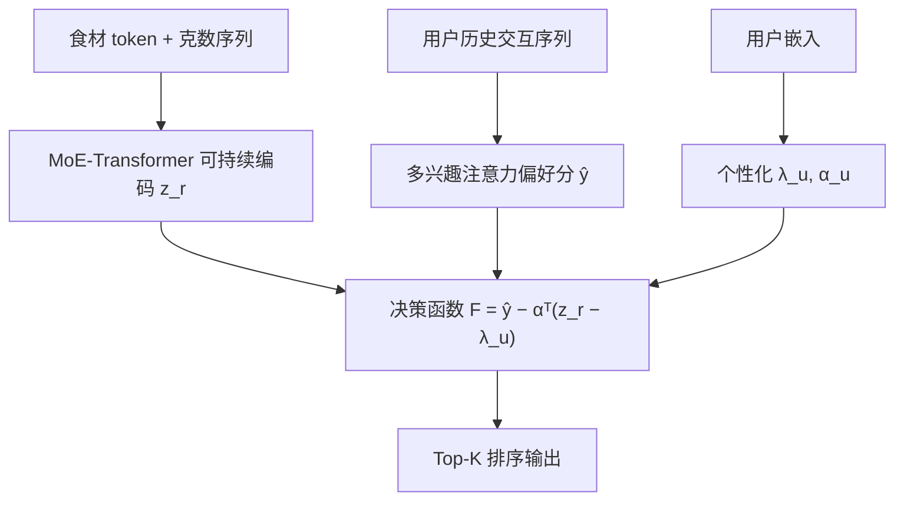
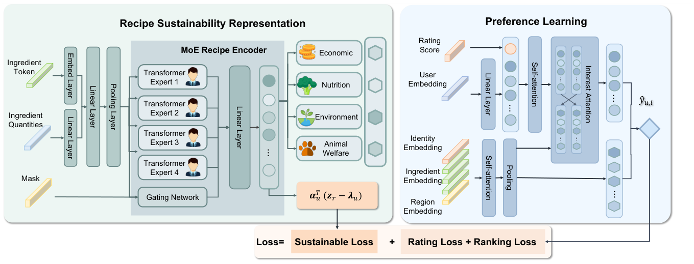

# Eating for a Sustainable Planet: Personalized Sustainable Diet Recommendation via Constraint-Aware Decision-Making Modeling (为可持续星球而食：基于约束感知决策建模的个性化可持续饮食推荐)

- **会议/期刊**: ICML 2026
- **作者与机构**: Ying Jin, Weiqing Min, Mingyu Huang, Shuqiang Jiang（中国科学院大学、中科院计算所智能信息处理重点实验室）
- **推荐链路定位**: 精排（Top-K 排序打分）
- **研究方向**: 冷启动与长尾推荐 / 多任务学习与列表级重排
- **论文原文**: [https://arxiv.org/abs/2608.24274v1](https://arxiv.org/abs/2608.24274v1)
- **开源代码**: 暂未开源

## TL;DR (1分钟核心速览)

现有饮食推荐把"可持续性"当作显式用户偏好来学习，但真实用户几乎不会带着可持续意识做点餐决策，导致宏观可持续目标无法落地到个体。本文把可持续饮食推荐重构为**约束感知决策问题**：偏好由历史交互学习，可持续性则建模为**用户可学习的约束阈值 $\lambda_u$与拉格朗日乘子$\alpha_u$**，在打分函数中显式施加惩罚项。作者构建 149k 食谱、179k 用户、744k 交互的 SusDiet 数据集，在 Top-20 全库排序下 NDCG 与 Recall 保持竞争力（0.0159 / 0.0316），同时营养指标从历史 38.74 提升至 37.59 以上、动物福利从 12.16 降至 3.03，实现"不牺牲偏好前提下的可持续性提升"。

## Background & Motivation (背景与核心矛盾)

- **主流范式**: 宏观层面用数学规划/情景分析在人口或国家尺度上求解满足营养、环境、成本、文化约束的最优膳食模式；微观层面则把食物推荐系统直接套用通用推荐范式，将可持续性作为又一个偏好维度去拟合。
- **前人局限**: 其一，宏观优化输出的是"规范性最优模式"，忽略个体异质性，个体采纳率极低；其二，微观推荐假设用户对可持续性持有**显式态度**，而现实中消费者极少在点餐时具备可持续意识（Fernqvist 2024; Gonzalez 2025），把可持续性当偏好学在概念上就错位了。
- **核心洞察 (Key Insight)**: 可持续饮食的转变往往要求在主食、肉类、乳制品上做结构性调整，这种调整常超出个体可接受阈值——因此可持续性更应被理解为**个体容忍边界（约束）**，而非**兴趣（偏好）**。
- **本文切入点**: 用拉格朗日对偶把"最大化偏好 s.t. 可持续指标上界"转化为带惩罚项的无约束打分 $F(u,r)=\hat{y}_{u,r}-\alpha_u^\top(s_r-\lambda_u)$，让约束阈值与权衡权重都成为用户特定的可学习参数。

## Method (核心方法设计)

### 1. 整体框架 (Overall Architecture)

模型由三部分协同构成：左侧 **食谱可持续性表征** 用 4 专家 MoE-Transformer 将"食材 token + 克数"序列编码为可持续嵌入 $z_r$，并经多任务头预测营养/环境/成本/动物福利四维指标；右侧 **偏好学习** 用自注意力 + 多兴趣注意力从用户历史交互中输出纯偏好分$\hat{y}_{u,r}$，与可持续性解耦；底部 **个性化约束权衡** 由用户嵌入生成$\lambda_u,\alpha_u$，将惩罚项$\alpha_u^\top(z_r-\lambda_u)$注入最终决策函数。训练以评分损失、BPR 排序损失与可持续惩罚损失的加权和联合优化，推理时对候选食谱按$F(u,r)$ 排序取 Top-K。

<figure class="paper-figure" markdown="span">
  <figcaption>图1. 个性化可持续饮食推荐框架。该架构包含三个组件：（1）食谱可持续性表示（左）利用MoE编码器将食材token和数量转换为多维可持续性嵌入zr。（2）偏好学习（右）利用自注意力和兴趣注意力从用户-食谱交互中输出偏好得分ˆyu,i。（3）个性化约束感知权衡（下）综合这些输出，通过用户特定参数实例化决策函数。</figcaption>
</figure>

### 2. 关键设计拆解 (Key Designs)

1. **MoE 可持续性编码器 + 不确定性加权多任务**：四维可持续指标量纲差异极大且相互竞争，单一 Transformer 难以兼顾。本文用 $E=4$个 Transformer 专家分别编码食材序列，门控$g_r=\mathrm{softmax}(\mathrm{MLP}(\bar{x}_r))$按序列均值动态加权，$z_r=\mathrm{LN}(W_g\sum_e g_r[e]p_r^{(e)}+b_g)$；四个回归头共享$z_r$但独立预测，损失采用可学习噪声权重$\mathcal{L}_{task}=\sum_k(\exp(-v_k)\mathrm{MSE}_k+v_k)$，让梯度自动按各任务噪声水平配平，避免手工调权。目标值先做带符号对数压缩再 z-score 归一化，抑制重尾分布。
2. **多兴趣注意力偏好学习**：用户口味在"菜品身份/食材构成/地域文化"三个视角上异质，单一用户向量会坍缩。本文对目标食谱构造 $v_{r,id},v_{r,ing},v_{r,reg}$三视图查询，分别对历史交互做注意力聚合$\beta_{i,r}=\mathrm{softmax}(\phi_Q(\tilde{v}_r)^\top\phi_K(\tilde{h}_i)/\sqrt{d})$，得到$e_{u,id},e_{u,ing},e_{u,reg}$后拼接投影为用户向量，偏好分$\hat{y}_{u,r}=\langle e_u,e_r\rangle$。该模块**完全不接触可持续信号**，保证偏好与约束解耦。
3. **个性化约束权衡与联合损失**：核心创新是把约束阈值做成用户特定参数而非全局超参。惩罚项 $p_{u,r}=\alpha_u^\top(z_r-\lambda_u)$直接进入损失$\mathcal{L}_{sus}=\mathbb{E}[p_{u,r}]$，总目标$\mathcal{L}=\mathcal{L}_{rating}+\beta_1\mathcal{L}_{rank}+\beta_2\mathcal{L}_{sus}+\beta_3\|\Theta\|_2^2$，其中$\mathcal{L}_{rank}$为 BPR 式成对排序损失。直觉上，$\lambda_u$刻画"该用户能容忍多不环保"，$\alpha_u$ 刻画"该用户愿意为可持续让渡多少偏好"，二者均由交互数据反推，无需用户显式声明。负采样采用历史交互内成对采样（正-负对），无额外难负样本挖掘。

## Experimental Setup & Evaluation Protocol (实验设置与评估协议)

- **数据集与预处理**: 自建 SusDiet，融合 recipeDB、Yummly-28k/66k、WorldCuisines、World Wide Recipe 五个公开食谱源，经 GPT 做食材短语解析、克数估计与可持续指标映射（人工抽检 500 例，可接受率 97%/91%/94%），再与 HUMMUS 及 Majumder 数据集的评分交互按菜名+元数据对齐。

| 数据集 | #Users | #Items | #Interactions | 稀疏度/密度 | 特征/场景说明 |
| :--- | :---: | :---: | :---: | :---: | :--- |
| SusDiet | 179,869 | 149,036 | 744,138 | 密度约 2.8e-5 | 7,340 种标准食材、131 国标签、四维可持续指标 |

- **数据划分与防穿越 (Splitting Strategy)**: 原文未明确给出划分细节（附录 C 提及按原始设置实现基线），从 Top-K 任务形式推断为**用户级留出划分**；需注意这是本文评估协议的一个薄弱点。
- **排名评测协议 (Ranking Protocol)**: 对每个用户对候选食谱排序取 Top-K（$K=5,10,20$），报告 NDCG@K 与 Recall@K；可持续性维度则统计 Top-K 推荐食谱的平均指标值（营养越高越好，环境/成本/动物福利越低越好），并与用户历史交互的指标均值（Origin）对照。
- **对比基线与超参设置**: 通用推荐 KNN、ICLRec、MSSR；食物域 HAFR、FGCN；可持续导向 GRAPE；另在附录补充 LLM 基线 Phi-3 与 KERL。嵌入维度 $d$ 与显著性检验标准原文未在正文明确给出。

## Key Experimental Results (实验关键数据)

### 1. 主实验对比 (Main Results)

Top-20 结果（↑越高越好，↓越低越好；加粗为最优）：

| 方法 | NDCG@20 | Recall@20 | Nutrition↑ | Environment↓ | Economy↓ | Animal↓ |
| :--- | :---: | :---: | :---: | :---: | :---: | :---: |
| Origin（历史） | - | - | 38.7363 | 70.3760 | 7.3932 | 12.1631 |
| KNN | 0.0062 | 0.0100 | 34.9248 | 66.1098 | 8.4511 | 17.0370 |
| ICLRec | 0.0170 | **0.0340** | 35.3663 | **59.5418** | 5.6958 | 5.6385 |
| MSSR | **0.0181** | 0.0312 | 35.9742 | 64.1614 | 6.8710 | 10.3917 |
| HAFR | 0.0098 | 0.0212 | 35.9525 | 61.5087 | 6.4426 | 11.2196 |
| FGCN | 0.0147 | 0.0273 | 37.1848 | 64.2924 | 6.4037 | 7.8085 |
| GRAPE | 0.0131 | 0.0265 | 37.2563 | 68.7837 | 6.8643 | 4.6847 |
| **Ours** | 0.0159 | 0.0316 | **37.5927** | 66.2894 | **4.9445** | **3.0255** |

Top-5 下 Ours 的 Recall 达 0.0171（最优），Nutrition 40.7221（最优），Animal Welfare 2.7954（最优）；Top-10 下 NDCG 0.0136 为最优。

### 2. 消融实验 (Ablation Study)

Top-20 设置下逐模块移除：

| 配置 | NDCG | Recall | Nutrition↑ | Environment↓ | Economy↓ | Animal↓ |
| :--- | :---: | :---: | :---: | :---: | :---: | :---: |
| w/o MoE | 0.0155 | 0.0321 | 35.3628 | 68.6534 | 6.2455 | 4.9456 |
| w/o IntAttn | 0.0110 | 0.0259 | 36.6532 | 68.2435 | 5.3234 | 4.3553 |
| w/o Constraint | **0.0173** | **0.0367** | 34.2454 | 70.8643 | 7.2345 | 5.9553 |
| Full | 0.0159 | 0.0316 | **37.5927** | **66.2894** | **4.9445** | **3.0255** |

### 3. 关键实验发现 (Key Findings)

1. **约束项是可持续性的唯一来源，且代价极小**：移除约束后 NDCG 反升至 0.0173（+8.8%），但营养跌至 34.25、动物福利升至 5.96、环境升至 70.86——纯偏好推荐会放大历史中的不可持续模式；加入约束仅损失约 8% 排序精度，却换来营养 +9.8%、动物福利 −49.2% 的收益，性价比极高。
2. **MoE 主要服务于可持续维度而非精度**：去掉 MoE 后 NDCG 仅降 0.0004，但营养从 37.59 掉到 35.36、动物福利从 3.03 升到 4.95，说明多专家结构确实在解耦四维异质指标，而非提升偏好拟合。
3. **学到的约束阈值高度个性化**：$\lambda_u$ 的环境维度 P10–P90 跨度达 46.11–92.83，动物福利维度标准差 20.80（均值仅 9.37），证明模型确实捕捉到个体容忍边界的巨大异质性；用户案例中同一用户 Top-5 推荐把环境从历史 86.78 压到 71.59、成本从 9.97 降到 6.99，而营养反升。

## Highlights & Limitations (亮点、对比与审稿批判)

- **与代表作对比 (vs. Prior Work)**: 宏观优化类工作（Springmann 2018; Chaudhary & Krishna 2019）输出人口级规范模式，无个体建模；GRAPE（Jing 2025）把绿色态度作为偏好维度学习，隐含"用户有显式可持续态度"假设；本文则把可持续性下沉为**可学习约束**，与偏好解耦，这是概念层面的根本差异。
- **可迁移亮点**: ①"约束即参数"的拉格朗日惩罚注入打分函数，可平移到任何带硬性合规/公平/预算边界的推荐场景（如广告预算约束、内容合规阈值）；②用不确定性加权多任务损失自动配平异质指标，免去手工调权，适合多目标精排。
- **审稿级局限批判**: ①约束阈值 $\lambda_u$ 完全从历史交互反推，而历史交互本身不含可持续信号，存在**标签不可辨识性**风险——模型学到的可能只是"该用户历史食谱的平均不环保程度"，而非真实容忍边界；②评估仅离线，且未明确数据划分与显著性检验，NDCG 绝对值极低（0.01 量级）说明任务本身极稀疏，排序精度差异的统计可靠性存疑；③静态偏好假设与指标不确定性（LLM 估计克数、外部数据库映射）会逐级传播到约束学习。

## Rating (四维评分)

- **方法创新性 (Novelty)**: ⭐⭐⭐⭐ （把可持续性从"偏好维度"重构为"用户可学习约束"是清晰的概念增量，拉格朗日惩罚注入打分函数的做法简洁有效）
- **评估协议与实验扎实度 (Protocol & Experiments)**: ⭐⭐⭐ （数据集构建扎实、消融完整，但划分策略与显著性检验未明确，NDCG 绝对值过低削弱结论稳健性）
- **写作与数学规范度 (Clarity & Rigor)**: ⭐⭐⭐⭐ （任务形式化与三模块推导清晰，约束-惩罚-损失的链条完整，附录补充充分）
- **工业落地与复现价值 (Industrial & Practical Value)**: ⭐⭐⭐ （约束感知打分框架易迁移，但依赖 LLM 预处理构建指标、未开源、离线验证，落地需在线行为实验支撑）
