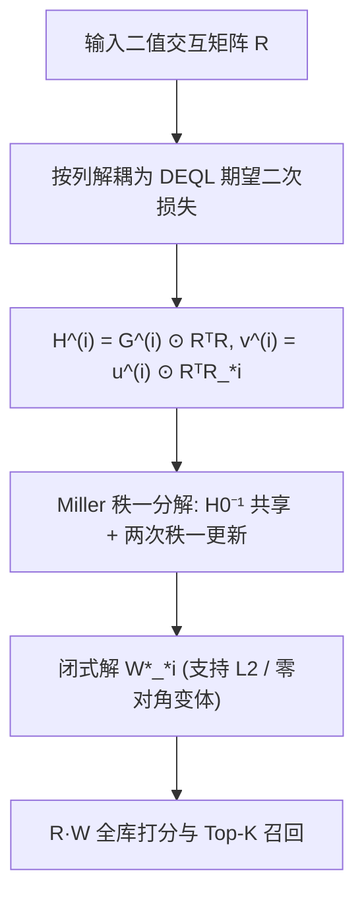

# Generalizing Linear Autoencoder Recommenders with Decoupled Expected Quadratic Loss (解耦期望二次损失：线性自编码器推荐的推广)

- **会议/期刊**: ICLR 2026
- **作者与机构**: Ruixin Guo, Xinyu Li, Hao Zhou, Ruoming Jin (Kent State University); Yang Zhou (Auburn University)
- **推荐链路定位**: 召回（Item-to-Item 相似度矩阵的闭式求解）
- **研究方向**: 协同过滤与双塔召回 / 自监督对比学习与交互去噪
- **论文原文**: [https://arxiv.org/abs/2603.07402v1](https://arxiv.org/abs/2603.07402v1)
- **开源代码**: [https://github.com/coderaBruce/DEQL](https://github.com/coderaBruce/DEQL)

## TL;DR (1分钟核心速览)

线性自编码器（LAE）如 EASE/EDLAE 因闭式解与强性能成为稀疏隐式反馈的强基线，但 EDLAE 仅在超参 $b=0$时给出闭式解，$b>0$区域完全未被探索。本文把 EDLAE 目标重写为按列解耦的期望二次损失 DEQL，证明$b>0$时解唯一存在（含此前被排除的$b>a$区域），并基于 Miller 矩阵逆定理将求解复杂度从$O(n^4)$降至$O(n^3)$。在 9 个基准、强/弱泛化两种划分下，DEQL(L2) 稳定优于$b=0$ 的 EDLAE，Amazon-Books 上 R@20 相对提升约 5.6%、N@20 约 8.3%。

## Background & Motivation (背景与核心矛盾)

- **主流范式**: LAE 学习 item-to-item 矩阵 $W\in\mathbb{R}^{n\times n}$，以$\hat{R}=RW$重建二值交互矩阵；EASE 用$\|R-RW\|_F^2+\lambda\|W\|_F^2$加零对角约束，EDLAE 进一步引入 dropout 与强调权重$a\ge b\ge 0$ 来抑制向单位阵过拟合。
- **前人局限**: 其一，EDLAE 的闭式解只在 $b=0$时给出，$b>0$是否有解、解是否唯一、是否更优均无理论回答；其二，$a\ge b$ 这一"强调被丢弃项"的约束被当作先验默认，从未被检验。
- **核心洞察 (Key Insight)**: EDLAE 的期望形式可按 $W$的列完全解耦，每列是一个独立的期望二次损失；当$b>0$时 Gram 矩阵$H^{(i)}$正定，解唯一存在；而$b=0$时$H^{(i)}$ 奇异，解集是一族"非对角相同、对角任意"的无穷解，Steck 的零对角解只是其中一员。
- **本文切入点**: 用 DEQL 统一刻画整个 $b\ge 0$ 解空间，并给出可落地的快速求解算法。

## Method (核心方法设计)

### 1. 整体框架 (Overall Architecture)

输入为用户-物品二值矩阵 $R$；对每个物品列$i$，把 dropout 掩码$\Delta$与强调矩阵$A$视为随机变量，构造随机对$(X^{(i)},Y^{(i)})$，在该分布下最小化期望二次损失得到闭式解$W_{*i}$；随后通过 Miller 矩阵逆定理的秩一分解，把$n$个$n\times n$逆矩阵的计算共享为一次基准逆加$n$次$O(n^2)$更新，最终输出$n\times n$ 相似度矩阵用于全库打分。

### 2. 关键设计拆解 (Key Designs)

1. **DEQL 解耦期望二次损失（把 EDLAE 从单一超参点解放为整个解空间）**：EDLAE 原目标含 Hadamard 积耦合，难以分析 $b>0$。DEQL 将其写为$l_{\mathcal{D}}(W)=\sum_{i=1}^{n}\mathbb{E}_{(X,Y)\sim\mathcal{D}^{(i)}}\|Y_{*i}-XW_{*i}\|_F^2$，逐列求导得$W_{*i}^{*}=\mathbb{E}[X^{\top}X]^{-1}\mathbb{E}[X^{\top}Y_{*i}]$。直觉上，这把"矩阵整体重建"降维成$n$ 个独立岭回归，从而让每个超参点的可解性变成 Gram 矩阵是否正定这一可判定问题。

2. **$b>0$唯一解与$b=0$解集刻画（回答"EDLAE 是否已最优"）**：对 EDLAE 特化后$H^{(i)}=G^{(i)}\odot R^{\top}R$、$v^{(i)}=u^{(i)}\odot R^{\top}R_{*i}$，其中$G^{(i)}$的对角/非对角元素由$(1-p)pa^2$、$(1-p)^2b^2$等四项按索引关系分段给出。定理 3.3 证明$b>0$时$G^{(i)}$正定、$H^{(i)}$正定故可逆，解唯一；$b=0$时第$i$行列全零导致奇异，解为$W_{*i,-i}^{*}=(H^{(i)}_{-i})^{-1}v^{(i)}_{-i}$且$W_{ii}$任意，定理 3.4 证明取零对角即退化为 Steck 原解。物理直觉：$b>0$ 相当于给"保留项"也注入重建信号，使 Gram 矩阵满秩，从而把解从一条仿射子空间收缩为单点。

3. **Miller 快速算法与训练目标（把 $O(n^4)$打到$O(n^3)$）**：直接逐$i$求逆需$O(n^4)$。作者把$H^{(i)}$拆为与$i$无关的$H_0=G_0\odot R^{\top}R$加两个秩一扰动$E_1^{(i)}$（仅第$i$列非零）与$E_2^{(i)}$（仅第$i$行非零），套用 Miller 定理两次得$H^{(i)-1}=H_+^{(i)-1}-\frac{1}{1+\mathrm{tr}(H_+^{(i)-1}E_2^{(i)})}H_+^{(i)-1}E_2^{(i)}H_+^{(i)-1}$，每步仅$O(n^2)$。总损失即 DEQL 本身（免负采样、免梯度迭代），加$L_2$时解为$(H^{(i)}+\lambda I)^{-1}v^{(i)}$，加零对角约束时用拉格朗日乘子修正为$H^{(i)-1}v^{(i)}-\frac{(H^{(i)-1}v^{(i)})_i}{(H^{(i)-1}l^{(i)})_i}H^{(i)-1}l^{(i)}$。整体复杂度$O(\max(m+n)n^2)$，与 EASE/EDLAE 同阶。

## Experimental Setup & Evaluation Protocol (实验设置与评估协议)

- **数据集与预处理**: 分两组。Group 1（强泛化，按用户切分、训练测试用户不重叠）用于对比 LAE 类模型；Group 2（弱泛化，按交互切分、用户可跨集）用于对比深度学习模型，与各文献惯例对齐。

| 数据集 | #Users | #Items | #Interactions | 密度 | 分组/说明 |
| :--- | :---: | :---: | :---: | :---: | :--- |
| Games | 1,006 | 896 | 15,276 | 1.69% | G1，item/user=0.89 |
| Beauty | 17,971 | 4,394 | 75,472 | 0.10% | G1 |
| Gowalla-1 | 29,243 | 13,681 | 677,956 | 0.17% | G1，作者自预处理 |
| ML-20M | 136,677 | 20,108 | 9,990,682 | 0.36% | G1 |
| Netflix | 463,435 | 17,769 | 56,880,037 | 0.69% | G1 |
| MSD | 571,353 | 41,140 | 33,633,450 | 0.14% | G1 |
| Amazon-Books | 52,643 | 91,599 | 2,984,108 | 0.06% | G2，item/user=1.74 |
| Yelp2018 | 31,668 | 38,048 | 1,561,406 | 0.13% | G2，item/user=1.20 |
| Gowalla | 29,858 | 40,981 | 1,027,370 | 0.08% | G2 |

- **数据划分与防穿越 (Splitting Strategy)**: Group 1 为**按用户划分**（强泛化，训练/测试用户不重叠）；Group 2 为**按交互划分**（弱泛化，用户可同时出现在训练与测试集）。未采用全局时间戳切分。
- **排名评测协议 (Ranking Protocol)**: 采用 **Full-Ranking（全库未交互物品排序）**，指标为 Recall@20 与 NDCG@20；LAE 类模型为闭式解，无训练负采样。
- **对比基线与超参设置**: LAE 基线 EASE、DLAE、EDLAE、ELSA；深度基线 PinSage、LightGCN、DGCF、SimpleX、SGL-ED、SSM(MF/GNN)。超参固定 $a=1$（目标对$a,b$同比例缩放不变，仅依赖$b/a$），$b\in[0.1,2.0]$步长 0.25，$\lambda\in\{10,\dots,500\}$，$p\in\{0.1,\dots,0.8\}$；改进显著性用 5 次随机切分的配对$t$检验（$\alpha=0.05$）验证。

## Key Experimental Results (实验关键数据)

### 1. 主实验对比 (Main Results)

**强泛化设定（Group 1，对比 LAE 类）**：

| Model | Games R@20 | Games N@20 | Beauty R@20 | Gowalla-1 R@20 | ML20M R@20 | Netflix R@20 | MSD R@20 |
| :--- | :---: | :---: | :---: | :---: | :---: | :---: | :---: |
| EASE | 0.2733 | 0.1640 | 0.1323 | 0.2230 | 0.3905 | 0.3618 | 0.3332 |
| DLAE | 0.2771 | 0.1664 | 0.1329 | 0.2143 | 0.3924 | 0.3620 | 0.3290 |
| EDLAE ($b{=}0$) | 0.2851 | 0.1681 | 0.1324 | 0.2268 | 0.3925 | 0.3656 | 0.3336 |
| ELSA | 0.2734 | 0.1658 | 0.1263 | 0.2255 | 0.3919 | 0.3625 | 0.3256 |
| DEQL(plain) | 0.2524 | 0.1565 | 0.1093 | 0.2149 | 0.3844 | 0.3606 | 0.3329 |
| DEQL(L2+zero-diag) | 0.2872 | 0.1704 | **0.1388** | 0.2278 | **0.3934** | 0.3656 | **0.3344** |
| **DEQL(L2)** | **0.2998** | **0.1842** | **0.1391** | **0.2288** | **0.3934** | **0.3658** | 0.3340 |
| Improv.% (vs EDLAE) | +5.16% | +9.58% | +5.06% | +0.88% | +0.23% | +0.05% | +0.24% |

**弱泛化设定（Group 2，对比深度模型）**：

| Model | Amazon-Books R@20 | Amazon-Books N@20 | Yelp2018 R@20 | Yelp2018 N@20 | Gowalla R@20 |
| :--- | :---: | :---: | :---: | :---: | :---: |
| LightGCN | 0.0411 | 0.0315 | 0.0649 | 0.0530 | 0.1830 |
| SimpleX | 0.0583 | 0.0468 | 0.0701 | 0.0575 | 0.1872 |
| SSM (GNN) | 0.0590 | 0.0459 | **0.0737** | **0.0609** | 0.1869 |
| EASE | 0.0710 | 0.0566 | 0.0657 | 0.0552 | 0.1765 |
| EDLAE | 0.0711 | 0.0566 | 0.0673 | 0.0565 | 0.1844 |
| DLAE | **0.0751** | 0.0610 | 0.0678 | 0.0570 | 0.1839 |
| **DEQL(L2)** | **0.0751** | **0.0613** | 0.0685 | 0.0576 | **0.1845** |
| Improv.% (vs 最强基线) | +0.0% | +0.49% | −7.05% (vs SSM) | −5.42% | +0.05% |

### 2. 消融实验 (Ablation Study)

| 变体 | Games R@20 | Beauty R@20 | ML20M R@20 | Amazon-Books R@20 | 说明 |
| :--- | :---: | :---: | :---: | :---: | :--- |
| DEQL(plain) | 0.2524 | 0.1093 | 0.3844 | 0.0695 | 无 $L_2$，全面劣于基线 |
| DEQL(L2+zero-diag) | 0.2872 | 0.1388 | 0.3934 | 0.0711 | 加 $L_2$ 后反超 EDLAE |
| DEQL(L2) | **0.2998** | **0.1391** | **0.3934** | **0.0751** | 放开零对角约束后最优 |
| EDLAE ($b{=}0$) | 0.2851 | 0.1324 | 0.3925 | 0.0711 | 原基线 |

### 3. 关键实验发现 (Key Findings)

1. **$b=0$确实不是最优**：$b/a$敏感性曲线（图 1）显示 ML-20M、Games、Netflix、MSD 上性能随$b$从 0 增大先升后降，峰值落在$b/a<1$区间；Games 上 DEQL(L2) 相对 EDLAE 的 R@20 提升达 +5.16%，且 5 次随机切分配对$t$检验$p=0.0137$ 拒绝"不优于"原假设。
2. **$b>a$在特定数据分布下反超**：Yelp2018 与 Amazon-Books 的最优$b/a$逼近甚至超过 1，与 EDLAE 默认的$a\ge b$先验相悖。作者归因于 item/user 比高（1.20 与 1.74）导致跨物品相关性噪声大，此时$b>a$ 转向"用保留项重建保留项"的自关联信号更稳；图 3 显示这两个数据集学到的对角值均值（0.3136、0.1639）显著高于其他数据集（如 Gowalla 0.0135），佐证了更强的类恒等映射倾向。
3. **$L_2$是性能的必要条件，零对角约束并非必要**：去掉$L_2$的 DEQL(plain) 在所有数据集上均劣于 EDLAE（如 Games 0.2524 vs 0.2851），而 DEQL(L2) 在 6 个强泛化数据集中的 5 个上优于 DEQL(L2+zero-diag)；图 3 显示最优解的对角值绝大多数落在 0.01–0.10，说明$L_2$ 已能有效压制对角项，硬约束反而损失自由度。

## Highlights & Limitations (亮点、对比与审稿批判)

- **与代表作对比 (vs. Prior Work)**: 与 EASE 相比，DEQL 保留了 $L_2$与可选零对角，但把"是否强调丢弃项"从固定先验变成可调连续超参；与 EDLAE 相比，本文不是提出新正则，而是**补全其解空间的理论缺口**并给出$b>0$的可计算路径，$b=0$ 情形被严格证明为本文解集的一个特例（定理 3.4）；与 ELSA/RDLAE 等放松对角约束的工作相比，DEQL 从损失函数层面而非参数化层面解释了对角自由度。
- **可迁移亮点**: 其一，"按列解耦 + 秩一扰动共享基准逆"的套路可直接迁移到任何含逐列不同 Gram 矩阵的闭式求解问题（如加权 EASE、带物品侧特征的线性模型）；其二，用 item/user 比作为选择 $a/b$ 先验的经验判据，对工业稀疏场景的超参初始化有直接参考价值。
- **审稿级局限批判**: 其一，DEQL 只是求解工具，**不提供哪个 $(a,b,p)$最优的理论指导**，超参仍需网格搜索，且$b/a$的最优区间随数据集漂移（0.5 到 >1），泛化性存疑；其二，$n\times n$矩阵需整体载入内存，Yelp2018 上约 80GB CPU 内存、训练 8 分钟，物品数上到百万级时需依赖低秩近似（仅$a=b$ 时有闭式解）或分块求逆，工业可扩展性未在真实大规模场景验证；其三，弱泛化设定下在 Yelp2018 上仍落后 SSM(GNN) 约 7%，说明 LAE 在稠密图结构信号上仍有天花板。

## Rating (四维评分)

- **方法创新性 (Novelty)**: ⭐⭐⭐⭐ （不是新模型而是新理论刻画：把 EDLAE 从单点解推广为整个 $b\ge0$解空间，$b=0$非唯一性与$b>0$ 唯一性两个定理干净有力，但本质仍是线性模型的闭式解推广，范式突破有限）
- **评估协议与实验扎实度 (Protocol & Experiments)**: ⭐⭐⭐⭐ （9 个数据集覆盖强/弱两种泛化划分、Full-Ranking 协议规范、5 次随机切分配对 $t$ 检验补齐显著性，但缺少大规模工业数据与线上 A/B）
- **写作与数学规范度 (Clarity & Rigor)**: ⭐⭐⭐⭐⭐ （DEQL 定义—特化—快速算法的推导链条完整，$G^{(i)}$分段元素、Miller 两步更新的公式均显式给出，复杂度分析含$O(n^{2.376})$ 下界讨论，附录证明齐全）
- **工业落地与复现价值 (Industrial & Practical Value)**: ⭐⭐⭐⭐ （代码已开源、闭式解无梯度调参、CPU 即可训练且时间远低于 GNN；但 $O(n^3)$逆运算与$O(n^2)$ 内存使其在百万物品级需低秩/分块改造，落地需额外工程）
