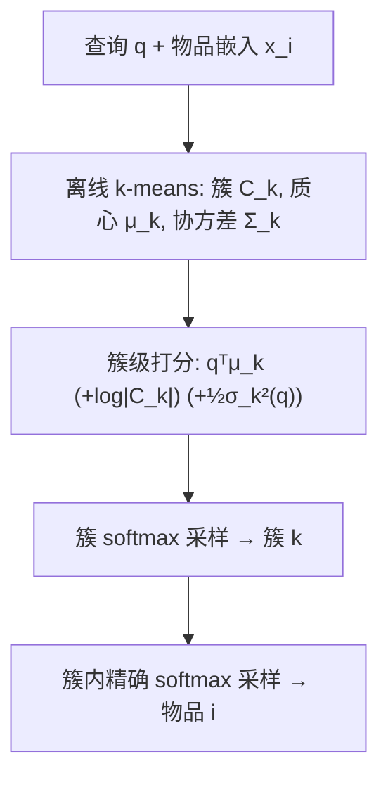

# Two-Level Softmax Sampling Done Right: Correcting Bias from Size Imbalance and Dispersion (两级 Softmax 采样做对了：校正簇大小失衡与离散度偏差)

- **会议/期刊**: NeurIPS 2026
- **作者与机构**: Walid Bendada (Spotify), Guillaume Salha-Galvan (SJTU Paris Elite Institute of Technology)
- **推荐链路定位**: 召回（大规模候选集 softmax 采样 / 负采样器）
- **研究方向**: 协同过滤与双塔召回 / 去偏与工业架构
- **论文原文**: [https://arxiv.org/abs/2610.10483v1](https://arxiv.org/abs/2610.10483v1)
- **开源代码**: [https://github.com/bendadaw/neurips-2ls](https://github.com/bendadaw/neurips-2ls)

## TL;DR (1分钟核心速览)

两级 softmax (2LS) 采样通过"先选簇、再选物品"把 $O(dN)$的精确 softmax 采样降到$O(d\sqrt{N})$，是双塔召回与 LLM 大词表采样的主流近似。本文首次严格证明 2LS 存在系统性偏差：它按簇质心打分却忽略簇大小$\pi_k$与簇内相似度方差$\sigma_k^2(q)$，导致小簇/低方差簇被过采样、大簇/高方差簇被欠采样，甚至破坏 softmax 的"等相似度等概率"不变性。作者提出 S-2LS（乘$|C_k|$）与 SD-2LS（再乘$\exp(\frac{1}{2}\sigma_k^2(q))$）两个即插即用校正。在 VK-LSVD/YAMBDA/GloVe-100 等 5 个数据集上，SD-2LS 将 KL 保真度相对 2LS 降低 3–5 倍（$\tau=0.05$）至 1–4 个数量级（$\tau=0.1,0.2$），S-2LS 零额外开销即 Pareto 支配 2LS。

## Background & Motivation (背景与核心矛盾)

- **主流范式**: 大规模召回/生成中，按 $p(i|q)\propto\exp(q^\top x_i/\tau)$采样是标准操作，但精确 softmax 需遍历全部$N$个物品，$O(dN)$不可行。2LS 用 k-means 把物品分成$K$簇，先对质心$\mu_k$做 softmax 选簇、再在簇内做 softmax 选物品，取$K\approx\sqrt{N}$得$O(d\sqrt{N})$，且保留相似度感知、支持全库采样（不像 top-$k$ 截断）。
- **前人局限**: ① 2LS 的簇级打分 $\exp(q^\top\mu_k/\tau)$完全不含簇基数$|C_k|$，隐含假设各簇 softmax 质量相等；② 簇内物品相似度围绕质心的离散程度被彻底忽略，方差大的簇其真实质量被低估。二者叠加使 2LS 偏离精确 softmax，且此前从未被形式化刻画（仅 Tranheden et al. 经验性提及簇大小失衡的效率损失）。
- **核心洞察 (Key Insight)**: 定义采样比 $R_i^{(N)}(q)=p^{\text{2LS}}(i|q)/p(i|q)$，可证其**只依赖$i$所在簇、与$q^\top x_i$无关**（Prop.1）。在 i.i.d. 混合分布假设下取$N\to\infty$，得$R_k^{(\infty)}(q)=c(q)\cdot\frac{\exp(q^\top\mu_k/\tau)}{\pi_k\,\mathbb{E}_{x\sim\mathcal{D}_k}[\exp(q^\top x/\tau)]}$；高斯近似下进一步化为$R_k^{(\infty)}\propto\frac{1}{\pi_k}\exp(\frac{1}{2}\sigma_k^2(q))$——偏差被干净地分解为"簇大小"与"簇内方差"两个正交轴。
- **本文切入点**: 既然偏差来源可解析分离，就在簇级打分上分别乘上 $|C_k|$与$\exp(\frac{1}{2}\sigma_k^2(q))$ 做精确补偿，保持簇内 softmax 与整体复杂度不变。

## Method (核心方法设计)

### 1. 整体框架 (Overall Architecture)

输入为物品嵌入 $\{x_i\}$、查询$q$与离线 k-means 划分$\{C_k,\mu_k,\Sigma_k\}$。在线采样时，先计算$K$个簇级得分（2LS 用$q^\top\mu_k$；S-2LS 加$\log|C_k|$；SD-2LS 再加$\frac{1}{2}q^\top\Sigma_k q/\tau^2$），对簇做 softmax 采样得到$k$，再在$C_k$内对物品做精确 softmax 采样得到$i$。训练/推理均无需改动下游模型，仅替换采样器；簇划分与协方差离线预计算并跨查询复用，故在线主导开销仍是簇级打分与单簇内打分。

### 2. 关键设计拆解 (Key Designs)

1. **S-2LS：簇大小校正（零开销）**：2LS 的簇级权重漏掉了簇的 softmax 质量正比于 $|C_k|$ 这一事实，导致小簇被系统性过采样。S-2LS 直接把簇级分布改为
$$p^{\text{S-2LS}}(k|q)=\frac{|C_k|\exp(q^\top\mu_k/\tau)}{\sum_{k'}|C_{k'}|\exp(q^\top\mu_{k'}/\tau)}$$
簇内分布不变。复杂度仍为 $O(dK+d|C_k|)$，与 2LS 完全一致。Prop.4 证明其渐近采样比$R_{i,\text{S-2LS}}^{(\infty)}(q)=c_{\text{S-2LS}}(q)\cdot\frac{\exp(q^\top\mu_k/\tau)}{\mathbb{E}_{x\sim\mathcal{D}_k}[\exp(q^\top x/\tau)]}$已不含$\pi_k$，即簇大小偏差被彻底消除，仅剩方差项。

2. **SD-2LS：方差（离散度）校正**：S-2LS 残留的偏差来自簇内相似度方差。理想校正应乘上矩母函数 $\mathbb{E}_{x\sim\mathcal{D}_k}[\exp(q^\top x/\tau)]$，但精确计算需遍历簇内全部物品，退化为$O(N)$。作者采用二阶截断展开（高斯下精确）：$\mathbb{E}[\exp(q^\top x/\tau)]\approx\exp(q^\top\mu_k/\tau+\frac{1}{2}\sigma_k^2(q))$，其中$\sigma_k^2(q)=\mathrm{Var}_{x\sim\mathcal{D}_k}(q^\top x/\tau)=\frac{1}{\tau^2}q^\top\Sigma_k q$。于是
$$p^{\text{SD-2LS}}(k|q)=\frac{|C_k|\exp\!\big(q^\top\mu_k/\tau+\tfrac{1}{2}\sigma_k^2(q)\big)}{\sum_{k'}|C_{k'}|\exp\!\big(q^\top\mu_{k'}/\tau+\tfrac{1}{2}\sigma_{k'}^2(q)\big)}$$
Prop.6 证明高斯假设下 $R_{i,\text{SD-2LS}}^{(\infty)}(q)\to 1$，即**渐近精确恢复 softmax**。代价是需算$K$个二次型$q^\top\Sigma_k q$，复杂度升至$O(d^2K+d|C_k|)$，取$K\approx\sqrt{N}$仍为$O(d^2\sqrt{N})$，因$d\ll N$ 而可忽略。

3. **训练目标、负采样与推理效率**：本文不涉及新的训练损失，而是替换采样算子本身——可直接嵌入 sampled softmax、对比学习 InfoNCE 负采样、或生成式解码的 token 采样。无额外负采样策略设计；S-2LS 与 2LS 延迟在测量噪声内一致（Pareto 支配），SD-2LS 在高维数据上慢 1.2–1.8×、低维上至多约 3×，但换来数个数量级的 KL 下降。

## Experimental Setup & Evaluation Protocol (实验设置与评估协议)

- **数据集与预处理**: 三个真实嵌入语料 + 两个受控合成语料，均用 k-means 取 $K=1024$簇（近似$\sqrt{N}$），三种方法共享同一划分与质心，唯一变量是簇采样规则。

| 数据集 | #Items $N$| 维度$d$ | 归一化 | 特征/场景说明 |
| :--- | :---: | :---: | :---: | :--- |
| VK-LSVD | 19.6 M | 64 | 否 | 工业视频推荐嵌入 |
| YAMBDA | 7.7 M | 128 | 是 | 工业音乐曲目嵌入 |
| GloVe-100 | 1.2 M | 100 | 是 | NLP 词向量 |
| Synth-balanced | 1 M | 100 | 否 | 等大小高斯混合（受控） |
| Synth-unbalanced | 1 M | 100 | 否 | 重尾簇大小（模拟真实） |

- **数据划分与防穿越 (Splitting Strategy)**: 非监督采样保真度评估，无训练/测试划分；每数据集随机取 $n_q=1000$ 个嵌入作查询，与精确 softmax 逐查询对比。
- **排名评测协议 (Ranking Protocol)**: 不涉及 Top-N 排序指标，而是**分布级保真度**：以精确 softmax 为参考，计算 $\mathrm{KL}(p^{\text{approx}}\|p^{\text{exact}})$（近似→精确方向，保证 top-$k$零概率时有限），并报告采样比$R_i^{(N)}(q)$与每查询延迟（ms，单线程 CPU，$\tau\in\{0.05,0.1,0.2\}$ 平均）。
- **对比基线与超参设置**: 对比 Exact softmax、2LS、Top-$k$softmax（$k=1000$，Faiss IVFFlat 实现）、Hierarchical softmax（递归二叉 k-means 树，叶大小$\ell=1024$，对$[256,4096]$鲁棒）、S-2LS、SD-2LS（全秩$\Sigma_k\in\mathbb{R}^{d\times d}$，无近似）。报告 95% 置信区间，偏差显著性$p<0.01$。

## Key Experimental Results (实验关键数据)

### 1. 主实验对比 (Main Results)

采样保真度 $\mathrm{KL}(p^{\text{approx}}\|p^{\text{exact}})$（越低越好，$\tau=0.1$，节选）：

| 数据集 | Top-$k$ | 2LS | Hierarchical | S-2LS (ours) | SD-2LS (ours) |
| :--- | :---: | :---: | :---: | :---: | :---: |
| GloVe-100 | 3.9907 | 0.0615 | 0.2897 | 0.0022 | **0.0001** |
| VK-LSVD | 5.2351 | 0.0297 | 0.3425 | 0.0051 | **0.0002** |
| YAMBDA | 3.5266 | 0.0300 | 0.6049 | 0.0098 | **0.0005** |
| Synth-balanced | 0.1580 | 0.3518 | 2.6158 | 0.2334 | **0.0293** |
| Synth-unbalanced | 0.2318 | 0.2858 | 3.1780 | 0.1728 | **0.0314** |

$\tau=0.2$时 SD-2LS 在三个真实语料上 KL 降至$10^{-6}$量级（如 VK-LSVD$2.7\times10^{-6}$vs. 2LS$0.0337$，约 4 个数量级）；$\tau=0.05$时 SD-2LS 相对 2LS 降 3–5 倍（VK-LSVD$0.0129$vs.$0.0541$）。延迟方面（附录表 2）：S-2LS 与 2LS 持平（VK-LSVD 2.662 vs. 2.564 ms），SD-2LS 为 2.906 ms（约 1.13×），相对 Exact 的 173 ms 仍有 59.5× 加速。

### 2. 消融实验 (Ablation Study)

以"逐项加入校正"作为天然消融（共享同一 k-means 划分，仅改簇级打分）：

| 配置 | 簇大小偏差 | 方差偏差 | VK-LSVD KL ($\tau{=}0.1$) | YAMBDA KL ($\tau{=}0.1$) |
| :--- | :---: | :---: | :---: | :---: |
| 2LS（无校正） | 有 | 有 | 0.0297 | 0.0300 |
| S-2LS（仅大小） | 无 | 有 | 0.0051 | 0.0098 |
| SD-2LS（大小+方差） | 无 | 无 | **0.0002** | **0.0005** |

### 3. 关键实验发现 (Key Findings)

1. **偏差真实且量级可观**：图 1/图 2 显示 VK-LSVD 上 2LS 的采样比随簇大小单调下降（大簇 $R<1$欠采样、小簇$R>1$过采样，$p<0.01$），且 S-2LS 校正大小后图 2 中方差偏差被"隔离"出来——高方差簇被欠采样，验证了 Prop.3 的$\frac{1}{\pi_k}\exp(\frac{1}{2}\sigma_k^2)$ 分解。
2. **温度放大校正价值**：$\tau$越大分布越平坦，簇质量估计越关键，SD-2LS 相对 2LS 的优势从$\tau=0.05$的 3–5 倍膨胀到$\tau=0.2$的 1–4 个数量级；合成数据进一步佐证机制——Synth-balanced（簇大小均匀）上校正收益有限、top-$k$ 低温下尚可，而 Synth-unbalanced（重尾）上 SD-2LS 稳定领先一个数量级。
3. **零成本即可拿到大部分收益**：S-2LS 与 2LS 延迟无统计差异却把 KL 降 1–2 个数量级（低温推荐场景最相关），构成对 2LS 的 Pareto 支配；SD-2LS 以 1.2–1.8× 延迟换数个数量级保真度，在 $d\ll N$ 的推荐场景中摊销后仍远优于 Exact 与 Hierarchical。

## Highlights & Limitations (亮点、对比与审稿批判)

- **与代表作对比 (vs. Prior Work)**: 相比 top-$k$ 截断（限制候选子集、KL 高达 3–7），本文保留全库采样；相比 hierarchical softmax（树路由误差逐层累积，YAMBDA 上 KL 0.60），2LS 家族仅两级、误差可控且可解析校正；相比 Tranheden et al. 仅经验观察簇大小效率损失，本文首次给出偏差的闭式渐近刻画与可证明的校正。
- **可迁移亮点**: ① "采样比 $R_i^{(N)}$+ 混合分布渐近"这套分析模板可直接用于审计其他分层/分桶采样器（如 IVF 检索、product quantization 码本采样）的偏差；② 二阶矩校正$\frac{1}{2}q^\top\Sigma_k q/\tau^2$ 可低成本嵌入任何"质心打分"式粗筛模块，作为方差感知的簇权重。
- **审稿级局限批判**: ① SD-2LS 依赖矩母函数二阶截断，对高偏度/高峰度嵌入分布可能欠准，且需存储 $K$个$d\times d$协方差（$K d^2$内存），高维大$K$时开销不可忽略；② 评估停留在分布保真度（KL/采样比/延迟），未在真实召回任务上报告 Recall@K/NDCG 或线上 A/B，下游收益仍是推断而非实证；③ 渐近分析假设 i.i.d. 混合采样与固定划分，簇数$K$、k-means 质量对偏差的敏感性未系统扫描。

## Rating (四维评分)

- **方法创新性 (Novelty)**: ⭐⭐⭐⭐ （首次形式化 2LS 的双轴偏差并给出闭式渐近比与高斯下精确恢复的证明，问题小而锋利，但本质是在簇打分上乘两个解析因子，机制偏轻量）
- **评估协议与实验扎实度 (Protocol & Experiments)**: ⭐⭐⭐⭐ （5 数据集含 2 个受控合成、3 档温度、95% CI 与 $p<0.01$ 显著性、延迟实测齐全；扣分在缺少下游召回指标与线上验证）
- **写作与数学规范度 (Clarity & Rigor)**: ⭐⭐⭐⭐⭐ （Prop.1–6 层层递进，偏差分解干净，附录证明完整，复杂度分析明确到 $O(d^2\sqrt{N})$）
- **工业落地与复现价值 (Industrial & Practical Value)**: ⭐⭐⭐⭐⭐ （S-2LS 零开销即插即用、代码开源、作者来自 Spotify 且数据即工业语料，可直接替换现有 2LS 采样器）

