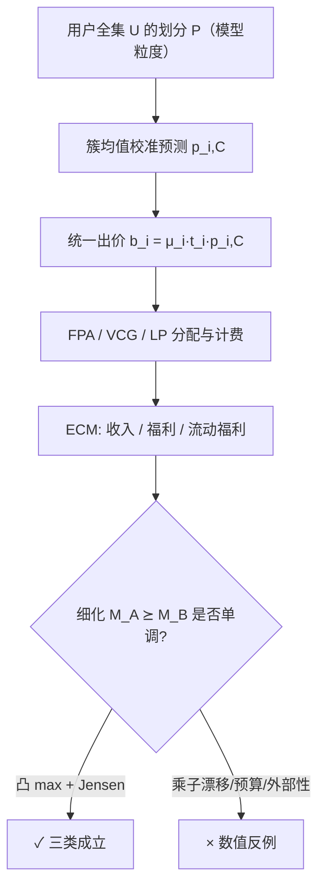

# Model Monotonicity in Autobidding Auctions: When Do Better Predictions Lead to Better Outcomes? (自动出价拍卖中的模型单调性：更好的预测何时带来更好的结果？)

- **会议/期刊**: ICML 2026
- **作者与机构**: Ashwinkumar Badanidiyuru (Uber Technologies, Inc.)
- **推荐链路定位**: 精排（pCTR/pCVR 打分 → 拍卖分配与计费）
- **研究方向**: CTR/CVR 预估与特征交叉 / 去偏公平与工业架构
- **论文原文**: [https://arxiv.org/abs/2605.31036v1](https://arxiv.org/abs/2605.31036v1)
- **开源代码**: 暂未开源

## TL;DR (1分钟核心速览)

平台普遍假设"pCTR/pCVR 模型更准 → 收入/福利更高"，但自动出价器会随预测自适应改价，形成模型-拍卖-出价三方反馈环。本文用概率论滤子（filtration）思想把"模型改进"形式化为**用户划分的细化关系** $M_A \succeq M_B$，系统刻画 tCPA/MAX-CPA × FPA/VCG × 有无预算共 8 种组合的 ECM 单调性。结论是**单调性极罕见**：仅 FPA+tCPA 无预算（Jensen 不等式保证收入与福利）、VCG+MAX-CPA 无预算（仅福利）、LP 分数分配+预算（福利）三类成立；其余全部给出数值反例，如 VCG+tCPA 收入与福利同降 6.2%、FPA+预算收入降 16.8%、FPA+MAX-CPA 收入暴跌 66.2%。

## Background & Motivation (背景与核心矛盾)

- **主流范式**: 工业界把 pCTR/pCVR 模型质量（AUC/LogLoss）当作独立优化目标，默认下游拍卖与自动出价器会"自动受益"。
- **前人局限**: 自动出价文献（Aggarwal et al. 2019/2024、Conitzer et al. 2022 的 pacing 均衡）全部在**固定预测模型**下分析均衡；而预测模型评估文献（Vasile et al. 2017 已警示 accuracy 与业务目标错位）又完全忽略出价器的策略反馈。两侧之间存在真空。
- **核心洞察 (Key Insight)**: 模型改进的本质是"对用户做更细的区分"，即把粗簇拆成细簇；而拍卖收入是 $\max_i t_i p_{i,C}$ 这类**凸函数**在簇上的加权和，凸性 + 校准保持使 Jensen 不等式成为单调性的唯一护城河——一旦出价乘子随信息结构变化或预算介入，凸性保护即失效。
- **本文切入点**: 用"划分细化"这一偏序替代点态精度指标，把"模型更好"变成可证明的数学对象，再逐组合检验 ECM 是否单调。

## Method (核心方法设计)

### 1. 整体框架 (Overall Architecture)

论文是纯理论工作，无神经网络。框架分三层：**预测层**把用户全集 $\mathcal{U}$划分为簇$\mathcal{P}$，簇内预测为真实转化率的簇均值$p_{i,C}=\frac{1}{|C|}\sum_{u\in C}p_i(u)$（保证校准）；**出价层**采用统一出价$b_i(C)=\mu_i t_i p_{i,C}$（tCPA）或$g_i p_{i,C}$（MAX-CPA，$g_i=\mu_i v_i$）；**拍卖层**在 FPA/SPA(=VCG)/LP 基准下决定分配$x_i(u)$与支付$\pi_i(u)$，最后聚合为收入、福利、流动福利三类 ECM。核心推理链是：细化$\Rightarrow$校准保持$\Rightarrow$对凸的$\max_i t_i p_{i,C}$用 Jensen$\Rightarrow$ 单调；反例则构造乘子随模型漂移使凸性失效。

### 2. 关键设计拆解 (Key Designs)

1. **模型细化关系（Refinement）**：点态指标（AUC/LogLoss）无法给出跨模型的可证明序关系。本文定义 $M_A \succeq M_B$当且仅当$\mathcal{P}_{M_A}$中每个簇都含于$\mathcal{P}_{M_B}$的某个簇，即$M_A$做了更细区分。该关系构成偏序，且对任意凹 Bayes risk$H$有$\sum_{C\in\mathcal{P}_{M_A}} w_C H(p_{i,C}) \le \sum_{C\in\mathcal{P}_{M_B}} w_C H(p_{i,C})$——细化在期望意义上改进一切 proper scoring loss，从而把"更准"锚定为可证明的数学性质而非经验指标。

2. **FPA+tCPA 的收入单调性（唯一收入保证）**：无预算时 tCPA 出价器最优乘子恒为 $\mu_i^*=1$（因为 CPA 恒等于$\mu_i t_i$，$\mu_i\le 1$才可行，转化随$\mu_i$单调增）。于是簇收入为$\mathrm{Rev}(M)=\sum_{C\in\mathcal{P}} w_C \max_i t_i p_{i,C}$，而$f(\mathbf{p})=\max_i t_i p_i$是线性函数逐点取最大，**必为凸**。粗簇拆细时权重$\lambda_j=w_{C^A_j}/w_{C^B}$满足$\sum_j\lambda_j=1$且$\sum_j\lambda_j p_{i,C^A_j}=p_{i,C^B}$（校准保持），Jensen 直接给出$\mathrm{Rev}(M_A)\ge\mathrm{Rev}(M_B)$。物理直觉：更细的信息只会让平台在每个子簇上"挑到更值钱的那个出价者"，凸性保证拆分不会亏。

3. **训练目标、负采样与推理效率**：本文无训练损失与负采样。需强调的是**反例构造的"乘子漂移"机制**：VCG+tCPA 反例中，粗模型下 A 赢 $\{0,1\}$、B 赢$\{2,3\}$，收入 3.23；细模型下 A 只赢$\{0\}$、B 赢$\{1,2,3\}$，收入 3.03——细化把高价值曝光（auction 1，$t_A p_{1,A}=0.5 > t_B p_{1,B}=0.3$）从高目标出价者转移给低目标出价者，且 VCG 支付依赖次高报价（外部性），竞争压力被细化削弱，收入与福利同降 6.2%。FPA+预算反例中预算约束使$\mu\neq 1$，受预算约束的广告主在细模型下以更低乘子赢更多拍卖，收入降 16.8%。FPA+MAX-CPA 反例中细化使市场分段成"各自垄断"，双方大幅压价（$g_1=g_2=1$），收入从 0.68 跌至 0.23（-66.2%），福利仅降 0.09%。

## Experimental Setup & Evaluation Protocol (实验设置与评估协议)

- **数据集与预处理**: 本文为纯理论 + 数值构造，**无真实数据集**。全部结论建立在 4 个 auction（或 2 个 segment）的小规模解析实例上，参数手工设定以保证计算可逐项复核。

| 实例 | 出价者 | 拍卖格式 | 关键参数 | 结论 |
| :--- | :---: | :---: | :---: | :--- |
| B.1 | 2×tCPA | SPA/VCG | $t_A=10, t_B=1$，4 auction | 收入/福利 -6.2% |
| B.2 | 2×tCPA+预算 | FPA | $B_1=3.185, t_1=8.674$ | 收入/流动福利 -16.8% |
| B.3 | 2×MAX-CPA | VCG | $v_1=10, v_2=8$，2 segment | 收入 -41.7%，福利 +25% |
| B.4 | 2×MAX-CPA | FPA | $v_1=600, v_2=10$，H/L 概率 0.9/0.1 | 收入 -66.2%，福利 -0.09% |

- **数据划分与防穿越 (Splitting Strategy)**: 不适用；但**均衡选择约定**等价于"防穿越"：tCPA 场景取 CPA 约束恰好绑定的乘子作为规范均衡，MAX-CPA FPA 场景明确声明只比较"指定可行乘子剖面"而非完整均衡（并给出 additive regret 上界 0.162 与 0.049 证明近似最优响应）。
- **排名评测协议 (Ranking Protocol)**: 不适用采样排序；ECM 在**全用户全集**上精确计算（等价 Full-Ranking 的确定性版本），无随机性、无置信区间。
- **对比基线与超参设置**: 对比对象是 8 种 (bidder type × auction format × budget) 组合的**自比较**（细模型 vs 粗模型），以及 LP 分数分配基准（非策略性、非激励相容）。无 embedding 维度、无显著性检验——这是理论论文的标准形态。

## Key Experimental Results (实验关键数据)

### 1. 主实验对比 (Main Results)

下表即论文 Table 1 的完整单调性刻画（✓ 成立 / × 存在反例 / — 指标未定义），是全文最核心的"结果表"：

| 出价者类型 | 拍卖格式 | 收入 | 福利 | 关键机制 |
| :--- | :---: | :---: | :---: | :--- |
| tCPA | FPA | ✓ | ✓ | Jensen + $\mu^*=1$ |
| tCPA | VCG (=SPA) | × | × | 外部性支付 + 约束绑定漂移（**-6.2%**） |
| tCPA + 预算 | FPA | × | × | 预算致乘子漂移（**-16.8%**） |
| tCPA + 预算 | LP | ✓ | ✓ | 提升论证（lifting） |
| MAX-CPA | FPA† | × | × | 分段垄断压价（**-66.2% / -0.09%**） |
| MAX-CPA | VCG | × | ✓ | 福利同构 Jensen；收入外部性失效（**-41.7%**） |
| MAX-CPA + 预算 | FPA† | × | × | 压价 + 预算双重失效 |
| MAX-CPA + 预算 | LP | — | ✓ | 提升论证 |

† 表示仅比较指定可行乘子剖面，非完整均衡刻画。

### 2. 消融实验 (Ablation Study)

本文无传统消融，但"移除某一条件"即等价于消融，下表按此逻辑重组：

| 配置 | 收入 | 福利 | 相对完整设定变化 |
| :--- | :---: | :---: | :--- |
| FPA + tCPA（完整） | ✓ | ✓ | 基准 |
| w/o 无预算假设（加预算） | × | × | 单调性崩塌，-16.8% |
| w/o FPA（换 VCG） | × | × | 单调性崩塌，-6.2% |
| w/o tCPA（换 MAX-CPA） | × | × | 单调性崩塌，-66.2% |
| w/o 策略性拍卖（换 LP） | ✓ | ✓ | 单调性恢复，但丧失 IC |

### 3. 关键实验发现 (Key Findings)

1. **凸性是单调性的唯一护城河，且极易被打破**：FPA+tCPA 的收入式 $\sum_C w_C\max_i t_i p_{i,C}$因$\max$的凸性受 Jensen 保护；但一旦乘子随模型变化（MAX-CPA 压价）或预算使$\mu\neq1$，凸性保护立即失效，收入可跌 16.8% 乃至 66.2%，量级远超"模型变差"的常规预期。
2. **VCG 的福利单调与收入非单调可以并存**：B.3 实例中福利从 4.0 升至 5.0（+25%）而收入从 2.4 跌至 1.4（-41.7%），证明"效率提升"与"平台变现"在 VCG 下方向相反，平台若只盯收入会误判模型价值。
3. **单调性与激励相容存在根本权衡**：唯一同时处理预算又保证单调的 LP 基准需要平台知道私有参数 $(t_i,v_i,B_i)$，因而**非激励相容**；而 IC-ROS 成立的 FPA 统一出价一旦加预算就失去单调。作者明确指出"目前不存在同时满足两者的机制"，这为后续机制设计留下硬约束。

## Highlights & Limitations (亮点、对比与审稿批判)

- **与代表作对比 (vs. Prior Work)**: 相比 Aggarwal et al. (2019/2024) 在固定模型下做均衡分析，本文首次把"模型质量"作为变量引入均衡；相比 Vasile et al. (2017) 仅定性警示 accuracy 与业务目标错位，本文给出可证明的偏序与完整分类；相比 Conitzer et al. (2022) 的 pacing 均衡，本文揭示预算正是击穿单调性的元凶。
- **可迁移亮点**: (1) "划分细化 + 校准保持 + 凸聚合"这套三段式证明模板可直接迁移到任何"模型输出进入凸聚合决策"的场景（如竞价排序、流量分配）；(2) 反例构造中"乘子随信息结构漂移"的思路可作为上线前模型评估的红队测试用例生成器。
- **审稿级局限批判**: (1) 全部结论建立在**完美校准 + 单物品拍卖 + 均匀出价**三重强假设上，多槽 GSP/GFP、非均匀出价、误校准下的结论均未触及，而工业界恰恰是后者；(2) MAX-CPA FPA 两行仅比较"指定可行乘子剖面"而非真均衡，反例的说服力弱于其他行，且全文无任何真实流量或仿真规模实验，"非单调现象在部署系统中多常见"这一最关键的经验问题被留作 open problem。

## Rating (四维评分)

- **方法创新性 (Novelty)**: ⭐⭐⭐⭐ （用滤子/划分细化把"模型更好"形式化为偏序，并以 Jensen 凸性给出干净的正向证明与系统性反例分类，视角新颖且理论自洽）
- **评估协议与实验扎实度 (Protocol & Experiments)**: ⭐⭐⭐ （8 种组合刻画完整、反例数值可逐项复核，但无真实数据、无仿真规模实验、MAX-CPA FPA 行非严格均衡，经验支撑偏薄）
- **写作与数学规范度 (Clarity & Rigor)**: ⭐⭐⭐⭐ （定理-证明-反例结构清晰，附录给出完整推导与 additive regret 上界，仅均衡选择约定略显繁琐）
- **工业落地与复现价值 (Industrial & Practical Value)**: ⭐⭐⭐ （结论对平台"模型上线必须 A/B 验证而非假设指标提升"有直接指导意义，但无开源代码、假设强于工业现实，落地需大量放宽）

