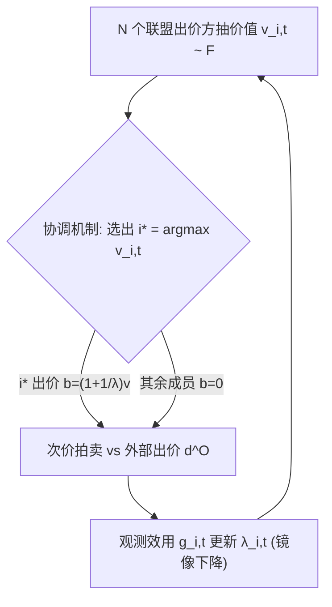

# On the Coordination of Value-Maximizing Bidders (论价值最大化出价方的协调机制)

- **会议/期刊**: ICML 2026
- **作者与机构**: Yanru Guan (PKU), Jiahao Zhang (CMU), Zhe Feng (Google DeepMind), Tao Lin (MSR & CUHK-Shenzhen)
- **推荐链路定位**: 出价策略层（广告竞价/自动出价，位于召回-排序之后的变现环节）
- **研究方向**: CTR预估与特征交叉 / 强化学习与动态探索推荐
- **论文原文**: [arXiv:2511.04993v4](https://arxiv.org/abs/2511.04993v4)
- **开源代码**: 暂未开源

## TL;DR (1分钟核心速览)

现有自动出价文献几乎全部假设各出价方**独立**竞价，忽略了现实中第三方代理统一托管多个广告主、或单一广告主管理多个 campaign 的**协调**场景。本文形式化 $N$个价值最大化、受 RoS 约束的出价方在$T$轮次价拍卖中的协调问题，提出极简机制：**仅联盟内最高价值者出价，其余成员弃拍**。理论上证明该机制在充要条件$\Delta\ge 0$下使每个成员效用（即 RoS 合规）严格改善，且对任意镜像下降类算法无条件提升联盟总价值，并在$\Delta\ge0$时渐近达到所有协调机制的最优。合成数据与 iPinYou 真实数据（100 次仿真）验证：联盟总效用由负转正（如$-0.040\to0.155$），总价值提升至$0.928$。

## Background & Motivation (背景与核心矛盾)

- **主流范式**: 自动出价（auto-bidding）在 RoS 约束下最大化转化价值，主流解法是镜像下降（mirror descent）类在线学习算法，理论 regret 达 $O(\sqrt{T})$。
- **前人局限**: ① 全部工作以**单出价方**为优化单元，无法刻画代理托管多广告主、单广告主多 campaign 的联合决策；② 经济学中的合谋（collusion）研究多针对**效用最大化者**的静态拍卖均衡，而价值最大化者在次价拍卖中天然倾向 overbid，性质完全不同。
- **核心洞察 (Key Insight)**: 联盟内多个同质出价方同时出价只会**互相抬价**（内部竞争推高支付），而次价拍卖中最终只有最高价值者能赢——因此让非最高价值者弃拍，既消除内部抬价，又不损失任何可赢得的曝光。
- **本文切入点**: 用一个"最高价值者出价"的极简协调协议，配合 overbidding 算法类与镜像下降算法类，给出 RoS 合规与总价值的严格理论刻画。

## Method (核心方法设计)

### 1. 整体框架 (Overall Architecture)

模型为 $N$个联盟出价方参与$T$轮次价拍卖，每轮各自从$F$独立抽取价值$v_{i,t}\in[0,B]$，外部竞争出价$d^O_t\sim D$独立采样（可吸收保留价）。出价方$i$面对的有效竞争价为$d_{i,t}=\max\{d^O_t,\max_{j\ne i}b_{j,t}\}$，获胜指示$x_{i,t}=\mathbb{I}\{b_{i,t}\ge d_{i,t}\}$，效用$u_{i,t}=x_{i,t}(v_{i,t}-d_{i,t})$。**独立出价**下所有$N$方均出价；**协调出价**下仅$i^\*=\arg\max_i v_{i,t}$以算法$\mathcal{A}$出价，其余置零。核心比较对象是两种情形下每方总效用$U^{\mathcal{C},\mathcal{A}}_{i,T}$与$U^{\mathcal{I},\mathcal{A}}_{i,T}$、以及联盟总价值$V_t$。

### 2. 关键设计拆解 (Key Designs)

1. **充要条件 $\Delta\ge0$（RoS 合规的精确边界）**：痛点在于"协调是否总对每个成员有利"此前无定论。定义
$$\Delta:=\mathbb{E}_{F,D}\big[(v_{(N-1)}-d^O)^+-(d^O-v_{(N)})^+\big],$$
即"次高价值相对外部出价的优势"减去"外部出价相对最高价值的优势"。**定理 3.1**：对任意弱 overbidding 算法 $\mathcal{A}$，$\Delta\ge0$时$\mathbb{E}[U^{\mathcal{C},\mathcal{A}}_{i,T}-U^{\mathcal{I},\mathcal{A}}_{i,T}]\ge T\Delta/N\ge0$；$\Delta<0$时存在 overbidding 算法使协调严格变差。直觉：协调把"内部竞争"替换为"以最高价值对抗外部"，$\Delta$恰度量了这次替换的净收益；且$N$足够大时$\Delta\ge0$ 自动成立（Observation 3.1）。

2. **镜像下降下的无条件总价值提升与渐近最优**：对 $\lambda_{i,t+1}=\lambda_{i,t}\exp(-\alpha g_{i,t})$类算法（$b=(1+1/\lambda)v$），**定理 4.1** 证明无需任何分布假设，$\lim_{T\to\infty}\mathbb{E}[\frac1T\sum_t(V^{\mathcal{C}}_t-V^{\mathcal{I}}_t)]\ge0$。证明关键：在导数空间$y=h'(\lambda)$中，协调下活跃者乘子收敛到$\lambda^\*=\inf\{\lambda:G^{(N)}(\lambda)\ge0\}$，而独立出价的总价值被"虚拟单一出价方"上界$V^{(N)}(\lambda^\*)$所控。**定理 4.2** 进一步：$\Delta\ge0$时协调镜像下降渐近达到**任意协调机制**的最优（此时$\lambda^\*\to0$，即联盟最终无限 overbid 以必赢）。

3. **训练目标、负采样与推理效率**：无监督损失，每轮仅需一次标量效用反馈 $g_{i,t}=v_{i,t}x_{i,t}-p_{i,t}$更新乘子，学习率$\alpha=1/\sqrt{T}$，单轮$O(1)$计算；协调仅增加一次$\arg\max$与$N-1$次零出价，在线开销可忽略。非 i.i.d. 扩展（定理 5.1/5.2）需逐出价方条件$\Delta_i:=\mathbb{E}[(v_i-d^O)\mathbb{I}\{v_i=\max_j v_j\}]>0$，此时仅保证**联盟总**效用/价值提升，不再保证每个个体。

## Experimental Setup & Evaluation Protocol (实验设置与评估协议)

- **数据集与预处理**: 合成数据（对称：$F=U[0,1]$，$D\in\{U[0,0.9],U[0,1],\text{Beta}(3,2)\}$；非对称：各出价方取 Uniform/Beta/截断高斯）与真实 iPinYou Season 2 测试集（2,521,630 条拍卖记录，5 个广告主）。

| 数据集 | #Bidders $N$| #Rounds$T$ | 价值/出价来源 | 场景说明 |
| :--- | :---: | :---: | :---: | :--- |
| Synthetic (i.i.d.) | 2 / 3 / 4 | 4000 | $F=U[0,1]$,$D$ 见上 | 对称市场 |
| Synthetic (non-i.i.d.) | 2 / 3 / 5 | 10000–20000 | 各异分布 $F_i$ | 异质联盟 |
| iPinYou (Real) | 4 / 5 | 20000 | 经验价格分布重采样 | 真实竞价价格 |

- **数据划分与防穿越 (Splitting Strategy)**: 真实数据仅用官方 Season 2 测试划分；因仅观测中标价、无出价方身份与协调标签，采用**经验 i.i.d. 模型**——从全部中标价池中有放回独立采样作为各出价方价值，外部出价同分布再乘 $U[1,2]$缩放因子以维持竞争压力，价格归一化到$[0,1]$。
- **排名评测协议 (Ranking Protocol)**: 非排序任务，评测指标为 (a) **效用**（价值减支付，$\ge0$即 RoS 合规）与 (b) **达成价值**；所有指标为 100 次独立仿真的均值，95% CI 按$\bar{x}\pm1.96\cdot s/\sqrt{100}$ 计算。
- **对比基线与超参设置**: 对比对象为 Independent（算法 1）vs. Coordinated（算法 2），均用熵镜像映射 $h(\lambda)=\lambda\log\lambda-\lambda$、$\alpha=1/\sqrt{T}$；$T$ 因收敛速度而异（4000–20000）。

## Key Experimental Results (实验关键数据)

### 1. 主实验对比 (Main Results)

下表为原文 Table 1 的联盟级汇总（按 $T$ 归一化，I=独立，C=协调）：

| 设置 | $N$|$T$ | 总效用 (I) | 总效用 (C) | 总价值 (I) | 总价值 (C) |
| :--- | :---: | :---: | :---: | :---: | :---: | :---: |
| i.i.d. (Fig 1a) | 2 | 4000 | -0.011 | **0.220** | 0.643 | **0.666** |
| i.i.d. (Fig 3a) | 4 | 4000 | -0.077 | **0.302** | 0.774 | **0.800** |
| i.i.d. (Fig 3b) | 3 | 4000 | -0.049 | **0.153** | 0.712 | **0.748** |
| non-i.i.d. (Fig 1b) | 2 | 10000 | 0.049 | **0.219** | 0.715 | **0.718** |
| non-i.i.d. (Fig 4a) | 3 | 20000 | -0.014 | **0.258** | 0.619 | **0.633** |
| non-i.i.d. (Fig 4b) | 5 | 20000 | -0.062 | **0.619** | 0.814 | **0.819** |
| Real (Fig 2) | 4 | 20000 | -0.040 | **0.155**±0.012 | 0.620±0.016 | **0.928**±0.003 |
| Real (Fig 5) | 5 | 20000 | -0.065 | **0.172**±0.012 | 0.608±0.012 | **0.958** |

### 2. 消融实验 (Ablation Study)

本文为理论驱动工作，无传统模块消融，其"消融"体现为对假设与算法类的逐层放松：

| 放松维度 | 结论 | 对应定理 |
| :--- | :--- | :--- |
| 任意 overbidding 算法 + $\Delta\ge0$| 每方效用提升$T\Delta/N$ | Thm 3.1 |
| 去掉 $\Delta\ge0$（$\Delta<0$） | 存在算法使协调严格变差（充要性） | Thm 3.1 反向 |
| 镜像下降类，无分布假设 | 联盟总价值弱提升 | Thm 4.1 |
| 镜像下降 + $\Delta\ge0$ | 渐近最优于任意协调机制 | Thm 4.2 |
| 非 i.i.d. + 逐方 $\Delta_i>0$ | 仅联盟总效用/价值提升 | Thm 5.1/5.2 |

### 3. 关键实验发现 (Key Findings)

1. **协调把 RoS 违规翻转为合规**：所有 8 组设置中独立出价的总效用几乎全为负（$-0.011$至$-0.077$），协调后全部转正（$0.153$–$0.619$），与定理 3.1 的$T\Delta/N$ 下界方向一致。
2. **真实数据增益最显著**：iPinYou 上总价值从 $0.620$跃至$0.928$（$N=4$）、$0.608$至$0.958$（$N=5$），相对提升约$50\%$–$58\%$，远超合成数据的$2\%$–$5\%$，说明真实价格分布下内部竞争抬价问题更严重。
3. **异质性只削弱个体保证、不削弱总量**：非 i.i.d. 设置下各出价方收敛速率分化（Fig 1b/4a/4b），个体价值提升不再对每人成立，但联盟总价值仍稳定提升，印证定理 5.2 的"仅总量保证"边界。

## Highlights & Limitations (亮点、对比与审稿批判)

- **与代表作对比 (vs. Prior Work)**: 相较 Chen et al. [9]（预算约束下效用最大化者的协调）与 Decarolis et al. [11]（GSP/VCG 下协调对收益的影响），本文首次刻画**价值最大化者**的协调，且给出充要条件而非仅充分条件；相较 Feng et al. [14] 的单出价方镜像下降，本文将其扩展为联盟级动力学分析。
- **可迁移亮点**: ① "仅最高价值者出价"可作为多 campaign 统一出价系统的默认去内部竞争规则，实现成本极低；② 导数空间 $y=h'(\lambda)$ 的势函数收敛分析可直接迁移到其他带约束的在线竞价算法分析。
- **审稿级局限批判**: ① 真实数据实验依赖"经验 i.i.d. 重采样"这一强假设，抹去了出价方身份与真实策略，实验说服力弱于理论；② 非 i.i.d. 下无法保证个体 RoS 改善，且 $\Delta<0$时缺乏替代协调机制的设计；③ 未考虑外部出价方也是自动出价方（动态响应）的情形，静态$d^O\sim D$ 假设在真实市场偏乐观。

## Rating (四维评分)

- **方法创新性 (Novelty)**: ⭐⭐⭐⭐ （首次系统刻画价值最大化者的协调问题，"最高价值者出价"极简却给出充要条件与渐近最优性，理论贡献扎实）
- **评估协议与实验扎实度 (Protocol & Experiments)**: ⭐⭐⭐ （100 次仿真 + 95% CI 规范，但真实数据仅靠经验 i.i.d. 重采样，缺乏真实协调标签与线上验证）
- **写作与数学规范度 (Clarity & Rigor)**: ⭐⭐⭐⭐⭐ （定理-引理-证明链条完整，充要性双向证明与高概率界（Azuma）齐备，符号统一）
- **工业落地与复现价值 (Industrial & Practical Value)**: ⭐⭐⭐⭐ （机制实现仅需一次 argmax 与零出价，开销可忽略，对多 campaign 广告主直接可用；但无开源代码，且依赖价值可观测）
