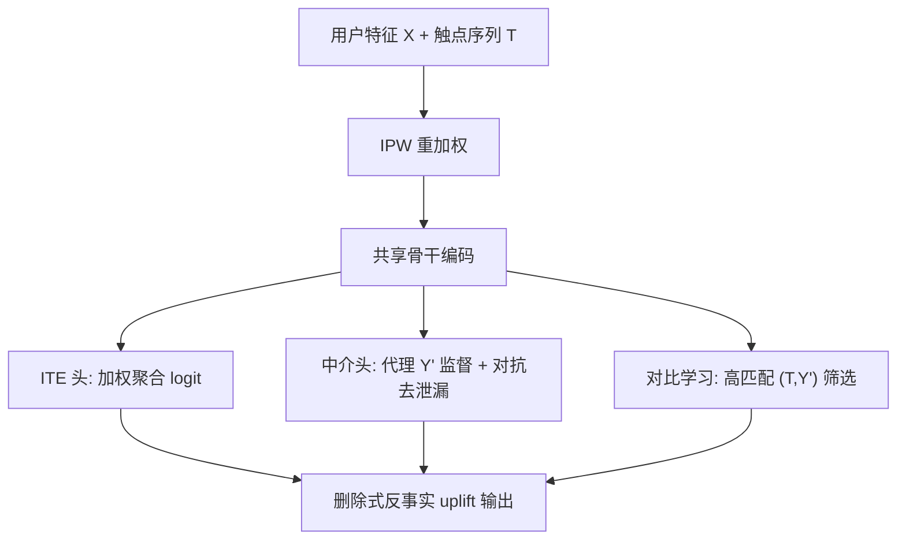
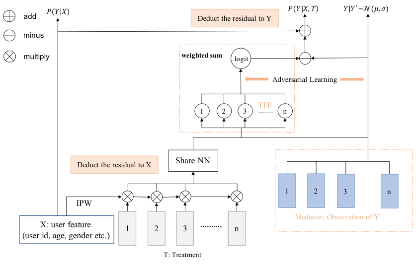

# ALM-MTA: Front-Door Causal Multi-Touch Attribution Method for Creator-Ecosystem Optimization (面向创作者生态优化的前门因果多触点归因方法)

- **会议/期刊**: ICLR 2026
- **作者与机构**: Yuguang Liu, Luyao Xia, Hu Liu 等（快手科技 / 奥克兰大学）
- **推荐链路定位**: 精排（为 uplift 重排与激励分配提供因果归因标签）
- **研究方向**: 去偏公平与工业架构 / 强化学习与动态探索推荐
- **论文原文**: [https://arxiv.org/abs/2605.08881v2](https://arxiv.org/abs/2605.08881v2)
- **开源代码**: [https://github.com/logwhistle/ALM-MTA](https://github.com/logwhistle/ALM-MTA)

## TL;DR (1分钟核心速览)

平台"消费驱动生产"(CDP) 场景下，多触点归因受制于无真值标签、系统级隐混杂与亿级触点空间三大难题，仅靠后门调整（IPW/DR）无法识别因果效应。本文提出 ALM-MTA：用**前门准则 + 对抗学习的代理中介**打通 $T\to M\to Y$ 通路并阻断捷径泄漏，用**对比学习**在高基数处理空间中保证正值性（overlap），并设计**分桶 AUUC 非个性化协议**在无 RCT 日志上评估因果效用。离线 AUC 0.907（较 SOTA +40%）、分组 AUUC 0.8686；线上 4 亿 DAU 系统中日活创作者 +0.6%、单位曝光效率 +670%。

## Background & Motivation (背景与核心矛盾)

- **主流范式**: 工业界归因分两派——规则法（末次点击等）精度高但覆盖极低；语义/路径相似度法覆盖广但只捕捉相关性，缺乏因果可识别性。
- **前人局限**: ① 因果派依赖**强可忽略性假设**（所有混杂均已观测），而推荐系统中用户意图、社交影响、平台策略偏差均为隐混杂 $W$，后门调整（IPW/DR/DML/DESCN）在此必然有偏；② 前门准则理论上可解，但要求中介$M$ 完全可观测且满足条件独立，实践中中介是隐变量；③ 触点空间达十亿级，前门边缘化时条件概率分母趋零，正值性 (positivity) 被破坏。
- **核心洞察 (Key Insight)**: 归因的本质是**反事实删除增益**——把某条消费视频从序列中删去后上传概率的下降量，即 $\Delta(\tau_j|X,T)=P(Y=1|do(T),X)-P(Y=1|do(T\setminus\tau_j),X)$。该定义天然是"个体级、序列级"的，规则法与相似度法都无法给出。
- **本文切入点**: 引入一个与结果 $Y$相关但**不泄露$Y$** 的代理$Y'$（新作品与已消费视频的匹配度），用对抗学习把隐中介"变成可观测"，从而真正落地前门识别。

## Method (核心方法设计)

### 1. 整体框架 (Overall Architecture)

输入用户上下文 $X$与时间序触点序列$T=\langle\tau_1,\dots,\tau_L\rangle$。先用 IPW 权重$w(x,t)=1/P_{obs}(T=t|X=x)$对日志重加权以消除$X\to T$的后门偏差；共享骨干编码序列后分两路：**ITE 头**以学习权重聚合触点嵌入参数化$P(Y|X,T)$的 logit，删除单个触点后重估 logit 之差即为 uplift；**中介观测头**由代理$Y'$监督，并通过对抗判别器压制$Y'\to Y$的捷径泄漏。对比学习分支筛选高匹配$(T,Y')$ 对以保障前门边缘化的正值性，残差修正进一步精炼信号。

<figure class="paper-figure" markdown="span">
  <figcaption>图3：ALM-MTA 架构。用户特征与处理序列经 IPW 重加权并由共享骨干网络编码。加权 ITE 头估计各触点提升，而对抗代理分支使潜在中介可观测且不泄露结果。残差修正精炼信号，共同实现大规模下的前门识别与稳定的反事实归因。4.1 消除潜在混杂的策略</figcaption>
</figure>

### 2. 关键设计拆解 (Key Designs)

1. **前门识别 + 对抗代理中介（把隐中介变可观测）**：因果图 $(X,W,T,M,Y)$中$W$同时影响$T$与$Y$，后门全被堵死。前门公式给出$E[Y|do(T=t)]=\sum_m E[Y|do(M=m)]P(M=m|do(T=t))$，其中$E[Y|do(M=m)]=\sum_{t',x}E[Y|M=m,T=t',X=x]P(T=t',X=x)$。难点在$M$不可观测：本文用代理$Y'$监督中介分支得$\hat{M}$，同时加对抗目标——判别器试图从$\hat{M}$预测$Y$，中介分支则抑制该可预测性，使$\hat{M}$只保留$T\to M\to Y$的必要信息。**直觉**：直接观测$Y'$会让 AUC 虚高至 0.97 但训练震荡不收敛（结果泄漏），对抗约束后 AUC 回落至 0.86 却稳定收敛——这正是"因果信号"与"捷径信号"的分水岭。附带收益：由条件方差单调性$Var(Y|X,Y)\ge Var(Y|X,T,Y')$，引入$Y'$ 降低了高基数触点下的估计方差。

2. **对比学习保障正值性 (Overlap)**：十亿级触点空间中大量触点极稀疏，前门边缘化分母趋零。构造正样本为上传前真实发生的 $(Y',T)$交互对、负样本为无关触点，用 InfoNCE 训练匹配分$\omega(\tau,Y')$，前门边缘化仅在高匹配子集$\tau_{high}=\{\tau\in T\mid\omega(\tau,Y')\in\text{top-}K\}$ 上进行并重新加权。**直觉**：把"对所有触点求和"收缩为"对语义上真能激发创作的触点求和"，既保证分母非零，又压低估计方差。

3. **训练目标、负采样与推理效率**：总损失为多任务组合 $\mathcal{L}=\mathcal{L}_{ITE}+\lambda_1\mathcal{L}_{adv}+\lambda_2\mathcal{L}_{InfoNCE}+\lambda_3\|\theta\|_2^2$，其中$\mathcal{L}_{adv}$为判别器与中介分支的极小极大博弈。训练采用流式 Hive 表逐小时构建，正负样本比控制在 2:3，并按序列长度分层采样（$L<20$时正负比 0.16%，$L>120$ 时 1.07%）以对齐上传活跃度分布。单次前向 1.31B FLOPs（骨干 0.92B + 对抗/对比 0.39B），推理时精排模型查询 MTA 模型取归因标签，转 point-wise 全打散训练；用 Direct Routing Gradient 缓解多目标梯度冲突。

## Experimental Setup & Evaluation Protocol (实验设置与评估协议)

- **数据集与预处理**: 快手线上连续 100 天消费-生产日志，构造 300 亿+ 训练实例，触点候选达十亿级；结果标签 $Y$为二值上传信号，代理$Y'$由新作品与候选触点的规则化相似度生成（不泄露$Y$）。

| 数据集 | #Users | #Items | #Interactions | 稀疏度/密度 | 特征/场景说明 |
| :--- | :---: | :---: | :---: | :---: | :--- |
| 快手 CDP 日志 | 4 亿 DAU | 十亿级触点 | 300 亿+ | 极稀疏 | 消费序列→上传，含代理 $Y'$ |

- **数据划分与防穿越 (Splitting Strategy)**: 流式训练，按小时构建 list-wise 样本表，正负样本分层采样（总体 2:3），推理阶段全打散。
- **排名评测协议 (Ranking Protocol)**: 无 RCT 真值，故设计**非个性化分桶 AUUC 协议**——基于 Shapley 值采样，按倾向性分层为处理簇桶，桶内对预测 uplift 排序并积分 uplift 曲线，AUUC 越大表示与真实因果增益越对齐；辅以 AUC / gAUC / log-loss。
- **对比基线与超参设置**: 三类基线——统计学习 LR；深度学习 deepMTA；因果学习 DML、DESCN、causalMTA。全部同数据同特征同划分。正则权重与对比损失权重敏感性低（图 8），稠密/稀疏参数学习率对收敛 AUC 影响有限。

## Key Experimental Results (实验关键数据)

### 1. 主实验对比 (Main Results)

| 方法 | AUC | log-loss ↓ | gAUC | avg AUUC |
| :--- | :---: | :---: | :---: | :---: |
| LR | 0.5102 | 0.7833 | 0.5011 | 0.4725 |
| deepMTA | 0.7598 | 0.4108 | 0.6364 | 0.6277 |
| DML | 0.6498 | 0.5433 | 0.5031 | 0.8421 |
| DESCN | 0.5492 | 0.6920 | 0.5003 | 0.8429 |
| causalMTA | 0.8167 | 0.2835 | 0.6752 | 0.8493 |
| **ALM-MTA** | **0.9070** | **0.1384** | **0.8210** | **0.8686** |
| Improv. vs SOTA | +11.1% | −51.2% | +21.6% | +2.3% |

线上 A/B（4 亿 DAU）：DAU +0.04%，日活创作者 +0.6%，单位曝光效率 +670%；归因覆盖率 0.39→0.58（1.49×），单次上传平均归因触点数 2.93→7.31（2.49×）；匹配激活准则下 Precision 4.32%→21.88%、Recall 7.95%→11.67%，头部桶 Precision 达 54%。

### 2. 消融实验 (Ablation Study)

| 配置 | AUC | UAUC | 现象 |
| :--- | :---: | :---: | :--- |
| DML + 倾向修正 + 特权输入 | 0.6498 | 0.50 | 后门调整无法解隐混杂 |
| 直接观测 $Y'$（无对抗） | 0.97 | 0.90 | 结果泄漏，损失震荡不收敛 |
| + 对抗学习 | 0.86 | 0.71 | 泄漏消除，稳定收敛 |
| + 对比学习（完整 ALM-MTA） | **0.907** | **0.825** | 正值性修复，精度再提升 |

### 3. 关键实验发现 (Key Findings)

1. **对抗约束是"去虚高"而非"降性能"**：直接喂 $Y'$ 得到 AUC 0.97 但训练不收敛（图 5a），对抗后 AUC 0.86 却稳定；再加对比学习反升至 0.907——说明前两步剥离的是捷径相关，第三步补回的是真实因果信号。
2. **因果效用与判别精度并非同向**：DML/DESCN 的 AUC 仅 0.55–0.65，分组 AUUC 却达 0.84，说明它们排序因果增益尚可但校准极差（log-loss 0.54/0.69）；ALM-MTA 是唯一在四项指标上同时最优的方法。
3. **稳定性是可复现性的硬指标**：跨随机种子（10/100/1000）的 pxtr 分布中，DML/DESCN 呈双峰离散，causalMTA 部分收敛，ALM-MTA 高度重叠（图 6）——结构精简 + L2 正则使归因结论不随初始化漂移。

## Highlights & Limitations (亮点、对比与审稿批判)

- **与代表作对比 (vs. Prior Work)**: 相比 causalMTA（依赖可观测混杂的后门反事实），本文用前门 + 对抗代理真正绕开隐混杂；相比 DML/DESCN 等后门系方法，本文额外解决了"代理泄漏"与"高基数正值性"两个工程级障碍；相比规则/Shapley 归因，本文给出个体级、序列级、可删除验证的 uplift。
- **可迁移亮点**: ① "代理监督 + 对抗去泄漏"这一组合可直接迁移到任何需要隐中介可观测化的因果推荐场景（如曝光→点击→留存链路）；② 分桶 AUUC 协议为无 RCT 的工业因果评估提供了可复用的替代方案。
- **审稿级局限批判**: ① 前门三条件（路径包含、$M\to Y$无后门、$T\to M$后门被$X$阻断）在真实系统中难以严格验证，论文仅以因果图论证而未做敏感性分析；② 代理$Y'$ 由人工规则定义，其质量直接决定识别有效性，规则偏差会传导为归因偏差；③ 线上增益（DAU +0.04%）量级极小，缺乏置信区间与多周期复现，统计显著性存疑。

## Rating (四维评分)

- **方法创新性 (Novelty)**: ⭐⭐⭐⭐ （首次把前门识别 + 对抗代理中介系统落地到亿级 MTA，因果图与识别推导完整，但各组件均为已有工具的巧妙组合）
- **评估协议与实验扎实度 (Protocol & Experiments)**: ⭐⭐⭐⭐ （300 亿样本 + 线上 A/B + 分桶 AUUC + 多种子稳定性，工业验证充分；扣分在无 RCT 真值、线上增益缺显著性检验）
- **写作与数学规范度 (Clarity & Rigor)**: ⭐⭐⭐⭐ （前门公式与 IPW 结合推导清晰，因果图规范；部分符号在正文与附录间略有重复定义）
- **工业落地与复现价值 (Industrial & Practical Value)**: ⭐⭐⭐⭐⭐ （代码已开源、承诺释放脱敏数据集，1.31B FLOPs 可控，已在 4 亿 DAU 系统全量部署，落地价值极高）

