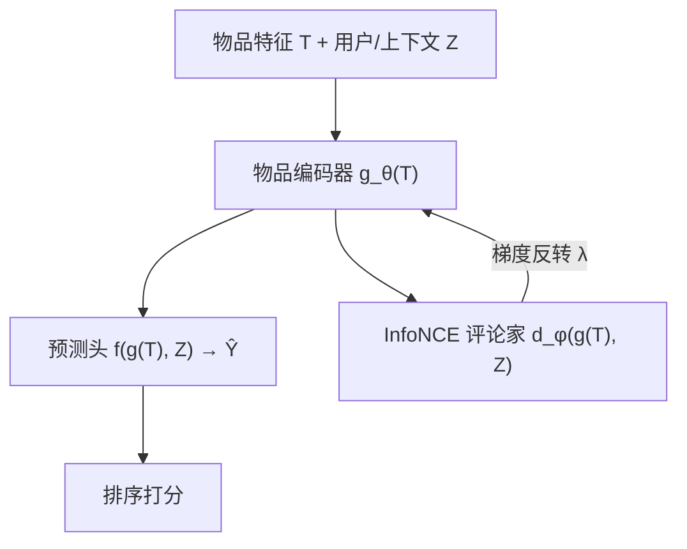
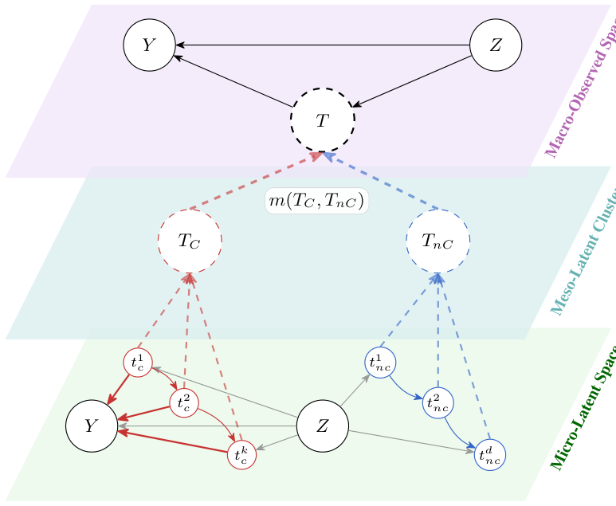

# Causal Representation Learning for Generalisable Recommendation (面向可泛化推荐的因果表征学习)

- **会议/期刊**: NeurIPS 2026
- **作者与机构**: Yorgos Felekis (Warwick), Michael O'Riordan, Oriol Corcoll, Ciarán M. Gilligan-Lee (Spotify & UCL)
- **推荐链路定位**: 精排（生产 session-ranking 模型）
- **研究方向**: 去偏公平与工业架构 / CTR 特征交叉
- **论文原文**: [arXiv:2605.27043v2](https://arxiv.org/abs/2605.27043v2)
- **开源代码**: 暂未开源

## TL;DR (1分钟核心速览)

推荐模型在曝光偏置日志上训练，训练分布与服务时候选分布不一致，导致离线指标无法预测线上表现。本文提出信息论解耦准则 $J(g)=I(g(T);Y|Z)-\lambda I(g(T);Z)$，证明其最优解剔除混杂相关的非因果信息，并用 InfoNCE 下界 + NCE-CLUB 上界导出可优化目标，仅需现有日志、零推理开销。合成 SCM、半合成 KuaiRand 与 Spotify 千万用户 A/B 三档验证：分布内持平、分布外显著提升，线上播放 +0.75%、跳过 −0.61%。

## Background & Motivation (背景与核心矛盾)

- **主流范式**: 推荐精排直接拟合 $E[Y|T,Z]$，其中$T$为候选物品、$Z$ 为用户/上下文特征；曝光偏置使训练样本仅来自已部署策略选中的子集。
- **前人局限**: ① 经典 CRL 追求潜在因果因子的可识别性，需额外假设或干预数据，日志数据难以满足；② DCCL/Rec4Ad 等去偏方法把解耦绑定到特定偏置机制（流行度、从众），换场景即失效，且需构造用户/结果特定的正负对。
- **核心洞察 (Key Insight)**: 观测到的物品 $T=m(T^C,T^{nC})$是因果分量与非因果分量的纠缠混合；非因果分量经后门路径$T\leftarrow T^{nC}\leftarrow Z\to Y$泄漏混杂信息。只要惩罚表征与混杂$Z$ 的互信息，即可切断该路径——无需完整识别潜在因子。
- **本文切入点**: 把"泛化"目标弱化为"抑制混杂依赖"，从而只需观测日志、可套用任意监督模型、无推理开销。

## Method (核心方法设计)

### 1. 整体框架 (Overall Architecture)

模型在标准监督排序骨干（生产 ranker / DeepFM）上增加一个物品侧表征编码器 $g_\theta(T)$与一个互信息评论家$d_\phi$。前向时$g_\theta(T)$与用户表征$Z$拼接送入预测头；训练时额外用 InfoNCE 评论家估计$I(g(T);Z)$，经梯度反转（GRL）作用于物品表征，使编码器在保持$Y$预测力的同时剥离与$Z$ 共享的信息。推理阶段评论家完全移除，仅保留原骨干，故零额外延迟。

<figure class="paper-figure" markdown="span">
  <figcaption>图1：分层因果纠缠。底部（微观潜在）：仅红色子集 {ti</figcaption>
</figure>

### 2. 关键设计拆解 (Key Designs)

1. **信息论解耦准则（Disentanglement Criterion）**：痛点在于仅最大化 $I(g(T);Y|Z)$ 仍会保留冗余混杂信号。本文改为效用减惩罚：
$$J(g)=I(g(T);Y|Z)-\lambda I(g(T);Z)$$
其中惩罚项约束的是物品表征而非预测头对 $Z$的直接使用。Proposition 1 证明在假设 A1（$Y\perp T^{nC}|T^C,Z$）与 A2（$I(T^{nC};Z|T^C)>0$，唯一虚假泄漏）下，理想表征$T^C$严格优于朴素纠缠表征$(T^C,T^{nC})$：两者效用相等，但后者惩罚多出$I(T^{nC};Z|T^C)>0$。Proposition 2 进一步证明对任意表征做"因果纯化"$\bar{g}=r(g)=\phi(T^C)$严格提升$J$，增益恰为$\lambda I(g;Z|\phi(T^C))$。

2. **可优化变分下界（Theorem 1）**：$J$中两项均不可直接计算。效用项用 InfoNCE 下界$I(g;Y|Z)\ge\log(K+1)-\mathcal{L}_{\text{utility}}$，其中负样本$y^-$从$p(y|z)$采样；惩罚项用 NCE-CLUB 上界$I(g;Z)\le\mathbb{E}_{p(g,z)}[d_\phi]-\mathbb{E}_{p(g)p(z)}[d_\phi]$。合并得可最小化目标：
$$\mathcal{L}_{\text{final}}=\mathcal{L}_{\text{utility}}+\lambda\,\mathcal{L}_{\text{penalty}},\quad \mathcal{L}_{\text{penalty}}=I_{\text{NCE-CLUB}}(g_\theta(T);Z;d_\phi)$$
物理直觉：评论家学的是对数密度比 $\log p(z|g)-\log p(z)$，编码器反向最小化该比值即抹去$Z$ 可预测的成分。

3. **训练目标、负采样与推理效率**：工程上不交替优化，而在 InfoNCE 目标上施加梯度反转，单次反向即可同时更新编码器与评论家，便于接入生产管线。负采样为 in-batch 负样本（效用项 $K$个结果负样本、惩罚项独立采样$Z$）。$\lambda$按"从 0 递增、取使验证指标仍在容差内的最强正则"选取。推理零开销；训练期用 NCE-CLUB 上界作诊断，生产运行中$U_{\text{CRL}}\le L_{\text{base}}/5$，保守推断互信息至少降 5 倍。

## Experimental Setup & Evaluation Protocol (实验设置与评估协议)

- **数据集与预处理**:

| 数据集 | #Users | #Items | #Interactions | 稀疏度/密度 | 特征/场景说明 |
| :--- | :---: | :---: | :---: | :---: | :--- |
| Synthetic SCM | — | — | 1,000 训练 / 1,000 验证 | — | $d=10$，$d_c=5$ 因果 + 5 非因果，线性加性高斯 |
| KuaiRand-Pure | 27,285 | 7,583 | ~1.186M 用户-视频对 | ~0.57% | 24 用户特征 + 54 视频特征，随机曝光日志 |
| Spotify 生产 | 百万级 | — | — | — | 个性化歌单生成 session-ranking |

- **数据划分与防穿越 (Splitting Strategy)**: KuaiRand 采用 `70%/15%/15%` 比例划分（训练/验证/测试），源域与目标域共享同一批留出用户、视频与合成点击，仅改变非因果捷径 $T^{nC}$的赋值（源域与$Z$ 强相关、目标域均匀随机），构成受控分布偏移。
- **排名评测协议 (Ranking Protocol)**: AUC 报 100 个种子的均值 ± 95% CI；Recall@5 / NDCG@5 为 `Full-Ranking`（对测试用户全部曝光物品按预测点击概率排序，二值相关性、折扣 $1/\log_2(i+1)$），仅统计至少 1 个正样本且至少 5 个曝光物品的用户。线上为两周 A/B，报告相对基线的百分比变化与 95% CI。
- **对比基线与超参设置**: 基线含 DeepFM（骨干）、DCCL（对比式去偏）、Oracle IPS（真实目标/源 $T^{nC}$概率比）、Oracle$T^{nC}$randomization（重采样捷径）。物品/用户 ID embedding 16 维，DeepFM 隐层 [32,16]、dropout 0.2、FM 维度 8；GRL 权重 25 步为 0、50 步线性升至 0.3 后固定；Adam lr$2\times10^{-3}$、batch 4096。

## Key Experimental Results (实验关键数据)

### 1. 主实验对比 (Main Results)

半合成 KuaiRand（100 种子，AUC 为均值 ± 95% CI）：

| 方法 | Source AUC | Target AUC | Recall@5 | NDCG@5 |
| :--- | :---: | :---: | :---: | :---: |
| Baseline (DeepFM) | 0.7249±0.0004 | 0.6914±0.0011 | 0.5697 | 0.4501 |
| DCCL | 0.7248±0.0004 | 0.6912±0.0011 | 0.5699 | 0.4501 |
| Oracle IPS | 0.7079±0.0008 | 0.7078±0.0008 | 0.5850 | 0.4678 |
| Oracle $T^{nC}$ rand. | 0.7243±0.0004 | **0.7243**±0.0004 | **0.5884** | **0.4717** |
| **CRL (ours)** | 0.7218±0.0005 | 0.7212±0.0004 | 0.5853 | 0.4676 |

线上 A/B（相对生产基线，两周，95% CI）：

| 指标 | % 变化 | 95% CI |
| :--- | :---: | :---: |
| Track Streams | **+0.75%** | [+0.54%, +0.96%] |
| Track Skips | **−0.61%** | [−0.74%, −0.47%] |
| Minutes Played | **+0.50%** | [+0.27%, +0.73%] |

### 2. 消融实验 (Ablation Study)

合成 SCM 上按非因果坐标保留量逐步移除（图 4）与随机压缩强度扫描（图 5）：

| 配置 | 干预敏感度 $\lvert\hat{Y}(T)-\hat{Y}(T')\rvert$ | 目标 MAE 变化 | 说明 |
| :--- | :---: | :---: | :--- |
| Baseline（无惩罚） | 随 $\sigma_Y$升至 ~0.35 | 基准 | 吸收$T^{nC}$ 信号 |
| CRL（$\lambda$ 递增） | 全区间≈0 | 高噪声下略优 | 完全免疫非因果干预 |
| 保留全部 $T^{nC}$| — | — |$J$随$\lambda$ 下降最快 |
| 纯因果 $g(T)=T^C$| — | — |$J$ 最高 |
| 压缩 $G=T^C+\epsilon_G$| — | — |$\lambda<\lambda_{\text{crit}}$ 时无损最优 |

### 3. 关键实验发现 (Key Findings)

1. **分布内持平、分布外大幅收敛**：CRL 源域 AUC 0.7218 略低于基线 0.7249，但目标域 0.7212 远高于基线 0.6914，把源→目标的 AUC 跌幅从 0.0335 压缩到 0.0006，逼近 Oracle 重采样（0.7243），是典型的"有效鲁棒性"。
2. **DCCL 在此设定下完全失效**：DCCL 目标域 AUC 0.6912 与基线 0.6914 几乎无差，说明绑定特定偏置机制（流行度/从众）的对比对构造无法覆盖本文的通用捷径泄漏；而本文不指定偏置机制即取得增益。
3. **线上增益与骨干重建同量级**：+0.75% 播放、−0.61% 跳过、+0.50% 播放时长三项均 95% 显著，作者称与当前生产 ranker 相对其成熟前代的重建收益同数量级，且推理零成本，证明"离线持平 + 线上提升"的解耦范式在工业规模可落地。

## Highlights & Limitations (亮点、对比与审稿批判)

- **与代表作对比 (vs. Prior Work)**: 相比 Wang et al. (WWW'22) 的反事实 VAE 需服务时后干预推断，本文无推理开销；相比 Corcoll et al. (2026) 需按混杂/结果分层的标注对比对，本文仅用原始日志；相比 DCCL/Rec4Ad 绑定特定偏置机制，本文的互信息惩罚与偏置机制无关，通用性更强。
- **可迁移亮点**: ① 用 NCE-CLUB 上界作训练期诊断、以 $U_{\text{CRL}}\le L_{\text{base}}/5$ 给出可解释的互信息下降下界，可直接移植到任何对抗式去偏管线；② 梯度反转替代交替优化，单次反向完成编码器+评论家更新，工程接入成本极低。
- **审稿级局限批判**: ① 理论依赖"混杂已被观测 $Z$完整编码"的假设，生产中用户/会话上下文必然不完整，未观测混杂下的增益缺乏保证（作者亦承认，仅建议结合 proximal causal inference 作扩展）；② 评估以合成/半合成偏移为主，真实线上仅一个场景一个表面，且$\lambda$ 需人工按验证容差调参，缺少跨场景的敏感性分析。

## Rating (四维评分)

- **方法创新性 (Novelty)**: ⭐⭐⭐⭐ （把 CRL 目标弱化为"抑制混杂依赖"，配 Proposition 1–3 的纯化与无损区间刻画，理论干净且切中曝光偏置本质）
- **评估协议与实验扎实度 (Protocol & Experiments)**: ⭐⭐⭐⭐ （合成 SCM + 半合成 KuaiRand 100 种子 CI + 千万级线上 A/B 三档递进，含 Oracle 上界对照，唯真实场景覆盖偏少）
- **写作与数学规范度 (Clarity & Rigor)**: ⭐⭐⭐⭐ （假设 A1/A2 与命题链条清晰，附录含高斯闭式验证与界有效性讨论，但正文对 NCE-CLUB 与 GRL 不等价的处理略显轻描淡写）
- **工业落地与复现价值 (Industrial & Practical Value)**: ⭐⭐⭐⭐⭐ （仅需现有日志、套任意监督模型、推理零开销，已在 Spotify 生产验证；扣分项为暂未开源）

