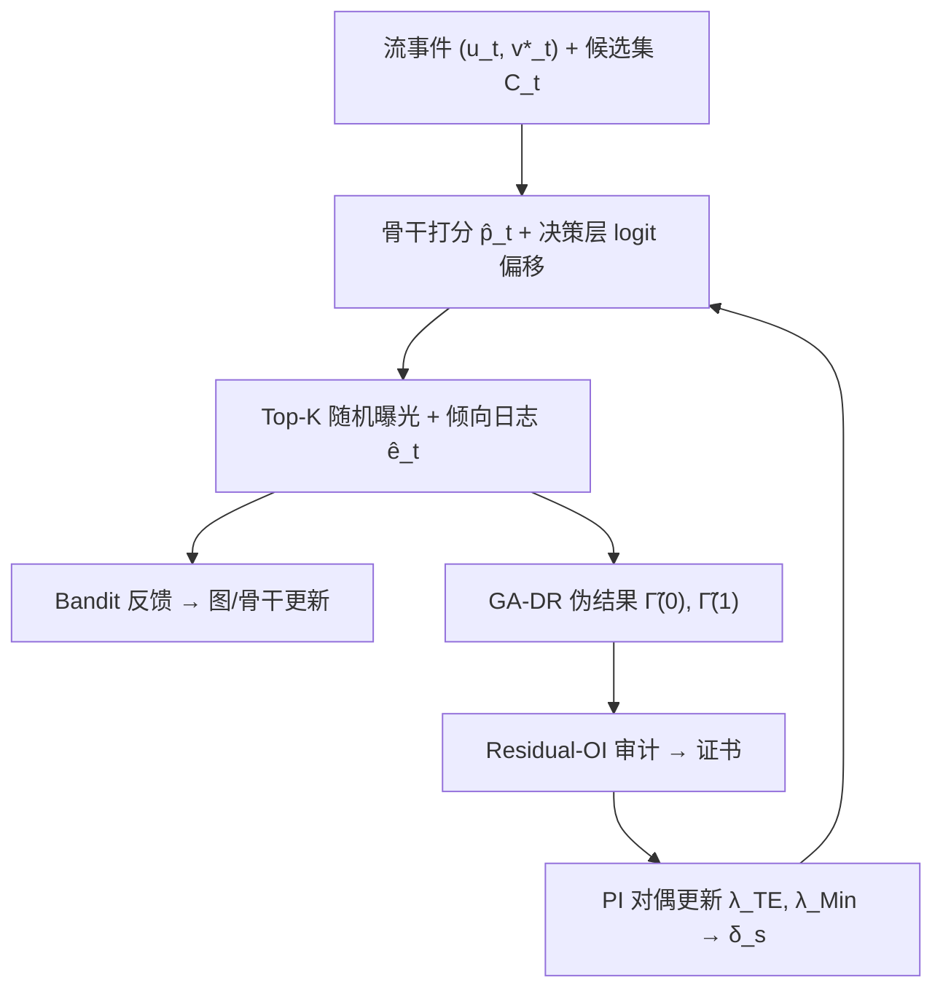

# COPF: An Online Framework for Deployment-Stable Counterfactual Fairness in Evolving Graphs (面向演化图的部署稳定反事实公平在线框架)

- **会议/期刊**: ICML 2026
- **作者与机构**: Sheng'en Li, Dongmian Zou（昆山杜克大学 祖冲之中心 & DIRC）
- **推荐链路定位**: 重排 / 决策层（曝光策略层，包裹任意骨干打分器）
- **研究方向**: 去偏公平、可信隐私与工业架构 / 强化学习与动态探索推荐
- **论文原文**: [https://arxiv.org/abs/2606.00700v1](https://arxiv.org/abs/2606.00700v1)
- **开源代码**: [https://github.com/lsnnnnnnnn/COPF](https://github.com/lsnnnnnnnn/COPF)

## TL;DR (1分钟核心速览)

在线链路推荐是**表演性 (performative)** 的：平台决定曝光哪些候选边，就改变了哪些边会形成、以及后续能观测到什么反馈，因此日志上算出的公平性指标在策略更新后会漂移甚至自我强化。COPF 把公平性重新定义为**曝光反事实**下的群体机会差（展示 vs. 不展示的因果效应差），通过显式探索 + 倾向 (propensity) 日志使其可识别，再用图感知双重鲁棒 (GA-DR) 残差上的 Residual-OI 审计与原始-对偶控制器在线纠偏。在 TGB 两条真实流与合成二分图上，COPF 将部署期最坏情形群体差尖峰显著压低（如合成图 Deploy 期 $g_{\text{TE gap}}$ 最坏值 0.0477→0.0274），同时 NDCG@10 不降反升（0.1417→0.1996）。

## Background & Motivation (背景与核心矛盾)

- **主流范式**: 时序图链路预测长期被当作离线预测任务（TGN、GraphMixer、EdgeBank），公平性则多通过对抗训练、重加权、偏置边丢弃等**表征层**手段在训练时注入。
- **前人局限**: 其一，日志中的结果同时混杂了用户偏好与平台"选择展示谁"，直接在实现日志上算公平指标会被选择偏差污染；其二，Mishler & Dalmasso 已证明许多可观测公平度量"训练时公平、部署后不公平"——策略更新本身会改变数据分布，公平性随之漂移。
- **核心洞察 (Key Insight)**: 公平性应当定义在**平台动作（曝光）的反事实效应**上，而非受保护属性的反事实干预；只要强制重叠 (overlap) 并记录倾向，单条在线流即可识别该因果量，且该量在策略切换下仍可比（deployment-stable）。
- **本文切入点**: 不做新的图编码器，而是做一个**决策层包装器**：可识别日志协议 + 图感知 DR 估计 + 残差不可区分性证书 + 在线约束控制，四件套叠加在任意骨干之上。

## Method (核心方法设计)

### 1. 整体框架 (Overall Architecture)

每轮 $t$，流揭示源点$u_t$与真实目标$v_t^\star$，在线构造候选集$C_t=\{v_t^\star\}\cup\mathcal{N}_t$（$N=200$负样本）；骨干打分$\hat{p}_t(u_t,v)$后，COPF 在 logit 上加两项偏移（分桶多校准偏移$b_{s,b}$与群体偏置$\delta_s$）得到$\tilde{p}_t(v)$，再由 Top-$K$随机策略采样曝光并记录边际倾向$\hat{e}_t(v)$；仅曝光候选产生 bandit 反馈，正样本回灌图与骨干；滚动窗口内用交叉拟合的 GA-DR 伪结果计算反事实间隙，Residual-OI 审计产出证书，原始-对偶控制器据此更新对偶变量与偏移。整个流程按 Pre→Deploy→Post 三阶段运行以显式测量部署稳定性。

### 2. 关键设计拆解 (Key Designs)

1. **曝光反事实公平间隙与最小效应护栏**：痛点是把公平定义在实现结果上会被选择偏差污染。本文定义群体 $s$的曝光平均处理效应$\tau_s=\mathbb{E}[Y^{(1)}-Y^{(0)}\mid A=s]$，主目标为收益平价$g_{\text{TE gap}}=\max_{s,s'}|\tau_s-\tau_{s'}|$，并加护栏$g_{\text{Min}}=\max_s[\tau_{\min}-\tau_s]_+$防止"靠少曝光来换平价"的配给式公平；另报组内反事实校准$g_{\text{Cal}}$ 作诊断。直觉：只有把"展示 vs. 不展示"的因果差拉平，才真正拉平了机会而非拉平了观测。

2. **GA-DR 伪结果 + Residual-OI 迁移定理**：痛点是反事实量在单条流上不可直接观测，且图上有局部溢出与时间相依。本文用自归一化图感知双重鲁棒估计
$$\tilde{\Gamma}_t^{(a)}=\hat{\mu}_{a,t}(W_t)+\frac{\mathbb{I}\{D_t(v)=a\}}{\hat{e}_t^{(a)}(v)}\big(Y_t-\hat{\mu}_{a,t}(W_t)\big),\quad \hat{\mathbb{E}}_{GA,\mathcal{W}}[Z]=\frac{\sum_{(t,v)\in\mathcal{W}}w_t Z_t}{\sum_{(t,v)\in\mathcal{W}}w_t}$$
并在审计族 $\mathcal{H}$上定义窗口残差-OI 间隙$\hat{c}_{\text{OI}}=\sup_{h\in\mathcal{H}}|\hat{\mathbb{E}}_{GA,\mathcal{W}}[h_t\hat{r}_t]|$。核心定理（Thm 4.5）证明：在时间混合与有界局部干扰下，插件残差上的$\varepsilon_T$-Residual-OI 蕴含真实反事实间隙被$\frac{2(\varepsilon_T+E_T)}{p_{\min}}$界住，其中$E_T$吸收倾向误差$\varepsilon_e$、结果 nuisance 误差$\varepsilon_\mu$、混合项$\sqrt{\tau_{\text{mix}}\log|\mathcal{H}|/W_{\text{eff}}}$与集中半径$\beta_T$。直觉：把"审计器无法区分残差"翻译成"真实群体差必然小"，从而把不可观测的因果量转化为可在线监控的统计量。

3. **在线多校准 + 原始-对偶控制器与训练目标**：痛点是如何在不重训骨干的前提下把间隙压回容差。决策层概率为 $\tilde{p}_t(v)=\sigma(\text{logit}(\hat{p}_t)+b_{s,b}+\delta_s)$；多校准器针对无曝光残差$r^{(0)}$按组×分数桶（每组 10 桶）更新活跃违规切片（预算$B_{\text{act}}$）；PI 控制器维护$(\lambda_{\text{TE}},\lambda_{\text{Cal}},\lambda_{\text{Min}})$，由软违反量$v_{\text{TE}}=[g_{\text{TE gap}}-\rho_{\text{TE}}]_+$ 驱动，并转为群体偏移
$$\delta_s=\text{clip}\big(\alpha\lambda_{\text{TE}}(\bar{\tau}-\hat{\tau}_s)+\alpha'\lambda_{\text{Min}}[\tau_{\min}-\hat{\tau}_s]_+\big)$$
负采样为在线无放回采 200 个负例（非 in-batch），倾向对均匀探索解析、对 Plackett–Luce 分量用 128 次蒙特卡洛估计并裁剪；推理开销为每轮摊还 $O(|C_t|dL+|C_t|k+B_{\text{act}})$，骨干可黑盒复用。

## Experimental Setup & Evaluation Protocol (实验设置与评估协议)

- **数据集与预处理**: 两条 TGB 时序流 + 一条注入群体偏置的合成二分图流；TGB 无真实敏感属性，默认用 ID-mod-2 作为"安慰剂"划分，敏感性实验改用度/活跃度划分。

| 数据集 | #Users | #Items | #Interactions | 稀疏度/密度 | 特征/场景说明 |
| :--- | :---: | :---: | :---: | :---: | :--- |
| tgbl-wiki | 约 9k 节点 | 同左（同构） | 157k 事件 | 极稀疏 | 用户编辑页面，目标侧审计 |
| tgbl-review | 约 350k 节点 | 同左（同构） | 4.9M 事件 | 极稀疏 | 用户评论商品，目标侧审计 |
| Synthetic-Bipartite | 600 | 4000 | 200,000 | 8.3% | 注入群体偏置，源侧审计 |

- **数据划分与防穿越 (Splitting Strategy)**: 采用**前序在线协议 OPP**（非 Leave-One-Out）：Pre/Deploy/Post 各 20k 轮共 60k 轮；所有特征仅用 $G_{\le t}$，候选在线前瞻构造，骨干与 nuisance 在线交叉拟合更新，严格无泄漏。
- **排名评测协议 (Ranking Protocol)**: 每轮 1 正 + 200 负的**采样排序**（$|C_t|\le 201$），指标为 MRR / Hits@10 / NDCG@10 / DeployHit@TopK；公平指标在同一滚动审计窗口（$L_{\text{win}}=50{,}000$）上由 GA-DR 伪结果计算，报告 3 个种子的均值±标准差与阶段内最坏值。
- **对比基线与超参设置**: 骨干为 EdgeBank、TGN（嵌入 128）、GraphMixer（token 64、2 层 mixer）；训练期公平基线为 TGN-Adv / TGN-Reweight / TGN-Penalty。曝光策略 Top-$K$随机，$K=10$，Pre 阶段$\epsilon=0.20$、Deploy/Post 阶段$\epsilon=0.02$、温度 0.7。

## Key Experimental Results (实验关键数据)

### 1. 主实验对比 (Main Results)

合成二分图 + GraphMixer（COPF 最有效场景，Deploy 阶段）：

| 方法 | NDCG@10 | Hits@10 | $g_{\text{TE gap}}$（均值/最坏） |$g_{\text{Cal max}}$（均值/最坏） |
| :--- | :---: | :---: | :---: | :---: |
| Base (GraphMixer) | 0.1417 | 0.2952 | 0.0103 / 0.0477 | 0.5816 / 0.9178 |
| **Base+COPF** | **0.1996** | **0.4154** | **0.0076 / 0.0274** | **0.5337 / 0.7067** |
| Improv. | +40.9% | +40.7% | −26.2% / −42.6% | −8.2% / −23.0% |

Wiki + TGN（真实流，Post 阶段）：

| 方法 | NDCG@10 | Hits@10 | $g_{\text{TE gap}}$（均值/最坏） |$g_{\text{Cal max}}$ |
| :--- | :---: | :---: | :---: | :---: |
| Base (TGN) | 0.2219 | 0.3982 | 0.0090 / 0.0226 | 0.4727 |
| **Base+COPF** | **0.2296** | **0.4121** | **0.0067 / 0.0242** | 0.4892 |
| TGN-Adv | 0.2219 | 0.3982 | 0.0090 / 0.0765 | 0.4727 |
| Improv. | +3.5% | +3.5% | −25.6% | — |

Review + TGN 上间隙本已很小（Post $g_{\text{TE gap}}$ 0.0030→0.0029，NDCG 0.0389→0.0392），COPF 近乎"不激活"；EdgeBank 上变化亦很小或混合。

### 2. 消融实验 (Ablation Study)

| 配置 | 关键观察 |
| :--- | :--- |
| Base（审计关闭） | 部署边界处出现公平尖峰与校准高频抖动 |
| + 仅多校准（$b_{s,b}$） | 压低$g_{\text{Cal max}}$，但对$g_{\text{TE gap}}$ 作用有限 |
| + 仅 PI 控制（$\delta_s$） | 压低$g_{\text{TE gap}}$ 尖峰，校准诊断改善较弱 |
| + 覆盖率驱动探索 | 缓解小切片短期饥饿，排序信号无明显退化 |
| $\epsilon$-greedy vs. Top-$K$ 随机 | 同探索率下后者曲线更平滑、尖峰更少 |
| 证书对齐 vs. 全窗口报告 | 两条曲线高度贴合，说明趋势非评估人群错配的伪影 |

### 3. 关键实验发现 (Key Findings)

1. **COPF 是"按需激活"的控制器而非恒定折衷**：在 Review（间隙已小）上几乎不改变策略，而在合成图 Deploy 期把最坏 $g_{\text{TE gap}}$ 从 0.0477 砍到 0.0274（−42.6%），说明其价值集中在曝光动态制造不稳定的时刻。
2. **公平改善不以效用为代价，甚至反向增益**：合成图 Deploy 期 NDCG@10 提升 40.9%，原因是校准偏移修正了骨干在偏移分布下的系统性高估，公平约束与排序精度在此场景下同向。
3. **训练期去偏与部署期控制正交**：TGN-Adv 在均值上与 Base 几乎一致，但最坏 $g_{\text{TE gap}}$ 反而恶化到 0.0765；COPF 叠加后最坏值回落，证明表征层去偏无法替代部署层的在线监控。

## Highlights & Limitations (亮点、对比与审稿批判)

- **与代表作对比 (vs. Prior Work)**: 相比 TGN-Adv / FairDrop 等**表征层**去偏，COPF 不触碰编码器、可黑盒包裹且直接作用于曝光决策；相比 Dwork et al. (2025) 的 Any-Kernel 在线 OI，本文审计的是**倾向日志识别的曝光反事实残差**而非实现结果，并把审计与因果识别、在线曝光控制耦合为闭环；相比 Cao et al. (2025) 的事后快照分析，本文追求部署时可比的在线证书。
- **可迁移亮点**: (i) "倾向日志 + DR 伪结果 + 残差 OI 证书"这套三段式可直接迁移到任何 bandit 式推荐流的公平/校准监控；(ii) 最小效应护栏 $g_{\text{Min}}$ 是防止"配给式公平"的通用工程技巧，值得写入线上公平约束模板。
- **审稿级局限批判**: 其一，TGB 无真实敏感属性，ID-mod-2 是安慰剂划分，结论的**外部效度**受限，且 bandit 化反馈令 $g_{\text{Cal}}$ 诊断方差大、解释力弱；其二，Assumption 4.3 的插件 Residual-OI 速率是**输入假设而非被证明的结论**，预算化活跃审计器在相依下的收敛性留作未来工作，理论闭环尚缺一角。

## Rating (四维评分)

- **方法创新性 (Novelty)**: ⭐⭐⭐⭐ （把表演性预测、反事实公平与 OI 证书三者缝合为部署层闭环，问题定义本身即贡献；但各组件均为已有工具的巧妙组合）
- **评估协议与实验扎实度 (Protocol & Experiments)**: ⭐⭐⭐⭐ （OPP 三阶段协议与最坏情形统计设计严谨、3 种子重复，但真实敏感属性缺失、合成流占比偏高）
- **写作与数学规范度 (Clarity & Rigor)**: ⭐⭐⭐⭐ （定理-引理-推论链条完整、假设可检验化处理到位；符号密度高，附录依赖较重）
- **工业落地与复现价值 (Industrial & Practical Value)**: ⭐⭐⭐⭐ （决策层黑盒包装、摊还开销低、代码开源，适合作为线上公平监控中间件；倾向日志与审计基础设施是落地门槛）
